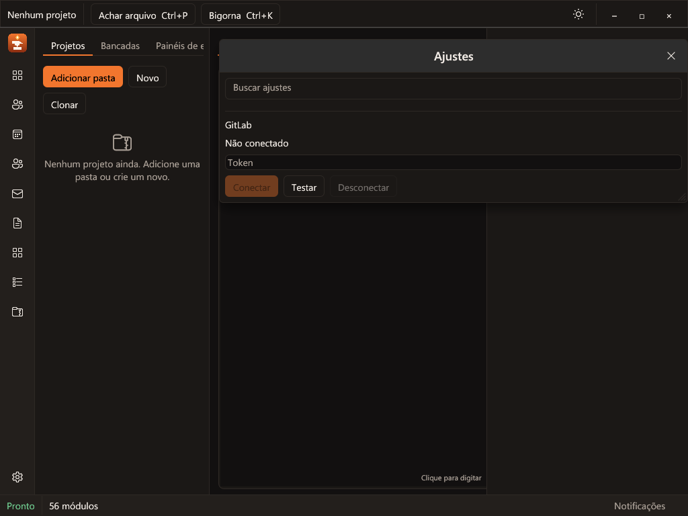

# Configurações do contador GitLab (janela "Ajustes")

Tela de configuração do contador GitLab, aberta como janela flutuante "Ajustes" sobre a área de trabalho, para informar o token de acesso e conectar/desconectar a conta.

## Como chegar
Na janela principal, clicar no botão "Ajustes" (ícone de engrenagem no rodapé do trilho de ícones, à esquerda) e, na janela "Ajustes", abrir a seção "GitLab". Comando de captura: `forja-app --locale pt-BR --theme dark --settings counter_gitlab`.

## Regiões
- **Barra superior (título):** (0,0)–(1280,42). Rótulo "Nenhum projeto" à esquerda; botões "Achar arquivo  Ctrl+P" e "Bigorna  Ctrl+K"; à direita, ícone de alternância de tema (sem nome acessível, ~1117–1117 px) e os botões de janela "–", "□" e "×".
- **Trilho de ícones à esquerda:** (0,42)–(52,768). Logotipo do app (imagem, 12–40 px) no topo e os botões-ícone "Quadro", "Ajudantes", "Rotinas", "Mutirão", "Pedidos", "Skills", "Uso", "Extensões" e "Acervo"; "Ajustes" fixado no rodapé.
- **Painel esquerdo (Projetos):** (52,42)–(304,768). Abas "Projetos" (ativa, sublinhada), "Bancadas" e "Painéis de extensões"; botões "Adicionar pasta" (destaque laranja), "Novo" e "Clonar"; estado vazio com ícone de pasta e o texto "Nenhum projeto ainda. Adicione uma pasta ou crie um novo.".
- **Área central:** (320,42)–(972,768). Barra de abas ("Terminal" ativa, "Editor", "Navegador", "Diferenças", "Visualizador", "Bancada", "Revisão", "Histórico", "Painéis de extensões"), barra de ferramentas com "+", quatro botões de ícone sem nome, "Receitas" e "Shell", e um painel vazio com o texto de apoio "Clique para digitar" no canto inferior direito (~884–975 px, y≈743). A maior parte desta região está encoberta pela janela "Ajustes".
- **Janela "Ajustes" (modal):** (328,58)–(1026,302). Título "Ajustes" centralizado com botão "Close window" (×) à direita; campo de busca "Buscar ajustes"; seção "GitLab" com status "Não conectado", campo "Token" (senha) e botões "Conectar" (desativado), "Testar" e "Desconectar" (desativado); pegada de redimensionamento em hachura no canto inferior direito.
- **Painel direito:** (988,42)–(1280,768). Abas "Arquivos" (ativa), "Mudanças", "Ajudante (chat)", "Busca", "Portas" e "Painéis de extensões" (esta além da borda da janela); ícone de grade (~1116–1144 px) e a mensagem "Nenhuma bancada ativa. Abra uma bancada para ver os arquivos.".
- **Barra de status:** (0,768)–(1280,800). "Pronto" (em verde), "56 módulos" e "Notificações" à direita.

## Elementos
| Elemento | Tipo | Posição (px) | Estado | O que faz |
|---|---|---|---|---|
| "Achar arquivo  Ctrl+P" | Button | (135,5)–(291,37) | — | Abre a busca rápida de arquivos (atalho Ctrl+P). |
| "Bigorna  Ctrl+K" | Button | (299,5)–(417,37) | — | Abre a paleta de comandos "Bigorna" (atalho Ctrl+K). |
| (sem nome acessível) | Unknown | (1101,5)–(1133,37) | — | Ícone de sol/tema; alterna tema claro/escuro. |
| "–" | Button | (1155,5)–(1187,37) | — | Minimiza a janela. |
| "□" | Button | (1195,5)–(1227,37) | — | Maximiza/restaura a janela. |
| "×" | Button | (1235,5)–(1269,37) | — | Fecha a janela do app. |
| "Nenhum projeto" | Label | (11,12)–(113,31) | — | Indica que não há projeto aberto. |
| (sem nome acessível) | Unknown | (304,42)–(320,768) | foco | Divisor vertical entre o painel esquerdo e a área central. |
| (sem nome acessível) | Unknown | (972,42)–(988,768) | foco | Divisor vertical entre a área central e o painel direito. |
| (sem nome acessível) | Unknown | (319,49)–(339,69) | foco | Canto superior esquerdo da janela "Ajustes" (arraste/redimensionamento). |
| (sem nome acessível) | Unknown | (1016,49)–(1036,69) | foco | Canto superior direito da janela "Ajustes". |
| (sem nome acessível) | Image | (12,50)–(40,78) | clique, foco | Logotipo da Forja no topo do trilho. |
| "Projetos" | Button | (64,50)–(138,82) | marcado=True | Aba ativa do painel esquerdo; mostra a lista de projetos. |
| (sem nome acessível) | Unknown | (64,50)–(300,82) | foco | Faixa das abas do painel esquerdo. |
| "Bancadas" | Button | (138,50)–(220,82) | marcado=False | Aba que mostraria as bancadas (branches de trabalho). |
| "Painéis de extensões" | Button | (220,50)–(371,82) | marcado=False | Aba de painéis de extensões do painel esquerdo. |
| "Terminal" | Button | (324,50)–(401,82) | marcado=True | Aba ativa da área central; oculta atrás do modal. |
| "Editor" | Button | (401,50)–(461,82) | marcado=False | Aba do editor; oculta atrás do modal. |
| "Navegador" | Button | (461,50)–(553,82) | marcado=False | Aba do navegador; oculta atrás do modal. |
| "Diferenças" | Button | (553,50)–(641,82) | marcado=False | Aba de diferenças; oculta atrás do modal. |
| "Visualizador" | Button | (641,50)–(739,82) | marcado=False | Aba do visualizador; oculta atrás do modal. |
| "Bancada" | Button | (739,50)–(815,82) | marcado=False | Aba da bancada; oculta atrás do modal. |
| "Revisão" | Button | (815,50)–(885,82) | marcado=False | Aba de revisão; oculta atrás do modal (apenas o fragmento "…uivos" aparece à direita do modal). |
| "Histórico" | Button | (885,50)–(965,82) | marcado=False | Aba de histórico; oculta atrás do modal. |
| "Painéis de extensões" | Button | (965,50)–(1115,82) | marcado=False | Aba de painéis de extensões da área central; parcialmente atrás do modal. |
| (sem nome acessível) | Unknown | (992,50)–(1268,82) | foco | Faixa das abas do painel direito. |
| "Arquivos" | Button | (992,50)–(1070,82) | marcado=True | Aba ativa do painel direito. |
| "Mudanças" | Button | (1070,50)–(1157,82) | marcado=False | Aba de mudanças do painel direito. |
| "Ajudante (chat)" | Button | (1115,50)–(1234,82) | marcado=False | Aba do chat do ajudante de código. |
| "Busca" | Button | (1157,50)–(1216,82) | marcado=False | Aba de busca. |
| "Portas" | Button | (1216,50)–(1278,82) | marcado=False | Aba de portas. |
| "Painéis de extensões" | Button | (1278,50)–(1429,82) | marcado=False | Aba de painéis de extensões do painel direito; retângulo vai além da largura da janela (1280 px). |
| (sem nome acessível) | Unknown | (339,51)–(1016,67) | foco | Barra de título arrastável da janela "Ajustes". |
| "Ajustes" | Window | (328,58)–(1026,302) | foco | Janela flutuante de configurações em foco. |
| (sem nome acessível) | Unknown | (361,59)–(993,107) | clique, foco | Área do cabeçalho do modal (texto "Ajustes" centralizado). |
| (sem nome acessível) | Unknown | (321,69)–(337,292) | foco | Borda esquerda de redimensionamento do modal. |
| (sem nome acessível) | Unknown | (1018,69)–(1034,292) | foco | Borda direita de redimensionamento do modal. |
| "Close window" | Button | (994,76)–(1008,90) | — | Fecha a janela "Ajustes" (× no cabeçalho). |
| (sem nome acessível) | Unknown | (64,80)–(300,82) | clique, foco | Sublinhado da aba ativa "Projetos". |
| (sem nome acessível) | Unknown | (992,80)–(1268,82) | clique, foco | Sublinhado da aba ativa "Arquivos". |
| "Quadro" | Button | (8,94)–(44,130) | marcado=False | Botão-ícone do quadro no trilho esquerdo. |
| "Adicionar pasta" | Button | (64,98)–(183,130) | — | Adiciona uma pasta de projeto; botão primário em laranja. |
| "Novo" | Button | (191,98)–(248,130) | — | Cria um projeto novo. |
| "+" | Button | (407,102)–(441,134) | — | Novo item na área central; oculto atrás do modal. |
| (sem nome acessível) | Unknown | (444,102)–(476,134) | clique, foco | Botão-ícone da barra de ferramentas central; oculto atrás do modal. |
| (sem nome acessível) | Unknown | (479,102)–(511,134) | clique, foco | Botão-ícone da barra de ferramentas central; oculto atrás do modal. |
| (sem nome acessível) | Unknown | (514,102)–(546,134) | clique, foco | Botão-ícone da barra de ferramentas central; oculto atrás do modal. |
| (sem nome acessível) | Unknown | (549,102)–(581,134) | clique, foco | Botão-ícone da barra de ferramentas central; oculto atrás do modal. |
| "Receitas" | Button | (584,102)–(658,134) | — | Abre receitas; oculto atrás do modal. |
| "Shell" | Button | (661,102)–(714,134) | — | Abre o shell; oculto atrás do modal. |
| (sem nome acessível) | Unknown | (328,107)–(404,129) | clique, foco | Controle da área central; oculto atrás do modal. |
| (sem nome acessível) | Unknown | (385,110)–(401,126) | clique, foco | Ícone dentro do controle anterior; oculto atrás do modal. |
| (ícone) | Label | (1116,114)–(1144,142) | clique | Ícone de grade/ilustração do estado vazio do painel direito. |
| (sem nome acessível) | TextInput | (337,116)–(1017,148) | clique, foco | Campo de busca de ajustes, com o texto de apoio "Buscar ajustes". |
| "Ajudantes" | Button | (8,138)–(44,174) | marcado=False | Botão-ícone de ajudantes no trilho esquerdo. |
| "Clonar" | Button | (64,138)–(128,170) | — | Clona um repositório para o painel de projetos. |
| (sem nome acessível) | Unknown | (328,139)–(980,756) | clique, foco | Painel central de fundo (área do terminal vazia, com o texto "Clique para digitar" em ~884–975 px, y≈743). |
| "Nenhuma bancada ativa. Abra uma bancada para ver os arquivos." | Label | (994,150)–(1266,188) | clique | Mensagem de estado vazio do painel direito; o início fica encoberto pelo modal. |
| "GitLab" | Label | (337,176)–(376,195) | clique | Título da seção de configuração do contador GitLab. |
| "Rotinas" | Button | (8,182)–(44,218) | marcado=False | Botão-ícone de rotinas no trilho esquerdo. |
| (ícone) | Label | (168,198)–(196,226) | clique | Ícone de pasta do estado vazio do painel esquerdo. |
| "Não conectado" | Label | (337,203)–(431,222) | clique | Status atual da integração GitLab. |
| "Mutirão" | Button | (8,226)–(44,262) | marcado=False | Botão-ícone do mutirão no trilho esquerdo. |
| (sem nome acessível) | PasswordInput | (337,230)–(1017,253) | clique, foco | Campo de senha para o token do GitLab (texto de apoio "Token"). |
| "Nenhum projeto ainda. Adicione uma pasta ou crie um novo." | Label | (66,234)–(298,272) | clique | Mensagem de estado vazio do painel de projetos. |
| "Conectar" | Button | (337,261)–(416,293) | desativado | Conecta à conta GitLab; inativo até haver token preenchido. |
| "Testar" | Button | (424,261)–(485,293) | — | Testa o token informado. |
| "Desconectar" | Button | (493,261)–(593,293) | desativado | Desconecta a conta; inativo por não haver conexão. |
| "Pedidos" | Button | (8,270)–(44,306) | marcado=False | Botão-ícone de pedidos no trilho esquerdo. |
| (sem nome acessível) | Unknown | (319,292)–(339,312) | foco | Canto inferior esquerdo de redimensionamento do modal. |
| (sem nome acessível) | Unknown | (1016,292)–(1036,312) | foco | Pegada de redimensionamento (hachura diagonal) no canto inferior direito do modal. |
| (sem nome acessível) | Unknown | (339,294)–(1016,310) | foco | Borda inferior de redimensionamento do modal. |
| "Skills" | Button | (8,314)–(44,350) | marcado=False | Botão-ícone de skills no trilho esquerdo. |
| "Uso" | Button | (8,358)–(44,394) | marcado=False | Botão-ícone de uso no trilho esquerdo. |
| "Extensões" | Button | (8,402)–(44,438) | marcado=False | Botão-ícone de extensões no trilho esquerdo. |
| "Acervo" | Button | (8,446)–(44,482) | marcado=False | Botão-ícone do acervo no trilho esquerdo. |
| "Ajustes" | Button | (8,724)–(44,760) | marcado=False | Botão-ícone de engrenagem que abre esta janela de ajustes. |
| "Pronto" | Label | (10,775)–(51,794) | clique | Status geral do app, em verde. |
| "56 módulos" | Label | (73,775)–(146,794) | clique | Quantidade de módulos carregados. |
| "Notificações" | Label | (1170,775)–(1246,794) | clique, foco | Área de notificações na barra de status. |

## Aparência
Tema escuro: fundo quase preto com variações de cinza-escuro para painéis e para a janela "Ajustes" (levemente mais clara que o fundo, com sombra e cantos arredondados). Cor de destaque laranja (âmbar) no botão "Adicionar pasta", no sublinhado das abas ativas "Projetos"/"Arquivos"/"Terminal" e no logotipo; o botão "Conectar" (desativado) também aparece com preenchimento âmbar apagado. Texto em cinza-claro sobre fundo escuro, em fonte sem serifa; "Pronto" na barra de status em verde. Botões com cantos arredondados e contornos sutis; espaçamento vertical regular de ~8–12 px entre linhas do formulário; campos de texto ocupam toda a largura do modal (337–1017 px). O modal é centralizado horizontalmente (328–1026 px) e posicionado no topo da área central.

## Problemas encontrados
- A aba "Painéis de extensões" do painel direito tem retângulo (1278,50)–(1429,82), que vai além da largura da janela de 1280 px: elemento cortado/fora da tela.
- O botão de fechar do modal tem nome acessível em inglês, "Close window", em uma interface em pt-BR.
- A janela "Ajustes" sobrepõe a barra de abas central ("Terminal", "Editor", "Navegador", "Diferenças", "Visualizador", "Bancada", "Revisão", "Histórico", "Painéis de extensões") e a barra de ferramentas ("+", quatro botões de ícone sem nome, "Receitas", "Shell"); o fragmento "…uivos" de "Histórico" aparece cortado ao lado do modal.
- O texto "Nenhuma bancada ativa. Abra uma bancada para ver os arquivos." começa em x=994, mas o modal se estende até x=1026: o início da frase fica encoberto.
- Três botões compartilham o mesmo nome acessível "Painéis de extensões" (ambiguidade para leitores de tela).
- Quatro botões de ícone da barra de ferramentas central ((444,102), (479,102), (514,102), (549,102)) estão sem nome acessível, e o texto de apoio "Clique para digitar" do painel central não tem elemento acessível correspondente.
- O botão "Conectar" está desativado, mas com preenchimento âmbar que o faz parecer acionável; os botões desativados ("Conectar", "Desconectar") têm contraste reduzido.
- O nome do botão "Achar arquivo  Ctrl+P" contém espaço duplo entre o rótulo e o atalho.
