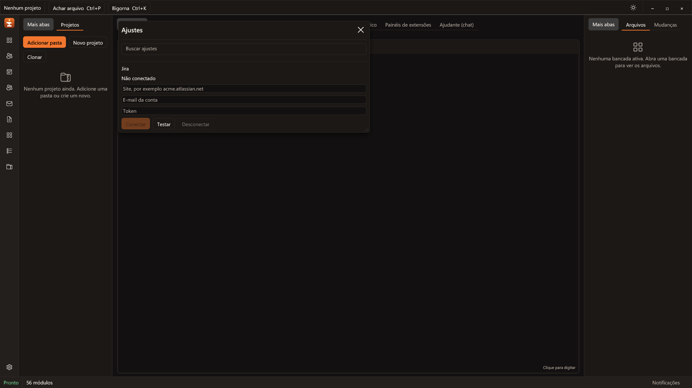

# Ajustes — contador Jira

Janela modal de ajustes da Forja aberta na seção "Jira", para configurar a conexão do contador com um site Jira (site, e-mail da conta e token).

## Como chegar
Na janela principal, clique no ícone de engrenagem "Ajustes" no rodapé do trilho à esquerda (retângulo (8,724)–(44,760)); na janela "Ajustes", localize a seção "Jira" rolando a lista ou digitando "Jira" no campo de busca de ajustes. Captura direta desta seção: `forja-app --locale pt-BR --theme dark --settings counter_jira`.

## Regiões
- **Barra superior** (0,0)–(1280,42): rótulo "Nenhum projeto", botões "Achar arquivo  Ctrl+P" e "Bigorna  Ctrl+K", ícone de tema (sol, sem nome acessível) e botões de janela "–", "□" e "×".
- **Trilho à esquerda** (0,42)–(52,768): logotipo (imagem sem nome em (12,50)–(40,78)) e coluna de ícones quadrados correspondentes aos botões "Quadro", "Ajudantes", "Rotinas", "Mutirão", "Pedidos", "Skills", "Uso", "Extensões", "Acervo" e, no rodapé, "Ajustes".
- **Painel esquerdo** (52,42)–(300,768): abas "Projetos" (marcada), "Bancadas" e "Painéis de extensões"; botões "Adicionar pasta" (destaque laranja), "Novo" e "Clonar"; estado vazio com ícone de pasta (rótulo "(ícone)" em (168,198)–(196,226)) e o texto "Nenhum projeto ainda. Adicione uma pasta ou crie um novo.".
- **Área central** (300,42)–(988,768): fileira de abas "Terminal" (marcada), "Editor", "Navegador", "Diferenças", "Visualizador", "Bancada", "Revisão", "Histórico" e "Painéis de extensões"; painel de terminal vazio, com a dica "Clique para digitar" visível no canto inferior direito. Sobre essa área está aberta a janela modal "Ajustes" (328,58)–(1026,364), que contém o campo de busca, a seção "Jira", os campos de conexão e os botões "Conectar", "Testar" e "Desconectar".
- **Painel direito** (988,42)–(1280,768): abas "Arquivos" (marcada), "Mudanças", "Ajudante (chat)", "Busca", "Portas" e "Painéis de extensões"; ícone de grade (rótulo "(ícone)" em (1116,114)–(1144,142)) e o aviso "Nenhuma bancada ativa. Abra uma bancada para ver os arquivos.".
- **Barra de status** (0,768)–(1280,800): "Pronto" e "56 módulos" à esquerda; "Notificações" à direita.

## Elementos
| Elemento | Tipo | Posição (px) | Estado | O que faz |
|---|---|---|---|---|
| "Nenhum projeto" | Label | (11,12)–(113,31) | — | Mostra que não há projeto ativo; clicável |
| "Achar arquivo  Ctrl+P" | Button | (135,5)–(291,37) | — | Abre a busca de arquivos (atalho Ctrl+P) |
| "Bigorna  Ctrl+K" | Button | (299,5)–(417,37) | — | Abre a paleta de comandos (atalho Ctrl+K) |
| (sem nome acessível) | Unknown | (1101,5)–(1133,37) | — | Ícone de sol no canto superior direito; alterna tema |
| "–" | Button | (1155,5)–(1187,37) | — | Minimiza a janela |
| "□" | Button | (1195,5)–(1227,37) | — | Maximiza/restaura a janela |
| "×" | Button | (1235,5)–(1269,37) | — | Fecha a janela |
| (sem nome acessível) | Unknown | (304,42)–(320,768) | — | Divisória vertical entre painel esquerdo e área central |
| (sem nome acessível) | Unknown | (972,42)–(988,768) | — | Divisória vertical entre área central e painel direito |
| (sem nome acessível) | Unknown | (319,49)–(339,69) | — | Controle pequeno no topo da divisória esquerda (recolher painel) |
| (sem nome acessível) | Unknown | (1016,49)–(1036,69) | — | Controle pequeno no topo da divisória direita (recolher painel) |
| (sem nome acessível) | Image | (12,50)–(40,78) | — | Logotipo da Forja no topo do trilho |
| "Projetos" | Button | (64,50)–(138,82) | marcado=True | Aba ativa do painel esquerdo |
| (sem nome acessível) | Unknown | (64,50)–(300,82) | — | Sublinhado da aba "Projetos" |
| "Bancadas" | Button | (138,50)–(220,82) | — | Aba de bancadas do painel esquerdo |
| "Painéis de extensões" | Button | (220,50)–(371,82) | — | Aba de painéis de extensões; truncada visualmente pela modal |
| "Terminal" | Button | (324,50)–(401,82) | marcado=True | Aba ativa da área central |
| "Editor" | Button | (401,50)–(461,82) | — | Aba do editor |
| "Navegador" | Button | (461,50)–(553,82) | — | Aba do navegador |
| "Diferenças" | Button | (553,50)–(641,82) | — | Aba de diferenças |
| "Visualizador" | Button | (641,50)–(739,82) | — | Aba do visualizador |
| "Bancada" | Button | (739,50)–(815,82) | — | Aba da bancada |
| "Revisão" | Button | (815,50)–(885,82) | — | Aba de revisão |
| "Histórico" | Button | (885,50)–(965,82) | — | Aba de histórico |
| "Painéis de extensões" | Button | (965,50)–(1115,82) | — | Aba de painéis de extensões da área central |
| (sem nome acessível) | Unknown | (992,50)–(1268,82) | — | Sublinhado da aba "Arquivos" do painel direito |
| "Arquivos" | Button | (992,50)–(1070,82) | marcado=True | Aba ativa do painel direito |
| "Mudanças" | Button | (1070,50)–(1157,82) | — | Aba de mudanças |
| "Ajudante (chat)" | Button | (1115,50)–(1234,82) | — | Aba do chat do ajudante; não visível na imagem |
| "Busca" | Button | (1157,50)–(1216,82) | — | Aba de busca |
| "Portas" | Button | (1216,50)–(1278,82) | — | Aba de portas |
| "Painéis de extensões" | Button | (1278,50)–(1429,82) | — | Aba de painéis de extensões; retângulo além da largura da imagem |
| (sem nome acessível) | Unknown | (339,51)–(1016,67) | — | Sublinhado da aba "Terminal" |
| "Ajustes" | Window | (328,58)–(1026,364) | foco | Janela modal de ajustes em primeiro plano |
| (sem nome acessível) | Unknown | (361,59)–(993,107) | — | Barra de título da modal (arraste); título "Ajustes" centralizado |
| (sem nome acessível) | Unknown | (321,69)–(337,354) | — | Alça de redimensionamento à esquerda da modal |
| (sem nome acessível) | Unknown | (1018,69)–(1034,354) | — | Alça de redimensionamento à direita da modal |
| "Close window" | Button | (994,76)–(1008,90) | — | Fecha a janela "Ajustes" (ícone "×") |
| (sem nome acessível) | Unknown | (64,80)–(300,82) | — | Linha divisória sob as abas do painel esquerdo |
| (sem nome acessível) | Unknown | (992,80)–(1268,82) | — | Linha divisória sob as abas do painel direito |
| "Quadro" | Button | (8,94)–(44,130) | — | Ícone do quadro no trilho esquerdo |
| "Adicionar pasta" | Button | (64,98)–(183,130) | — | Adiciona uma pasta de projeto (botão laranja) |
| "Novo" | Button | (191,98)–(248,130) | — | Cria um novo projeto |
| "+" | Button | (407,102)–(441,134) | — | Botão com "+"; oculto sob a modal |
| (sem nome acessível) | Unknown | (444,102)–(476,134) | — | Botão de ícone; oculto sob a modal |
| (sem nome acessível) | Unknown | (479,102)–(511,134) | — | Botão de ícone; oculto sob a modal |
| (sem nome acessível) | Unknown | (514,102)–(546,134) | — | Botão de ícone; oculto sob a modal |
| (sem nome acessível) | Unknown | (549,102)–(581,134) | — | Botão de ícone; oculto sob a modal |
| "Receitas" | Button | (584,102)–(658,134) | — | Abre receitas; oculto sob a modal |
| "Shell" | Button | (661,102)–(714,134) | — | Abre o shell; oculto sob a modal |
| (sem nome acessível) | Unknown | (328,107)–(404,129) | — | Elemento sob a modal, na região da busca |
| (sem nome acessível) | Unknown | (385,110)–(401,126) | — | Elemento pequeno sob a modal |
| (ícone) | Label | (1116,114)–(1144,142) | — | Ícone de grade no painel direito (estado vazio) |
| (sem nome acessível) | TextInput | (337,116)–(1017,148) | — | Campo "Buscar ajustes" (texto de apoio visível) |
| "Ajudantes" | Button | (8,138)–(44,174) | — | Ícone de ajudantes no trilho esquerdo |
| "Clonar" | Button | (64,138)–(128,170) | — | Clona um projeto |
| (sem nome acessível) | Unknown | (328,139)–(980,756) | — | Painel de terminal vazio atrás da modal; mostra a dica "Clique para digitar" no canto inferior |
| "Nenhuma bancada ativa. Abra uma bancada para ver os arquivos." | Label | (994,150)–(1266,188) | — | Aviso do painel direito; parte coberta pela modal |
| "Jira" | Label | (337,176)–(357,195) | — | Título da seção de ajustes do contador Jira |
| "Rotinas" | Button | (8,182)–(44,218) | — | Ícone de rotinas no trilho esquerdo |
| (ícone) | Label | (168,198)–(196,226) | — | Ícone de pasta do estado vazio do painel esquerdo |
| "Não conectado" | Label | (337,203)–(431,222) | — | Estado atual da conexão com o Jira |
| "Mutirão" | Button | (8,226)–(44,262) | — | Ícone do mutirão no trilho esquerdo |
| "Nenhum projeto ainda. Adicione uma pasta ou crie um novo." | Label | (66,234)–(298,272) | — | Estado vazio do painel esquerdo |
| (sem nome acessível) | TextInput | (337,230)–(1017,253) | — | Campo do site Jira (texto de apoio "Site, por exemplo acme.atlassian.net") |
| "Pedidos" | Button | (8,270)–(44,306) | — | Ícone de pedidos no trilho esquerdo |
| (sem nome acessível) | TextInput | (337,261)–(1017,284) | — | Campo "E-mail da conta" |
| "Skills" | Button | (8,314)–(44,350) | — | Ícone de skills no trilho esquerdo |
| (sem nome acessível) | PasswordInput | (337,292)–(1017,315) | — | Campo "Token" (entrada mascarada) |
| "Conectar" | Button | (337,323)–(416,355) | desativado | Conecta ao Jira; indisponível enquanto os campos não estão preenchidos |
| "Testar" | Button | (424,323)–(485,355) | — | Testa a configuração informada |
| "Desconectar" | Button | (493,323)–(593,355) | desativado | Encerra a conexão; indisponível porque não há conexão |
| (sem nome acessível) | Unknown | (319,354)–(339,374) | — | Alça de canto (inferior esquerdo) da modal |
| (sem nome acessível) | Unknown | (1016,354)–(1036,374) | — | Alça de canto (inferior direito) da modal |
| (sem nome acessível) | Unknown | (339,356)–(1016,372) | — | Alça de redimensionamento inferior da modal |
| "Uso" | Button | (8,358)–(44,394) | — | Ícone de uso no trilho esquerdo |
| "Extensões" | Button | (8,402)–(44,438) | — | Ícone de extensões no trilho esquerdo |
| "Acervo" | Button | (8,446)–(44,482) | — | Ícone do acervo no trilho esquerdo |
| "Ajustes" | Button | (8,724)–(44,760) | — | Engrenagem no rodapé do trilho; abre a janela "Ajustes" |
| "Pronto" | Label | (10,775)–(51,794) | — | Status atual na barra inferior |
| "56 módulos" | Label | (73,775)–(146,794) | — | Quantidade de módulos carregados |
| "Notificações" | Label | (1170,775)–(1246,794) | — | Área de notificações à direita da barra de status |

## Aparência
Tema escuro: fundo quase preto com leve tom marrom-escuro, texto em cinza-claro e ícones em cinza médio. A cor de destaque é o laranja, usado no logotipo, no botão "Adicionar pasta" (fundo laranja com texto escuro), no sublinhado das abas marcadas ("Projetos", "Terminal", "Arquivos") e no texto do botão desativado "Conectar" (laranja apagado). A modal "Ajustes" usa um plano de fundo um tom mais claro que a janela, cantos arredondados e sombra, com o título centralizado em negrito e o botão de fechar ("×") no canto superior direito. Os campos de texto são retangulares escuros com contorno sutil e cantos levemente arredondados, alinhados da esquerda (x337) até x1017, com espaçamento vertical uniforme de cerca de 31 px entre campos; os botões "Conectar", "Testar" e "Desconectar" ficam em linha abaixo do campo "Token". O campo de busca ocupa a largura toda no topo da modal. Espaçamentos gerais consistentes (8–16 px); a tipografia é uma sans-serif de tamanho único, com o título da modal maior.

## Problemas encontrados
- Botão "Painéis de extensões" em (1278,50)–(1429,82) tem retângulo além da largura da imagem (1280 px) e fica cortado fora da janela.
- Três botões com o mesmo nome acessível "Painéis de extensões" em posições distintas ((220,50), (965,50) e (1278,50)); nomes duplicados dificultam navegação e automação por acessibilidade.
- "Ajudante (chat)" em (1115,50)–(1234,82) sobrepõe o retângulo de "Busca" (1157,50)–(1216,82) e não aparece renderizado na imagem.
- Botão "Close window" com nome acessível em inglês em uma interface em pt-BR.
- Ícone clicável de tema (sol) em (1101,5)–(1133,37) sem nome acessível.
- Vários elementos interativos sem nome acessível: campos de texto (só identificáveis pelo texto de apoio visível), botões de ícone em (444,102)–(581,134), alças de redimensionamento e divisórias da modal e sublinhados de abas.
- A modal cobre e trunca elementos de fundo: a aba "Painéis de extensões" do painel esquerdo aparece cortada ("Painéis de e…"), a aba "Arquivos" aparece como "…uivos" e o aviso "Nenhuma bancada ativa..." é parcialmente encoberto — sobreposição esperada de uma modal, mas que reduz a legibilidade dos rótulos.
- Os botões "+", "Receitas" e "Shell" (faixa y102–134) ficam totalmente sob a modal e invisíveis nesta captura.
- Texto "Clique para digitar" solto no canto inferior direito da área central (parte do painel de terminal vazio atrás da modal), sem elemento correspondente nomeado na árvore.
