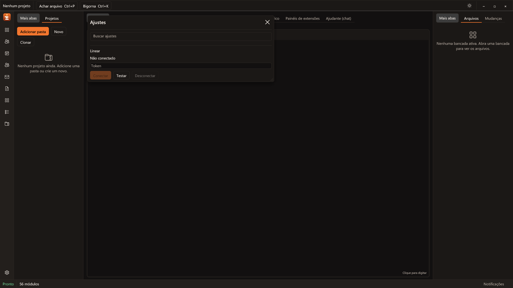

# Ajustes — counter_linear (Linear)

Janela modal de ajustes da conexão "Linear" (alvo `counter_linear`), aberta sobre a tela principal da Forja, com campo de token e ações de conexão.

## Como chegar
No app: clique no botão "Ajustes" no fim do trilho de módulos à esquerda (retângulo (8,724)–(44,760)) e abra os ajustes da integração Linear (alvo `counter_linear`). Comando de captura: `forja-app --locale pt-BR --theme dark --settings counter_linear`.

## Regiões
- **Barra de título superior** (0,0)–(1280,37): rótulo "Nenhum projeto", botões "Achar arquivo Ctrl+P" e "Bigorna Ctrl+K" à esquerda; à direita, botão de tema (ícone de sol, sem nome), e os botões de janela "–" (minimizar), "□" (maximizar) e "×" (fechar).
- **Trilho de módulos à esquerda** (0,37)–(52,768): ícone do módulo ativo no topo (imagem sem nome em (12,50)–(40,78)) e coluna de botões-ícone: "Quadro", "Ajudantes", "Rotinas", "Mutirão", "Pedidos", "Skills", "Uso", "Extensões", "Acervo" e, no fim, "Ajustes".
- **Painel lateral esquerdo (Projetos)** (52,37)–(304,768): abas "Projetos" (ativa, sublinhada em laranja), "Bancadas" e "Painéis de extensões" (cortada pelo modal); botões "Adicionar pasta", "Novo" e "Clonar"; ícone de pasta (rótulo "(ícone)" em (168,198)–(196,226)) e a mensagem "Nenhum projeto ainda. Adicione uma pasta ou crie um novo.".
- **Área central** (304,37)–(988,768): faixa de abas ("Terminal" marcada, além de "Editor", "Navegador", "Diferenças", "Visualizador", "Bancada", "Revisão", "Histórico", "Painéis de extensões") encoberta pela janela modal "Ajustes" (328,58)–(1026,302). Abaixo do modal resta uma grande área de texto vazia com a legenda "Clique para digitar" no canto inferior direito (~883,737).
- **Janela modal "Ajustes"** (328,58)–(1026,302): título "Ajustes" centralizado com botão de fechar ("Close window") à direita; campo de busca "Buscar ajustes"; seção "Linear" com estado "Não conectado", campo de senha "Token" e os botões "Conectar" (desativado), "Testar" e "Desconectar" (desativado).
- **Painel direito** (988,37)–(1280,768): faixa de abas com "Arquivos" (ativa), "Mudanças", "Busca" e "Portas" visíveis ("Painéis de extensões" estende-se além da borda da janela); ícone de grade (rótulo "(ícone)" em (1116,114)–(1144,142)) e a mensagem "Nenhuma bancada ativa. Abra uma bancada para ver os arquivos.".
- **Barra de status** (0,768)–(1280,800): "Pronto" à esquerda, "56 módulos" em seguida e "Notificações" à direita.

## Elementos
| Elemento | Tipo | Posição (px) | Estado | O que faz |
|---|---|---|---|---|
| "Nenhum projeto" | Label | (11,12)–(113,31) | — | Indica o projeto atual na barra de título. |
| "Achar arquivo  Ctrl+P" | Button | (135,5)–(291,37) | — | Abre a busca de arquivos (atalho Ctrl+P). |
| "Bigorna  Ctrl+K" | Button | (299,5)–(417,37) | — | Abre a paleta de comandos (atalho Ctrl+K). |
| (sem nome acessível) | Unknown | (1101,5)–(1133,37) | — | Ícone de sol; alterna tema claro/escuro. |
| "–" | Button | (1155,5)–(1187,37) | — | Minimiza a janela. |
| "□" | Button | (1195,5)–(1227,37) | — | Maximiza/restaura a janela. |
| "×" | Button | (1235,5)–(1269,37) | — | Fecha a janela. |
| (sem nome acessível) | Image | (12,50)–(40,78) | — | Ícone do módulo ativo no topo do trilho. |
| "Projetos" | Button | (64,50)–(138,82) | marcado=True | Aba ativa do painel lateral; mostra a lista de projetos. |
| (sem nome acessível) | Unknown | (64,50)–(300,82) | — | Sublinhado/fundo da aba ativa "Projetos". |
| "Bancadas" | Button | (138,50)–(220,82) | marcado=False | Aba do painel lateral. |
| "Painéis de extensões" | Button | (220,50)–(371,82) | marcado=False | Aba do painel lateral; texto interrompido pelo modal. |
| "Terminal" | Button | (324,50)–(401,82) | marcado=True | Aba da área central; encoberta pelo modal. |
| "Editor" | Button | (401,50)–(461,82) | marcado=False | Aba da área central; encoberta pelo modal. |
| "Navegador" | Button | (461,50)–(553,82) | marcado=False | Aba da área central; encoberta pelo modal. |
| "Diferenças" | Button | (553,50)–(641,82) | marcado=False | Aba da área central; encoberta pelo modal. |
| "Visualizador" | Button | (641,50)–(739,82) | marcado=False | Aba da área central; encoberta pelo modal. |
| "Bancada" | Button | (739,50)–(815,82) | marcado=False | Aba da área central; encoberta pelo modal. |
| "Revisão" | Button | (815,50)–(885,82) | marcado=False | Aba da área central; encoberta pelo modal. |
| "Histórico" | Button | (885,50)–(965,82) | marcado=False | Aba da área central; encoberta pelo modal. |
| "Painéis de extensões" | Button | (965,50)–(1115,82) | marcado=False | Aba da área central; encoberta parcialmente pelo modal. |
| (sem nome acessível) | Unknown | (992,50)–(1268,82) | — | Faixa de abas do painel direito. |
| "Arquivos" | Button | (992,50)–(1070,82) | marcado=True | Aba ativa do painel direito; lista de arquivos (vazia). |
| "Mudanças" | Button | (1070,50)–(1157,82) | marcado=False | Aba do painel direito. |
| "Ajudante (chat)" | Button | (1115,50)–(1234,82) | marcado=False | Aba do painel direito; retângulo sobrepõe "Mudanças" e "Busca". |
| "Busca" | Button | (1157,50)–(1216,82) | marcado=False | Aba do painel direito. |
| "Portas" | Button | (1216,50)–(1278,82) | marcado=False | Aba do painel direito. |
| "Painéis de extensões" | Button | (1278,50)–(1429,82) | marcado=False | Aba do painel direito; ultrapassa a borda direita da janela. |
| (sem nome acessível) | Unknown | (319,49)–(339,69) | — | Elemento de borda à esquerda da faixa de abas central. |
| (sem nome acessível) | Unknown | (1016,49)–(1036,69) | — | Elemento de borda à direita da faixa de abas central. |
| (sem nome acessível) | Unknown | (339,51)–(1016,67) | — | Faixa de fundo das abas centrais. |
| "Ajustes" | Window | (328,58)–(1026,302) | foco | Janela modal de ajustes do alvo `counter_linear`. |
| (sem nome acessível) | Unknown | (361,59)–(993,107) | — | Barra de título do modal (título "Ajustes" centralizado). |
| (sem nome acessível) | Unknown | (321,69)–(337,292) | — | Borda esquerda do modal (redimensionamento). |
| (sem nome acessível) | Unknown | (1018,69)–(1034,292) | — | Borda direita do modal (redimensionamento). |
| "Close window" | Button | (994,76)–(1008,90) | — | Fecha a janela modal; ícone "×". |
| (sem nome acessível) | Unknown | (64,80)–(300,82) | — | Sublinhado inferior da aba ativa do painel esquerdo. |
| (sem nome acessível) | Unknown | (992,80)–(1268,82) | — | Sublinhado inferior da aba ativa do painel direito. |
| "Quadro" | Button | (8,94)–(44,130) | marcado=False | Botão-ícone do trilho esquerdo. |
| "Adicionar pasta" | Button | (64,98)–(183,130) | — | Abre o seletor para adicionar uma pasta de projeto. |
| "Novo" | Button | (191,98)–(248,130) | — | Cria um projeto novo. |
| "+" | Button | (407,102)–(441,134) | — | Botão de adicionar da barra da área central; encoberto pelo modal. |
| (sem nome acessível) | Unknown | (444,102)–(476,134) | — | Botão-ícone da barra central, sem nome; encoberto pelo modal. |
| (sem nome acessível) | Unknown | (479,102)–(511,134) | — | Botão-ícone da barra central, sem nome; encoberto pelo modal. |
| (sem nome acessível) | Unknown | (514,102)–(546,134) | — | Botão-ícone da barra central, sem nome; encoberto pelo modal. |
| (sem nome acessível) | Unknown | (549,102)–(581,134) | — | Botão-ícone da barra central, sem nome; encoberto pelo modal. |
| "Receitas" | Button | (584,102)–(658,134) | — | Abre receitas; encoberto pelo modal. |
| "Shell" | Button | (661,102)–(714,134) | — | Abre o shell; encoberto pelo modal. |
| (sem nome acessível) | Unknown | (328,107)–(404,129) | — | Elemento no canto superior esquerdo do modal. |
| (sem nome acessível) | Unknown | (385,110)–(401,126) | — | Elemento interno do canto do modal. |
| "Buscar ajustes" (TextInput sem nome acessível) | TextInput | (337,116)–(1017,148) | — | Campo de busca de ajustes; texto de sugestão "Buscar ajustes". |
| (ícone) | Label | (1116,114)–(1144,142) | — | Ícone de grade do painel direito (estado vazio). |
| "Ajudantes" | Button | (8,138)–(44,174) | marcado=False | Botão-ícone do trilho esquerdo. |
| "Clonar" | Button | (64,138)–(128,170) | — | Clona um projeto (desabilitado na prática, sem projetos). |
| (sem nome acessível) | Unknown | (328,139)–(980,756) | — | Área de texto central vazia; exibe "Clique para digitar" no canto inferior direito. |
| "Nenhuma bancada ativa. Abra uma bancada para ver os arquivos." | Label | (994,150)–(1266,188) | — | Mensagem de estado vazio do painel de arquivos. |
| "Linear" | Label | (337,176)–(374,195) | — | Título da seção de ajustes da conexão Linear. |
| "Rotinas" | Button | (8,182)–(44,218) | marcado=False | Botão-ícone do trilho esquerdo. |
| (ícone) | Label | (168,198)–(196,226) | — | Ícone de pasta do estado vazio do painel de projetos. |
| "Não conectado" | Label | (337,203)–(431,222) | — | Estado atual da conexão Linear. |
| "Mutirão" | Button | (8,226)–(44,262) | marcado=False | Botão-ícone do trilho esquerdo. |
| "Token" (PasswordInput sem nome acessível) | PasswordInput | (337,230)–(1017,253) | — | Campo de senha para o token da conexão Linear. |
| "Nenhum projeto ainda. Adicione uma pasta ou crie um novo." | Label | (66,234)–(298,272) | — | Mensagem de estado vazio do painel de projetos. |
| "Conectar" | Button | (337,261)–(416,293) | desativado | Conecta à Linear; inativo até haver token. |
| "Testar" | Button | (424,261)–(485,293) | — | Testa as credenciais informadas. |
| "Desconectar" | Button | (493,261)–(593,293) | desativado | Encerra a conexão; inativo por não haver conexão. |
| "Pedidos" | Button | (8,270)–(44,306) | marcado=False | Botão-ícone do trilho esquerdo. |
| (sem nome acessível) | Unknown | (319,292)–(339,312) | — | Alça inferior esquerda do modal. |
| (sem nome acessível) | Unknown | (1016,292)–(1036,312) | — | Alça inferior direita do modal. |
| (sem nome acessível) | Unknown | (339,294)–(1016,310) | — | Borda inferior do modal. |
| "Skills" | Button | (8,314)–(44,350) | marcado=False | Botão-ícone do trilho esquerdo. |
| "Uso" | Button | (8,358)–(44,394) | marcado=False | Botão-ícone do trilho esquerdo. |
| "Extensões" | Button | (8,402)–(44,438) | marcado=False | Botão-ícone do trilho esquerdo. |
| "Acervo" | Button | (8,446)–(44,482) | marcado=False | Botão-ícone do trilho esquerdo. |
| "Ajustes" | Button | (8,724)–(44,760) | marcado=False | Botão-ícone do trilho esquerdo; abre a tela de ajustes. |
| "Pronto" | Label | (10,775)–(51,794) | — | Status geral na barra de status. |
| "56 módulos" | Label | (73,775)–(146,794) | — | Contagem de módulos carregados. |
| "Notificações" | Label | (1170,775)–(1246,794) | — | Área de notificações na barra de status. |

## Aparência
Tema escuro: fundo geral quase preto (~#1b1b1b), painéis e barras em cinza-escuro, e a janela modal "Ajustes" em cinza um pouco mais claro com barra de título destacada. A cor de destaque é o laranja: sublinhado e texto da aba ativa "Projetos", fundo do botão "Adicionar pasta" e rótulo do botão desativado "Conectar". Tipografia sans-serif de ~13–14 px, com títulos de seção ("Linear", "Não conectado") ligeiramente maiores. Botões com cantos levemente arredondados e espaçamento uniforme (~8 px). Campos de entrada ocupam toda a largura do modal (337–1017 px) e são empilhados com espaçamento regular. Estados vazios usam ícone centralizado e texto cinza. A barra de status é uma faixa contínua na base, com "Notificações" alinhado à direita.

## Problemas encontrados
- A aba "Painéis de extensões" do painel direito tem retângulo (1278,50)–(1429,82), ultrapassando a largura da janela (1280 px); seu texto não pode estar integralmente visível.
- O botão de fechar o modal tem nome acessível "Close window", em inglês, na localização pt-BR.
- Sobreposição na árvore de acessibilidade: "Ajudante (chat)" (1115,50)–(1234,82) sobrepõe as abas "Mudanças" e "Busca"; na imagem apenas "Mudanças", "Busca" e "Portas" aparecem.
- Vários botões-ícone da barra da área central ("+", quatro botões entre 444–581 px) e os elementos de borda das faixas de abas e do modal estão sem nome acessível.
- O TextInput de busca e o PasswordInput de token não têm nome acessível; dependem apenas do texto de sugestão ("Buscar ajustes", "Token").
- O texto "Clique para digitar" (~883,737) é exibido em cinza escuro sobre fundo escuro, com contraste baixo.
- Duas abas aparecem marcadas simultaneamente ("Projetos" no painel esquerdo e "Terminal" na área central), o que dificulta identificar o painel realmente ativo.
- Os botões "Receitas" e "Shell" e os ícones vizinhos permanecem totalmente encobertos pelo modal, sem indicação visual de sua existência.
