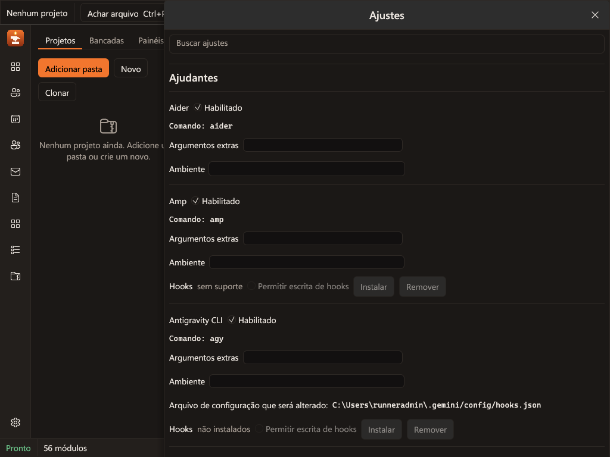

# Ajustes — Ajudantes

Tela de configuração dos ajudantes de código (agentes de IA): permite habilitar cada ajudante, definir comando, argumentos extras, ambiente e gerenciar hooks, em uma janela modal sobre a área de trabalho do app.

## Como chegar
Na janela principal, acionar o botão de engrenagem "Ajustes" no fim do trilho esquerdo (ou o comando de ajustes) e escolher a seção "Ajudantes"; a captura corresponde ao comando `forja-app --locale pt-BR --theme dark --settings helper`.

## Regiões
- **Janela-mãe (fundo)**: (0,0)–(1280,800). Barra superior (0,0)–(1280,42) com "Nenhum projeto", "Achar arquivo  Ctrl+P", "Bigorna  Ctrl+K", botão de tema (sol) e controles "–", "□", "×"; trilho esquerdo de ícones (0,42)–(56,768) com o logotipo e os botões "Quadro", "Ajudantes", "Rotinas", "Mutirão", "Pedidos", "Skills", "Uso", "Extensões", "Acervo", "Ajustes"; faixa de abas do app (304,42)–(1280,90) com "Terminal", "Editor", "Navegador", "Diferenças", "Visualizador", "Bancada", "Revisão", "Histórico", "Arquivos", "Mudanças", "Ajudante (chat)", "Busca", "Portas" e abas "Painéis de extensões"; painel de projetos (56,42)–(304,768) com "Projetos", "Bancadas", "Adicionar pasta", "Novo", "Clonar" e estado vazio "Nenhum projeto ainda. Adicione uma pasta ou crie um novo."; painel direito (988,42)–(1280,768) com o aviso "Nenhuma bancada ativa. Abra uma bancada para ver os arquivos."; barra de status (0,768)–(1280,800) com "Pronto", "56 módulos" e "Notificações".
- **Modal "Ajustes"**: (328,0)–(1077,3579) (visível até y≈800; o restante é alcançado rolando). Barra de título (328,0)–(1077,42) com o título "Ajustes" e o botão "Close window"; campo de busca "Buscar ajustes" (337,58)–(1068,90); área de conteúdo (328,100)–(980,756 na primeira dobra) com o título "Ajudantes" e um cartão por ajudante.
- **Cartão de ajudante (padrão repetido)**: nome + caixa "Habilitado"; linha "Comando: <cmd>"; campos "Argumentos extras" e "Ambiente"; quando aplicável, linha "Arquivo de configuração que será alterado:" com o caminho; seção "Hooks" com estado ("sem suporte", "não instalados" ou "Carregando…"), caixa "Permitir escrita de hooks" e botões "Instalar"/"Remover".

## Elementos
| Elemento | Tipo | Posição (px) | Estado | O que faz |
|---|---|---|---|---|
| Contorno superior esquerdo (fora da imagem, y negativo) | Unknown | (319,-10)–(339,11) | — | Canto/borda de redimensionamento da janela |
| Contorno superior direito (fora da imagem, y negativo) | Unknown | (1066,-10)–(1086,11) | — | Canto/borda de redimensionamento |
| Contorno superior central (fora da imagem) | Unknown | (339,-8)–(1066,9) | — | Borda superior da janela |
| "Ajustes" | Window | (328,0)–(1077,3579) | foco | Janela modal de ajustes |
| Barra de título (sem nome) | Unknown | (361,1)–(1044,49) | clique | Área de arraste do título do modal |
| "Achar arquivo  Ctrl+P" | Button | (135,5)–(291,37) | — | Abre a busca de arquivos (atalho Ctrl+P) |
| "Bigorna  Ctrl+K" | Button | (299,5)–(417,37) | — | Abre a paleta de comandos (atalho Ctrl+K) |
| Ícone de tema/sol (sem nome acessível) | Unknown | (1101,5)–(1133,37) | clique | Alterna o tema |
| "–" | Button | (1155,5)–(1187,37) | — | Minimiza a janela |
| "□" | Button | (1195,5)–(1227,37) | — | Maximiza/restaura a janela |
| "×" | Button | (1235,5)–(1269,37) | — | Fecha a janela-mãe |
| Borda esquerda da janela-mãe (sem nome) | Unknown | (321,11)–(337,3569) | — | Contorno lateral |
| Borda direita da janela-mãe (sem nome) | Unknown | (1068,11)–(1084,3569) | — | Contorno lateral |
| "Nenhum projeto" | Label | (11,12)–(113,31) | clique | Indica que não há projeto aberto |
| "Close window" | Button | (1045,18)–(1059,32) | — | Fecha o modal "Ajustes" (ícone ×) |
| Separador vertical esquerdo (sem nome) | Unknown | (304,42)–(320,768) | — | Divide painel de projetos do restante |
| Separador vertical direito (sem nome) | Unknown | (972,42)–(988,768) | — | Divide painel direito |
| Logotipo da Forja (sem nome acessível) | Image | (12,50)–(40,78) | clique | Identidade do app no trilho |
| "Projetos" | Button | (64,50)–(138,82) | marcado=True | Aba ativa do painel esquerdo |
| Faixa da aba "Projetos" (sem nome) | Unknown | (64,50)–(300,82) | — | Destaque da aba ativa |
| "Bancadas" | Button | (138,50)–(220,82) | marcado=False | Alterna para a aba de bancadas |
| "Painéis de extensões" | Button | (220,50)–(371,82) | marcado=False | Aba de painéis de extensões (cortada pelo modal) |
| "Terminal" | Button | (324,50)–(401,82) | marcado=True | Aba do painel terminal |
| "Editor" | Button | (401,50)–(461,82) | marcado=False | Aba do editor |
| "Navegador" | Button | (461,50)–(553,82) | marcado=False | Aba do navegador |
| "Diferenças" | Button | (553,50)–(641,82) | marcado=False | Aba de diffs |
| "Visualizador" | Button | (641,50)–(739,82) | marcado=False | Aba do visualizador |
| "Bancada" | Button | (739,50)–(815,82) | marcado=False | Aba da bancada |
| "Revisão" | Button | (815,50)–(885,82) | marcado=False | Aba de revisão |
| "Histórico" | Button | (885,50)–(965,82) | marcado=False | Aba de histórico |
| "Painéis de extensões" | Button | (965,50)–(1115,82) | marcado=False | Aba de painéis de extensões à direita |
| "Arquivos" | Button | (992,50)–(1070,82) | marcado=True | Aba ativa do painel direito |
| Faixa das abas direitas (sem nome) | Unknown | (992,50)–(1268,82) | — | Destaque do grupo de abas |
| "Mudanças" | Button | (1070,50)–(1157,82) | marcado=False | Aba de mudanças |
| "Ajudante (chat)" | Button | (1115,50)–(1234,82) | marcado=False | Aba do chat do ajudante |
| "Busca" | Button | (1157,50)–(1216,82) | marcado=False | Aba de busca |
| "Portas" | Button | (1216,50)–(1278,82) | marcado=False | Aba de portas |
| "Painéis de extensões" | Button | (1278,50)–(1429,82) | marcado=False | Aba fora da largura visível (1280 px) |
| Campo "Buscar ajustes" (sem nome acessível) | TextInput | (337,58)–(1068,90) | clique | Filtra as seções de ajustes |
| Sublinha da aba "Projetos" (sem nome) | Unknown | (64,80)–(300,82) | clique | Indicador da aba ativa |
| Sublinha das abas direitas (sem nome) | Unknown | (992,80)–(1268,82) | clique | Indicador da aba ativa |
| "Quadro" | Button | (8,94)–(44,130) | marcado=False | Vai ao quadro (trilho esquerdo) |
| "Adicionar pasta" | Button | (64,98)–(183,130) | — | Adiciona uma pasta de projeto |
| "Novo" | Button | (191,98)–(248,130) | — | Cria um projeto novo |
| "+" | Button | (407,102)–(441,134) | — | Adiciona item (sob o modal) |
| Controle sem nome 1 | Unknown | (444,102)–(476,134) | clique | Controle da barra sob o modal |
| Controle sem nome 2 | Unknown | (479,102)–(511,134) | clique | Controle da barra sob o modal |
| Controle sem nome 3 | Unknown | (514,102)–(546,134) | clique | Controle da barra sob o modal |
| Controle sem nome 4 | Unknown | (549,102)–(581,134) | clique | Controle da barra sob o modal |
| "Receitas" | Button | (584,102)–(658,134) | — | Aba/ação de receitas (sob o modal) |
| "Shell" | Button | (661,102)–(714,134) | — | Aba/ação de shell (sob o modal) |
| Ornamento do título (sem nome) | Unknown | (328,107)–(404,129) | clique | Elemento junto ao título "Ajudantes" |
| Marcador do título (sem nome) | Unknown | (385,110)–(401,126) | clique | Detalhe visual do título |
| "(ícone)" | Label | (1116,114)–(1144,142) | clique | Ícone do painel direito (grade), sem rótulo |
| "Ajudantes" | Label | (337,118)–(419,142) | clique | Título da seção |
| "Ajudantes" | Button | (8,138)–(44,174) | marcado=False | Atalho do trilho para esta seção |
| "Clonar" | Button | (64,138)–(128,170) | — | Clona um projeto |
| Área de conteúdo do modal (sem nome) | Unknown | (328,139)–(980,756) | clique | Superfície rolável com os cartões |
| "Nenhuma bancada ativa. Abra uma bancada para ver os arquivos." | Label | (994,150)–(1266,188) | clique | Estado vazio do painel direito |
| "Habilitado" (Aider) | CheckBox | (378,164)–(459,196) | marcado=True | Liga/desliga o ajudante Aider |
| "Aider" | Label | (337,171)–(370,190) | clique | Nome do cartão |
| "Rotinas" | Button | (8,182)–(44,218) | marcado=False | Seção de rotinas (trilho) |
| "(ícone)" | Label | (168,198)–(196,226) | clique | Ícone de pasta do estado vazio de projetos |
| "Comando: aider" | Label | (337,204)–(444,219) | clique | Mostra o comando `aider` (monoespaçado) |
| "Mutirão" | Button | (8,226)–(44,262) | marcado=False | Seção mutirão (trilho) |
| Campo "Argumentos extras" do Aider (sem nome) | TextInput | (461,232)–(729,255) | clique | Argumentos adicionais do comando |
| "Nenhum projeto ainda. Adicione uma pasta ou crie um novo." | Label | (66,234)–(298,272) | clique | Estado vazio do painel de projetos |
| "Argumentos extras" | Label | (337,234)–(453,253) | clique | Rótulo do campo |
| "Pedidos" | Button | (8,270)–(44,306) | marcado=False | Seção pedidos (trilho) |
| Campo "Ambiente" do Aider (sem nome) | TextInput | (404,272)–(732,295) | clique | Variáveis de ambiente |
| "Ambiente" | Label | (337,274)–(396,293) | clique | Rótulo do campo |
| "Skills" | Button | (8,314)–(44,350) | marcado=False | Seção skills (trilho) |
| "Habilitado" (Amp) | CheckBox | (374,321)–(455,353) | marcado=True | Liga/desliga o ajudante Amp |
| "Amp" | Label | (337,328)–(366,347) | clique | Nome do cartão |
| "Uso" | Button | (8,358)–(44,394) | marcado=False | Seção uso (trilho) |
| "Comando: amp" | Label | (337,361)–(428,376) | clique | Mostra o comando `amp` |
| Campo "Argumentos extras" do Amp (sem nome) | TextInput | (461,389)–(729,412) | clique | Argumentos adicionais |
| "Argumentos extras" | Label | (337,391)–(453,410) | clique | Rótulo do campo |
| "Extensões" | Button | (8,402)–(44,438) | marcado=False | Seção extensões (trilho) |
| Campo "Ambiente" do Amp (sem nome) | TextInput | (404,429)–(732,452) | clique | Variáveis de ambiente |
| "Ambiente" | Label | (337,431)–(396,450) | clique | Rótulo do campo |
| "Acervo" | Button | (8,446)–(44,482) | marcado=False | Seção acervo (trilho) |
| "Permitir escrita de hooks" (Amp) | CheckBox | (468,464)–(638,496) | desativado, marcado=False | Autorizaria a escrita de hooks (indisponível) |
| "Instalar" (Amp) | Button | (646,464)–(715,499) | desativado | Instalaria hooks (indisponível) |
| "Remover" (Amp) | Button | (723,464)–(802,499) | desativado | Removeria hooks (indisponível) |
| "Hooks" | Label | (337,471)–(376,490) | clique | Rótulo da seção de hooks |
| "sem suporte" | Label | (384,471)–(460,490) | clique | Estado dos hooks do Amp |
| "Habilitado" (Antigravity CLI) | CheckBox | (435,521)–(516,553) | marcado=True | Liga/desliga o ajudante |
| "Antigravity CLI" | Label | (337,528)–(427,547) | clique | Nome do cartão |
| "Comando: agy" | Label | (337,561)–(428,576) | clique | Mostra o comando `agy` |
| Campo "Argumentos extras" (Antigravity, sem nome) | TextInput | (461,589)–(729,612) | clique | Argumentos adicionais |
| "Argumentos extras" | Label | (337,591)–(453,610) | clique | Rótulo do campo |
| Campo "Ambiente" (Antigravity, sem nome) | TextInput | (404,629)–(732,652) | clique | Variáveis de ambiente |
| "Ambiente" | Label | (337,631)–(396,650) | clique | Rótulo do campo |
| "Arquivo de configuração que será alterado:" | Label | (337,671)–(603,690) | clique | Avisa qual arquivo os hooks tocam |
| "C:\Users\runneradmin\.gemini/config/hooks.json" | Label | (611,673)–(961,688) | clique | Caminho do arquivo de hooks (monoespaçado) |
| "Permitir escrita de hooks" (Antigravity) | CheckBox | (481,704)–(651,736) | desativado, marcado=False | Autorização de hooks (indisponível) |
| "Instalar" (Antigravity) | Button | (659,704)–(728,739) | desativado | Instalaria hooks |
| "Remover" (Antigravity) | Button | (736,704)–(815,739) | desativado | Removeria hooks |
| "Hooks" | Label | (337,711)–(376,730) | clique | Rótulo da seção |
| "não instalados" | Label | (384,711)–(473,730) | clique | Estado dos hooks |
| "Ajustes" | Button | (8,724)–(44,760) | marcado=False | Atalho do trilho para Ajustes |
| "Habilitado" (Claude Code) | CheckBox | (423,761)–(505,793) | marcado=True | Liga/desliga o ajudante |
| "Claude Code" | Label | (337,768)–(415,787) | clique | Nome do cartão |
| "Pronto" | Label | (10,775)–(51,794) | clique | Status geral na barra inferior |
| "56 módulos" | Label | (73,775)–(146,794) | clique | Contagem de módulos carregados |
| "Notificações" | Label | (1170,775)–(1246,794) | clique | Indicador de notificações |
| "Comando: claude" | Label | (337,801)–(451,816) | clique | Mostra o comando `claude` |
| Campo "Argumentos extras" (Claude, sem nome) | TextInput | (461,829)–(729,852) | clique | Argumentos adicionais |
| "Argumentos extras" | Label | (337,831)–(453,850) | clique | Rótulo do campo |
| Campo "Ambiente" (Claude, sem nome) | TextInput | (404,869)–(732,892) | clique | Variáveis de ambiente |
| "Ambiente" | Label | (337,871)–(396,890) | clique | Rótulo do campo |
| "Arquivo de configuração que será alterado:" | Label | (337,911)–(603,930) | clique | Avisa qual arquivo os hooks tocam |
| "C:\Users\runneradmin\.claude/settings.json" | Label | (611,913)–(931,928) | clique | Caminho do arquivo |
| "Permitir escrita de hooks" (Claude) | CheckBox | (481,944)–(651,976) | desativado, marcado=False | Autorização de hooks |
| "Instalar" (Claude) | Button | (659,944)–(728,979) | desativado | Instalaria hooks |
| "Remover" (Claude) | Button | (736,944)–(815,979) | desativado | Removeria hooks |
| "Hooks" | Label | (337,951)–(376,970) | clique | Rótulo da seção |
| "não instalados" | Label | (384,951)–(473,970) | clique | Estado dos hooks |
| "Habilitado" (Cline CLI) | CheckBox | (398,1001)–(479,1033) | marcado=True | Liga/desliga o ajudante |
| "Cline CLI" | Label | (337,1008)–(390,1027) | clique | Nome do cartão |
| "Comando: cline" | Label | (337,1041)–(444,1056) | clique | Mostra o comando `cline` |
| Campo "Argumentos extras" (Cline, sem nome) | TextInput | (461,1069)–(729,1092) | clique | Argumentos adicionais |
| "Argumentos extras" | Label | (337,1071)–(453,1090) | clique | Rótulo do campo |
| Campo "Ambiente" (Cline, sem nome) | TextInput | (404,1109)–(732,1132) | clique | Variáveis de ambiente |
| "Ambiente" | Label | (337,1111)–(396,1130) | clique | Rótulo do campo |
| "Habilitado" (OpenAI Codex CLI) | CheckBox | (457,1158)–(538,1190) | marcado=True | Liga/desliga o ajudante |
| "OpenAI Codex CLI" | Label | (337,1165)–(449,1184) | clique | Nome do cartão |
| "Comando: codex" | Label | (337,1198)–(444,1213) | clique | Mostra o comando `codex` |
| Campo "Argumentos extras" (Codex, sem nome) | TextInput | (461,1226)–(729,1249) | clique | Argumentos adicionais |
| "Argumentos extras" | Label | (337,1228)–(453,1247) | clique | Rótulo do campo |
| Campo "Ambiente" (Codex, sem nome) | TextInput | (404,1266)–(732,1289) | clique | Variáveis de ambiente |
| "Ambiente" | Label | (337,1268)–(396,1287) | clique | Rótulo do campo |
| "Arquivo de configuração que será alterado:" | Label | (337,1308)–(603,1327) | clique | Avisa qual arquivo os hooks tocam |
| "C:\Users\runneradmin\.codex/hooks.json" | Label | (611,1310)–(900,1325) | clique | Caminho do arquivo |
| "Permitir escrita de hooks" (Codex) | CheckBox | (481,1341)–(651,1373) | desativado, marcado=False | Autorização de hooks |
| "Instalar" (Codex) | Button | (659,1341)–(728,1376) | desativado | Instalaria hooks |
| "Remover" (Codex) | Button | (736,1341)–(815,1376) | desativado | Removeria hooks |
| "Hooks" | Label | (337,1348)–(376,1367) | clique | Rótulo da seção |
| "não instalados" | Label | (384,1348)–(473,1367) | clique | Estado dos hooks |
| "Habilitado" (Continue CLI) | CheckBox | (424,1398)–(505,1430) | marcado=True | Liga/desliga o ajudante |
| "Continue CLI" | Label | (337,1405)–(416,1424) | clique | Nome do cartão |
| "Comando: cn" | Label | (337,1438)–(421,1453) | clique | Mostra o comando `cn` |
| Campo "Argumentos extras" (Continue, sem nome) | TextInput | (461,1466)–(729,1489) | clique | Argumentos adicionais |
| "Argumentos extras" | Label | (337,1468)–(453,1487) | clique | Rótulo do campo |
| Campo "Ambiente" (Continue, sem nome) | TextInput | (404,1506)–(732,1529) | clique | Variáveis de ambiente |
| "Ambiente" | Label | (337,1508)–(396,1527) | clique | Rótulo do campo |
| "Habilitado" (GitHub Copilot CLI) | CheckBox | (460,1555)–(541,1587) | marcado=True | Liga/desliga o ajudante |
| "GitHub Copilot CLI" | Label | (337,1562)–(452,1581) | clique | Nome do cartão |
| "Comando: copilot" | Label | (337,1595)–(459,1610) | clique | Mostra o comando `copilot` |
| Campo "Argumentos extras" (Copilot, sem nome) | TextInput | (461,1623)–(729,1646) | clique | Argumentos adicionais |
| "Argumentos extras" | Label | (337,1625)–(453,1644) | clique | Rótulo do campo |
| Campo "Ambiente" (Copilot, sem nome) | TextInput | (404,1663)–(732,1686) | clique | Variáveis de ambiente |
| "Ambiente" | Label | (337,1665)–(396,1684) | clique | Rótulo do campo |
| "Arquivo de configuração que será alterado:" | Label | (337,1705)–(603,1724) | clique | Avisa qual arquivo os hooks tocam |
| ".github/hooks/*.json" | Label | (611,1707)–(763,1722) | clique | Padrão de caminho dos hooks |
| "Permitir escrita de hooks" (Copilot) | CheckBox | (474,1738)–(644,1770) | desativado, marcado=False | Autorização de hooks |
| "Instalar" (Copilot) | Button | (652,1738)–(721,1773) | desativado | Instalaria hooks |
| "Remover" (Copilot) | Button | (729,1738)–(808,1773) | desativado | Removeria hooks |
| "Hooks" | Label | (337,1745)–(376,1764) | clique | Rótulo da seção |
| "Carregando…" | Label | (384,1745)–(466,1764) | clique | Estado dos hooks ainda não resolvido |
| "Habilitado" (Crush) | CheckBox | (380,1795)–(461,1827) | marcado=True | Liga/desliga o ajudante |
| "Crush" | Label | (337,1802)–(372,1821) | clique | Nome do cartão |
| "Comando: crush" | Label | (337,1835)–(444,1850) | clique | Mostra o comando `crush` |
| Campo "Argumentos extras" (Crush, sem nome) | TextInput | (461,1863)–(729,1886) | clique | Argumentos adicionais |
| "Argumentos extras" | Label | (337,1865)–(453,1884) | clique | Rótulo do campo |
| Campo "Ambiente" (Crush, sem nome) | TextInput | (404,1903)–(732,1926) | clique | Variáveis de ambiente |
| "Ambiente" | Label | (337,1905)–(396,1924) | clique | Rótulo do campo |
| "Arquivo de configuração que será alterado:" | Label | (337,1945)–(603,1964) | clique | Avisa qual arquivo os hooks tocam |
| "crush.json" | Label | (611,1947)–(687,1962) | clique | Caminho do arquivo |
| "Permitir escrita de hooks" (Crush) | CheckBox | (474,1978)–(644,2010) | desativado, marcado=False | Autorização de hooks |
| "Instalar" (Crush) | Button | (652,1978)–(721,2013) | desativado | Instalaria hooks |
| "Remover" (Crush) | Button | (729,1978)–(808,2013) | desativado | Removeria hooks |
| "Hooks" | Label | (337,1985)–(376,2004) | clique | Rótulo da seção |
| "Carregando…" | Label | (384,1985)–(466,2004) | clique | Estado dos hooks ainda não resolvido |
| "Habilitado" (Cursor Agent CLI) | CheckBox | (449,2035)–(530,2067) | marcado=True | Liga/desliga o ajudante |
| "Cursor Agent CLI" | Label | (337,2042)–(441,2061) | clique | Nome do cartão |
| "Comando: cursor-agent" | Label | (337,2075)–(497,2090) | clique | Mostra o comando `cursor-agent` |
| Campo "Argumentos extras" (Cursor, sem nome) | TextInput | (461,2103)–(729,2126) | clique | Argumentos adicionais |
| "Argumentos extras" | Label | (337,2105)–(453,2124) | clique | Rótulo do campo |
| Campo "Ambiente" (Cursor, sem nome) | TextInput | (404,2143)–(732,2166) | clique | Variáveis de ambiente |
| "Ambiente" | Label | (337,2145)–(396,2164) | clique | Rótulo do campo |
| "Habilitado" (Gemini CLI) | CheckBox | (411,2192)–(492,2224) | marcado=True | Liga/desliga o ajudante |
| "Gemini CLI" | Label | (337,2199)–(403,2218) | clique | Nome do cartão |
| "Comando: gemini" | Label | (337,2232)–(451,2247) | clique | Mostra o comando `gemini` |
| Campo "Argumentos extras" (Gemini, sem nome) | TextInput | (461,2260)–(729,2283) | clique | Argumentos adicionais |
| "Argumentos extras" | Label | (337,2262)–(453,2281) | clique | Rótulo do campo |
| Campo "Ambiente" (Gemini, sem nome) | TextInput | (404,2300)–(732,2323) | clique | Variáveis de ambiente |
| "Ambiente" | Label | (337,2302)–(396,2321) | clique | Rótulo do campo |
| "Arquivo de configuração que será alterado:" | Label | (337,2342)–(603,2361) | clique | Avisa qual arquivo os hooks tocam |
| "C:\Users\runneradmin\.gemini/settings.json" | Label | (611,2344)–(931,2359) | clique | Caminho do arquivo |
| "Permitir escrita de hooks" (Gemini) | CheckBox | (474,2375)–(644,2407) | desativado, marcado=False | Autorização de hooks |
| "Instalar" (Gemini) | Button | (652,2375)–(721,2410) | desativado | Instalaria hooks |
| "Remover" (Gemini) | Button | (729,2375)–(808,2410) | desativado | Removeria hooks |
| "Hooks" | Label | (337,2382)–(376,2401) | clique | Rótulo da seção |
| "Carregando…" | Label | (384,2382)–(466,2401) | clique | Estado dos hooks ainda não resolvido |
| "Habilitado" (Goose) | CheckBox | (384,2432)–(466,2464) | marcado=True | Liga/desliga o ajudante |
| "Goose" | Label | (337,2439)–(376,2458) | clique | Nome do cartão |
| "Comando: goose" | Label | (337,2472)–(444,2487) | clique | Mostra o comando `goose` |
| Campo "Argumentos extras" (Goose, sem nome) | TextInput | (461,2500)–(729,2523) | clique | Argumentos adicionais |
| "Argumentos extras" | Label | (337,2502)–(453,2521) | clique | Rótulo do campo |
| Campo "Ambiente" (Goose, sem nome) | TextInput | (404,2540)–(732,2563) | clique | Variáveis de ambiente |
| "Ambiente" | Label | (337,2542)–(396,2561) | clique | Rótulo do campo |
| "Arquivo de configuração que será alterado:" | Label | (337,2582)–(603,2601) | clique | Avisa qual arquivo os hooks tocam |
| "C:\Users\runneradmin\.agents/plugins/<nome>/hooks/hooks.json" | Label | (611,2584)–(1068,2599) | clique | Caminho do arquivo |
| "Permitir escrita de hooks" (Goose) | CheckBox | (474,2615)–(644,2647) | desativado, marcado=False | Autorização de hooks |
| "Instalar" (Goose) | Button | (652,2615)–(721,2650) | desativado | Instalaria hooks |
| "Remover" (Goose) | Button | (729,2615)–(808,2650) | desativado | Removeria hooks |
| "Hooks" | Label | (337,2622)–(376,2641) | clique | Rótulo da seção |
| "Carregando…" | Label | (384,2622)–(466,2641) | clique | Estado dos hooks ainda não resolvido |
| "Habilitado" (Kimi Code CLI) | CheckBox | (431,2672)–(512,2704) | marcado=True | Liga/desliga o ajudante |
| "Kimi Code CLI" | Label | (337,2679)–(423,2698) | clique | Nome do cartão |
| "Comando: kimi" | Label | (337,2712)–(436,2727) | clique | Mostra o comando `kimi` |
| Campo "Argumentos extras" (Kimi, sem nome) | TextInput | (461,2740)–(729,2763) | clique | Argumentos adicionais |
| "Argumentos extras" | Label | (337,2742)–(453,2761) | clique | Rótulo do campo |
| Campo "Ambiente" (Kimi, sem nome) | TextInput | (404,2780)–(732,2803) | clique | Variáveis de ambiente |
| "Ambiente" | Label | (337,2782)–(396,2801) | clique | Rótulo do campo |
| "Permitir escrita de hooks" (Kimi) | CheckBox | (474,2815)–(644,2847) | desativado, marcado=False | Autorização de hooks |
| "Instalar" (Kimi) | Button | (652,2815)–(721,2850) | desativado | Instalaria hooks |
| "Remover" (Kimi) | Button | (729,2815)–(808,2850) | desativado | Removeria hooks |
| "Hooks" | Label | (337,2822)–(376,2841) | clique | Rótulo da seção |
| "Carregando…" | Label | (384,2822)–(466,2841) | clique | Estado dos hooks ainda não resolvido |
| "Habilitado" (Kiro CLI) | CheckBox | (392,2872)–(473,2904) | marcado=True | Liga/desliga o ajudante |
| "Kiro CLI" | Label | (337,2879)–(384,2898) | clique | Nome do cartão |
| "Comando: kiro-cli" | Label | (337,2912)–(467,2927) | clique | Mostra o comando `kiro-cli` |
| Campo "Argumentos extras" (Kiro, sem nome) | TextInput | (461,2940)–(729,2963) | clique | Argumentos adicionais |
| "Argumentos extras" | Label | (337,2942)–(453,2961) | clique | Rótulo do campo |
| Campo "Ambiente" (Kiro, sem nome) | TextInput | (404,2980)–(732,3003) | clique | Variáveis de ambiente |
| "Ambiente" | Label | (337,2982)–(396,3001) | clique | Rótulo do campo |
| "Arquivo de configuração que será alterado:" | Label | (337,3022)–(603,3041) | clique | Avisa qual arquivo os hooks tocam |
| ".kiro/hooks/<id>.json" | Label | (611,3024)–(771,3039) | clique | Padrão de caminho dos hooks |
| "Permitir escrita de hooks" (Kiro) | CheckBox | (474,3055)–(644,3087) | desativado, marcado=False | Autorização de hooks |
| "Instalar" (Kiro) | Button | (652,3055)–(721,3090) | desativado | Instalaria hooks |
| "Remover" (Kiro) | Button | (729,3055)–(808,3090) | desativado | Removeria hooks |
| "Hooks" | Label | (337,3062)–(376,3081) | clique | Rótulo da seção |
| "Carregando…" | Label | (384,3062)–(466,3081) | clique | Estado dos hooks ainda não resolvido |
| "Habilitado" (OpenCode) | CheckBox | (411,3112)–(493,3144) | marcado=True | Liga/desliga o ajudante |
| "OpenCode" | Label | (337,3119)–(403,3138) | clique | Nome do cartão |
| "Comando: opencode" | Label | (337,3152)–(467,3167) | clique | Mostra o comando `opencode` |
| Campo "Argumentos extras" (OpenCode, sem nome) | TextInput | (461,3180)–(729,3203) | clique | Argumentos adicionais |
| "Argumentos extras" | Label | (337,3182)–(453,3201) | clique | Rótulo do campo |
| Campo "Ambiente" (OpenCode, sem nome) | TextInput | (404,3220)–(732,3243) | clique | Variáveis de ambiente |
| "Ambiente" | Label | (337,3222)–(396,3241) | clique | Rótulo do campo |
| "Arquivo de configuração que será alterado:" | Label | (337,3262)–(603,3281) | clique | Avisa qual arquivo os hooks tocam |
| "opencode.json" | Label | (611,3264)–(710,3279) | clique | Caminho do arquivo |
| "Permitir escrita de hooks" (OpenCode) | CheckBox | (474,3295)–(644,3327) | desativado, marcado=False | Autorização de hooks |
| "Instalar" (OpenCode) | Button | (652,3295)–(721,3330) | desativado | Instalaria hooks |
| "Remover" (OpenCode) | Button | (729,3295)–(808,3330) | desativado | Removeria hooks |
| "Hooks" | Label | (337,3302)–(376,3321) | clique | Rótulo da seção |
| "Carregando…" | Label | (384,3302)–(466,3321) | clique | Estado dos hooks ainda não resolvido |
| "Habilitado" (Qwen Code) | CheckBox | (416,3352)–(498,3384) | marcado=True | Liga/desliga o ajudante |
| "Qwen Code" | Label | (337,3359)–(408,3378) | clique | Nome do cartão |
| "Comando: qwen" | Label | (337,3392)–(436,3407) | clique | Mostra o comando `qwen` |
| Campo "Argumentos extras" (Qwen, sem nome) | TextInput | (461,3420)–(729,3443) | clique | Argumentos adicionais |
| "Argumentos extras" | Label | (337,3422)–(453,3441) | clique | Rótulo do campo |
| Campo "Ambiente" (Qwen, sem nome) | TextInput | (404,3460)–(732,3483) | clique | Variáveis de ambiente |
| "Ambiente" | Label | (337,3462)–(396,3481) | clique | Rótulo do campo |
| "Arquivo de configuração que será alterado:" | Label | (337,3502)–(603,3521) | clique | Avisa qual arquivo os hooks tocam |
| ".qwen/settings.json" | Label | (611,3504)–(756,3519) | clique | Caminho do arquivo |
| "Permitir escrita de hooks" (Qwen) | CheckBox | (474,3535)–(644,3567) | desativado, marcado=False | Autorização de hooks |
| "Instalar" (Qwen) | Button | (652,3535)–(721,3570) | desativado | Instalaria hooks |
| "Remover" (Qwen) | Button | (729,3535)–(808,3570) | desativado | Removeria hooks |
| "Hooks" | Label | (337,3542)–(376,3561) | clique | Rótulo da seção |
| "Carregando…" | Label | (384,3542)–(466,3561) | clique | Estado dos hooks ainda não resolvido |
| Contorno inferior esquerdo (sem nome) | Unknown | (319,3569)–(339,3589) | — | Borda inferior da janela |
| Contorno inferior direito (sem nome) | Unknown | (1066,3569)–(1086,3589) | — | Borda inferior da janela |
| Contorno inferior central (sem nome) | Unknown | (339,3571)–(1066,3587) | — | Borda inferior da janela |

Os elementos com y > 800 (do "Comando: claude" em diante) não aparecem na captura; são alcançados rolando o modal. Aider, Amp e os cartões acima da dobra exibem: Aider sem seção de hooks; Amp com hooks "sem suporte"; Antigravity e Claude Code com hooks "não instalados".

## Aparência
Tema escuro: fundo quase preto na janela-mãe e no modal (tons de cinza muito escuro), painéis com cinza levemente mais claro. Acento laranja ("Brasa") no botão "Adicionar pasta" e na guia/sublinha da aba "Projetos"; o restante dos controles é neutro, com botões "Instalar"/"Remover" esmaecidos (desativados). Texto em cinza-claro; rótulos ("Argumentos extras", "Ambiente", "Hooks") em cinza médio. Nomes de comandos (`aider`, `amp`, `agy`…), caminhos de arquivos e valores de campos aparecem em fonte monoespaçada. Cartões separados por linhas divisórias horizontais finais, alinhados à esquerda a partir de x≈337, com campos de texto largura fixa (~268–328 px). Espaçamento vertical consistente entre cartões (~37–40 px entre linhas). O modal é centralizado com o fundo escurecido por sobreposição.

## Problemas encontrados
- O botão de fechar do modal tem nome acessível em inglês ("Close window") em uma tela de locale pt-BR.
- O botão "Painéis de extensões" (1278,50)–(1429,82) fica além da largura da imagem (1280 px), fora da área visível.
- Elementos de borda da janela com retângulos em y negativo ((319,-10)–(339,11), (1066,-10)–(1086,11), (339,-8)–(1066,9)), parcialmente fora da captura.
- Retângulos sobrepostos na faixa de abas direita: "Painéis de extensões" (965–1115) sobrepõe "Arquivos" (992–1070) e "Mudanças" (1070–1157); "Ajudante (chat)" (1115–1234) sobrepõe "Busca" (1157–1216) — possível sobreposição de abas.
- A janela "Ajustes" tem altura declarada de 3579 px, muito além dos 800 px da captura; todo o conteúdo dos cartões abaixo de Claude Code só é acessível rolando, sem indicação visível de rolagem na dobra exibida.
- Oito cartões exibem "Carregando…" persistente no estado de hooks (Continue CLI, Crush, Gemini CLI, Goose, Kimi Code CLI, Kiro CLI, OpenCode, Qwen Code) — status não resolvido na captura.
- O caminho do Goose termina em x=1068, tocando a borda interna do modal (limite em x≈1066), sem folga à direita.
- Vários controles sem nome acessível: quatro elementos Unknown em (444–581,102–134), o botão de tema (1101,5)–(1133,37) e todos os campos TextInput ("Argumentos extras", "Ambiente", "Buscar ajustes") sem rótulo associado.
- O botão "Ajustes" do trilho esquerdo permanece marcado=False enquanto a tela de Ajustes está aberta (estado inconsistente com a tela exibida).
