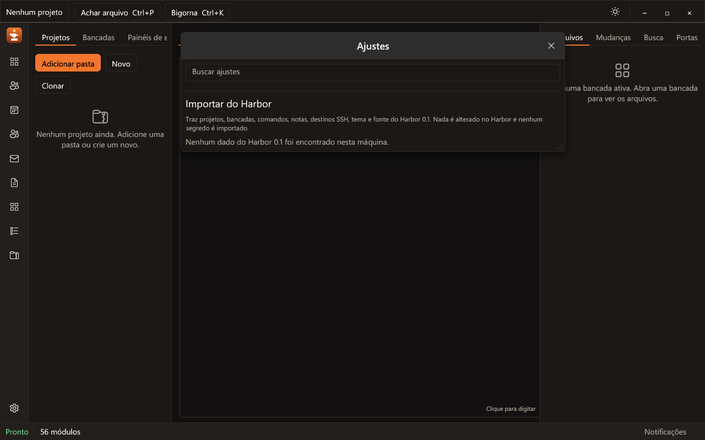

# Ajustes — Importar do Harbor

Tela de configurações que exibe a seção "Importar do Harbor", para trazer dados de uma instalação anterior do Harbor 0.1 (nada encontrado nesta máquina).

## Como chegar
No trilho esquerdo de ícones, clique no botão "Ajustes" (engrenagem, base do trilho, ~(8,724)–(44,760)); na janela "Ajustes" que se abre sobre a área central, a seção "Importar do Harbor" está visível no topo do conteúdo. Comando de captura: `forja-app --locale pt-BR --theme dark --settings import`.

## Regiões
- **Barra superior** (0,0)–(1280,42): etiqueta "Nenhum projeto", botões "Achar arquivo  Ctrl+P" e "Bigorna  Ctrl+K" à esquerda; à direita, um botão sem nome acessível com ícone de sol (tema) e os botões de janela "–", "□" e "×".
- **Trilho à esquerda** (0,42)–(48,768): logotipo do app (imagem sem nome, (12,50)–(40,78)) e uma coluna de botões-ícone: "Quadro", "Ajudantes", "Rotinas", "Mutirão", "Pedidos", "Skills", "Uso", "Extensões", "Acervo" e, no fim, "Ajustes". Nenhum está marcado.
- **Painel lateral esquerdo (Projetos)** (48,42)–(310,768): abas "Projetos" (marcada, com sublinhado), "Bancadas" e "Painéis de extensões"; botões "Adicionar pasta" (destaque laranja), "Novo" e "Clonar"; ícone de pasta central ((168,198)–(196,226)) e mensagem "Nenhum projeto ainda. Adicione uma pasta ou crie um novo.".
- **Área central** (310,42)–(980,768): abas "Terminal" (marcada), "Editor", "Navegador", "Diferenças", "Visualizador", "Bancada", "Revisão" e "Histórico"; abaixo, o painel de terminal (região sem nome (328,139)–(980,756)) com o aviso "Clique para digitar" no canto inferior direito — quase tudo coberto pelo diálogo "Ajustes".
- **Painel direito** (980,42)–(1280,768): abas "Painéis de extensões", com "Arquivos" (marcada), "Mudanças", "Ajudante (chat)", "Busca" e "Portas"; ícone de grade ((1116,114)–(1144,142)) e a mensagem "Nenhuma bancada ativa. Abra uma bancada para ver os arquivos.".
- **Diálogo "Ajustes" (janela flutuante)** (328,58)–(1026,276): título "Ajustes", botão "Close window" (×), campo de busca de ajustes (placeholder "Buscar ajustes"), título "Importar do Harbor", texto explicativo e a mensagem "Nenhum dado do Harbor 0.1 foi encontrado nesta máquina.". Alças de redimensionamento sem nome nas laterais e bordas.
- **Barra de status** (0,768)–(1280,800): "Pronto" (em verde), "56 módulos" e "Notificações" à direita.

## Elementos
| Elemento | Tipo | Posição (px) | Estado | O que faz |
|---|---|---|---|---|
| "Achar arquivo  Ctrl+P" | Button | (135,5)–(291,37) | | Abre a busca de arquivos (atalho Ctrl+P) |
| "Bigorna  Ctrl+K" | Button | (299,5)–(417,37) | | Abre a paleta de comandos (atalho Ctrl+K) |
| (sem nome acessível) | Unknown | (1101,5)–(1133,37) | | Ícone de sol: alterna o tema |
| "–" | Button | (1155,5)–(1187,37) | | Minimiza a janela |
| "□" | Button | (1195,5)–(1227,37) | | Maximiza/restaura a janela |
| "×" | Button | (1235,5)–(1269,37) | | Fecha a janela |
| "Nenhum projeto" | Label | (11,12)–(113,31) | | Mostra que não há projeto aberto |
| (sem nome acessível) | Unknown | (304,42)–(320,768) | | Divisor redimensionável entre painel esquerdo e área central |
| (sem nome acessível) | Unknown | (972,42)–(988,768) | | Divisor redimensionável entre área central e painel direito |
| (sem nome acessível) | Unknown | (319,49)–(339,69) | | Alça superior do divisor esquerdo |
| (sem nome acessível) | Unknown | (1016,49)–(1036,69) | | Alça superior do divisor direito |
| (sem nome acessível) | Image | (12,50)–(40,78) | | Logotipo do app no topo do trilho |
| "Projetos" | Button | (64,50)–(138,82) | marcado=True | Aba ativa do painel esquerdo; mostra a lista de projetos |
| (sem nome acessível) | Unknown | (64,50)–(300,82) | | Faixa de fundo/realce das abas do painel esquerdo |
| "Bancadas" | Button | (138,50)–(220,82) | marcado=False | Aba de bancadas do painel esquerdo |
| "Painéis de extensões" | Button | (220,50)–(371,82) | marcado=False | Aba de painéis de extensões (texto cortado pela borda do painel) |
| "Terminal" | Button | (324,50)–(401,82) | marcado=True | Aba ativa da área central; mostra o terminal |
| "Editor" | Button | (401,50)–(461,82) | marcado=False | Aba do editor de arquivos |
| "Navegador" | Button | (461,50)–(553,82) | marcado=False | Aba do navegador de conteúdo |
| "Diferenças" | Button | (553,50)–(641,82) | marcado=False | Aba de comparação de diffs |
| "Visualizador" | Button | (641,50)–(739,82) | marcado=False | Aba de visualização de arquivos |
| "Bancada" | Button | (739,50)–(815,82) | marcado=False | Aba da bancada de trabalho |
| "Revisão" | Button | (815,50)–(885,82) | marcado=False | Aba de revisão |
| "Histórico" | Button | (885,50)–(965,82) | marcado=False | Aba de histórico |
| "Painéis de extensões" | Button | (965,50)–(1115,82) | marcado=False | Aba de painéis de extensões do lado direito |
| (sem nome acessível) | Unknown | (992,50)–(1268,82) | | Faixa de fundo das abas do painel direito (sobrepõe os botões nomeados) |
| "Arquivos" | Button | (992,50)–(1070,82) | marcado=True | Aba ativa do painel direito; lista de arquivos |
| "Mudanças" | Button | (1070,50)–(1157,82) | marcado=False | Aba de mudanças pendentes |
| "Ajudante (chat)" | Button | (1115,50)–(1234,82) | marcado=False | Aba do chat com ajudantes |
| "Busca" | Button | (1157,50)–(1216,82) | marcado=False | Aba de busca |
| "Portas" | Button | (1216,50)–(1278,82) | marcado=False | Aba de portas (servidores/encaminhamentos) |
| "Painéis de extensões" | Button | (1278,50)–(1429,82) | marcado=False | Outra aba de extensões; fica além da borda direita da janela |
| (sem nome acessível) | Unknown | (339,51)–(1016,67) | | Faixa superior da área central atrás do diálogo |
| "Ajustes" | Window | (328,58)–(1026,276) | foco | Diálogo modal de configurações |
| (sem nome acessível) | Unknown | (361,59)–(993,107) | | Barra de título do diálogo (arrastar) |
| (sem nome acessível) | Unknown | (321,69)–(337,266) | | Alça lateral esquerda de redimensionamento do diálogo |
| (sem nome acessível) | Unknown | (1018,69)–(1034,266) | | Alça lateral direita de redimensionamento do diálogo |
| "Close window" | Button | (994,76)–(1008,90) | | Fecha o diálogo (nome em inglês; ícone ×) |
| (sem nome acessível) | Unknown | (64,80)–(300,82) | | Sublinhado da aba "Projetos" |
| (sem nome acessível) | Unknown | (992,80)–(1268,82) | | Sublinhado da aba "Arquivos" |
| "Quadro" | Button | (8,94)–(44,130) | marcado=False | Botão-ícone do trilho: quadro geral |
| "Adicionar pasta" | Button | (64,98)–(183,130) | | Abre o seletor para importar uma pasta como projeto |
| "Novo" | Button | (191,98)–(248,130) | | Cria um projeto novo |
| "+" | Button | (407,102)–(441,134) | | Ação de adicionar (novo item) |
| (sem nome acessível) | Unknown | (444,102)–(476,134) | | Botão-ícone de filtro na barra do terminal |
| (sem nome acessível) | Unknown | (479,102)–(511,134) | | Botão-ícone de filtro na barra do terminal |
| (sem nome acessível) | Unknown | (514,102)–(546,134) | | Botão-ícone de filtro na barra do terminal |
| (sem nome acessível) | Unknown | (549,102)–(581,134) | | Botão-ícone de filtro na barra do terminal |
| "Receitas" | Button | (584,102)–(658,134) | | Abre a lista de receitas do terminal |
| "Shell" | Button | (661,102)–(714,134) | | Abre um terminal shell |
| (sem nome acessível) | Unknown | (328,107)–(404,129) | | Item da navegação lateral do diálogo (ícone + texto coberto pelo diálogo) |
| (sem nome acessível) | Unknown | (385,110)–(401,126) | | Ícone dentro do item de navegação do diálogo |
| (ícone) | Label | (1116,114)–(1144,142) | | Ícone de grade no painel direito (estado vazio) |
| (sem nome acessível) | TextInput | (337,116)–(1017,148) | | Campo de busca com placeholder "Buscar ajustes" |
| "Ajudantes" | Button | (8,138)–(44,174) | marcado=False | Botão-ícone do trilho: ajudantes de código |
| "Clonar" | Button | (64,138)–(128,170) | | Clona um repositório como projeto |
| (sem nome acessível) | Unknown | (328,139)–(980,756) | | Área do terminal da bancada (coberta pelo diálogo; contém o aviso "Clique para digitar") |
| "Nenhuma bancada ativa. Abra uma bancada para ver os arquivos." | Label | (994,150)–(1266,188) | | Mensagem de estado vazio do painel direito (parcialmente coberta pelo diálogo) |
| "Importar do Harbor" | Label | (337,176)–(492,200) | | Título da seção de importação |
| (ícone) | Label | (168,198)–(196,226) | | Ícone de pasta no estado vazio do painel de projetos |
| "Traz projetos, bancadas, comandos, notas, destinos SSH, tema e fonte do Harbor 0.1. Nada é alterado no Harbor e nenhum segredo é importado." | Label | (337,208)–(988,240) | | Explica o que a importação traz e o que não toca |
| "Rotinas" | Button | (8,182)–(44,218) | marcado=False | Botão-ícone do trilho: rotinas |
| "Nenhum projeto ainda. Adicione uma pasta ou crie um novo." | Label | (66,234)–(298,272) | | Estado vazio do painel de projetos |
| "Nenhum dado do Harbor 0.1 foi encontrado nesta máquina." | Label | (337,248)–(705,267) | | Resultado da verificação: nada a importar |
| (sem nome acessível) | Unknown | (319,266)–(339,286) | | Alça inferior do divisor esquerdo |
| (sem nome acessível) | Unknown | (1016,266)–(1036,286) | | Alça inferior do divisor direito |
| (sem nome acessível) | Unknown | (339,268)–(1016,284) | | Borda inferior da área central atrás do diálogo |
| "Mutirão" | Button | (8,226)–(44,262) | marcado=False | Botão-ícone do trilho: mutirão |
| "Pedidos" | Button | (8,270)–(44,306) | marcado=False | Botão-ícone do trilho: pedidos |
| "Skills" | Button | (8,314)–(44,350) | marcado=False | Botão-ícone do trilho: skills |
| "Uso" | Button | (8,358)–(44,394) | marcado=False | Botão-ícone do trilho: uso |
| "Extensões" | Button | (8,402)–(44,438) | marcado=False | Botão-ícone do trilho: extensões |
| "Acervo" | Button | (8,446)–(44,482) | marcado=False | Botão-ícone do trilho: acervo |
| "Ajustes" | Button | (8,724)–(44,760) | marcado=False | Botão-ícone do trilho: abre a janela de ajustes |
| "Pronto" | Label | (10,775)–(51,794) | | Status geral em verde |
| "56 módulos" | Label | (73,775)–(146,794) | | Contagem de módulos carregados |
| "Notificações" | Label | (1170,775)–(1246,794) | | Atalho para notificações |

## Aparência
Tema escuro: fundo marrom-grafite quase preto (≈ #2b2624) nas regiões, com painéis levemente mais claros que o fundo da janela. O destaque principal é o laranja (cor "Brasa"): a aba "Projetos" ativa tem texto e sublinhado laranja, e "Adicionar pasta" é um botão sólido laranja com texto escuro; "Terminal" e "Arquivos" ativos usam texto claro com sublinhado claro. Textos em cinza-claro/quase branco, com descrições e estados vazios em cinza médio. O diálogo "Ajustes" usa um painel um tom acima do fundo, título centralizado em branco e campo de busca com borda arredondada sutil. A barra de status exibe "Pronto" em verde e o restante em cinza. Tipografia sans-serif única em dois tamanhos (títulos de seção maiores, corpo menor), alinhamento à esquerda no diálogo e ícones centrados nos botões do trilho (36 px por botão, com o grupo de ajustes isolado na base).

## Problemas encontrados
- A última aba "Painéis de extensões" (1278,50)–(1429,82) ultrapassa a largura da janela (1280 px): o texto fica cortado fora da área visível.
- O botão que fecha o diálogo tem nome acessível em inglês ("Close window") numa interface em pt-BR.
- O diálogo "Ajustes" cobre a maior parte da área central e invade o painel direito, escondendo parte da mensagem "Nenhuma bancada ativa. Abra uma bancada para ver os arquivos." e as abas centrais — esperado num modal, mas a sobreposição não é indicada por sombra/contraste suficientes nas bordas.
- Vários controles sem nome acessível: o alternador de tema (1101,5), os quatro botões-ícone de filtro do terminal (444–581,102), o campo de busca do diálogo e as alças/divisores, dificultando o uso por leitor de tela.
- A faixa sem nome (992,50)–(1268,82) sobrepõe os botões nomeados "Arquivos", "Mudanças", "Ajudante (chat)", "Busca" e "Portas" no painel direito.
- Dois itens de navegação do diálogo (328,107)–(404,129) e (385,110)–(401,126) ficam atrás da barra de título/campo, sem texto legível na imagem.
- A aba "Painéis de extensões" do painel esquerdo (220,50)–(371,82) é cortada pela borda do divisor em x≈304, mostrando apenas "Painéis de e…".
