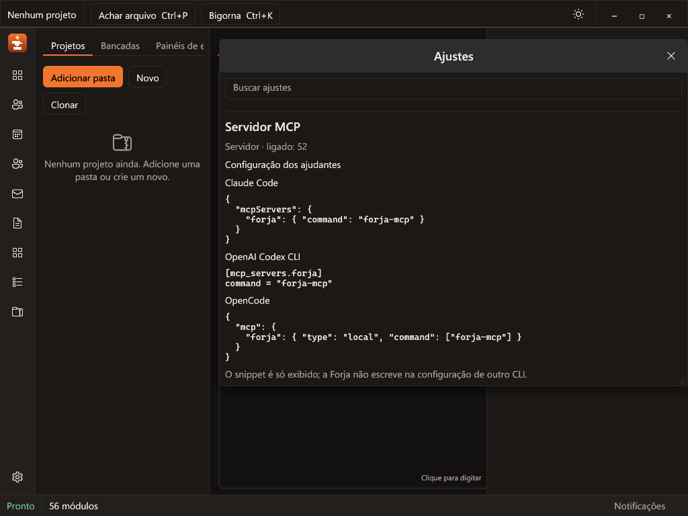

# Ajustes — Servidor MCP

Tela de configurações que mostra, na seção "Servidor MCP", como registrar o servidor MCP da Forja nos ajudantes de código (Claude Code, OpenAI Codex CLI e OpenCode), por meio de snippets de configuração.

## Como chegar
Clicar no botão "Ajustes" (ícone de engrenagem na base do trilho à esquerda, (8,724)–(44,760)) e abrir a seção "Servidor MCP" na janela "Ajustes". Comando de captura: `forja-app --locale pt-BR --theme dark --settings mcp`.

## Regiões
- **Barra superior** (0,0)–(1280,37): rótulo "Nenhum projeto" à esquerda, botões "Achar arquivo Ctrl+P" e "Bigorna Ctrl+K", botão de tema (ícone de sol) e botões de janela "–", "□", "×".
- **Trilho à esquerda** (0,42)–(52,768): logotipo da Forja no topo e uma coluna de botões de ícone — "Quadro", "Ajudantes", "Rotinas", "Mutirão", "Pedidos", "Skills", "Uso", "Extensões", "Acervo" — com "Ajustes" fixado embaixo.
- **Painel lateral esquerdo** (52,42)–(318,768): abas "Projetos" (marcada, com sublinhado laranja), "Bancadas" e "Painéis de extensões"; botões "Adicionar pasta", "Novo" e "Clonar"; estado vazio com ícone de pasta e o texto "Nenhum projeto ainda. Adicione uma pasta ou crie um novo.".
- **Área central** (318,42)–(988,768): faixa de abas "Terminal" (marcada), "Editor", "Navegador", "Diferenças", "Visualizador", "Bancada", "Revisão", "Histórico" e "Painéis de extensões", com a barra de ferramentas "+", "Receitas" e "Shell" logo abaixo. Quase toda a área é coberta pela janela modal "Ajustes".
- **Janela "Ajustes" (modal)** (328,58)–(1026,575): título "Ajustes" e botão "Close window"; campo de busca; título "Servidor MCP", contador "Servidor · ligado: 52", rótulo "Configuração dos ajudantes" e três blocos de snippet em fonte monoespaçada ("Claude Code" em JSON, "OpenAI Codex CLI" em TOML, "OpenCode" em JSON), fechados pelo aviso "O snippet é só exibido; a Forja não escreve na configuração de outro CLI.".
- **Painel direito** (988,42)–(1280,768): abas "Arquivos" (marcada), "Mudanças", "Ajudante (chat)", "Busca" e "Portas"; ícone de grade e o estado vazio "Nenhuma bancada ativa. Abra uma bancada para ver os arquivos.".
- **Barra de status** (0,768)–(1280,800): "Pronto" em verde, "56 módulos" e "Notificações" à direita.

## Elementos
| Elemento | Tipo | Posição (px) | Estado | O que faz |
|---|---|---|---|---|
| "Achar arquivo  Ctrl+P" | Button | (135,5)–(291,37) | — | Abre a busca rápida de arquivos (atalho Ctrl+P). |
| "Bigorna  Ctrl+K" | Button | (299,5)–(417,37) | — | Abre a paleta de comandos (atalho Ctrl+K). |
| Elemento sem nome (ícone de sol) | Unknown | (1101,5)–(1133,37) | — | Alterna o tema claro/escuro. |
| "–" | Button | (1155,5)–(1187,37) | — | Minimiza a janela. |
| "□" | Button | (1195,5)–(1227,37) | — | Maximiza/restaura a janela. |
| "×" | Button | (1235,5)–(1269,37) | — | Fecha a janela. |
| "Nenhum projeto" | Label | (11,12)–(113,31) | — | Mostra que não há projeto aberto. |
| Elemento sem nome (divisória vertical) | Unknown | (304,42)–(320,768) | — | Separa o painel esquerdo da área central; arrastável. |
| Elemento sem nome (divisória vertical) | Unknown | (972,42)–(988,768) | — | Separa a área central do painel direito; arrastável. |
| Elemento sem nome (peça de canto) | Unknown | (319,49)–(339,69) | — | Alça/rolagem no canto superior esquerdo da área central. |
| Elemento sem nome (peça de canto) | Unknown | (1016,49)–(1036,69) | — | Alça/rolagem no canto superior direito da área central. |
| Elemento sem nome (logotipo) | Image | (12,50)–(40,78) | — | Marca da Forja (bigorna laranja) no topo do trilho. |
| "Projetos" | Button | (64,50)–(138,82) | marcado=True | Aba do painel esquerdo; seleciona a lista de projetos. |
| Elemento sem nome (faixa de abas) | Unknown | (64,50)–(300,82) | — | Contêiner/indicador da faixa de abas do painel esquerdo. |
| "Bancadas" | Button | (138,50)–(220,82) | marcado=False | Aba que mostraria a lista de bancadas. |
| "Painéis de extensões" | Button | (220,50)–(371,82) | marcado=False | Aba que mostraria painéis de extensões. |
| "Terminal" | Button | (324,50)–(401,82) | marcado=True | Aba da área central; seleciona o painel de terminal. |
| "Editor" | Button | (401,50)–(461,82) | marcado=False | Aba do editor de arquivos. |
| "Navegador" | Button | (461,50)–(553,82) | marcado=False | Aba do painel de navegador. |
| "Diferenças" | Button | (553,50)–(641,82) | marcado=False | Aba de comparação de diffs. |
| "Visualizador" | Button | (641,50)–(739,82) | marcado=False | Aba de visualização de arquivos. |
| "Bancada" | Button | (739,50)–(815,82) | marcado=False | Aba da bancada ativa. |
| "Revisão" | Button | (815,50)–(885,82) | marcado=False | Aba de revisão. |
| "Histórico" | Button | (885,50)–(965,82) | marcado=False | Aba de histórico. |
| "Painéis de extensões" | Button | (965,50)–(1115,82) | marcado=False | Aba com retângulo deslocado; repete a aba de extensões sobre a faixa do painel direito. |
| Elemento sem nome (faixa de abas) | Unknown | (992,50)–(1268,82) | — | Contêiner da faixa de abas do painel direito. |
| "Arquivos" | Button | (992,50)–(1070,82) | marcado=True | Aba do painel direito; lista de arquivos da bancada. |
| "Mudanças" | Button | (1070,50)–(1157,82) | marcado=False | Aba de mudanças da bancada. |
| "Ajudante (chat)" | Button | (1115,50)–(1234,82) | marcado=False | Aba de chat com o ajudante. |
| "Busca" | Button | (1157,50)–(1216,82) | marcado=False | Aba de busca no projeto. |
| "Portas" | Button | (1216,50)–(1278,82) | marcado=False | Aba de portas em uso. |
| "Painéis de extensões" | Button | (1278,50)–(1429,82) | marcado=False | Aba com retângulo além da largura da janela (imagem tem 1280 px). |
| Elemento sem nome (faixa de abas) | Unknown | (339,51)–(1016,67) | — | Contêiner das abas da área central. |
| "Ajustes" | Window | (328,58)–(1026,575) | foco | Janela modal de configurações sobre a área central. |
| Elemento sem nome (barra de título) | Unknown | (361,59)–(993,107) | — | Área de título/arrasto da janela "Ajustes". |
| Elemento sem nome (borda) | Unknown | (321,69)–(337,565) | — | Borda/rolagem esquerda do modal. |
| Elemento sem nome (borda) | Unknown | (1018,69)–(1034,565) | — | Borda/rolagem direita do modal. |
| "Close window" | Button | (994,76)–(1008,90) | — | Fecha a janela "Ajustes" (ícone "×"). |
| Elemento sem nome (sublinhado) | Unknown | (64,80)–(300,82) | — | Indicador laranja da aba ativa "Projetos". |
| Elemento sem nome (sublinhado) | Unknown | (992,80)–(1268,82) | — | Indicador laranja da aba ativa "Arquivos". |
| "Quadro" | Button | (8,94)–(44,130) | marcado=False | Botão de ícone do trilho; abre o quadro de projetos. |
| "Adicionar pasta" | Button | (64,98)–(183,130) | — | Ação destacada (laranja) para importar uma pasta como projeto. |
| "Novo" | Button | (191,98)–(248,130) | — | Cria um projeto novo. |
| "+" | Button | (407,102)–(441,134) | — | Nova aba de terminal; oculto atrás da janela "Ajustes". |
| Elemento sem nome (ícone) | Unknown | (444,102)–(476,134) | — | Botão de ícone da barra do terminal; oculto atrás do modal. |
| Elemento sem nome (ícone) | Unknown | (479,102)–(511,134) | — | Botão de ícone da barra do terminal; oculto atrás do modal. |
| Elemento sem nome (ícone) | Unknown | (514,102)–(546,134) | — | Botão de ícone da barra do terminal; oculto atrás do modal. |
| Elemento sem nome (ícone) | Unknown | (549,102)–(581,134) | — | Botão de ícone da barra do terminal; oculto atrás do modal. |
| "Receitas" | Button | (584,102)–(658,134) | — | Abre receitas no terminal; oculto atrás do modal. |
| "Shell" | Button | (661,102)–(714,134) | — | Abre um shell no terminal; oculto atrás do modal. |
| Elemento sem nome (sobreposto) | Unknown | (328,107)–(404,129) | — | Elemento sob o campo de busca do modal; coberto por ele. |
| Elemento sem nome (sobreposto) | Unknown | (385,110)–(401,126) | — | Pequeno ícone sob o campo de busca do modal. |
| Elemento sem nome (ícone) | Label | (1116,114)–(1144,142) | — | Ícone de grade do estado vazio no painel direito. |
| Elemento sem nome (campo de busca) | TextInput | (337,116)–(1017,148) | — | Campo de texto "Buscar ajustes" dentro do modal. |
| "Ajudantes" | Button | (8,138)–(44,174) | marcado=False | Botão de ícone do trilho; abre os ajudantes. |
| "Clonar" | Button | (64,138)–(128,170) | — | Clona um repositório para criar um projeto. |
| Elemento sem nome (área de conteúdo) | Unknown | (328,139)–(980,756) | — | Área central (terminal) sob a janela modal; clicável. |
| "Nenhuma bancada ativa. Abra uma bancada para ver os arquivos." | Label | (994,150)–(1266,188) | — | Estado vazio do painel de arquivos. |
| "Servidor MCP" | Label | (337,176)–(449,200) | — | Título da seção de configurações exibida. |
| "Rotinas" | Button | (8,182)–(44,218) | marcado=False | Botão de ícone do trilho; abre rotinas. |
| Elemento sem nome (ícone) | Label | (168,198)–(196,226) | — | Ícone de pasta do estado vazio do painel esquerdo. |
| "Servidor · ligado: 52" | Label | (337,208)–(459,227) | — | Estado do servidor MCP: ligado, 52 conexões/unidades. |
| "Mutirão" | Button | (8,226)–(44,262) | marcado=False | Botão de ícone do trilho; abre o mutirão. |
| "Nenhum projeto ainda. Adicione uma pasta ou crie um novo." | Label | (66,234)–(298,272) | — | Estado vazio da lista de projetos. |
| "Configuração dos ajudantes" | Label | (337,235)–(509,254) | — | Subtítulo da seção. |
| "Claude Code" | Label | (337,262)–(415,281) | — | Nome do primeiro ajudante listado. |
| "Pedidos" | Button | (8,270)–(44,306) | marcado=False | Botão de ícone do trilho; abre pedidos. |
| "{ "mcpServers": { "forja": { "command": "forja-mcp" } } }" | Label | (337,289)–(634,364) | — | Snippet JSON de configuração do MCP no Claude Code (somente exibição). |
| "Skills" | Button | (8,314)–(44,350) | marcado=False | Botão de ícone do trilho; abre skills. |
| "Uso" | Button | (8,358)–(44,394) | marcado=False | Botão de ícone do trilho; abre o uso. |
| "OpenAI Codex CLI" | Label | (337,372)–(449,391) | — | Nome do segundo ajudante listado. |
| "[mcp_servers.forja] command = "forja-mcp"" | Label | (337,399)–(497,429) | — | Snippet TOML de configuração do MCP no Codex CLI (somente exibição). |
| "Extensões" | Button | (8,402)–(44,438) | marcado=False | Botão de ícone do trilho; abre extensões. |
| "OpenCode" | Label | (337,437)–(403,456) | — | Nome do terceiro ajudante listado. |
| "Acervo" | Button | (8,446)–(44,482) | marcado=False | Botão de ícone do trilho; abre o acervo. |
| "{ "mcp": { "forja": { "type": "local", "command": ["forja-mcp"] } } }" | Label | (337,464)–(779,539) | — | Snippet JSON de configuração do MCP no OpenCode (somente exibição). |
| "O snippet é só exibido; a Forja não escreve na configuração de outro CLI." | Label | (337,547)–(786,566) | — | Aviso de que a Forja não edita a configuração de outro CLI. |
| Elemento sem nome (alça) | Unknown | (319,565)–(339,585) | — | Alça de redimensionamento inferior esquerda do modal. |
| Elemento sem nome (alça) | Unknown | (1016,565)–(1036,585) | — | Alça de redimensionamento inferior direita do modal. |
| Elemento sem nome (borda inferior) | Unknown | (339,567)–(1016,583) | — | Borda inferior do modal para redimensionar. |
| "Ajustes" | Button | (8,724)–(44,760) | marcado=False | Botão de engrenagem na base do trilho; abre esta tela. |
| "Pronto" | Label | (10,775)–(51,794) | — | Status geral do app, em verde. |
| "56 módulos" | Label | (73,775)–(146,794) | — | Quantidade de módulos carregados. |
| "Notificações" | Label | (1170,775)–(1246,794) | — | Acesso às notificações na barra de status. |

## Aparência
Tema escuro: fundo geral quase preto (marrom-escuro nas barras laterais, cinza-escuro na janela modal), sem gradientes. Cor de destaque laranja (identidade "Brasa") usada no logotipo, no botão primário "Adicionar pasta", nos sublinhados das abas ativas ("Projetos", "Terminal", "Arquivos") e no "×" do modal. Tipografia: sans-serif para a interface (título "Ajustes" em negrito, corpos em ~13 px) e monoespaçada para os três snippets de configuração, cada um precedido do nome do CLI. O status "Pronto" aparece em verde. Espaçamento regular: ~16 px entre blocos do modal, ~24 px entre as seções de CLI, snippets recuados em ~8 px. Abas alinhadas em faixas horizontais de ~32 px de altura nas três colunas; divisórias verticais separam painel esquerdo, área central e painel direito.

## Problemas encontrados
- O botão "Painéis de extensões" tem retângulo (1278,50)–(1429,82), que ultrapassa a largura da janela (imagem com 1280 px): elemento cortado/fora da tela.
- A faixa de abas da área central aparece duplicada na árvore com retângulos deslocados: a mesma sequência de abas é listada em (324,50)–(965,82) e novamente entre (965,50) e (1429,82), sobrepondo o painel direito e a aba "Arquivos".
- A janela modal "Ajustes" sobrepõe a barra de ferramentas central: "+", os quatro botões sem nome (444–581,102), "Receitas" e "Shell" ficam ocultos atrás dela.
- O campo de busca do modal é um TextInput sem nome acessível (só o texto de apoio "Buscar ajustes" é visível).
- Botões sem nome acessível: o alternador de tema (ícone de sol, (1101,5)) e os quatro botões de ícone da barra do terminal ((444,102)–(581,134)).
- O botão de fechar do modal tem o rótulo em inglês ("Close window") numa interface em pt-BR.
- Ícones registrados apenas como "(ícone)" ((168,198) e (1116,114)) sem texto alternativo descritivo.
- Textos secundários ("Servidor · ligado: 52" e o aviso final do modal) em cinza médio sobre fundo escuro, com contraste aparentemente baixo.
