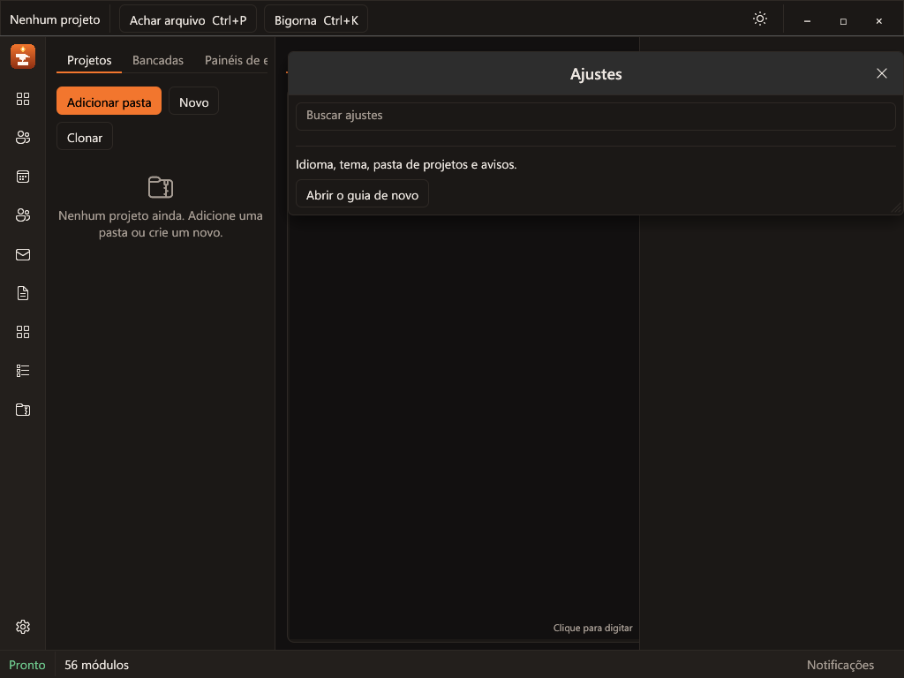

# Ajustes — Onboarding (janela modal)

Tela de configurações iniciais (onboarding) da Forja, apresentada como janela modal "Ajustes" sobre a área de trabalho, com o campo de busca de ajustes, a descrição da seção ("Idioma, tema, pasta de projetos e avisos.") e o atalho para reabrir o guia inicial.

## Como chegar
Na janela principal, clicar no botão "Ajustes" (ícone de engrenagem) na base do trilho à esquerda (8,724)–(44,760); a seção de onboarding abre como janela sobreposta. O botão "Abrir o guia de novo" (337,203)–(488,235) reapresenta o guia inicial. Comando de captura: `forja-app --locale pt-BR --theme dark --settings onboarding`.

## Regiões
- **Barra superior** (0,0)–(1280,42): rótulo "Nenhum projeto", botões "Achar arquivo  Ctrl+P" e "Bigorna  Ctrl+K", ícone de tema (sol) e botões de janela "–", "□", "×".
- **Trilho à esquerda** (0,42)–(52,768): logo da Forja (12,50)–(40,78) e coluna de ícones: "Quadro", "Ajudantes", "Rotinas", "Mutirão", "Pedidos", "Skills", "Uso", "Extensões", "Acervo" e, na base, "Ajustes".
- **Painel lateral esquerdo (Projetos)** (52,42)–(304,768): abas "Projetos" (marcada), "Bancadas" e "Painéis de extensões"; botões "Adicionar pasta", "Novo" e "Clonar"; estado vazio com ícone de pasta e o texto "Nenhum projeto ainda. Adicione uma pasta ou crie um novo.".
- **Área central** (320,42)–(972,768): barra de abas ("Terminal" marcada, "Editor", "Navegador", "Diferenças", "Visualizador", "Bancada", "Revisão", "Histórico", "Painéis de extensões") e uma grande área de texto com a dica "Clique para digitar"; quase toda encoberta pela janela "Ajustes".
- **Painel direito** (988,42)–(1280,768): abas "Arquivos" (marcada), "Mudanças", "Ajudante (chat)", "Busca", "Portas" e "Painéis de extensões"; estado vazio com ícone e o texto "Nenhuma bancada ativa. Abra uma bancada para ver os arquivos.".
- **Janela modal "Ajustes"** (328,58)–(1026,244): título "Ajustes" centrado, botão "Close window" no canto, campo de busca "Buscar ajustes", texto "Idioma, tema, pasta de projetos e avisos." e botão "Abrir o guia de novo".
- **Barra de status** (0,768)–(1280,800): "Pronto" (em verde), "56 módulos" à esquerda e "Notificações" à direita.

## Elementos
| Elemento | Tipo | Posição (px) | Estado | O que faz |
|---|---|---|---|---|
| "Achar arquivo  Ctrl+P" | Button | (135,5)–(291,37) | — | Abre a busca de arquivos (atalho Ctrl+P indicado no rótulo) |
| "Bigorna  Ctrl+K" | Button | (299,5)–(417,37) | — | Abre a paleta de comandos (atalho Ctrl+K indicado no rótulo) |
| (sem nome acessível) | Unknown | (1101,5)–(1133,37) | — | Ícone de sol na barra superior; alterna o tema (claro/escuro) |
| "–" | Button | (1155,5)–(1187,37) | — | Minimiza a janela |
| "□" | Button | (1195,5)–(1227,37) | — | Maximiza/restaura a janela |
| "×" | Button | (1235,5)–(1269,37) | — | Fecha a janela do aplicativo |
| "Nenhum projeto" | Label | (11,12)–(113,31) | clicável | Indica que não há projeto aberto; clicável para seleção |
| (sem nome acessível) | Unknown | (304,42)–(320,768) | foco | Divisor vertical entre o painel de projetos e a área central |
| (sem nome acessível) | Unknown | (972,42)–(988,768) | foco | Divisor vertical entre a área central e o painel direito |
| (sem nome acessível) | Unknown | (319,49)–(339,69) | foco | Elemento pequeno no canto superior esquerdo da área central (marcador da faixa de abas) |
| (sem nome acessível) | Unknown | (1016,49)–(1036,69) | foco | Elemento pequeno no canto superior direito da área central (marcador da faixa de abas) |
| (sem nome acessível) | Image | (12,50)–(40,78) | clicável | Logotipo da Forja no topo do trilho esquerdo |
| "Projetos" | Button | (64,50)–(138,82) | marcado=True | Aba ativa do painel esquerdo; mostra a lista de projetos |
| (sem nome acessível) | Unknown | (64,50)–(300,82) | foco | Faixa de fundo da barra de abas do painel esquerdo |
| "Bancadas" | Button | (138,50)–(220,82) | marcado=False | Alterna o painel esquerdo para a lista de bancadas |
| "Painéis de extensões" | Button | (220,50)–(371,82) | marcado=False | Terceira aba do painel esquerdo; texto visualmente truncado pela janela "Ajustes" |
| "Terminal" | Button | (324,50)–(401,82) | marcado=True | Aba central ativa; oculta atrás da janela "Ajustes" |
| "Editor" | Button | (401,50)–(461,82) | marcado=False | Aba central do editor; oculta atrás da janela "Ajustes" |
| "Navegador" | Button | (461,50)–(553,82) | marcado=False | Aba central do navegador; oculta atrás da janela "Ajustes" |
| "Diferenças" | Button | (553,50)–(641,82) | marcado=False | Aba central de diferenças; oculta atrás da janela "Ajustes" |
| "Visualizador" | Button | (641,50)–(739,82) | marcado=False | Aba central do visualizador; oculta atrás da janela "Ajustes" |
| "Bancada" | Button | (739,50)–(815,82) | marcado=False | Aba central da bancada; oculta atrás da janela "Ajustes" |
| "Revisão" | Button | (815,50)–(885,82) | marcado=False | Aba central de revisão; oculta atrás da janela "Ajustes" |
| "Histórico" | Button | (885,50)–(965,82) | marcado=False | Aba central de histórico; oculta atrás da janela "Ajustes" |
| "Painéis de extensões" | Button | (965,50)–(1115,82) | marcado=False | Última aba central; oculta atrás da janela "Ajustes" |
| (sem nome acessível) | Unknown | (992,50)–(1268,82) | foco | Faixa de fundo da barra de abas do painel direito |
| "Arquivos" | Button | (992,50)–(1070,82) | marcado=True | Aba ativa do painel direito (lista de arquivos); parcialmente encoberta pela janela "Ajustes" |
| "Mudanças" | Button | (1070,50)–(1157,82) | marcado=False | Aba do painel direito com as mudanças da bancada |
| "Ajudante (chat)" | Button | (1115,50)–(1234,82) | marcado=False | Aba do painel direito com o chat do ajudante; retângulo sobrepõe "Busca" |
| "Busca" | Button | (1157,50)–(1216,82) | marcado=False | Aba de busca do painel direito; retângulo sobrepõe "Ajudante (chat)" |
| "Portas" | Button | (1216,50)–(1278,82) | marcado=False | Aba do painel direito com as portas em uso |
| "Painéis de extensões" | Button | (1278,50)–(1429,82) | marcado=False | Aba que se estende além da borda direita da imagem (1429 > 1280); não visível |
| (sem nome acessível) | Unknown | (339,51)–(1016,67) | foco | Faixa fina sobre a barra de abas central; encoberta pela janela "Ajustes" |
| "Ajustes" | Window | (328,58)–(1026,244) | foco | Janela modal de configurações (seção de onboarding) |
| (sem nome acessível) | Unknown | (361,59)–(993,107) | clicável | Área da barra de título da janela, com o título "Ajustes" centrado |
| (sem nome acessível) | Unknown | (321,69)–(337,234) | foco | Borda esquerda da janela (redimensionamento) |
| (sem nome acessível) | Unknown | (1018,69)–(1034,234) | foco | Borda direita da janela (redimensionamento) |
| "Close window" | Button | (994,76)–(1008,90) | — | Fecha a janela "Ajustes" (ícone "×") |
| (sem nome acessível) | Unknown | (64,80)–(300,82) | clicável | Sublinhado da aba ativa "Projetos" no painel esquerdo |
| (sem nome acessível) | Unknown | (992,80)–(1268,82) | clicável | Sublinhado da aba ativa "Arquivos" no painel direito |
| "Quadro" | Button | (8,94)–(44,130) | marcado=False | Ícone do trilho esquerdo; abre o quadro |
| "Adicionar pasta" | Button | (64,98)–(183,130) | — | Adiciona uma pasta de projeto (botão destacado em laranja) |
| "Novo" | Button | (191,98)–(248,130) | — | Cria um novo projeto |
| "+" | Button | (407,102)–(441,134) | — | Botão de adicionar da área central; encoberto pela janela "Ajustes" |
| (sem nome acessível) | Unknown | (444,102)–(476,134) | clicável | Ícone da barra central; encoberto pela janela "Ajustes" |
| (sem nome acessível) | Unknown | (479,102)–(511,134) | clicável | Ícone da barra central; encoberto pela janela "Ajustes" |
| (sem nome acessível) | Unknown | (514,102)–(546,134) | clicável | Ícone da barra central; encoberto pela janela "Ajustes" |
| (sem nome acessível) | Unknown | (549,102)–(581,134) | clicável | Ícone da barra central; encoberto pela janela "Ajustes" |
| "Receitas" | Button | (584,102)–(658,134) | — | Botão "Receitas" da barra central; encoberto pela janela "Ajustes" |
| "Shell" | Button | (661,102)–(714,134) | — | Botão "Shell" da barra central; encoberto pela janela "Ajustes" |
| (sem nome acessível) | Unknown | (328,107)–(404,129) | clicável | Elemento no interior da janela, acima do campo de busca, junto à borda esquerda; sem conteúdo visível identificável |
| (sem nome acessível) | Unknown | (385,110)–(401,126) | clicável | Pequeno elemento (16×16 px) no interior da janela, sobre a posição anterior; sem conteúdo visível identificável |
| (ícone) | Label | (1116,114)–(1144,142) | clicável | Ícone (quadrados enfileirados) acima da mensagem de estado vazio do painel direito |
| (sem nome acessível) | TextInput | (337,116)–(1017,148) | clicável | Campo de busca de ajustes; exibe o marcador "Buscar ajustes" |
| "Ajudantes" | Button | (8,138)–(44,174) | marcado=False | Ícone do trilho esquerdo; abre os ajudantes de código |
| "Clonar" | Button | (64,138)–(128,170) | — | Clona um repositório/projeto |
| (sem nome acessível) | Unknown | (328,139)–(980,756) | clicável | Grande área de texto da região central, com a dica "Clique para digitar" na base (714); encoberta no topo pela janela "Ajustes" |
| "Nenhuma bancada ativa. Abra uma bancada para ver os arquivos." | Label | (994,150)–(1266,188) | clicável | Mensagem de estado vazio do painel direito |
| "Idioma, tema, pasta de projetos e avisos." | Label | (337,176)–(587,195) | clicável | Descrição da seção de ajustes exibida (onboarding) |
| "Rotinas" | Button | (8,182)–(44,218) | marcado=False | Ícone do trilho esquerdo; abre as rotinas |
| (ícone) | Label | (168,198)–(196,226) | clicável | Ícone de pasta acima da mensagem de estado vazio do painel de projetos |
| "Abrir o guia de novo" | Button | (337,203)–(488,235) | — | Reapresenta o guia de onboarding |
| "Mutirão" | Button | (8,226)–(44,262) | marcado=False | Ícone do trilho esquerdo; abre o mutirão |
| "Nenhum projeto ainda. Adicione uma pasta ou crie um novo." | Label | (66,234)–(298,272) | clicável | Mensagem de estado vazio do painel de projetos |
| (sem nome acessível) | Unknown | (319,234)–(339,254) | foco | Canto inferior esquerdo da janela "Ajustes" (redimensionamento) |
| (sem nome acessível) | Unknown | (1016,234)–(1036,254) | foco | Canto inferior direito da janela "Ajustes" (redimensionamento) |
| (sem nome acessível) | Unknown | (339,236)–(1016,252) | foco | Borda inferior da janela "Ajustes" (redimensionamento) |
| "Pedidos" | Button | (8,270)–(44,306) | marcado=False | Ícone do trilho esquerdo; abre os pedidos |
| "Skills" | Button | (8,314)–(44,350) | marcado=False | Ícone do trilho esquerdo; abre as skills |
| "Uso" | Button | (8,358)–(44,394) | marcado=False | Ícone do trilho esquerdo; abre o uso |
| "Extensões" | Button | (8,402)–(44,438) | marcado=False | Ícone do trilho esquerdo; abre as extensões |
| "Acervo" | Button | (8,446)–(44,482) | marcado=False | Ícone do trilho esquerdo; abre o acervo |
| "Ajustes" | Button | (8,724)–(44,760) | marcado=False | Ícone de engrenagem na base do trilho; abre esta tela de ajustes |
| "Pronto" | Label | (10,775)–(51,794) | clicável | Indicador de estado na barra de status (texto verde) |
| "56 módulos" | Label | (73,775)–(146,794) | clicável | Contagem de módulos carregados |
| "Notificações" | Label | (1170,775)–(1246,794) | clicável | Abre as notificações; à direita da barra de status |

## Aparência
Tema escuro com fundo quase preto de tom levemente quente nas áreas de trabalho e um cinza-escuro mais claro na janela modal e na barra de título; a barra de status e o painel direito usam tons ainda mais escuros. A cor de destaque é o laranja (Brasa): botão "Adicionar pasta" preenchido em laranja com texto escuro, sublinhados das abas ativas ("Projetos", "Terminal", "Arquivos") em laranja e o logotipo no trilho também em laranja. Textos em cinza-claro para títulos e abas e em cinza médio para estados vazios e dicas ("Clique para digitar", "Buscar ajustes"); "Pronto" na barra de status em verde. Tipografia sem serifa em dois tamanhos (rótulos de barra e abas menores, mensagens e título da janela maiores, com "Ajustes" em negrito). Espaçamento uniforme: trilho de ícones de 36 px de largura com botões de 36 px a cada 44 px; abas com sublinhado de 2 px colado à base da faixa (y=80–82); a janela modal é flutuante com sombra, bordas de redimensionamento fora do retângulo declarado e cantos retos.

## Problemas encontrados
- Botão "Close window" (994,76)–(1008,90) com nome acessível em inglês (não traduzido para pt-BR) e alvo muito pequeno (14×14 px).
- Aba "Painéis de extensões" (1278,50)–(1429,82) do painel direito se estende além da largura da imagem (1280 px); texto cortado/fora da janela.
- A janela "Ajustes" sobrepõe as barras de abas: a aba esquerda "Painéis de extensões" (220,50)–(371,82) aparece truncada ("Painéis de e…") e a aba "Arquivos" (992,50)–(1070,82) aparece parcialmente encoberta ("uivos").
- Retângulos sobrepostos entre "Ajudante (chat)" (1115,50)–(1234,82), "Busca" (1157,50)–(1216,82) e "Portas" (1216,50)–(1278,82).
- Vários elementos sem nome acessível: o campo de busca de ajustes (TextInput em 337,116), a grande área de texto central (328,139)–(980,756), o botão-ícone de tema (1101,5), o logotipo (12,50), os separadores verticais e os cinco ícones da barra central (444–581,102), que identificam apenas pela posição.
- Os botões "+", "Receitas" e "Shell" e os quatro ícones sem nome da faixa central (y≈102–134) ficam totalmente encobertos pela janela "Ajustes", assim como a aba central ativa "Terminal".
