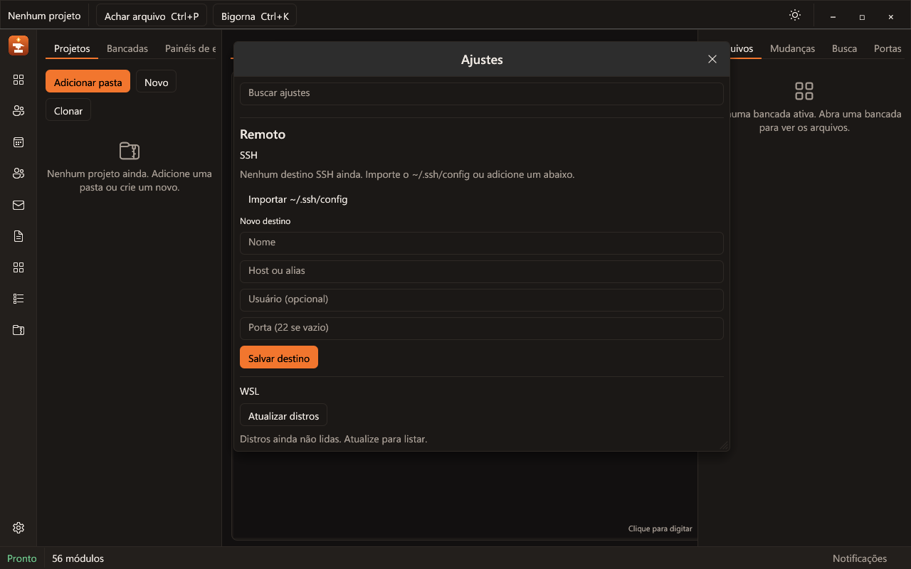

# Ajustes — Remoto

Tela de configurações do app aberta na seção "Remoto", para gerenciar destinos SSH (importados do `~/.ssh/config` ou cadastrados manualmente) e listar distros WSL; aparece como janela modal sobre a tela principal.

## Como chegar
Na tela principal, clique no ícone de engrenagem "Ajustes" na base do trilho à esquerda (8,724)–(44,760) e escolha a seção "Remoto". Equivalente por linha de comando: `forja-app --locale pt-BR --theme dark --settings remote`. A captura correspondente fica em `captures/pt-BR.dark.settings.remote.png`.

## Regiões
- **Barra superior** (0,0)–(1280,42): rótulo do projeto atual ("Nenhum projeto"), botões "Achar arquivo Ctrl+P" e "Bigorna Ctrl+K", alternador de tema (ícone de sol) e os botões de janela "–", "□", "×".
- **Trilho à esquerda** (0,42)–(52,768): logotipo laranja (bigorna) no topo e uma coluna de botões de ícone: Quadro, Ajudantes, Rotinas, Mutirão, Pedidos, Skills, Uso, Extensões, Acervo e, na base, Ajustes.
- **Painel de projetos** (52,42)–(312,768): abas "Projetos" (ativa, com sublinhado laranja), "Bancadas" e "Painéis de extensões"; botões "Adicionar pasta", "Novo" e "Clonar"; estado vazio com ícone de pasta e a mensagem "Nenhum projeto ainda. Adicione uma pasta ou crie um novo.".
- **Área central (terminal)** (312,42)–(980,768): painel de terminal com abas "Terminal" (ativa), "Editor", "Navegador", "Diferenças", "Visualizador", "Bancada", "Revisão", "Histórico" e "Painéis de extensões"; quase todo coberto pela janela modal; nota "Clique para digitar" visível na base.
- **Janela modal "Ajustes"** (328,58)–(1026,635): título "Ajustes" com botão de fechar, campo "Buscar ajustes", e o conteúdo da seção Remoto (SSH e WSL).
- **Painel direito** (980,42)–(1280,768): abas "Arquivos" (ativa, com sublinhado), "Mudanças", "Ajudante (chat)", "Busca", "Portas" e "Painéis de extensões" (esta última cortada pela borda da janela); estado vazio com ícone de grade e a mensagem "Nenhuma bancada ativa. Abra uma bancada para ver os arquivos.".
- **Barra de status** (0,768)–(1280,800): "Pronto" (em verde), "56 módulos" à esquerda e "Notificações" à direita.

## Elementos
| Elemento | Tipo | Posição (px) | Estado | O que faz |
|---|---|---|---|---|
| "Achar arquivo  Ctrl+P" | Button | (135,5)–(291,37) | — | Abre a busca/seleção de arquivos (atalho Ctrl+P). |
| "Bigorna  Ctrl+K" | Button | (299,5)–(417,37) | — | Abre a paleta de comandos (atalho Ctrl+K). |
| (sem nome acessível) | Unknown | (1101,5)–(1133,37) | — | Ícone de sol na barra superior: alternador de tema claro/escuro. |
| "–" | Button | (1155,5)–(1187,37) | — | Minimiza a janela. |
| "□" | Button | (1195,5)–(1227,37) | — | Maximiza/restaura a janela. |
| "×" | Button | (1235,5)–(1269,37) | — | Fecha a janela do app. |
| "Nenhum projeto" | Label | (11,12)–(113,31) | — | Indica que nenhum projeto está aberto. |
| (sem nome acessível) | Unknown | (304,42)–(320,768) | — | Divisor vertical à esquerda da área central; passa por trás do modal. |
| (sem nome acessível) | Unknown | (972,42)–(988,768) | — | Divisor vertical à direita da área central; passa por trás do modal. |
| (sem nome acessível) | Unknown | (319,49)–(339,69) | — | Pequeno controle no canto superior esquerdo do painel central, coberto pelo modal. |
| (sem nome acessível) | Unknown | (1016,49)–(1036,69) | — | Pequeno controle no canto superior direito do painel central, coberto pelo modal. |
| (sem nome acessível) | Image | (12,50)–(40,78) | — | Logotipo do app (bigorna laranja) no topo do trilho. |
| "Projetos" | Button | (64,50)–(138,82) | marcado=True | Aba ativa do painel de projetos. |
| (sem nome acessível) | Unknown | (64,50)–(300,82) | — | Faixa das abas do painel de projetos. |
| "Bancadas" | Button | (138,50)–(220,82) | marcado=False | Aba para alternar à lista de bancadas. |
| "Painéis de extensões" | Button | (220,50)–(371,82) | marcado=False | Aba de painéis de extensões do painel esquerdo; texto cortado pelo modal. |
| "Terminal" | Button | (324,50)–(401,82) | marcado=True | Aba ativa da área central (terminal). |
| "Editor" | Button | (401,50)–(461,82) | marcado=False | Aba do editor; oculta atrás do modal. |
| "Navegador" | Button | (461,50)–(553,82) | marcado=False | Aba do navegador; oculta atrás do modal. |
| "Diferenças" | Button | (553,50)–(641,82) | marcado=False | Aba de diferenças; oculta atrás do modal. |
| "Visualizador" | Button | (641,50)–(739,82) | marcado=False | Aba do visualizador; oculta atrás do modal. |
| "Bancada" | Button | (739,50)–(815,82) | marcado=False | Aba da bancada; oculta atrás do modal. |
| "Revisão" | Button | (815,50)–(885,82) | marcado=False | Aba de revisão; oculta atrás do modal. |
| "Histórico" | Button | (885,50)–(965,82) | marcado=False | Aba de histórico; aparece cortada ("…uivos") à direita do modal. |
| "Painéis de extensões" | Button | (965,50)–(1115,82) | marcado=False | Aba de painéis de extensões da área central; parcialmente coberta pelo modal. |
| (sem nome acessível) | Unknown | (992,50)–(1268,82) | — | Faixa das abas do painel direito. |
| "Arquivos" | Button | (992,50)–(1070,82) | marcado=True | Aba ativa do painel direito (lista de arquivos). |
| "Mudanças" | Button | (1070,50)–(1157,82) | marcado=False | Aba de mudanças do repositório. |
| "Ajudante (chat)" | Button | (1115,50)–(1234,82) | marcado=False | Aba do chat com ajudantes de código. |
| "Busca" | Button | (1157,50)–(1216,82) | marcado=False | Aba de busca. |
| "Portas" | Button | (1216,50)–(1278,82) | marcado=False | Aba de portas. |
| "Painéis de extensões" | Button | (1278,50)–(1429,82) | marcado=False | Aba de painéis de extensões do painel direito; retângulo vai além da largura da janela (1280 px). |
| (sem nome acessível) | Unknown | (339,51)–(1016,67) | — | Faixa do cabeçalho do painel central, atrás do topo do modal. |
| "Ajustes" | Window | (328,58)–(1026,635) | foco | Janela modal de configurações; contém toda a seção Remoto. |
| (sem nome acessível) | Unknown | (361,59)–(993,107) | — | Faixa superior do modal (barra de título e cabeçalho). |
| (sem nome acessível) | Unknown | (321,69)–(337,625) | — | Borda esquerda do modal (arrasto/redimensionamento). |
| (sem nome acessível) | Unknown | (1018,69)–(1034,625) | — | Borda direita do modal (arrasto/redimensionamento). |
| "Close window" | Button | (994,76)–(1008,90) | — | Ícone "×" no título do modal: fecha a janela de ajustes. |
| (sem nome acessível) | Unknown | (64,80)–(300,82) | — | Sublinhado laranja da aba ativa "Projetos". |
| (sem nome acessível) | Unknown | (992,80)–(1268,82) | — | Sublinhado laranja da aba ativa "Arquivos". |
| "Quadro" | Button | (8,94)–(44,130) | marcado=False | Botão de ícone do trilho: abre o quadro. |
| "Adicionar pasta" | Button | (64,98)–(183,130) | — | Importa uma pasta existente como projeto (botão em destaque laranja). |
| "Novo" | Button | (191,98)–(248,130) | — | Cria um projeto novo. |
| "+" | Button | (407,102)–(441,134) | — | Botão "+" da barra de ferramentas do painel de projetos; coberto pelo modal. |
| (sem nome acessível) | Unknown | (444,102)–(476,134) | — | Botão de ícone sem nome da barra de projetos; coberto pelo modal. |
| (sem nome acessível) | Unknown | (479,102)–(511,134) | — | Botão de ícone sem nome da barra de projetos; coberto pelo modal. |
| (sem nome acessível) | Unknown | (514,102)–(546,134) | — | Botão de ícone sem nome da barra de projetos; coberto pelo modal. |
| (sem nome acessível) | Unknown | (549,102)–(581,134) | — | Botão de ícone sem nome da barra de projetos; coberto pelo modal. |
| "Receitas" | Button | (584,102)–(658,134) | — | Botão "Receitas" da barra de projetos; coberto pelo modal. |
| "Shell" | Button | (661,102)–(714,134) | — | Botão "Shell" da barra de projetos; coberto pelo modal. |
| (sem nome acessível) | Unknown | (328,107)–(404,129) | — | Controle sem nome junto ao canto superior esquerdo do campo de busca do modal. |
| (sem nome acessível) | Unknown | (385,110)–(401,126) | — | Pequeno elemento interno associado ao campo de busca do modal. |
| (ícone) | Label | (1116,114)–(1144,142) | — | Ícone de grade do estado vazio do painel direito. |
| (sem nome acessível) | TextInput | (337,116)–(1017,148) | — | Campo de busca com espaço reservado "Buscar ajustes". |
| "Ajudantes" | Button | (8,138)–(44,174) | marcado=False | Botão de ícone do trilho: abre os ajudantes. |
| "Clonar" | Button | (64,138)–(128,170) | — | Clona um repositório como projeto. |
| (sem nome acessível) | Unknown | (328,139)–(980,756) | — | Área do terminal na região central, em sua maior parte atrás do modal; traz a nota "Clique para digitar" na base. |
| "Nenhuma bancada ativa. Abra uma bancada para ver os arquivos." | Label | (994,150)–(1266,188) | — | Mensagem de estado vazio do painel direito. |
| "Remoto" | Label | (337,176)–(401,200) | — | Título da seção de configurações exibida. |
| "Rotinas" | Button | (8,182)–(44,218) | marcado=False | Botão de ícone do trilho: abre rotinas. |
| (ícone) | Label | (168,198)–(196,226) | — | Ícone de pasta do estado vazio do painel de projetos. |
| "SSH" | Label | (337,208)–(362,227) | — | Subtítulo da seção de destinos SSH. |
| "Mutirão" | Button | (8,226)–(44,262) | marcado=False | Botão de ícone do trilho: abre o mutirão. |
| "Nenhum projeto ainda. Adicione uma pasta ou crie um novo." | Label | (66,234)–(298,272) | — | Mensagem de estado vazio do painel de projetos. |
| "Nenhum destino SSH ainda. Importe o ~/.ssh/config ou adicione um abaixo." | Label | (337,235)–(807,254) | — | Mensagem de estado vazio da lista de destinos SSH. |
| "Importar ~/.ssh/config" | Button | (337,262)–(500,294) | — | Importa os hosts do arquivo de configuração SSH do usuário. |
| "Pedidos" | Button | (8,270)–(44,306) | marcado=False | Botão de ícone do trilho: abre os pedidos. |
| "Novo destino" | Label | (337,302)–(408,318) | — | Rótulo do formulário de novo destino SSH. |
| "Skills" | Button | (8,314)–(44,350) | marcado=False | Botão de ícone do trilho: abre skills. |
| (sem nome acessível) | TextInput | (337,326)–(1017,358) | — | Campo "Nome" do novo destino SSH. |
| "Uso" | Button | (8,358)–(44,394) | marcado=False | Botão de ícone do trilho: abre o uso. |
| (sem nome acessível) | TextInput | (337,366)–(1017,398) | — | Campo "Host ou alias" do novo destino SSH. |
| "Extensões" | Button | (8,402)–(44,438) | marcado=False | Botão de ícone do trilho: abre extensões. |
| (sem nome acessível) | TextInput | (337,406)–(1017,438) | — | Campo "Usuário (opcional)" do novo destino SSH. |
| "Acervo" | Button | (8,446)–(44,482) | marcado=False | Botão de ícone do trilho: abre o acervo. |
| (sem nome acessível) | TextInput | (337,446)–(1017,478) | — | Campo "Porta (22 se vazio)" do novo destino SSH. |
| "Salvar destino" | Button | (337,486)–(447,518) | — | Salva o destino SSH preenchido (botão em destaque laranja). |
| "WSL" | Label | (337,540)–(364,559) | — | Subtítulo da seção WSL. |
| "Atualizar distros" | Button | (337,567)–(460,599) | — | Lê a lista de distros WSL instaladas. |
| "Distros ainda não lidas. Atualize para listar." | Label | (337,607)–(600,626) | — | Estado vazio da lista de distros WSL. |
| (sem nome acessível) | Unknown | (319,625)–(339,645) | — | Pequeno controle no canto inferior esquerdo do painel central, atrás do modal. |
| (sem nome acessível) | Unknown | (1016,625)–(1036,645) | — | Pequeno controle no canto inferior direito do painel central, atrás do modal. |
| (sem nome acessível) | Unknown | (339,627)–(1016,643) | — | Faixa inferior do painel central, atrás da base do modal. |
| "Ajustes" | Button | (8,724)–(44,760) | marcado=False | Botão de ícone do trilho que abre esta tela de configurações. |
| "Pronto" | Label | (10,775)–(51,794) | — | Status geral do app na barra de status, em verde. |
| "56 módulos" | Label | (73,775)–(146,794) | — | Quantidade de módulos carregados. |
| "Notificações" | Label | (1170,775)–(1246,794) | — | Acesso às notificações na barra de status. |

## Aparência
Tema escuro: fundo quase preto na barra superior e no trilho, painéis em cinza-escuro e a janela modal "Ajustes" em um tom um pouco mais claro, com cantos arredondados e sombra projetada. O acento laranja (paleta "Brasa") aparece no logotipo, nos botões primários "Adicionar pasta" e "Salvar destino" e nos sublinhados das abas ativas "Projetos", "Terminal" e "Arquivos". Texto em cinza-claro sobre fundo escuro; espaços reservados dos campos em cinza médio. Tipografia sem serifa, corpo pequeno (aprox. 12–14 px), rótulos de seção ("Remoto", "SSH", "WSL") em tamanho maior. Botões com cantos arredondados, contornos sutis e bom espaçamento vertical entre os campos do formulário; os campos ocupam toda a largura do modal. Na barra de status, "Pronto" aparece em verde, distinguindo-se dos demais rótulos em cinza.

## Problemas encontrados
- A aba "Painéis de extensões" do painel direito (1278,50)–(1429,82) se estende além da largura da janela (1280 px): o texto fica fora da área visível.
- O botão de fechar do modal tem nome acessível em inglês, "Close window", em uma interface pt-BR.
- Os quatro campos do formulário de novo destino SSH e o campo "Buscar ajustes" são TextInput "(sem nome acessível)": o rótulo existe apenas como texto visual/espaço reservado.
- Vários elementos sem nome acessível: divisores verticais, faixas de abas e bordas do modal, quatro botões de ícone da barra de projetos (444–581, 102–134) e os ícones registrados apenas como "(ícone)".
- A janela modal sobrepõe a barra de abas central e os botões "+", "Receitas" e "Shell" do painel de projetos; as abas "Editor", "Navegador", "Diferenças", "Visualizador" e "Bancada" ficam totalmente ocultas e "Painéis de e…" aparece truncado na borda esquerda do modal (sobreposição esperada em modal, mas que esconde controles da tela de fundo).
- Os botões de janela da barra de título têm apenas símbolos como nome ("–", "□", "×").
