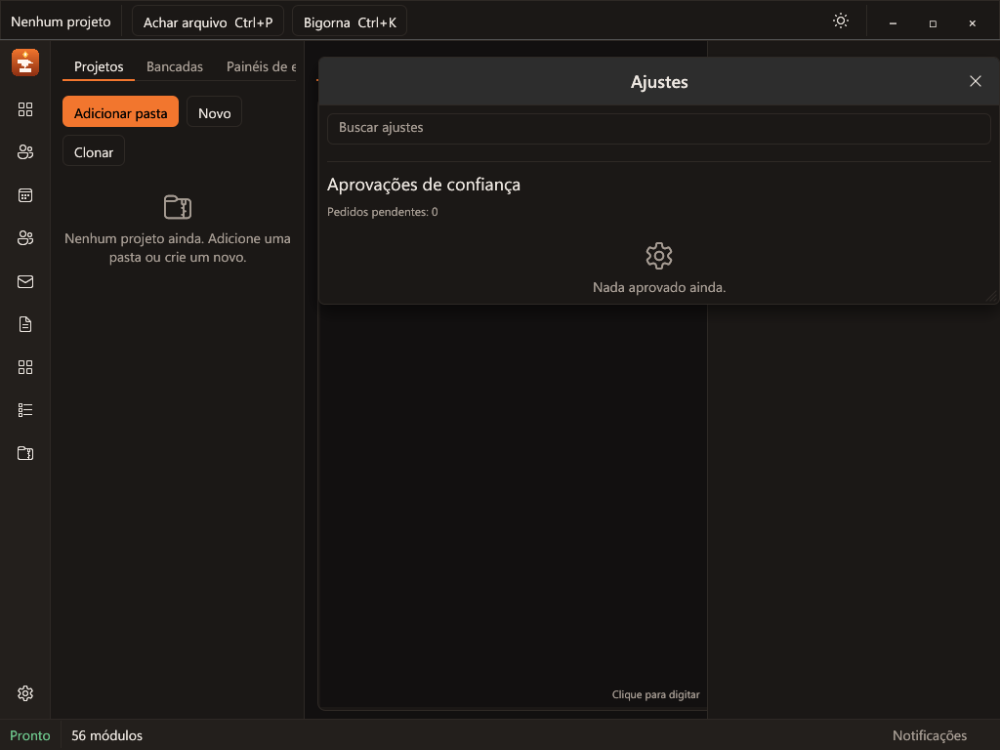

# Ajustes — Aprovações de confiança

Tela de configurações da Forja que mostra a seção "Aprovações de confiança", exibida como diálogo modal sobre a janela principal.

## Como chegar
Abra a janela de Ajustes pelo botão "Ajustes" na base do trilho de ícones à esquerda (ou pelo botão de engrenagem) e selecione a seção de confiança. Captura obtida com `forja-app --locale pt-BR --theme dark --settings trust`.

## Regiões
- **Barra de título superior** — (0,0)–(1280,42): rótulo "Nenhum projeto" à esquerda, botões "Achar arquivo  Ctrl+P" e "Bigorna  Ctrl+K", alternador de tema (ícone de sol, sem nome) e os botões de janela "–", "□" e "×".
- **Trilho à esquerda** — (0,42)–(56,768): logotipo da Forja (imagem em (12,50)–(40,78)) e uma coluna de botões-ícone: "Quadro", "Ajudantes", "Rotinas", "Mutirão", "Pedidos", "Skills", "Uso", "Extensões", "Acervo" e, na base, "Ajustes".
- **Painel esquerdo (Projetos)** — (56,42)–(304,768): abas "Projetos" (marcada), "Bancadas" e "Painéis de extensões"; botões "Adicionar pasta" (destaque laranja), "Novo" e "Clonar"; mensagem de vazio "Nenhum projeto ainda. Adicione uma pasta ou crie um novo." com ícone de pasta.
- **Área central** — (320,42)–(972,768): linha de abas "Terminal" (marcada), "Editor", "Navegador", "Diferenças", "Visualizador", "Bancada", "Revisão", "Histórico" e "Painéis de extensões"; barra de ferramentas com "+", quatro ícones sem nome, "Receitas" e "Shell"; grande área de texto com o aviso "Clique para digitar" no canto inferior. É coberta em sua parte superior pelo diálogo "Ajustes" (328,58)–(1026,312).
- **Diálogo "Ajustes"** — (328,58)–(1026,312): janela modal com título "Ajustes", botão "Close window" no canto, campo de busca sem nome acessível (texto de apoio "Buscar ajustes"), título "Aprovações de confiança", contador "Pedidos pendentes: 0", ícone de engrenagem e texto "Nada aprovado ainda.".
- **Painel direito** — (988,42)–(1280,768): abas "Arquivos" (marcada), "Mudanças", "Ajudante (chat)", "Busca", "Portas" e "Painéis de extensões"; ícone de grade e mensagem "Nenhuma bancada ativa. Abra uma bancada para ver os arquivos.".
- **Barra de status** — (0,768)–(1280,800): "Pronto" e "56 módulos" à esquerda, "Notificações" à direita.

## Elementos
| Elemento | Tipo | Posição (px) | Estado | O que faz |
|---|---|---|---|---|
| "Achar arquivo  Ctrl+P" | Button | (135,5)–(291,37) | — | Abre a busca rápida de arquivos (atalho Ctrl+P). |
| "Bigorna  Ctrl+K" | Button | (299,5)–(417,37) | — | Abre a paleta de comandos (atalho Ctrl+K). |
| (sem nome acessível) | Unknown | (1101,5)–(1133,37) | — | Ícone de sol: alternador de tema claro/escuro. |
| "–" | Button | (1155,5)–(1187,37) | — | Minimiza a janela. |
| "□" | Button | (1195,5)–(1227,37) | — | Maximiza/restaura a janela. |
| "×" | Button | (1235,5)–(1269,37) | — | Fecha a janela do app. |
| "Nenhum projeto" | Label | (11,12)–(113,31) | — | Indica que não há projeto aberto. |
| (sem nome acessível) | Unknown | (304,42)–(320,768) | — | Divisor vertical entre o painel esquerdo e a área central. |
| (sem nome acessível) | Unknown | (972,42)–(988,768) | — | Divisor vertical entre a área central e o painel direito. |
| (sem nome acessível) | Unknown | (319,49)–(339,69) | — | Canto superior esquerdo do diálogo "Ajustes". |
| (sem nome acessível) | Unknown | (1016,49)–(1036,69) | — | Canto superior direito do diálogo "Ajustes". |
| (sem nome acessível) | Image | (12,50)–(40,78) | — | Logotipo da Forja (bigorna laranja). |
| "Projetos" | Button | (64,50)–(138,82) | marcado=True | Aba ativa do painel esquerdo; mostra o painel de projetos. |
| (sem nome acessível) | Unknown | (64,50)–(300,82) | — | Faixa de fundo/sublinhado da aba "Projetos". |
| "Bancadas" | Button | (138,50)–(220,82) | marcado=False | Aba para o painel de bancadas. |
| "Painéis de extensões" | Button | (220,50)–(371,82) | marcado=False | Aba do grupo de painéis de extensões; parcialmente encoberta pelo diálogo. |
| "Terminal" | Button | (324,50)–(401,82) | marcado=True | Aba ativa da área central; mostra o terminal. |
| "Editor" | Button | (401,50)–(461,82) | marcado=False | Aba do editor de texto. |
| "Navegador" | Button | (461,50)–(553,82) | marcado=False | Aba do painel de navegador. |
| "Diferenças" | Button | (553,50)–(641,82) | marcado=False | Aba de visualização de diferenças. |
| "Visualizador" | Button | (641,50)–(739,82) | marcado=False | Aba do visualizador de arquivos. |
| "Bancada" | Button | (739,50)–(815,82) | marcado=False | Aba da visão de bancada. |
| "Revisão" | Button | (815,50)–(885,82) | marcado=False | Aba de revisão. |
| "Histórico" | Button | (885,50)–(965,82) | marcado=False | Aba de histórico. |
| "Painéis de extensões" | Button | (965,50)–(1115,82) | marcado=False | Segunda ocorrência do grupo de painéis de extensões na área central. |
| (sem nome acessível) | Unknown | (992,50)–(1268,82) | — | Faixa de fundo da aba "Arquivos" no painel direito. |
| "Arquivos" | Button | (992,50)–(1070,82) | marcado=True | Aba ativa do painel direito; lista de arquivos. |
| "Mudanças" | Button | (1070,50)–(1157,82) | marcado=False | Aba de mudanças pendentes. |
| "Ajudante (chat)" | Button | (1115,50)–(1234,82) | marcado=False | Aba do chat com o ajudante. |
| "Busca" | Button | (1157,50)–(1216,82) | marcado=False | Aba de busca. |
| "Portas" | Button | (1216,50)–(1278,82) | marcado=False | Aba de portas. |
| "Painéis de extensões" | Button | (1278,50)–(1429,82) | marcado=False | Terceiro grupo de painéis de extensões; retângulo além da largura da janela. |
| (sem nome acessível) | Unknown | (339,51)–(1016,67) | — | Barra de título interna do diálogo "Ajustes". |
| "Ajustes" | Window | (328,58)–(1026,312) | foco | Diálogo modal de configurações exibindo a seção de confiança. |
| (sem nome acessível) | Unknown | (361,59)–(993,107) | — | Cabeçalho do diálogo, atrás do título e do botão de fechar. |
| (sem nome acessível) | Unknown | (321,69)–(337,302) | — | Borda/pegador esquerdo do diálogo. |
| (sem nome acessível) | Unknown | (1018,69)–(1034,302) | — | Borda/pegador direito do diálogo. |
| "Close window" | Button | (994,76)–(1008,90) | — | Ícone "×" que fecha o diálogo de Ajustes. |
| (sem nome acessível) | Unknown | (64,80)–(300,82) | — | Sublinhado da aba ativa "Projetos". |
| (sem nome acessível) | Unknown | (992,80)–(1268,82) | — | Sublinhado da aba ativa "Arquivos". |
| "Quadro" | Button | (8,94)–(44,130) | marcado=False | Ícone do quadro (visão geral) no trilho esquerdo. |
| "Adicionar pasta" | Button | (64,98)–(183,130) | — | Botão destacado em laranja para adicionar uma pasta de projeto. |
| "Novo" | Button | (191,98)–(248,130) | — | Cria um projeto novo. |
| "+" | Button | (407,102)–(441,134) | — | Abre nova aba/ação na área central. |
| (sem nome acessível) | Unknown | (444,102)–(476,134) | — | Ícone de ferramenta da barra central, sem nome. |
| (sem nome acessível) | Unknown | (479,102)–(511,134) | — | Ícone de ferramenta da barra central, sem nome. |
| (sem nome acessível) | Unknown | (514,102)–(546,134) | — | Ícone de ferramenta da barra central, sem nome. |
| (sem nome acessível) | Unknown | (549,102)–(581,134) | — | Ícone de ferramenta da barra central, sem nome. |
| "Receitas" | Button | (584,102)–(658,134) | — | Abre a lista de receitas. |
| "Shell" | Button | (661,102)–(714,134) | — | Abre o terminal shell. |
| (sem nome acessível) | Unknown | (328,107)–(404,129) | — | Rótulo interno do campo de busca de ajustes. |
| (sem nome acessível) | Unknown | (385,110)–(401,126) | — | Ícone de lupa do campo de busca. |
| (ícone) | Label | (1116,114)–(1144,142) | — | Ícone de grade do painel direito (vazio de bancada). |
| (sem nome acessível) | TextInput | (337,116)–(1017,148) | — | Campo "Buscar ajustes": filtra as seções de configuração. |
| "Ajudantes" | Button | (8,138)–(44,174) | marcado=False | Ícone do painel de ajudantes no trilho esquerdo. |
| "Clonar" | Button | (64,138)–(128,170) | — | Clona um projeto existente. |
| (sem nome acessível) | Unknown | (328,139)–(980,756) | — | Área central de texto (editor/entrada), com o aviso "Clique para digitar" na base. |
| "Nenhuma bancada ativa. Abra uma bancada para ver os arquivos." | Label | (994,150)–(1266,188) | — | Mensagem de vazio do painel de arquivos. |
| "Aprovações de confiança" | Label | (337,176)–(535,200) | — | Título da seção de configuração em exibição. |
| "Rotinas" | Button | (8,182)–(44,218) | marcado=False | Ícone do painel de rotinas no trilho esquerdo. |
| "Pedidos pendentes: 0" | Label | (337,208)–(450,224) | — | Contador de pedidos de aprovação pendentes. |
| (ícone) | Label | (168,198)–(196,226) | — | Ícone de pasta do painel de projetos vazio. |
| "Mutirão" | Button | (8,226)–(44,262) | marcado=False | Ícone do painel de mutirão no trilho esquerdo. |
| "Nenhum projeto ainda. Adicione uma pasta ou crie um novo." | Label | (66,234)–(298,272) | — | Mensagem de vazio do painel de projetos. |
| (ícone) | Label | (663,248)–(691,276) | — | Ícone de engrenagem central do diálogo. |
| "Pedidos" | Button | (8,270)–(44,306) | marcado=False | Ícone do painel de pedidos no trilho esquerdo. |
| "Nada aprovado ainda." | Label | (609,284)–(745,303) | — | Mensagem de vazio da lista de aprovações. |
| (sem nome acessível) | Unknown | (319,302)–(339,322) | — | Canto inferior esquerdo do diálogo. |
| (sem nome acessível) | Unknown | (1016,302)–(1036,322) | — | Canto inferior direito do diálogo. |
| (sem nome acessível) | Unknown | (339,304)–(1016,320) | — | Borda inferior do diálogo. |
| "Skills" | Button | (8,314)–(44,350) | marcado=False | Ícone do painel de skills no trilho esquerdo. |
| "Uso" | Button | (8,358)–(44,394) | marcado=False | Ícone do painel de uso no trilho esquerdo. |
| "Extensões" | Button | (8,402)–(44,438) | marcado=False | Ícone do painel de extensões no trilho esquerdo. |
| "Acervo" | Button | (8,446)–(44,482) | marcado=False | Ícone do painel de acervo no trilho esquerdo. |
| "Ajustes" | Button | (8,724)–(44,760) | marcado=False | Ícone que abre esta tela de Ajustes. |
| "Pronto" | Label | (10,775)–(51,794) | — | Status geral do app na barra de status. |
| "56 módulos" | Label | (73,775)–(146,794) | — | Quantidade de módulos carregados. |
| "Notificações" | Label | (1170,775)–(1246,794) | — | Atalho para a área de notificações. |

## Aparência
Tema escuro: fundo geral quase preto (tons de cinza muito escuro na área central e no painel de projetos), com o diálogo "Ajustes" em cinza levemente mais claro e a barra de título no topo ainda mais escura. A cor de destaque é o laranja, visível no logotipo, no sublinhado das abas ativas ("Projetos", "Terminal", "Arquivos") e no botão "Adicionar pasta", que usa laranja cheio com texto escuro. A tipografia é uma sans-serif pequena; títulos ("Ajustes", "Aprovações de confiança") em tamanho maior e pesos maiores que rótulos e mensagens de vazio. Os textos secundários ("Pedidos pendentes: 0", "Nada aprovado ainda.", avisos de vazio, "Clique para digitar") aparecem em cinza médio com contraste reduzido. O diálogo tem cantos arredondados e é centralizado na área central; as abas são alinhadas à esquerda em linhas únicas, e o trilho de ícones mantém espaçamento uniforme de 44 px de largura.

## Problemas encontrados
- O botão "Painéis de extensões" do painel direito, em (1278,50)–(1429,82), tem retângulo além da largura da imagem (1280 px): fica cortado fora da janela.
- O diálogo "Ajustes" se sobrepõe às abas das áreas central e direita: os textos "Painéis de e…" e "Arquivos" aparecem parcialmente encobertos na captura.
- O TextInput do campo de busca de ajustes (337,116)–(1017,148) não tem nome acessível, embora exiba o texto de apoio "Buscar ajustes".
- O botão de fechar do diálogo usa o nome "Close window" em inglês, sem tradução para pt-BR.
- Quatro ícones da barra de ferramentas central (444–581, y 102–134) e o alternador de tema do topo não têm nome acessível.
- O nome "Painéis de extensões" se repete em três botões distintos, o que dificulta a identificação por leitores de tela.
- Textos secundários em cinza médio sobre fundo escuro ("Nada aprovado ainda.", "Pedidos pendentes: 0", avisos de vazio e "Clique para digitar") têm baixo contraste.
