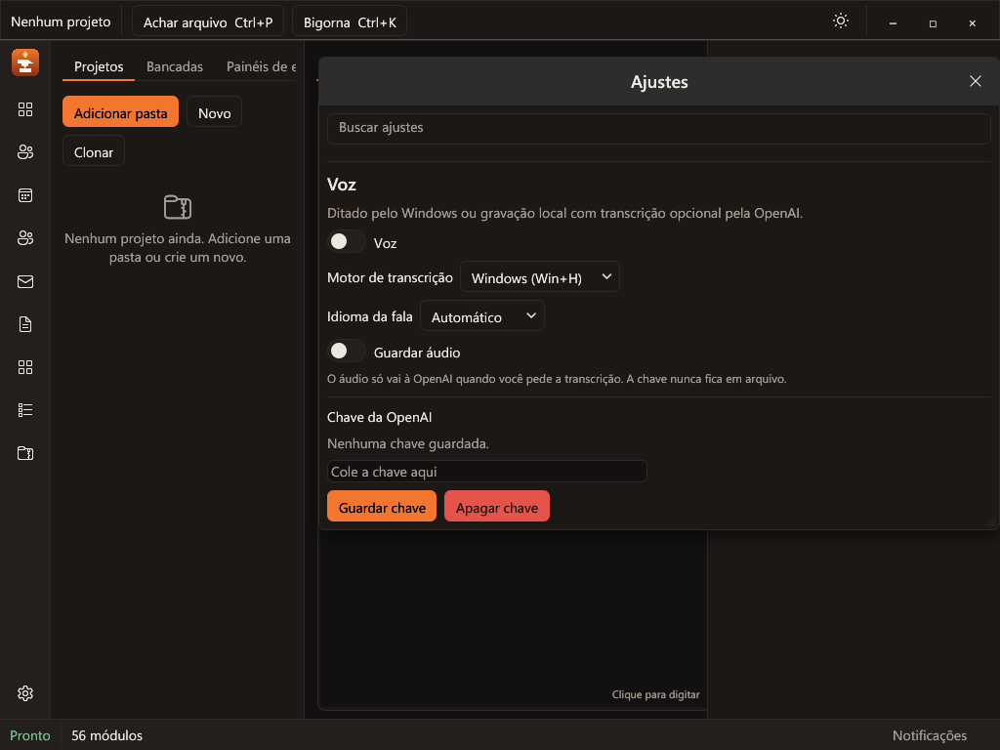

# Ajustes — Voz

Tela de configurações do app, exibida como janela modal "Ajustes" sobre a área de trabalho, com a seção **Voz** (ditado e transcrição) aberta.

## Como chegar
No app, clique no botão "Ajustes" na base do trilho de ícones à esquerda (ou use o atalho associado); dentro da janela, a seção "Voz" aparece na lista de seções. Captura: `forja-app --locale pt-BR --theme dark --settings voice`.

## Regiões
- **Barra superior** (0,0)–(1280,42): rótulo "Nenhum projeto", botões "Achar arquivo  Ctrl+P" e "Bigorna  Ctrl+K" à esquerda; botão de tema (sem nome, ~1118,21) e botões de janela "–", "□", "×" à direita.
- **Trilho à esquerda** (0,42)–(48,768): coluna de ícones — logo da Forja no topo (12,50)–(40,78), depois "Quadro", "Ajudantes", "Rotinas", "Mutirão", "Pedidos", "Skills", "Uso", "Extensões", "Acervo" e, na base, "Ajustes".
- **Painel lateral esquerdo** (48,42)–(300,768): abas "Projetos" (marcada), "Bancadas", "Painéis de extensões"; botões "Adicionar pasta" (destaque laranja), "Novo" e "Clonar"; estado vazio "Nenhum projeto ainda. Adicione uma pasta ou crie um novo." com ícone de pasta (168,198)–(196,226).
- **Faixa de abas central** (300,42)–(980,82): abas "Terminal" (marcada), "Editor", "Navegador", "Diferenças", "Visualizador", "Bancada", "Revisão", "Histórico", mais "Painéis de extensões" à direita.
- **Painel direito** (988,42)–(1280,768): abas "Arquivos" (marcada), "Mudanças", "Ajudante (chat)", "Busca", "Portas"; estado vazio "Nenhuma bancada ativa. Abra uma bancada para ver os arquivos." com ícone (1016,49)–(1036,69).
- **Janela modal "Ajustes"** (328,58)–(1026,543): título "Ajustes" centrado, botão "Close window" (994,76)–(1008,90), campo de busca "Buscar ajustes" (337,116)–(1017,148) e a seção "Voz" com interruptores, seletores e campo de chave.
- **Barra de status** (0,768)–(1280,800): "Pronto", "56 módulos" à esquerda; "Notificações" à direita.

## Elementos
| Elemento | Tipo | Posição (px) | Estado | O que faz |
|---|---|---|---|---|
| "Achar arquivo  Ctrl+P" | Button | (135,5)–(291,37) | — | Abre a busca rápida de arquivos (Ctrl+P). |
| "Bigorna  Ctrl+K" | Button | (299,5)–(417,37) | — | Abre a paleta de comandos (Ctrl+K). |
| (sem nome acessível) | Unknown | (1101,5)–(1133,37) | — | Ícone de alternância de tema (sol) na barra superior. |
| "–" | Button | (1155,5)–(1187,37) | — | Minimiza a janela. |
| "□" | Button | (1195,5)–(1227,37) | — | Maximiza/restaura a janela. |
| "×" | Button | (1235,5)–(1269,37) | — | Fecha a janela do app. |
| "Nenhum projeto" | Label | (11,12)–(113,31) | — | Indica que nenhum projeto está aberto. |
| (sem nome acessível) | Unknown | (304,42)–(320,768) | — | Divisor vertical entre o painel esquerdo e a área central. |
| (sem nome acessível) | Unknown | (972,42)–(988,768) | — | Divisor vertical entre a área central e o painel direito. |
| (sem nome acessível) | Unknown | (319,49)–(339,69) | — | Canto/ornamento da faixa de abas central. |
| (sem nome acessível) | Unknown | (1016,49)–(1036,69) | — | Canto/ornamento da faixa de abas do painel direito. |
| (sem nome acessível) | Image | (12,50)–(40,78) | — | Logo da Forja no topo do trilho. |
| "Projetos" | Button | (64,50)–(138,82) | marcado=True | Aba ativa do painel esquerdo; mostra a lista de projetos. |
| (sem nome acessível) | Unknown | (64,50)–(300,82) | — | Fundo/sublinha da aba "Projetos". |
| "Bancadas" | Button | (138,50)–(220,82) | marcado=False | Aba de bancadas (branches de trabalho). |
| "Painéis de extensões" | Button | (220,50)–(371,82) | marcado=False | Aba de painéis de extensões; texto cortado na borda do painel. |
| "Terminal" | Button | (324,50)–(401,82) | marcado=True | Aba ativa da área central; mostra o terminal. |
| "Editor" | Button | (401,50)–(461,82) | marcado=False | Aba do editor de arquivos. |
| "Navegador" | Button | (461,50)–(553,82) | marcado=False | Aba do navegador de arquivos. |
| "Diferenças" | Button | (553,50)–(641,82) | marcado=False | Aba de diffs. |
| "Visualizador" | Button | (641,50)–(739,82) | marcado=False | Aba do visualizador. |
| "Bancada" | Button | (739,50)–(815,82) | marcado=False | Aba da bancada. |
| "Revisão" | Button | (815,50)–(885,82) | marcado=False | Aba de revisão. |
| "Histórico" | Button | (885,50)–(965,82) | marcado=False | Aba de histórico. |
| "Painéis de extensões" | Button | (965,50)–(1115,82) | marcado=False | Segunda aba de painéis de extensões, à direita; fica encoberta pelas abas seguintes. |
| (sem nome acessível) | Unknown | (992,50)–(1268,82) | — | Fundo/sublinha do grupo de abas do painel direito. |
| "Arquivos" | Button | (992,50)–(1070,82) | marcado=True | Aba ativa do painel direito; lista de arquivos. |
| "Mudanças" | Button | (1070,50)–(1157,82) | marcado=False | Aba de mudanças (git). |
| "Ajudante (chat)" | Button | (1115,50)–(1234,82) | marcado=False | Aba do chat com o ajudante de IA. |
| "Busca" | Button | (1157,50)–(1216,82) | marcado=False | Aba de busca. |
| "Portas" | Button | (1216,50)–(1278,82) | marcado=False | Aba de portas encaminhadas/serviços. |
| "Painéis de extensões" | Button | (1278,50)–(1429,82) | marcado=False | Terceira aba de painéis de extensões; retângulo vai além da largura da imagem (1280 px). |
| (sem nome acessível) | Unknown | (339,51)–(1016,67) | — | Linha da faixa de abas central. |
| "Ajustes" | Window | (328,58)–(1026,543) | focus | Janela modal de configurações em foco. |
| (sem nome acessível) | Unknown | (361,59)–(993,107) | — | Barra de título da modal, com o texto "Ajustes" centrado. |
| (sem nome acessível) | Unknown | (321,69)–(337,533) | — | Borda/sombra esquerda da modal. |
| (sem nome acessível) | Unknown | (1018,69)–(1034,533) | — | Borda/sombra direita da modal. |
| "Close window" | Button | (994,76)–(1008,90) | — | Ícone × que fecha a janela "Ajustes". |
| (sem nome acessível) | Unknown | (64,80)–(300,82) | — | Sublinha da aba "Projetos". |
| (sem nome acessível) | Unknown | (992,80)–(1268,82) | — | Sublinha da aba "Arquivos". |
| "Quadro" | Button | (8,94)–(44,130) | marcado=False | Ícone do quadro (board) no trilho. |
| "Adicionar pasta" | Button | (64,98)–(183,130) | — | Adiciona uma pasta de projeto (botão de destaque laranja). |
| "Novo" | Button | (191,98)–(248,130) | — | Cria um novo projeto. |
| "+" | Button | (407,102)–(441,134) | — | Abre nova aba/ação na área central. |
| (sem nome acessível) | Unknown | (444,102)–(476,134) | — | Botão-ícone ao lado de "+" (setas de navegação). |
| (sem nome acessível) | Unknown | (479,102)–(511,134) | — | Botão-ícone da barra de ferramentas central. |
| (sem nome acessível) | Unknown | (514,102)–(546,134) | — | Botão-ícone da barra de ferramentas central. |
| (sem nome acessível) | Unknown | (549,102)–(581,134) | — | Botão-ícone da barra de ferramentas central. |
| "Receitas" | Button | (584,102)–(658,134) | — | Acesso a receitas (fluxos prontos). |
| "Shell" | Button | (661,102)–(714,134) | — | Controle de shell do terminal. |
| (sem nome acessível) | Unknown | (328,107)–(404,129) | — | Ícone de aba do terminal (canto superior da área central). |
| (sem nome acessível) | Unknown | (385,110)–(401,126) | — | × de fechar da aba do terminal. |
| (ícone) | Label | (1116,114)–(1144,142) | — | Ícone de grade (sem bancada) do painel direito. |
| (sem nome acessível) | TextInput | (337,116)–(1017,148) | — | Campo "Buscar ajustes" para filtrar seções da modal. |
| "Ajudantes" | Button | (8,138)–(44,174) | marcado=False | Ícone de ajudantes no trilho. |
| "Clonar" | Button | (64,138)–(128,170) | — | Clona um projeto existente. |
| (sem nome acessível) | Unknown | (328,139)–(980,756) | — | Área central atrás da modal (conteúdo do terminal). |
| "Nenhuma bancada ativa. Abra uma bancada para ver os arquivos." | Label | (994,150)–(1266,188) | — | Estado vazio do painel de arquivos. |
| "Voz" | Label | (337,176)–(366,200) | — | Título da seção de configurações de voz. |
| "Rotinas" | Button | (8,182)–(44,218) | marcado=False | Ícone de rotinas no trilho. |
| (ícone) | Label | (168,198)–(196,226) | — | Ícone de pasta do estado vazio de projetos. |
| "Ditado pelo Windows ou gravação local com transcrição opcional pela OpenAI." | Label | (337,208)–(824,227) | — | Descrição da seção Voz. |
| "Mutirão" | Button | (8,226)–(44,262) | marcado=False | Ícone de mutirão no trilho. |
| "Nenhum projeto ainda. Adicione uma pasta ou crie um novo." | Label | (66,234)–(298,272) | — | Estado vazio do painel de projetos. |
| "Voz" | CheckBox | (337,235)–(408,259) | marcado=False | Interruptor que liga/desliga a voz (aparece como toggle). |
| "Motor de transcrição" | Label | (337,267)–(465,299) | — | Rótulo do seletor de motor de transcrição. |
| (sem nome acessível) | Unknown | (473,267)–(637,299) | — | Seletor suspenso com o valor "Windows (Win+H)". |
| "Pedidos" | Button | (8,270)–(44,306) | marcado=False | Ícone de pedidos no trilho. |
| "Idioma da fala" | Label | (337,307)–(424,339) | — | Rótulo do seletor de idioma. |
| (sem nome acessível) | Unknown | (432,307)–(560,339) | — | Seletor suspenso com o valor "Automático". |
| "Skills" | Button | (8,314)–(44,350) | marcado=False | Ícone de skills no trilho. |
| "Guardar áudio" | CheckBox | (337,347)–(473,371) | marcado=False | Interruptor para guardar o áudio das gravações. |
| "Uso" | Button | (8,358)–(44,394) | marcado=False | Ícone de uso no trilho. |
| "O áudio só vai à OpenAI quando você pede a transcrição. A chave nunca fica em arquivo." | Label | (337,379)–(808,395) | — | Nota de privacidade da transcrição. |
| "Extensões" | Button | (8,402)–(44,438) | marcado=False | Ícone de extensões no trilho. |
| "Chave da OpenAI" | Label | (337,417)–(444,436) | — | Título do bloco de chave de API. |
| "Nenhuma chave guardada." | Label | (337,444)–(502,463) | — | Estado atual da chave (nenhuma salva). |
| "Acervo" | Button | (8,446)–(44,482) | marcado=False | Ícone de acervo no trilho. |
| (sem nome acessível) | PasswordInput | (337,471)–(665,494) | — | Campo para colar a chave (texto "Cole a chave aqui"). |
| "Guardar chave" | Button | (337,502)–(449,534) | — | Salva a chave informada (destaque laranja). |
| "Apagar chave" | Button | (457,502)–(565,534) | — | Remove a chave guardada (botão rosado/destrutivo). |
| (sem nome acessível) | Unknown | (319,533)–(339,553) | — | Canto inferior esquerdo da modal. |
| (sem nome acessível) | Unknown | (1016,533)–(1036,553) | — | Canto inferior direito da modal. |
| (sem nome acessível) | Unknown | (339,535)–(1016,551) | — | Borda inferior da modal. |
| "Ajustes" | Button | (8,724)–(44,760) | marcado=False | Ícone que abre esta janela de ajustes (o estado "marcado" continua falso mesmo com a modal aberta). |
| "Pronto" | Label | (10,775)–(51,794) | — | Status atual na barra inferior ("Pronto"). |
| "56 módulos" | Label | (73,775)–(146,794) | — | Contagem de módulos carregados. |
| "Notificações" | Label | (1170,775)–(1246,794) | — | Área/atalho de notificações na barra inferior. |

## Aparência
Tema escuro em tons de marrom-quase-preto: fundo geral escuro (marrom escuro na barra superior e painéis), modal um pouco mais escura e opaca com sombra suave nas bordas. Acento laranja ("Brasa") em "Adicionar pasta", "Guardar chave", na sublinha das abas ativas ("Projetos", "Terminal", "Arquivos") e no toggle desligado; botão destrutivo "Apagar chave" em rosa avermelhado. Texto em cinza claro com títulos em branco; rótulos secundários em cinza médio. Tipografia sem serifa, corpos entre ~12 e 16 px; título "Ajustes" centrado e em peso maior. Botões com cantos levemente arredondados, campo de busca ocupando toda a largura da modal (337–1017) e espaçamento vertical consistente (~30 px) entre linhas da seção "Voz". Os seletores suspensos ("Windows (Win+H)", "Automático") ficam alinhados à direita de seus rótulos.

## Problemas encontrados
- Aba "Painéis de extensões" (220,50)–(371,82) do painel esquerdo é cortada na borda do painel (visível só "Painéis de e") e se sobrepõe à aba "Terminal" (324,50)–(401,82).
- A segunda aba "Painéis de extensões" (965,50)–(1115,82) fica encoberta por "Arquivos" (992,50)–(1070,82) e "Ajudante (chat)" (1115,50)–(1234,82); não aparece na captura.
- "Ajudante (chat)" (1115,50)–(1234,82) se sobrepõe a "Busca" (1157,50)–(1216,82) e "Portas" (1216,50)–(1278,82) na mesma faixa de abas.
- A terceira aba "Painéis de extensões" (1278,50)–(1429,82) tem retângulo além da largura da imagem (1280 px), indicando elemento fora da janela visível.
- Botão "Close window" com nome acessível em inglês em uma interface em pt-BR.
- TextInput de busca de ajustes (337,116)–(1017,148) e PasswordInput da chave (337,471)–(665,494) não têm nome acessível; dependem apenas do texto de exemplos/placeholder.
- O botão "Ajustes" do trilho permanece marcado=False enquanto a janela "Ajustes" está aberta em foco, inconsistência de estado de seleção.
- Vários botões-ícone sem nome acessível na barra de ferramentas central (444–581, 102–134), o que impede identificação por leitor de tela.
