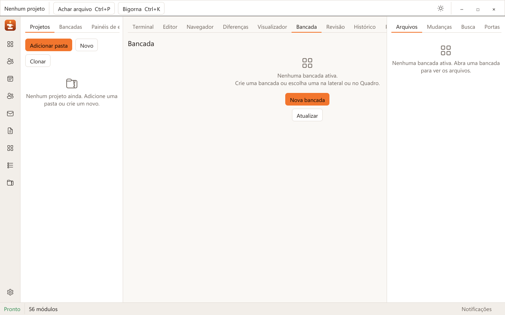

# Bancada — detalhe (sem bancada ativa)

Tela inicial da área de bancada, mostrada sem projeto e sem bancada ativa: à esquerda o painel de projetos vazio, no centro o aviso de bancada inativa e à direita o painel "Arquivos" com estado vazio. Variante em tema claro da página de referência (pt-BR.dark.bench-tab.bench.detail): a estrutura é a mesma; mudam o tema, o tamanho da janela (1920×1080 px) e a disposição das abas, agora em fileiras visíveis com botões "Mais abas" em vez de empilhadas.

## Como chegar
Abrir o aplicativo Forja (`forja-app --locale pt-BR --theme light --bench-tab bench.detail`); por padrão a tela inicial já cai nesta visão. Também se chega por `Ctrl+K` (Bigorna) ou clicando em "Projetos" no trilho esquerdo e depois na aba "Bancada" da área central. Comando de captura: `forja atlas capture --bench-tab bench.detail --locale pt-BR --theme light`.

## Regiões
- **Barra superior** (0,0)–(1920,40): rótulo "Nenhum projeto", botões "Achar arquivo Ctrl+P" e "Bigorna Ctrl+K", botão de alternância de tema (ícone de sol, sem nome acessível) e botões de janela ("–", "□", "×").
- **Trilho esquerdo de ícones** (0,40)–(50,1048): logo no topo e coluna de botões-ícone ("Quadro", "Ajudantes", "Rotinas", "Mutirão", "Pedidos", "Skills", "Uso", "Extensões", "Acervo"); no rodapé, "Ajustes".
- **Painel de projetos** (50,40)–(304,1048): botão "Mais abas" e aba "Projetos" (marcada); ações "Adicionar pasta", "Novo projeto" e "Clonar"; estado vazio com ícone de pasta e o texto "Nenhum projeto ainda. Adicione uma pasta ou crie um novo.".
- **Área central** (320,40)–(1612,1048): botão "Mais abas" e fileira de abas visíveis ("Terminal", "Editor", "Navegador", "Diferenças", "Visualizador", "Bancada" marcada, "Revisão", "Histórico", "Painéis de extensões", "Ajudante (chat)"); título "Bancada"; estado vazio com ícone de grade, a mensagem "Nenhuma bancada ativa.\nCrie uma bancada ou escolha uma na lateral ou no Quadro." — completa, sem o truncamento visto na referência escura — e os botões "Nova bancada" e "Atualizar".
- **Painel direito (Arquivos)** (1628,40)–(1920,1048): botão "Mais abas", abas "Arquivos" (marcada) e "Mudanças"; ícone de grade e a mensagem "Nenhuma bancada ativa. Abra uma bancada para ver os arquivos.".
- **Barra de status** (0,1048)–(1920,1080): "Pronto" em verde, "56 módulos" e, à direita, "Notificações".

## Elementos
| Elemento | Tipo | Posição (px) | Estado | O que faz |
|---|---|---|---|---|
| "Achar arquivo  Ctrl+P" | Button | (135,5)–(291,37) | — | Abre a busca de arquivos pelo atalho Ctrl+P |
| "Bigorna  Ctrl+K" | Button | (299,5)–(417,37) | — | Abre a paleta de comandos (Bigorna) pelo atalho Ctrl+K |
| (sem nome acessível) | Unknown | (1741,5)–(1773,37) | — | Botão-ícone de sol na barra superior; alterna o tema |
| "–" | Button | (1795,5)–(1827,37) | — | Minimiza a janela |
| "□" | Button | (1835,5)–(1867,37) | — | Maximiza/restaura a janela |
| "×" | Button | (1875,5)–(1909,37) | — | Fecha a janela |
| "Nenhum projeto" | Label | (11,12)–(113,31) | — | Mostra que nenhum projeto está aberto |
| (sem nome acessível) | Unknown | (304,42)–(320,1048) | focus | Divisória vertical entre o painel de projetos e a área central |
| (sem nome acessível) | Unknown | (1612,42)–(1628,1048) | focus | Divisória vertical entre a área central e o painel direito |
| (sem nome acessível) | Image | (12,50)–(40,78) | — | Ícone/logo da Forja no topo do trilho esquerdo |
| "Mais abas" | Button | (64,50)–(149,85) | — | Abre as demais abas do painel de projetos |
| "Mais abas" | Button | (324,50)–(409,85) | — | Abre as demais abas da área central |
| "Mais abas" | Button | (1632,50)–(1717,85) | — | Abre as demais abas do painel direito |
| "Projetos" | Button | (157,52)–(231,84) | marcado=True | Aba ativa do painel esquerdo; mostra a lista de projetos |
| "Terminal" | Button | (417,52)–(494,84) | marcado=False | Aba da área central; abre um terminal |
| "Editor" | Button | (494,52)–(554,84) | marcado=False | Aba da área central; abre o editor |
| "Navegador" | Button | (554,52)–(646,84) | marcado=False | Aba da área central; abre o navegador |
| "Diferenças" | Button | (646,52)–(734,84) | marcado=False | Aba da área central; mostra diferenças |
| "Visualizador" | Button | (734,52)–(832,84) | marcado=False | Aba da área central; abre o visualizador |
| "Bancada" | Button | (832,52)–(908,84) | marcado=True | Aba ativa da área central; mostra o detalhe da bancada |
| "Revisão" | Button | (908,52)–(978,84) | marcado=False | Aba da área central; abre a revisão |
| "Histórico" | Button | (978,52)–(1057,84) | marcado=False | Aba da área central; abre o histórico |
| "Painéis de extensões" | Button | (1057,52)–(1208,84) | marcado=False | Aba da área central; abre os painéis de extensões |
| "Ajudante (chat)" | Button | (1208,52)–(1327,84) | marcado=False | Aba da área central; abre o chat do ajudante; texto em cinza mais claro |
| "Arquivos" | Button | (1725,52)–(1803,84) | marcado=True | Aba ativa do painel direito; exibe o explorador de arquivos |
| "Mudanças" | Button | (1803,52)–(1890,84) | marcado=False | Aba do painel direito; mostraria as mudanças da bancada |
| "Quadro" | Button | (8,94)–(44,130) | marcado=False | Botão-ícone do trilho; abre o quadro de bancadas |
| "Adicionar pasta" | Button | (64,101)–(183,133) | — | Destaque laranja; adiciona uma pasta de projeto |
| "Novo projeto" | Button | (191,101)–(297,133) | — | Cria um novo projeto |
| "Bancada" | Label | (324,109)–(390,133) | — | Título da área central |
| (ícone) | Label | (1756,117)–(1784,145) | — | Ícone de grade do estado vazio do painel Arquivos |
| "Ajudantes" | Button | (8,138)–(44,174) | marcado=False | Botão-ícone do trilho; abre a lista de ajudantes |
| "Clonar" | Button | (64,141)–(128,173) | — | Clona um projeto |
| "Nenhuma bancada ativa. Abra uma bancada para ver os arquivos." | Label | (1634,153)–(1906,191) | — | Estado vazio do painel Arquivos |
| (ícone) | Label | (952,157)–(980,185) | — | Ícone de grade do estado vazio da área central |
| "Rotinas" | Button | (8,182)–(44,218) | marcado=False | Botão-ícone do trilho; abre rotinas |
| "Nenhuma bancada ativa.\nCrie uma bancada ou escolha uma na lateral ou no Quadro." | Label | (783,193)–(1149,231) | — | Mensagem central de bancada inativa; aparece completa, centralizada |
| (ícone) | Label | (168,201)–(196,229) | — | Ícone de pasta do estado vazio do painel de projetos |
| "Mutirão" | Button | (8,226)–(44,262) | marcado=False | Botão-ícone do trilho; abre o mutirão |
| "Nenhum projeto ainda. Adicione uma pasta ou crie um novo." | Label | (66,237)–(298,275) | — | Estado vazio do painel de projetos |
| "Nova bancada" | Button | (910,247)–(1022,279) | — | Cria uma bancada; botão preenchido em laranja |
| "Pedidos" | Button | (8,270)–(44,306) | marcado=False | Botão-ícone do trilho; abre pedidos |
| "Atualizar" | Button | (927,287)–(1005,319) | — | Recarrega o conteúdo da área central |
| "Skills" | Button | (8,314)–(44,350) | marcado=False | Botão-ícone do trilho; abre skills |
| "Uso" | Button | (8,358)–(44,394) | marcado=False | Botão-ícone do trilho; abre uso |
| "Extensões" | Button | (8,402)–(44,438) | marcado=False | Botão-ícone do trilho; abre extensões |
| "Acervo" | Button | (8,446)–(44,482) | marcado=False | Botão-ícone do trilho; abre o acervo |
| "Ajustes" | Button | (8,1004)–(44,1040) | marcado=False | Botão-ícone do rodapé do trilho; abre os ajustes |
| "Pronto" | Label | (10,1055)–(51,1074) | — | Status geral, exibido em verde |
| "56 módulos" | Label | (73,1055)–(146,1074) | — | Contagem de módulos carregados |
| "Notificações" | Label | (1810,1055)–(1886,1074) | — | Abre as notificações |

## Aparência
Tema claro: fundo branco-osso com variações muito sutis de tom entre painéis; divisórias verticais e bordas em cinza-claro. A cor de destaque continua sendo o laranja, agora nos botões preenchidos "Adicionar pasta" e "Nova bancada" (texto branco sobre laranja) e no texto e sublinhado das abas marcadas "Projetos", "Bancada" e "Arquivos"; o "Pronto" da barra de status segue em verde. Diferentemente da referência escura, o contraste do texto escuro sobre fundo claro é alto; abas inativas e mensagens de estado vazio usam cinza médio, e a aba "Ajudante (chat)" aparece em cinza ainda mais claro. Tipografia sem serifa em dois tamanhos: rótulos de aba/ação em ~13–15 px e textos de estado vazio em ~14 px. O trilho esquerdo usa botões quadrados de 36 px só com ícones, espaçados regularmente a cada 44 px. Com a janela larga (1920×1080), todas as abas cabem em uma única fileira por região, acompanhadas de botões "Mais abas" de estouro; alinhamento consistente: ações do painel de projetos em coluna, estados vazios centralizados em cada painel e botões "Nova bancada" e "Atualizar" centralizados na área vertical da região central.

## Problemas encontrados
- O botão de tema na barra superior (1741,5)–(1773,37) é um Unknown sem nome acessível; só é identificável pelo ícone de sol.
- Três botões com o mesmo nome "Mais abas" ((64,50)–(149,85), (324,50)–(409,85) e (1632,50)–(1717,85)) em regiões diferentes, sem contexto que os distinga para leitores de tela.
- Rótulos interativos expostos como Label com ação click — "Notificações" (com focus), "Pronto", "56 módulos" e as mensagens de estado vazio —, com papel incompatível com o comportamento de botão.
- A aba "Ajudante (chat)" é renderizada em cinza mais claro que as abas vizinhas, com contraste reduzido.
- Vários elementos da árvore estão sem nome acessível (as duas divisórias, a Image do logo e os ícones "(ícone)"), o que reduz a navegabilidade por leitor de tela.
