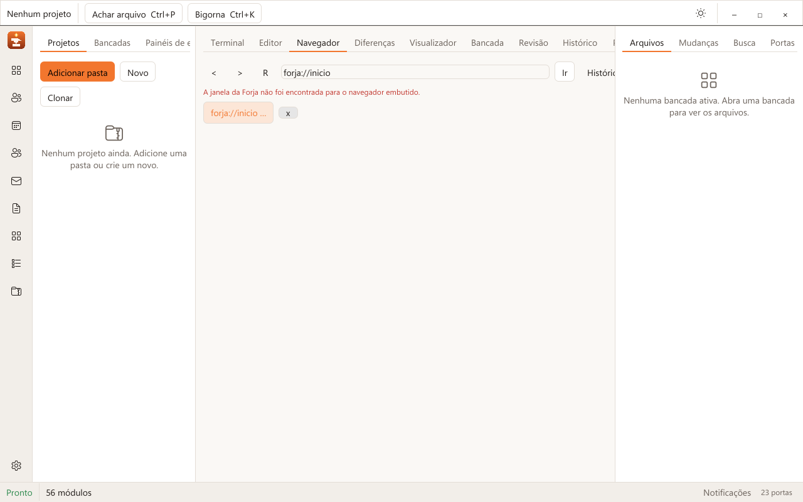

# Aba de bancada — painel Navegador (browser.tab)

Tela principal do app em uma bancada com o painel central na aba **Navegador**, que embute um navegador de URLs `forja://`; nesta captura (tema claro, janela de 1920×1080) o navegador exibe apenas a página inicial `forja://inicio` e os painéis de projetos e arquivos estão vazios. Variante clara da página de referência `pt-BR.dark.bench-tab.browser.tab`.

## Como chegar
Na janela principal, clique na aba **Navegador** da faixa de abas do painel central (554,52)–(646,84). A tela foi aberta com `forja-app --locale pt-BR --theme light --bench-tab browser.tab`; a captura do Atlas está em `captures/pt-BR.light.bench-tab.browser.tab.png`.

## Regiões
- **Barra superior** (0,0)–(1920,42): pílula "Nenhum projeto" à esquerda; botões "Achar arquivo  Ctrl+P" e "Bigorna  Ctrl+K"; ícone de alternância de tema (sol) em (1741,5)–(1773,37); botões de janela "–", "□", "×" à direita.
- **Trilho à esquerda** (0,42)–(48,1048): logotipo (12,50)–(40,78) no topo e coluna de botões-ícone: "Quadro", "Ajudantes", "Rotinas", "Mutirão", "Pedidos", "Skills", "Uso", "Extensões", "Acervo" e, no rodapé do trilho, "Ajustes".
- **Painel esquerdo (Projetos)** (48,42)–(304,1048): botão "Mais abas" e a aba "Projetos" (marcada); botões "Adicionar pasta" (destaque laranja), "Novo projeto" e "Clonar"; estado vazio com ícone de pasta (168,201)–(196,229) e o texto "Nenhum projeto ainda. Adicione uma pasta ou crie um novo.".
- **Divisor** (304,42)–(320,1048): faixa vertical sem nome entre os painéis esquerdo e central.
- **Painel central (Navegador)** (320,42)–(1612,1048): botão "Mais abas" e abas "Terminal", "Editor", "Navegador" (marcada), "Diferenças", "Visualizador", "Bancada", "Revisão", "Histórico", "Painéis de extensões" e "Ajudante (chat)"; barra de navegação com "<", ">", "R", campo de endereço "forja://inicio", "Ir", "Histórico", "Nova aba" e o indicador "100%"; chip "forja://inicio …" com botão de fechar "x"; área da página com o título "forja://inicio" (duas ocorrências centradas) e o aviso "O navegador embutido fica oculto quando a janela está sem foco ou fora da tela. Clique na janela para exibir a página.".
- **Divisor** (1612,42)–(1628,1048): faixa vertical sem nome entre os painéis central e direito.
- **Painel direito (Arquivos)** (1628,42)–(1920,1048): botão "Mais abas" e abas "Arquivos" (marcada) e "Mudanças"; estado vazio com ícone de grade (1756,117)–(1784,145) e o texto "Nenhuma bancada ativa. Abra uma bancada para ver os arquivos.".
- **Barra de status** (0,1048)–(1920,1080): "Pronto", "56 módulos" à esquerda e "Notificações" à direita.

Diferenças em relação à variante escura (janela de 1024×768): aqui a janela é 1920×1080, todas as abas do painel central cabem visíveis e nada fica cortado; os painéis esquerdo e direito mostram só a aba ativa mais o botão "Mais abas" (na variante escura as demais abas aparecem na faixa); a mensagem do navegador é o aviso neutro de janela sem foco (na variante escura era o erro "A janela da Forja não foi encontrada para o navegador embutido."); a área da página exibe o título "forja://inicio" duas vezes; a barra de status não lista o contador de portas.

## Elementos
| Elemento | Tipo | Posição (px) | Estado | O que faz |
|---|---|---|---|---|
| "Achar arquivo  Ctrl+P" | Button | (135,5)–(291,37) | click,focus | Abre a busca rápida de arquivos (atalho Ctrl+P). |
| "Bigorna  Ctrl+K" | Button | (299,5)–(417,37) | click,focus | Abre a paleta de comandos (atalho Ctrl+K). |
| (sem nome acessível) | Unknown | (1741,5)–(1773,37) | click,focus | Ícone de sol: alterna o tema da interface. |
| "–" | Button | (1795,5)–(1827,37) | click,focus | Minimiza a janela. |
| "□" | Button | (1835,5)–(1867,37) | click,focus | Restaura/maximiza a janela. |
| "×" | Button | (1875,5)–(1909,37) | click,focus | Fecha a janela. |
| "Nenhum projeto" | Label | (11,12)–(113,31) | click,focus | Indica que nenhum projeto está aberto; provavelmente abre a lista de projetos. |
| (sem nome acessível) | Unknown | (304,42)–(320,1048) | focus | Divisor vertical entre painel esquerdo e central. |
| (sem nome acessível) | Unknown | (1612,42)–(1628,1048) | focus | Divisor vertical entre painel central e direito. |
| (sem nome acessível) | Image | (12,50)–(40,78) | click,focus | Logotipo da Forja no topo do trilho. |
| "Mais abas" | Button | (64,50)–(149,85) | click,focus | Primeira ocorrência: revela as demais abas do painel esquerdo. |
| "Mais abas" | Button | (324,50)–(409,85) | click,focus | Segunda ocorrência: revela as demais abas do painel central. |
| "Mais abas" | Button | (1632,50)–(1717,85) | click,focus | Terceira ocorrência: revela as demais abas do painel direito. |
| "Projetos" | Button | (157,52)–(231,84) | click,focus | marcado=True — aba ativa do painel esquerdo, mostra a lista de projetos. |
| "Terminal" | Button | (417,52)–(494,84) | click,focus | marcado=False — aba do painel central para o terminal. |
| "Editor" | Button | (494,52)–(554,84) | click,focus | marcado=False — aba do painel central para o editor. |
| "Navegador" | Button | (554,52)–(646,84) | click,focus | marcado=True — aba atual, mostra o navegador embutido. |
| "Diferenças" | Button | (646,52)–(734,84) | click,focus | marcado=False — aba de visualização de diffs. |
| "Visualizador" | Button | (734,52)–(832,84) | click,focus | marcado=False — aba de visualizador de arquivos. |
| "Bancada" | Button | (832,52)–(908,84) | click,focus | marcado=False — aba de detalhes da bancada. |
| "Revisão" | Button | (908,52)–(978,84) | click,focus | marcado=False — aba de revisão. |
| "Histórico" | Button | (978,52)–(1057,84) | click,focus | marcado=False — aba de histórico (primeira ocorrência; a segunda é o botão da barra do navegador). |
| "Painéis de extensões" | Button | (1057,52)–(1208,84) | click,focus | marcado=False — aba de painéis de extensões. |
| "Ajudante (chat)" | Button | (1208,52)–(1327,84) | click,focus | marcado=False — aba do chat do ajudante. |
| "Arquivos" | Button | (1725,52)–(1803,84) | click,focus | marcado=True — aba ativa do painel direito, lista de arquivos da bancada. |
| "Mudanças" | Button | (1803,52)–(1890,84) | click,focus | marcado=False — aba de mudanças da bancada. |
| "Quadro" | Button | (8,94)–(44,130) | click,focus | marcado=False — botão-ícone do trilho para o quadro. |
| "Adicionar pasta" | Button | (64,101)–(183,133) | click,focus | Ação destacada (fundo laranja) para importar uma pasta como projeto. |
| "Novo projeto" | Button | (191,101)–(297,133) | click,focus | Cria um novo projeto. |
| "<" | Button | (324,109)–(358,141) | click,focus | Navega para a página anterior do navegador. |
| ">" | Button | (366,109)–(399,141) | click,focus | Navega para a página seguinte do navegador. |
| "R" | Button | (407,109)–(440,141) | click,focus | Recarrega a página atual do navegador. |
| "Ir" | Button | (884,109)–(916,141) | click,focus | Confirma/navega para a URL digitada no campo de endereço. |
| "Histórico" | Button | (924,109)–(1003,141) | click,focus | Abre o histórico do navegador embutido (segunda ocorrência do nome). |
| "Nova aba" | Button | (1011,109)–(1093,141) | click,focus | Abre uma nova aba do navegador. |
| "100%" | Label | (1100,109)–(1128,141) | click | Indicador de zoom da página. |
| "forja://inicio" | TextInput | (448,114)–(876,137) | click,focus | Campo de endereço do navegador, com a URL inicial (primeira das quatro ocorrências do texto). |
| (ícone) | Label | (1756,117)–(1784,145) | click | Ícone de grade do estado vazio do painel de arquivos. |
| "Ajudantes" | Button | (8,138)–(44,174) | click,focus | marcado=False — botão-ícone do trilho para ajudantes. |
| "Clonar" | Button | (64,141)–(128,173) | click,focus | Abre o fluxo de clonagem de repositório/projeto. |
| "forja://inicio …" | Button | (324,149)–(436,184) | click,focus | Chip da aba "forja://inicio" aberta no navegador, com borda e texto laranja. |
| "Nenhuma bancada ativa. Abra uma bancada para ver os arquivos." | Label | (1634,153)–(1906,191) | click | Estado vazio do painel de arquivos. |
| "x" | Button | (444,157)–(475,176) | click,focus | Fecha o chip/aba "forja://inicio". |
| "Rotinas" | Button | (8,182)–(44,218) | click,focus | marcado=False — botão-ícone do trilho para rotinas. |
| (ícone) | Label | (168,201)–(196,229) | click | Ícone de pasta do estado vazio do painel de projetos. |
| "Mutirão" | Button | (8,226)–(44,262) | click,focus | marcado=False — botão-ícone do trilho para o mutirão. |
| "Nenhum projeto ainda. Adicione uma pasta ou crie um novo." | Label | (66,237)–(298,275) | click | Estado vazio do painel de projetos. |
| "Pedidos" | Button | (8,270)–(44,306) | click,focus | marcado=False — botão-ícone do trilho para pedidos. |
| "Skills" | Button | (8,314)–(44,350) | click,focus | marcado=False — botão-ícone do trilho para skills. |
| "Uso" | Button | (8,358)–(44,394) | click,focus | marcado=False — botão-ícone do trilho para uso. |
| "Extensões" | Button | (8,402)–(44,438) | click,focus | marcado=False — botão-ícone do trilho para extensões. |
| "Acervo" | Button | (8,446)–(44,482) | click,focus | marcado=False — botão-ícone do trilho para o acervo. |
| "forja://inicio" | Label | (929,456)–(1003,475) | click | Título da página inicial exibido no centro do navegador. |
| "forja://inicio" | Label | (934,483)–(998,499) | click | Subtítulo da página inicial, repetido abaixo do título. |
| "O navegador embutido fica oculto quando a janela está sem foco ou fora da tela. Clique na janela para exibir a página." | Label | (653,513)–(1279,529) | click | Aviso do navegador embutido: a página é pausada quando a janela perde o foco ou sai da tela. |
| "Ajustes" | Button | (8,1004)–(44,1040) | click,focus | marcado=False — botão-ícone do trilho para os ajustes, no rodapé do trilho. |
| "Pronto" | Label | (10,1055)–(51,1074) | click | Status geral na barra inferior, em verde. |
| "56 módulos" | Label | (73,1055)–(146,1074) | click | Quantidade de módulos carregados. |
| "Notificações" | Label | (1810,1055)–(1886,1074) | click,focus | Área/atalho de notificações na barra de status. |

## Aparência
Tema claro de fundo creme/off-white (tons próximos de #f5f1ea), com painéis em branco levemente destacado e divisores claros de 16 px. A cor de destaque é o laranja ("Brasa"): fundo laranja com texto branco no botão "Adicionar pasta", texto laranja e sublinhado laranja nas abas marcadas "Projetos", "Navegador" e "Arquivos", e borda e texto laranja sobre fundo laranja-claro no chip "forja://inicio …". Os textos são em cinza-escuro sobre fundo claro, sans-serif de ~12–14 px; abas e botões de barra têm ~32 px de altura com espaçamento uniforme, alinhados à esquerda nas faixas de abas e centralizados nos botões-ícone do trilho. "Pronto" na barra de status aparece em verde; a barra de status usa texto menor (~12 px), com "Pronto" e "56 módulos" à esquerda e "Notificações" à direita. Comparada à variante escura, a hierarquia de destaque é a mesma, trocando apenas a inversão claro/escuro; o aviso do navegador aqui é neutro (cinza), não laranja-avermelhado como o erro da variante escura.

## Problemas encontrados
- Botões de janela nomeados apenas por símbolo: "–", "□" e "×", sem nomes acessíveis descritivos (Minimizar/Maximizar/Fechar).
- Botão "R" da barra de navegação tem nome não descritivo (não indica "Recarregar").
- Elementos sem nome acessível: alternador de tema (1741,5)–(1773,37), os dois divisores verticais (304,42)–(320,1048) e (1612,42)–(1628,1048), o logotipo (12,50)–(40,78) e os dois rótulos "(ícone)".
- O nome "Mais abas" aparece três vezes na árvore sem diferenciação de qual faixa de abas controla.
- O nome "Histórico" aparece duas vezes com papéis diferentes (aba do painel central e botão da barra do navegador).
- O texto "forja://inicio" aparece quatro vezes com papéis diferentes (campo de endereço, chip de aba, título e subtítulo da página), sem diferenciação na árvore.
- Baixo contraste nos textos de estado vazio ("Nenhum projeto ainda…", "Nenhuma bancada ativa…"), nas abas inativas e em "Notificações", em cinza claro sobre fundo creme.
