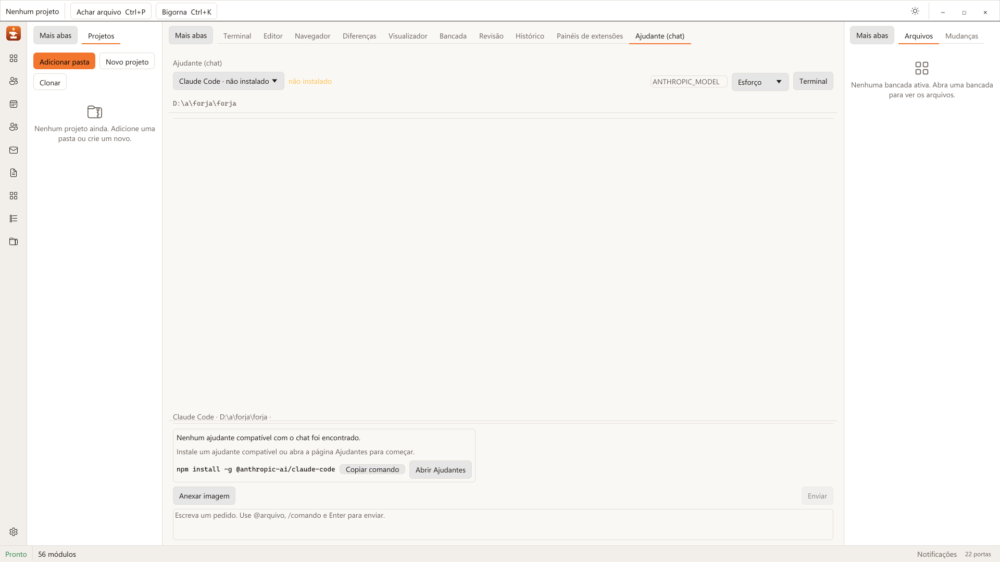

# Bancada — aba Ajudante (chat) (tema claro)

Tela da bancada com a aba "Ajudante (chat)" ativa: painel central de conversa com o agente de código, flanqueado pelo painel de projetos à esquerda e pelo painel de arquivos da bancada à direita. Variante pt-BR, tema claro, janela de 1920×1080.

## Como chegar
Na janela principal, abra uma bancada e, na faixa de abas do cabeçalho central, clique em "Ajudante (chat)". Como a tela foi capturada diretamente nessa aba, o comando é: `forja-app --locale pt-BR --theme light --bench-tab chat.tab`.

## Regiões
- **Barra de título** (0,0)–(1920,37): rótulo do projeto ("Nenhum projeto"), botões "Achar arquivo  Ctrl+P" e "Bigorna  Ctrl+K", botão-ícone de tema (sol) e os botões de janela "–", "□" e "×".
- **Trilho à esquerda** (0,37)–(52,1048): logotipo da Forja (imagem laranja, 12,50–40,78) e coluna de botões-ícone: "Quadro", "Ajudantes", "Rotinas", "Mutirão", "Pedidos", "Skills", "Uso", "Extensões", "Acervo" e, no pé, "Ajustes".
- **Painel lateral esquerdo** (52,37)–(304,1048): botão "Mais abas", aba "Projetos" (marcada), botões "Adicionar pasta" (destacado em laranja), "Novo projeto" e "Clonar"; estado vazio com ícone de pasta e o texto "Nenhum projeto ainda. Adicione uma pasta ou crie um novo.".
- **Divisor 1** (304,42)–(320,1048): separador vertical arrastável entre o painel esquerdo e a área central.
- **Área central** (320,37)–(1612,1048): faixa de abas com "Mais abas" e, na sequência, "Terminal", "Editor", "Navegador", "Diferenças", "Visualizador", "Bancada", "Revisão", "Histórico", "Painéis de extensões" e "Ajudante (chat)" (marcada, com sublinhado laranja); cabeçalho do chat com o título "Ajudante (chat)", ComboBox "Ajudante" mostrando "Claude Code · não instalado", o aviso "não instalado" em laranja e o caminho "D:\a\forja\forja" em fonte monoespaçada; área de mensagens vazia; rodapé com "Claude Code · D:\a\forja\forja ·", a mensagem "Nenhum ajudante compatível com o chat foi encontrado.", o comando "npm install -g @anthropic-ai/claude-code" com "Copiar comando" e "Abrir Ajudantes"; compositor com "Anexar imagem", "Enviar" (desativado) e campo multilinha com a sugestão "Escreva um pedido. Use @arquivo, /comando e Enter para enviar.".
- **Divisor 2** (1612,42)–(1628,1048): separador vertical arrastável entre a área central e o painel direito.
- **Painel direito** (1628,37)–(1920,1048): botão "Mais abas", abas "Arquivos" (marcada) e "Mudanças"; ícone sem nome acessível; cabeçalho com o campo de texto "ANTHROPIC_MODEL", ComboBox "Esforço" e botão "Terminal"; mensagem "Nenhuma bancada ativa. Abra uma bancada para ver os arquivos.".
- **Barra de status** (0,1048)–(1920,1080): "Pronto" (em verde) e "56 módulos" à esquerda; "Notificações" e "22 portas" à direita.

## Diferenças para a página de referência (pt-BR.dark)
A estrutura e a ordem dos elementos são as mesmas; mudam tema, largura da janela e visibilidade:
- **Tema claro**: fundos creme/off-white em vez de marrom-quase-preto, texto cinza-escuro em vez de cinza-claro; os destaques laranja (logotipo, "Adicionar pasta", sublinhado da aba ativa, "não instalado") e o "Pronto" em verde se mantêm, com bom contraste no fundo claro.
- **Janela de 1920 px**: na referência (1024 px) várias abas estouravam a borda direita; aqui a faixa central exibe as dez abas completas, incluindo "Bancada", "Revisão", "Histórico", "Painéis de extensões" e a aba selecionada "Ajudante (chat)", e o painel direito mostra apenas "Mais abas", "Arquivos" e "Mudanças" — desaparecem as sobreposições e os elementos fora da área visível da variante escura.
- **Status do ajudante**: em vez de "ocioso" (verde), o ComboBox mostra "Claude Code · não instalado" e surge o rótulo "não instalado" em laranja; aparecem também o aviso de falta de ajudante, o comando de instalação com "Copiar comando" e "Abrir Ajudantes", botões que não cabiam na referência.
- **Compositor visível por inteiro**: o botão "Enviar" aparece (desativado, em cinza) e o campo multilinha mostra a sugestão "Escreva um pedido. Use @arquivo, /comando e Enter para enviar.".
- **Barra de status**: além de "Notificações", surge "22 portas" à direita.

## Elementos
| Elemento | Tipo | Posição (px) | Estado | O que faz |
|---|---|---|---|---|
| "Achar arquivo  Ctrl+P" | Button | (135,5)–(291,37) | — | Abre a busca rápida de arquivos (atalho Ctrl+P). |
| "Bigorna  Ctrl+K" | Button | (299,5)–(417,37) | — | Abre a paleta de comandos (atalho Ctrl+K). |
| (sem nome acessível) | Unknown | (1741,5)–(1773,37) | — | Ícone de sol: alterna o tema da interface. |
| "–" | Button | (1795,5)–(1827,37) | — | Minimiza a janela. |
| "□" | Button | (1835,5)–(1867,37) | — | Maximiza/restaura a janela. |
| "×" | Button | (1875,5)–(1909,37) | — | Fecha a janela. |
| "Nenhum projeto" | Label | (11,12)–(113,31) | — | Mostra o projeto corrente; vazio porque nenhum projeto está aberto. |
| (sem nome acessível) | Unknown | (304,42)–(320,1048) | — | Divisor vertical entre painel esquerdo e área central. |
| (sem nome acessível) | Unknown | (1612,42)–(1628,1048) | — | Divisor vertical entre área central e painel direito. |
| (sem nome acessível) | Image | (12,50)–(40,78) | — | Logotipo da Forja no topo do trilho. |
| "Mais abas" | Button | (64,50)–(149,85) | — | Menu com as abas restantes do grupo do painel esquerdo. |
| "Mais abas" | Button | (324,50)–(409,85) | — | Menu com as abas restantes do grupo central da bancada. |
| "Mais abas" | Button | (1632,50)–(1717,85) | — | Menu com as abas restantes do grupo do painel direito. |
| "Projetos" | Button | (157,52)–(231,84) | marcado=True | Aba ativa do painel esquerdo; mostra a lista de projetos. |
| "Terminal" | Button | (417,52)–(494,84) | marcado=False | Aba que alterna o painel central para o terminal. |
| "Editor" | Button | (494,52)–(554,84) | marcado=False | Aba que alterna o painel central para o editor de texto. |
| "Navegador" | Button | (554,52)–(646,84) | marcado=False | Aba que alterna o painel central para o navegador. |
| "Diferenças" | Button | (646,52)–(734,84) | marcado=False | Aba que alterna o painel central para a visualização de diferenças. |
| "Visualizador" | Button | (734,52)–(832,84) | marcado=False | Aba que alterna o painel central para o visualizador de arquivos. |
| "Bancada" | Button | (832,52)–(908,84) | marcado=False | Aba que alterna o painel central para a visão da bancada. |
| "Revisão" | Button | (908,52)–(978,84) | marcado=False | Aba que alterna o painel central para a revisão. |
| "Histórico" | Button | (978,52)–(1057,84) | marcado=False | Aba que alterna o painel central para o histórico. |
| "Painéis de extensões" | Button | (1057,52)–(1208,84) | marcado=False | Aba que alterna o painel central para os painéis de extensões. |
| "Ajudante (chat)" | Button | (1208,52)–(1327,84) | marcado=True | Aba selecionada desta tela; mostra o chat com o ajudante. |
| "Arquivos" | Button | (1725,52)–(1803,84) | marcado=True | Aba ativa do painel direito; lista os arquivos da bancada. |
| "Mudanças" | Button | (1803,52)–(1890,84) | marcado=False | Aba de alterações da bancada. |
| "Quadro" | Button | (8,94)–(44,130) | marcado=False | Botão-ícone do trilho; abre o quadro (board). |
| "Adicionar pasta" | Button | (64,101)–(183,133) | — | Ação destacada para adicionar uma pasta de projeto. |
| "Novo projeto" | Button | (191,101)–(297,133) | — | Cria um novo projeto. |
| "Ajudante (chat)" | Label | (332,111)–(426,130) | — | Título do painel de chat. |
| (ícone) | Label | (1756,117)–(1784,145) | — | Ícone no cabeçalho do painel direito (sem nome acessível). |
| "Ajudantes" | Button | (8,138)–(44,174) | marcado=False | Botão-ícone do trilho; abre a seção de ajudantes. |
| "Ajudante" | ComboBox | (332,138)–(546,173) | — | Seletor do ajudante do chat; exibe "Claude Code · não instalado". |
| "Terminal" | Button | (1523,138)–(1600,173) | — | Abre um terminal vinculado à bancada, no cabeçalho do painel direito. |
| "Esforço" | ComboBox | (1405,140)–(1515,175) | — | Seletor do nível de esforço do ajudante. |
| "Clonar" | Button | (64,141)–(128,173) | — | Clona um repositório/projeto. |
| (sem nome acessível) | TextInput | (1249,145)–(1397,168) | — | Campo de texto do cabeçalho do painel direito, exibindo "ANTHROPIC_MODEL". |
| "não instalado" | Label | (554,146)–(637,165) | — | Status do ajudante selecionado, exibido em laranja. |
| "Nenhuma bancada ativa. Abra uma bancada para ver os arquivos." | Label | (1634,153)–(1906,191) | — | Estado vazio do painel de arquivos da bancada. |
| "Rotinas" | Button | (8,182)–(44,218) | marcado=False | Botão-ícone do trilho; abre a seção de rotinas. |
| "D:\a\forja\forja" | Label | (332,191)–(454,206) | — | Caminho do projeto da conversa, em fonte monoespaçada. |
| (ícone) | Label | (168,201)–(196,229) | — | Ícone de pasta do estado vazio do painel de projetos (sem nome acessível). |
| "Mutirão" | Button | (8,226)–(44,262) | marcado=False | Botão-ícone do trilho; abre a seção Mutirão. |
| "Nenhum projeto ainda. Adicione uma pasta ou crie um novo." | Label | (66,237)–(298,275) | — | Mensagem de estado vazio da lista de projetos. |
| "Pedidos" | Button | (8,270)–(44,306) | marcado=False | Botão-ícone do trilho; abre a seção de pedidos. |
| "Skills" | Button | (8,314)–(44,350) | marcado=False | Botão-ícone do trilho; abre a seção de skills. |
| "Uso" | Button | (8,358)–(44,394) | marcado=False | Botão-ícone do trilho; abre a seção de uso. |
| "Extensões" | Button | (8,402)–(44,438) | marcado=False | Botão-ícone do trilho; abre a seção de extensões. |
| "Acervo" | Button | (8,446)–(44,482) | marcado=False | Botão-ícone do trilho; abre a seção de acervo. |
| "Claude Code · D:\a\forja\forja ·" | Label | (332,791)–(524,810) | — | Rodapé do chat com o contexto da conversa (ajudante e caminho). |
| "Nenhum ajudante compatível com o chat foi encontrado." | Label | (339,831)–(692,850) | — | Aviso de que o chat está indisponível por falta de ajudante. |
| "Instale um ajudante compatível ou abra a página Ajudantes para começar." | Label | (339,858)–(796,877) | — | Orientação para resolver a ausência de ajudante. |
| "Abrir Ajudantes" | Button | (786,885)–(906,920) | — | Atalho para a página Ajudantes, onde se instala um ajudante. |
| "Copiar comando" | Button | (652,892)–(778,911) | — | Copia o comando de instalação exibido ao lado. |
| "npm install -g @anthropic-ai/claude-code" | Label | (339,894)–(644,909) | — | Comando de instalação do ajudante Claude Code, em fonte monoespaçada. |
| "Anexar imagem" | Button | (332,935)–(452,970) | — | Anexa uma imagem à mensagem do chat. |
| "Enviar" | Button | (1539,935)–(1600,970) | desativado | Envia a mensagem; inativo enquanto não há texto nem ajudante ativo. |
| (sem nome acessível) | MultilineTextInput | (332,978)–(1600,1038) | — | Campo multilinha para digitar o pedido ao ajudante; exibe a sugestão "Escreva um pedido. Use @arquivo, /comando e Enter para enviar.". |
| "Ajustes" | Button | (8,1004)–(44,1040) | marcado=False | Botão-ícone do pé do trilho; abre os ajustes. |
| "Pronto" | Label | (10,1055)–(51,1074) | — | Estado geral do app na barra de status, exibido em verde. |
| "56 módulos" | Label | (73,1055)–(146,1074) | — | Quantidade de módulos carregados. |
| "Notificações" | Label | (1761,1055)–(1837,1074) | — | Abre a área de notificações. |
| "22 portas" | Label | (1853,1056)–(1902,1072) | — | Quantidade de portas abertas no app. |

## Aparência
Tema claro: fundos creme/off-white (tom quente) nas três colunas e na barra de título, com painéis ligeiramente mais claros que o fundo. Texto em cinza-escuro; abas e botões inativos em cinza médio. Destaques em laranja: o logotipo do trilho, o botão "Adicionar pasta" (fundo laranja com texto claro), os sublinhados das abas ativas "Projetos", "Ajudante (chat)" e "Arquivos", o status "não instalado" e o indicador "Pronto" aparece em verde na barra de status. O caminho "D:\a\forja\forja" e o comando "npm install -g @anthropic-ai/claude-code" usam fonte monoespaçada. Botões com contorno arredondado fino e fundo levemente elevado; os do trilho são quadrados de 36 px, só com ícone. Abas com altura uniforme (~32 px), sublinhado laranja de 2 px na ativa. "Enviar" aparece esmaecido (desativado). Barra de status com uma linha, ~32 px, texto pequeno. Grande área vazia no meio do chat entre o cabeçalho e o rodapé, pois não há mensagens.

## Problemas encontrados
- O ajudante do chat não está instalado: o ComboBox "Ajudante" mostra "Claude Code · não instalado", o rótulo "não instalado" aparece em laranja e o chat exibe o aviso de ausência junto ao comando de instalação — a função principal desta tela está indisponível neste estado.
- O status "não instalado" aparece duas vezes seguidas (dentro do texto do ComboBox "Claude Code · não instalado" e no rótulo separado "não instalado"), redundância visual.
- O rótulo "Claude Code · D:\a\forja\forja ·" termina com um separador "·" solto.
- O campo de texto do cabeçalho do painel direito exibe o texto em inglês "ANTHROPIC_MODEL" (não traduzido para pt-BR); o comando "npm install -g @anthropic-ai/claude-code" está em inglês, mas é um comando real e não deve ser traduzido.
- TextInput e MultilineTextInput sem nome acessível.
- O botão de tema (sol, 1741–1773) fica como Unknown sem nome acessível; os rótulos de ícone em (1756,117) e (168,201) também não têm nome acessível.
- Os dois divisores verticais (304–320 e 1612–1628) são Unknown sem nome acessível.
