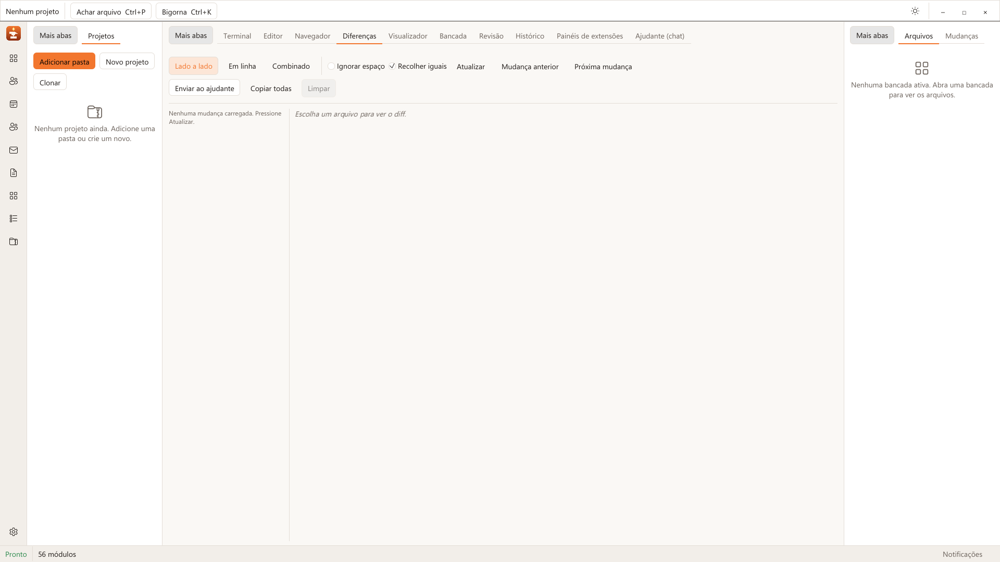

state: pt-BR.light.bench-tab.diff.tab
capture_sha: (ver arquivo de captura)
model: opencode/glm-5.3-flash-free
---

# Aba Diferenças da bancada (painel central) — estado vazio (tema claro)

Tela principal do app com a aba "Diferenças" aberta no painel central, sem projeto nem bancada ativa: as áreas mostram apenas mensagens de estado vazio. Variante clara da página de referência (pt-BR.dark.bench-tab.diff.tab); a janela aqui é mais larga (1920 px), o que muda o que fica visível.

## Como chegar
Abrir o app com `forja-app --locale pt-BR --theme light --bench-tab diff.tab`; na interface, clicar na aba "Diferenças" na faixa de abas do painel central (a captura usa o comando acima).

## Regiões
- **Barra superior (título/comandos)**: (0,0)–(1920,42). Rótulo do projeto ("Nenhum projeto"), botões "Achar arquivo  Ctrl+P" e "Bigorna  Ctrl+K", alternador de tema (ícone de sol) e botões de janela (–, □, ×).
- **Trilho à esquerda**: (0,42)–(56,1048). Coluna de ícones: logo da Forja no topo e botões "Quadro", "Ajudantes", "Rotinas", "Mutirão", "Pedidos", "Skills", "Uso", "Extensões", "Acervo", com "Ajustes" fixado embaixo.
- **Painel lateral esquerdo (Projetos)**: (56,42)–(304,1048). Botão "Mais abas", aba "Projetos" (ativa); botões "Adicionar pasta" (destaque laranja), "Novo projeto", "Clonar"; ícone de pasta e mensagem "Nenhum projeto ainda. Adicione uma pasta ou crie um novo.".
- **Divisor 1**: (304,42)–(320,1048). Separador vertical redimensionável entre o painel esquerdo e a área central.
- **Área central (Diferenças)**: (320,42)–(1612,1048). Botão "Mais abas" e abas "Terminal", "Editor", "Navegador", "Diferenças" (ativa), "Visualizador", "Bancada", "Revisão", "Histórico", "Painéis de extensões", "Ajudante (chat)"; barra de modo ("Lado a lado" destacado, "Em linha", "Combinado"), caixas "Ignorar espaço" e "Recolher iguais", botões "Atualizar", "Mudança anterior", "Próxima mudança"; segunda linha com "Enviar ao ajudante", "Copiar todas", "Limpar" (desativado); mensagens "Nenhuma mudança carregada. Pressione Atualizar." e "Escolha um arquivo para ver o diff.".
- **Divisor 2**: (1612,42)–(1628,1048). Separador vertical entre a área central e o painel direito.
- **Painel direito (Arquivos)**: (1628,42)–(1920,1048). Botão "Mais abas", abas "Arquivos" (ativa) e "Mudanças"; ícone de grade e mensagem "Nenhuma bancada ativa. Abra uma bancada para ver os arquivos.".
- **Barra de status**: (0,1048)–(1920,1080). "Pronto" à esquerda, "56 módulos" ao lado e "Notificações" à direita.

## Elementos
| Elemento | Tipo | Posição (px) | Estado | O que faz |
|---|---|---|---|---|
| "Nenhum projeto" | Rótulo | (11,12)–(113,31) | — | Mostra o projeto atual (nenhum aberto); clicável. |
| "Achar arquivo  Ctrl+P" | Botão | (135,5)–(291,37) | — | Abre a busca rápida de arquivos (atalho Ctrl+P). |
| "Bigorna  Ctrl+K" | Botão | (299,5)–(417,37) | — | Abre a paleta de comandos (atalho Ctrl+K). |
| (sem nome acessível) | Desconhecido | (1741,5)–(1773,37) | — | Ícone de sol na barra superior; alternador de tema. |
| "–" | Botão | (1795,5)–(1827,37) | — | Minimiza a janela. |
| "□" | Botão | (1835,5)–(1867,37) | — | Maximiza/restaura a janela. |
| "×" | Botão | (1875,5)–(1909,37) | — | Fecha a janela. |
| (sem nome acessível) | Desconhecido | (304,42)–(320,1048) | — | Divisor vertical entre o painel esquerdo e a área central. |
| (sem nome acessível) | Desconhecido | (1612,42)–(1628,1048) | — | Divisor vertical entre a área central e o painel direito. |
| (sem nome acessível) | Imagem | (12,50)–(40,78) | — | Ícone/logo da Forja no topo do trilho. |
| "Mais abas" | Botão | (64,50)–(149,85) | — | Revela abas adicionais do painel esquerdo que não cabem na faixa. |
| "Mais abas" | Botão | (324,50)–(409,85) | — | Revela abas adicionais do painel central. |
| "Mais abas" | Botão | (1632,50)–(1717,85) | — | Revela abas adicionais do painel direito. |
| "Projetos" | Botão | (157,52)–(231,84) | marcado=True | Aba ativa do painel esquerdo; mostra a lista de projetos. |
| "Terminal" | Botão | (417,52)–(494,84) | marcado=False | Aba do painel central; abre o terminal. |
| "Editor" | Botão | (494,52)–(554,84) | marcado=False | Aba do painel central; abre o editor. |
| "Navegador" | Botão | (554,52)–(646,84) | marcado=False | Aba do painel central; abre o navegador. |
| "Diferenças" | Botão | (646,52)–(734,84) | marcado=True | Aba ativa do painel central; exibe o diff. |
| "Visualizador" | Botão | (734,52)–(832,84) | marcado=False | Aba do painel central; abre o visualizador. |
| "Bancada" | Botão | (832,52)–(908,84) | marcado=False | Aba do painel central; abre a visão da bancada. |
| "Revisão" | Botão | (908,52)–(978,84) | marcado=False | Aba do painel central; abre a revisão. |
| "Histórico" | Botão | (978,52)–(1057,84) | marcado=False | Aba do painel central; abre o histórico. |
| "Painéis de extensões" | Botão | (1057,52)–(1208,84) | marcado=False | Aba do painel central; abre os painéis de extensões. |
| "Ajudante (chat)" | Botão | (1208,52)–(1327,84) | marcado=False | Aba do painel central; abre o chat do ajudante. |
| "Arquivos" | Botão | (1725,52)–(1803,84) | marcado=True | Aba ativa do painel direito; lista de arquivos da bancada. |
| "Mudanças" | Botão | (1803,52)–(1890,84) | marcado=False | Aba do painel direito; lista de mudanças. |
| "Quadro" | Botão | (8,94)–(44,130) | marcado=False | Botão-ícone do trilho; abre o quadro. |
| "Adicionar pasta" | Botão | (64,101)–(183,133) | — | Ação primária (laranja) para adicionar uma pasta de projeto. |
| "Novo projeto" | Botão | (191,101)–(297,133) | — | Cria um novo projeto. |
| "Lado a lado" | Botão | (324,109)–(419,144) | — | Modo de exibição do diff em duas colunas; aparece com fundo e texto laranja na imagem. |
| "Em linha" | Botão | (427,109)–(503,144) | — | Modo de diff em linha única. |
| "Combinado" | Botão | (511,109)–(607,144) | — | Modo de diff combinado. |
| "Ignorar espaço" | Caixa de seleção | (629,111)–(738,143) | marcado=False | Ignora diferenças de espaço em branco no diff. |
| "Recolher iguais" | Caixa de seleção | (746,111)–(857,143) | marcado=True | Recolhe trechos sem mudanças; vem marcada por padrão. |
| "Atualizar" | Botão | (865,111)–(943,143) | — | Recarrega o diff. |
| "Mudança anterior" | Botão | (951,111)–(1083,143) | — | Navega à mudança anterior. |
| "Próxima mudança" | Botão | (1091,111)–(1226,143) | — | Navega à próxima mudança. |
| (ícone) | Rótulo | (1756,117)–(1784,145) | — | Ícone de grade do estado vazio do painel de arquivos. |
| "Ajudantes" | Botão | (8,138)–(44,174) | marcado=False | Botão-ícone do trilho; abre os ajudantes. |
| "Clonar" | Botão | (64,141)–(128,173) | — | Clona um repositório como projeto. |
| "Enviar ao ajudante" | Botão | (324,152)–(461,184) | — | Envia o diff atual ao ajudante de código. |
| "Copiar todas" | Botão | (469,152)–(571,184) | — | Copia todas as diferenças para a área de transferência. |
| "Limpar" | Botão | (579,152)–(645,187) | desativado | Limpa a seleção/diff atual; indisponível sem conteúdo. |
| "Nenhuma bancada ativa. Abra uma bancada para ver os arquivos." | Rótulo | (1634,153)–(1906,191) | — | Mensagem de estado vazio do painel de arquivos. |
| "Rotinas" | Botão | (8,182)–(44,218) | marcado=False | Botão-ícone do trilho; abre as rotinas. |
| (ícone) | Rótulo | (168,201)–(196,229) | — | Ícone de pasta do estado vazio do painel de projetos. |
| "Nenhuma mudança carregada. Pressione Atualizar." | Rótulo | (324,209)–(543,241) | — | Mensagem de estado vazio da coluna esquerda do diff; quebra em duas linhas. |
| "Escolha um arquivo para ver o diff." | Rótulo | (566,209)–(779,228) | — | Mensagem em itálico do lado direito do diff. |
| "Mutirão" | Botão | (8,226)–(44,262) | marcado=False | Botão-ícone do trilho; abre o mutirão. |
| "Nenhum projeto ainda. Adicione uma pasta ou crie um novo." | Rótulo | (66,237)–(298,275) | — | Mensagem de estado vazio do painel de projetos. |
| "Pedidos" | Botão | (8,270)–(44,306) | marcado=False | Botão-ícone do trilho; abre os pedidos. |
| "Skills" | Botão | (8,314)–(44,350) | marcado=False | Botão-ícone do trilho; abre as skills. |
| "Uso" | Botão | (8,358)–(44,394) | marcado=False | Botão-ícone do trilho; abre o uso. |
| "Extensões" | Botão | (8,402)–(44,438) | marcado=False | Botão-ícone do trilho; abre as extensões. |
| "Acervo" | Botão | (8,446)–(44,482) | marcado=False | Botão-ícone do trilho; abre o acervo. |
| "Ajustes" | Botão | (8,1004)–(44,1040) | marcado=False | Botão-ícone do trilho fixo embaixo; abre os ajustes. |
| "Pronto" | Rótulo | (10,1055)–(51,1074) | — | Status atual na barra de status. |
| "56 módulos" | Rótulo | (73,1055)–(146,1074) | — | Quantidade de módulos carregados. |
| "Notificações" | Rótulo | (1810,1055)–(1886,1074) | — | Abre a área de notificações. |

## Aparência
Mesma estrutura da referência escura; muda a paleta. Tema claro: fundo bege/creme claro nas barras, no painel esquerdo e na barra de status, com a área central e o painel direito em branco quase puro, separados por linhas verticais finas. Cor de destaque laranja, usada no logo do trilho, na ação primária "Adicionar pasta" (fundo laranja, texto branco), no botão de modo "Lado a lado" (fundo laranja claro, texto laranja) e no status "Pronto" em verde. Tipografia sans-serif pequena; abas ativas com texto escuro e sublinhado laranja na base da faixa (y≈85); textos de estado vazio em cinza médio, com "Escolha um arquivo para ver o diff." em itálico. Divisores verticais de 16 px separam os três painéis; botões do trilho com 36 px de largura; barras de ferramentas do central em duas linhas (y≈109 e y≈152). Por serem estados sem conteúdo, os painéis têm muito espaço vazio.

## Problemas encontrados
- Contraste dos textos de estado vazio é baixo: cinza claro sobre fundo claro ("Nenhum projeto ainda. Adicione uma pasta ou crie um novo.", "Nenhuma mudança carregada. Pressione Atualizar.", "Escolha um arquivo para ver o diff." e "Nenhuma bancada ativa. Abra uma bancada para ver os arquivos."); "Limpar" desativado também tem contraste reduzido (esperado para estado desabilitado).
- Botão da barra superior sem nome acessível em (1741,5)–(1773,37) (ícone de sol, alternador de tema); divisores, o logo do trilho e os ícones de estado vazio também não têm nome acessível.
- As três faixas de abas dependem do botão "Mais abas" para alcançar as demais abas do painel (por exemplo, "Bancadas" e as demais do painel direito não aparecem na árvore nesta captura); nenhuma aba fica cortada nesta largura de janela.
- Nenhum elemento com retângulo além dos limites da janela (1920×1080) nesta variante — diferentemente da referência escura, onde várias abas e botões do diff estouravam a largura.
