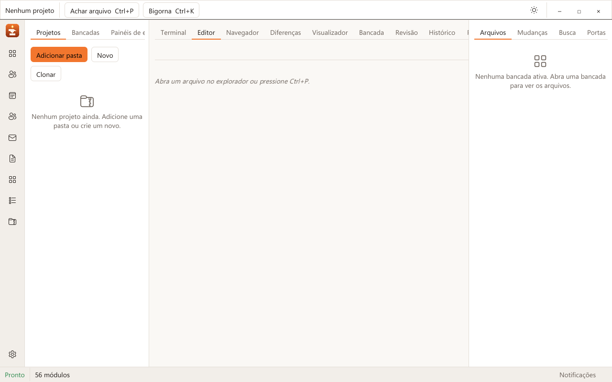

# Tela principal — aba Editor sem projeto (bench-tab editor.tab)

Janela principal da Forja no estado inicial, sem projeto aberto, com o painel central na aba "Editor" e o painel direito em "Arquivos", ambos exibindo mensagens de vazio.

## Como chegar
Abrir o app já leva a esta tela quando nenhum projeto está ativo: `forja-app --locale pt-BR --theme light --bench-tab editor.tab`. Pela interface, é a janela inicial; a aba "Editor" do grupo central e a aba "Arquivos" do grupo direito estão selecionadas.

## Regiões
- **Barra superior** (0,0)–(1920,42): à esquerda o rótulo "Nenhum projeto" e os botões "Achar arquivo  Ctrl+P" e "Bigorna  Ctrl+K"; à direita um ícone de tema (sol) sem nome acessível e os botões de janela "–", "□" e "×".
- **Trilho à esquerda** (0,42)–(52,1048): logotipo da Forja no topo e uma coluna de ícones-quadrados: "Quadro", "Ajudantes", "Rotinas", "Mutirão", "Pedidos", "Skills", "Uso", "Extensões", "Acervo" e, no rodapé do trilho, "Ajustes".
- **Painel lateral esquerdo** (52,42)–(304,1048): botão "Mais abas" e a aba "Projetos" (selecionada); botões "Adicionar pasta" (destacado em laranja), "Novo projeto" e "Clonar"; ícone de pasta e a mensagem "Nenhum projeto ainda. Adicione uma pasta ou crie um novo."
- **Área central** (320,42)–(1612,1048): botão "Mais abas" e o grupo de abas "Terminal", "Editor" (selecionada, com sublinhado laranja), "Navegador", "Diferenças", "Visualizador", "Bancada", "Revisão", "Histórico", "Painéis de extensões" e "Ajudante (chat)"; abaixo, uma régua horizontal e a mensagem em itálico "Abra um arquivo no explorador ou pressione Ctrl+P." sobre fundo vazio.
- **Painel direito** (1628,42)–(1920,1048): botão "Mais abas" e as abas "Arquivos" (selecionada) e "Mudanças"; ícone de grade e a mensagem "Nenhuma bancada ativa. Abra uma bancada para ver os arquivos."
- **Barra de status** (0,1048)–(1920,1080): à esquerda "Pronto" (em verde) e "56 módulos"; à direita "Notificações".

## Elementos
| Elemento | Tipo | Posição (px) | Estado | O que faz |
|---|---|---|---|---|
| "Achar arquivo  Ctrl+P" | Button | (135,5)–(291,37) | — | Abre a busca rápida de arquivos pelo nome (atalho Ctrl+P). |
| "Bigorna  Ctrl+K" | Button | (299,5)–(417,37) | — | Abre a paleta de comandos (atalho Ctrl+K). |
| (sem nome acessível) | Unknown | (1741,5)–(1773,37) | — | Ícone de sol; alterna o tema da interface. |
| "–" | Button | (1795,5)–(1827,37) | — | Minimiza a janela. |
| "□" | Button | (1835,5)–(1867,37) | — | Maximiza/restaura a janela. |
| "×" | Button | (1875,5)–(1909,37) | — | Fecha a janela. |
| "Nenhum projeto" | Label | (11,12)–(113,31) | — | Mostra que não há projeto aberto; abre a lista de projetos. |
| (sem nome acessível) | Unknown | (304,42)–(320,1048) | foco | Divisor arrastável entre o painel esquerdo e a área central. |
| (sem nome acessível) | Unknown | (1612,42)–(1628,1048) | foco | Divisor arrastável entre a área central e o painel direito. |
| (sem nome acessível) | Image | (12,50)–(40,78) | — | Logotipo da Forja no topo do trilho. |
| "Mais abas" | Button | (64,50)–(149,85) | — | Abre a lista das abas restantes do painel esquerdo. |
| "Mais abas" | Button | (324,50)–(409,85) | — | Abre a lista das abas restantes do grupo central. |
| "Mais abas" | Button | (1632,50)–(1717,85) | — | Abre a lista das abas restantes do grupo direito. |
| "Projetos" | Button | (157,52)–(231,84) | marcado=True | Aba selecionada do painel esquerdo; mostra a lista de projetos. |
| "Terminal" | Button | (417,52)–(494,84) | marcado=False | Aba central que abriria o terminal integrado. |
| "Editor" | Button | (494,52)–(554,84) | marcado=True | Aba central selecionada; mostra o editor de arquivos. |
| "Navegador" | Button | (554,52)–(646,84) | marcado=False | Aba central do navegador de código/estrutura. |
| "Diferenças" | Button | (646,52)–(734,84) | marcado=False | Aba central de comparação de arquivos. |
| "Visualizador" | Button | (734,52)–(832,84) | marcado=False | Aba central de pré-visualização. |
| "Bancada" | Button | (832,52)–(908,84) | marcado=False | Aba central que mostraria o conteúdo da bancada. |
| "Revisão" | Button | (908,52)–(978,84) | marcado=False | Aba central de revisão de código. |
| "Histórico" | Button | (978,52)–(1057,84) | marcado=False | Aba central de histórico. |
| "Painéis de extensões" | Button | (1057,52)–(1208,84) | marcado=False | Aba central dos painéis de extensões. |
| "Ajudante (chat)" | Button | (1208,52)–(1327,84) | marcado=False | Aba central do chat do ajudante. |
| "Arquivos" | Button | (1725,52)–(1803,84) | marcado=True | Aba selecionada do painel direito; mostra o explorador de arquivos. |
| "Mudanças" | Button | (1803,52)–(1890,84) | marcado=False | Aba do painel direito com as alterações da bancada. |
| "Quadro" | Button | (8,94)–(44,130) | marcado=False | Atalho do trilho para o quadro de tarefas. |
| "Adicionar pasta" | Button | (64,101)–(183,133) | — | Abre o seletor para adicionar uma pasta como projeto. |
| "Novo projeto" | Button | (191,101)–(297,133) | — | Cria um projeto novo. |
| (ícone) | Label | (1756,117)–(1784,145) | — | Ícone de grade do estado vazio do painel "Arquivos". |
| "Ajudantes" | Button | (8,138)–(44,174) | marcado=False | Atalho do trilho para a lista de ajudantes. |
| "Clonar" | Button | (64,141)–(128,173) | — | Clona um repositório para criar um projeto. |
| "Nenhuma bancada ativa. Abra uma bancada para ver os arquivos." | Label | (1634,153)–(1906,191) | — | Mensagem de vazio do explorador de arquivos. |
| "Abra um arquivo no explorador ou pressione Ctrl+P." | Label | (324,171)–(647,190) | — | Mensagem de vazio da área do editor. |
| "Rotinas" | Button | (8,182)–(44,218) | marcado=False | Atalho do trilho para rotinas. |
| (ícone) | Label | (168,201)–(196,229) | — | Ícone de pasta do estado vazio da lista de projetos. |
| "Mutirão" | Button | (8,226)–(44,262) | marcado=False | Atalho do trilho para o mutirão de ajudantes. |
| "Nenhum projeto ainda. Adicione uma pasta ou crie um novo." | Label | (66,237)–(298,275) | — | Mensagem de vazio da lista de projetos. |
| "Pedidos" | Button | (8,270)–(44,306) | marcado=False | Atalho do trilho para pedidos. |
| "Skills" | Button | (8,314)–(44,350) | marcado=False | Atalho do trilho para skills. |
| "Uso" | Button | (8,358)–(44,394) | marcado=False | Atalho do trilho para o consumo de tokens. |
| "Extensões" | Button | (8,402)–(44,438) | marcado=False | Atalho do trilho para extensões. |
| "Acervo" | Button | (8,446)–(44,482) | marcado=False | Atalho do trilho para o acervo. |
| "Ajustes" | Button | (8,1004)–(44,1040) | marcado=False | Atalho do trilho para os ajustes, fixado no fim do trilho. |
| "Pronto" | Label | (10,1055)–(51,1074) | — | Estado geral do app na barra de status. |
| "56 módulos" | Label | (73,1055)–(146,1074) | — | Contagem de módulos carregados. |
| "Notificações" | Label | (1810,1055)–(1886,1074) | — | Abre o painel de notificações. |

## Aparência
Tema claro: fundo geral off-white quente (tom creme), com a área central em branco levemente mais claro que os painéis e o trilho. Cor de destaque laranja, usada no botão primário "Adicionar pasta", no sublinhado das abas selecionadas ("Projetos", "Editor", "Arquivos") e no logotipo. O texto "Pronto" da barra de status aparece em verde. Tipografia sans-serif de corpo pequeno (aprox. 12–13 px); as mensagens de estado vazio vêm em itálico e cinza. Abas selecionadas em texto escuro, não selecionadas em cinza médio. Os três grupos de abas (esquerdo, central, direito) ficam alinhados na mesma faixa (y 50–85), cada um precedido por um botão "Mais abas", separados por divisores verticais de 16 px. Botões de ação têm fundo branco com borda sutil e cantos arredondados; o trilho esquerdo usa apenas ícones quadrados de 36 px centralizados.

## Mudanças em relação à referência (pt-BR.dark.bench-tab.editor.tab)
- Mesma estrutura e mesmos rótulos; muda o tema (claro em vez de escuro) e a janela capturada é maior (1920×1080 em vez de 1024×768), então as coordenadas escalam.
- Cada grupo de abas passa a exibir um botão "Mais abas" antes das abas: no painel esquerdo, as abas "Bancadas" e "Painéis de extensões" da referência não aparecem mais diretamente; no grupo direito, só "Arquivos" e "Mudanças" ficam visíveis.
- Com a janela mais larga, o grupo central mostra todas as dez abas ("Terminal" a "Ajudante (chat)") sem cortes, e os problemas de sobreposição e de elementos fora da janela da referência não ocorrem: as abas ficam lado a lado, sem invasão entre grupos.
- O botão de criação de projeto tem o rótulo "Novo projeto" (na referência escura, "Novo").
- Cores: fundo creme/branco em vez de marrom-escuro; textos em cinza-escuro sobre claro; o laranja de destaque e o verde de "Pronto" se mantêm. O contraste geral é melhor que na referência escura.

## Problemas encontrados
- Botão sem nome acessível: o ícone de tema na barra superior (1741,5)–(1773,37) é um Unknown clicável sem rótulo.
- Divisores verticais (304,42)–(320,1048) e (1612,42)–(1628,1048) são Unknown sem nome acessível, o que dificulta identificação por leitor de tela.
- Ícones/imagens sem alternativa textual: logotipo (12,50)–(40,78) e os ícones de estado vazio (1756,117) e (168,201) aparecem como "(sem nome acessível)".
- Três botões com o mesmo nome "Mais abas" (64,50), (324,50) e (1632,50) em grupos diferentes, o que gera ambiguidade para leitores de tela.
- Textos de estado vazio em cinza itálico sobre fundo claro têm contraste reduzido para corpo pequeno ("Abra um arquivo no explorador ou pressione Ctrl+P.").
