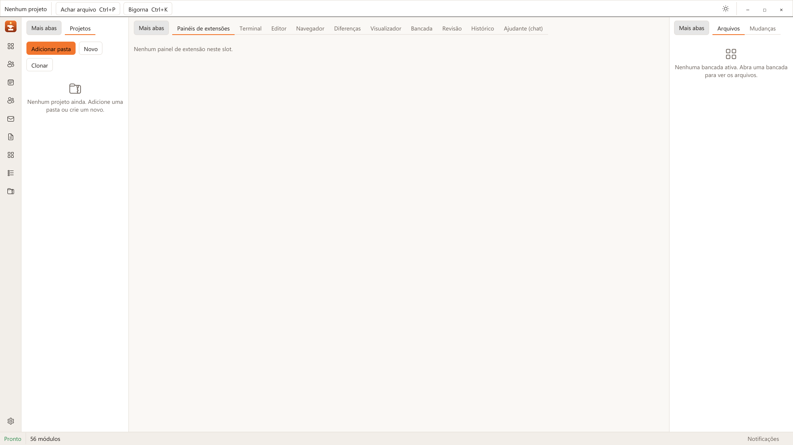

# Aba de bancada — Painéis de extensões (slot vazio) — tema claro

Tela da aba de bancada com o painel central apontando para o slot `extension.panels.bench`, sem painel de extensão carregado, e os painéis laterais (Projetos e Arquivos) também em estado vazio.

## Como chegar
Abrir o app sem projeto ativo e com a aba de bancada selecionada: `forja-app --locale pt-BR --theme light --bench-tab extension.panels.bench`. Na interface: na faixa de abas da área central clicar em "Painéis de extensões" (ou manter a aba de bancada ativa) — o painel central exibe a mensagem de slot vazio. Comando de captura: captura do estado `pt-BR.light.bench-tab.extension.panels.bench` (tema light, idioma pt-BR), imagem `captures/pt-BR.light.bench-tab.extension.panels.bench.png` (1920×1080 px, escala 1.0).

## Regiões
- **Barra superior** (0,0)–(1920,42): rótulo do projeto ("Nenhum projeto"), botões "Achar arquivo  Ctrl+P" e "Bigorna  Ctrl+K", alternador de tema (ícone de sol, sem nome) e botões de janela (–, □, ×).
- **Trilho à esquerda** (0,42)–(52,1048): logotipo da Forja (imagem laranja) no topo e botões-ícone na vertical: "Quadro", "Ajudantes", "Rotinas", "Mutirão", "Pedidos", "Skills", "Uso", "Extensões", "Acervo" e, no rodapé, "Ajustes".
- **Painel lateral esquerdo** (52,42)–(304,1048): botão "Mais abas", aba "Projetos" (ativa, com sublinhado), botões "Adicionar pasta" (destaque laranja) e "Novo projeto", botão "Clonar" e estado vazio com ícone de pasta e o texto "Nenhum projeto ainda. Adicione uma pasta ou crie um novo.".
- **Divisor** (304,42)–(320,1048): separador redimensionável entre o painel esquerdo e a área central (sem nome acessível).
- **Área central** (320,42)–(1612,1048): botão "Mais abas" e a faixa de abas "Terminal", "Editor", "Navegador", "Diferenças", "Visualizador", "Bancada", "Revisão", "Histórico", "Painéis de extensões" (ativa) e "Ajudante (chat)"; abaixo, a mensagem "Nenhum painel de extensão neste slot." — conteúdo vazio do slot `extension.panels.bench`.
- **Divisor** (1612,42)–(1628,1048): separador redimensionável entre a área central e o painel direito (sem nome acessível).
- **Painel lateral direito** (1628,42)–(1920,1048): botão "Mais abas", abas "Arquivos" (ativa, com sublinhado) e "Mudanças", ícone de grade e a mensagem "Nenhuma bancada ativa. Abra uma bancada para ver os arquivos.".
- **Barra de status** (0,1048)–(1920,1080): "Pronto" (em verde), "56 módulos" e, à direita, "Notificações".

## Elementos
| Elemento | Tipo | Posição (px) | Estado | O que faz |
|---|---|---|---|---|
| "Achar arquivo  Ctrl+P" | Button | (135,5)–(291,37) | click,focus | Abre a busca rápida de arquivos (atalho Ctrl+P) |
| "Bigorna  Ctrl+K" | Button | (299,5)–(417,37) | click,focus | Abre a paleta de comandos (atalho Ctrl+K) |
| (sem nome acessível) | Unknown | (1741,5)–(1773,37) | click,focus | Ícone de sol: alternador de tema claro/escuro |
| "–" | Button | (1795,5)–(1827,37) | click,focus | Minimiza a janela |
| "□" | Button | (1835,5)–(1867,37) | click,focus | Maximiza/restaura a janela |
| "×" | Button | (1875,5)–(1909,37) | click,focus | Fecha a janela |
| "Nenhum projeto" | Label | (11,12)–(113,31) | click,focus | Rótulo na barra superior indicando ausência de projeto aberto |
| (sem nome acessível) | Unknown | (304,42)–(320,1048) | focus | Divisor vertical entre o painel esquerdo e a área central |
| (sem nome acessível) | Unknown | (1612,42)–(1628,1048) | focus | Divisor vertical entre a área central e o painel direito |
| (sem nome acessível) | Image | (12,50)–(40,78) | click,focus | Logotipo da Forja (bigorna laranja) no topo do trilho |
| "Mais abas" | Button | (64,50)–(149,85) | click,focus | Menu com as abas restantes do painel esquerdo que não couberam |
| "Mais abas" | Button | (324,50)–(409,85) | click,focus | Menu com as abas restantes da área central que não couberam |
| "Mais abas" | Button | (1632,50)–(1717,85) | click,focus | Menu com as abas restantes do painel direito que não couberam |
| "Projetos" | Button | (157,52)–(231,84) | click,focus; marcado=True | Aba ativa do painel esquerdo; mostra a lista de projetos |
| "Terminal" | Button | (417,52)–(494,84) | click,focus; marcado=False | Aba da área central que mostra o terminal |
| "Editor" | Button | (494,52)–(554,84) | click,focus; marcado=False | Aba que mostra o editor de arquivos |
| "Navegador" | Button | (554,52)–(646,84) | click,focus; marcado=False | Aba que mostra o navegador |
| "Diferenças" | Button | (646,52)–(734,84) | click,focus; marcado=False | Aba que mostra o visor de diferenças |
| "Visualizador" | Button | (734,52)–(832,84) | click,focus; marcado=False | Aba que mostra o visualizador |
| "Bancada" | Button | (832,52)–(908,84) | click,focus; marcado=False | Aba que mostra a bancada |
| "Revisão" | Button | (908,52)–(978,84) | click,focus; marcado=False | Aba que mostra a revisão |
| "Histórico" | Button | (978,52)–(1057,84) | click,focus; marcado=False | Aba que mostra o histórico |
| "Painéis de extensões" | Button | (1057,52)–(1208,84) | click,focus; marcado=True | Aba ativa da área central; mostra os painéis de extensão do slot `extension.panels.bench` |
| "Ajudante (chat)" | Button | (1208,52)–(1327,84) | click,focus; marcado=False | Aba do chat do ajudante |
| "Arquivos" | Button | (1725,52)–(1803,84) | click,focus; marcado=True | Aba ativa do painel direito; lista de arquivos da bancada |
| "Mudanças" | Button | (1803,52)–(1890,84) | click,focus; marcado=False | Aba que alterna para a lista de mudanças |
| "Quadro" | Button | (8,94)–(44,130) | click,focus; marcado=False | Botão-ícone do trilho para o quadro |
| "Adicionar pasta" | Button | (64,101)–(183,133) | click,focus | Adiciona uma pasta de projeto (botão em destaque laranja) |
| "Novo projeto" | Button | (191,101)–(297,133) | click,focus | Cria um novo projeto |
| "Nenhum painel de extensão neste slot." | Label | (324,109)–(563,128) | click | Mensagem de estado vazio do slot `extension.panels.bench` |
| (ícone) | Label | (1756,117)–(1784,145) | click | Ícone de grade do estado vazio do painel direito |
| "Ajudantes" | Button | (8,138)–(44,174) | click,focus; marcado=False | Botão-ícone do trilho para a lista de ajudantes |
| "Clonar" | Button | (64,141)–(128,173) | click,focus | Clona um projeto/bancada |
| "Nenhuma bancada ativa. Abra uma bancada para ver os arquivos." | Label | (1634,153)–(1906,191) | click | Mensagem de estado vazio do painel de arquivos |
| "Rotinas" | Button | (8,182)–(44,218) | click,focus; marcado=False | Botão-ícone do trilho para rotinas |
| (ícone) | Label | (168,201)–(196,229) | click | Ícone de pasta do estado vazio do painel de projetos |
| "Mutirão" | Button | (8,226)–(44,262) | click,focus; marcado=False | Botão-ícone do trilho para o mutirão |
| "Nenhum projeto ainda. Adicione uma pasta ou crie um novo." | Label | (66,237)–(298,275) | click | Mensagem de estado vazio da lista de projetos |
| "Pedidos" | Button | (8,270)–(44,306) | click,focus; marcado=False | Botão-ícone do trilho para pedidos |
| "Skills" | Button | (8,314)–(44,350) | click,focus; marcado=False | Botão-ícone do trilho para skills |
| "Uso" | Button | (8,358)–(44,394) | click,focus; marcado=False | Botão-ícone do trilho para uso |
| "Extensões" | Button | (8,402)–(44,438) | click,focus; marcado=False | Botão-ícone do trilho para extensões |
| "Acervo" | Button | (8,446)–(44,482) | click,focus; marcado=False | Botão-ícone do trilho para o acervo |
| "Ajustes" | Button | (8,1004)–(44,1040) | click,focus; marcado=False | Botão-ícone do trilho para os ajustes, fixado no rodapé |
| "Pronto" | Label | (10,1055)–(51,1074) | click | Status geral na barra inferior, em verde |
| "56 módulos" | Label | (73,1055)–(146,1074) | click | Contagem de módulos carregados |
| "Notificações" | Label | (1810,1055)–(1886,1074) | click,focus | Atalho para notificações, à direita da barra de status |

## Aparência (em relação à referência dark)
Estrutura e posições idênticas às da página de referência (`pt-BR.dark.bench-tab.extension.panels.bench`), variando o tema e a geometria: nesta captura a janela tem 1920×1080 px (a referência tinha 1053×768 px), o que elimina os estouros e sobreposições de abas registrados na referência — todas as abas cabem em suas faixas e não há abas cortadas nem fora da janela. Também diferem os grupos de abas visíveis: aqui cada painel exibe um botão "Mais abas" (64, 324 e 1632 px) e as abas "Bancadas", "Busca" e "Portas" da referência não aparecem — foram recolhidas no menu "Mais abas". Tema light com fundo creme quase branco (tonalidade quente, coerente com o sistema "Brasa"); barra superior e barra de status levemente mais claras/escuras que o conteúdo, separadas por traços finos. O destaque continua laranja: logotipo no trilho, botão primário "Adicionar pasta" e o sublinhado das abas ativas ("Projetos", "Painéis de extensões" e "Arquivos"). Texto em cinza-escuro sobre fundo claro, com bom contraste nas mensagens; ícones e textos de estado vazio em cinza médio (contraste menor). "Pronto" segue em verde. Tipografia sem serifa, corpo em torno de 14 px (abas e botões) e 13 px na barra de status; botões-ícone do trilho de 36×36 px com passo de 44 px, mensagens de estado vazio centralizadas no painel correspondente.

## Problemas encontrados
- Elementos sem nome acessível: alternador de tema (1741,5), os dois divisores verticais (304,42 e 1612,42) e o logotipo (12,50) — apenas "Unknown"/"Image" sem nome na árvore.
- Botões de janela nomeados apenas pelos símbolos "–", "□" e "×", sem rótulo descritivo (minimizar/maximizar/fechar).
- Três botões com o mesmo nome acessível "Mais abas" (um por painel), ambíguos para leitores de tela.
- Rótulos de estado vazio e ícones de estado vazio ((ícone) em (1756,117) e (168,201)) expostos como Label clicável, mas sem ação correspondente.
