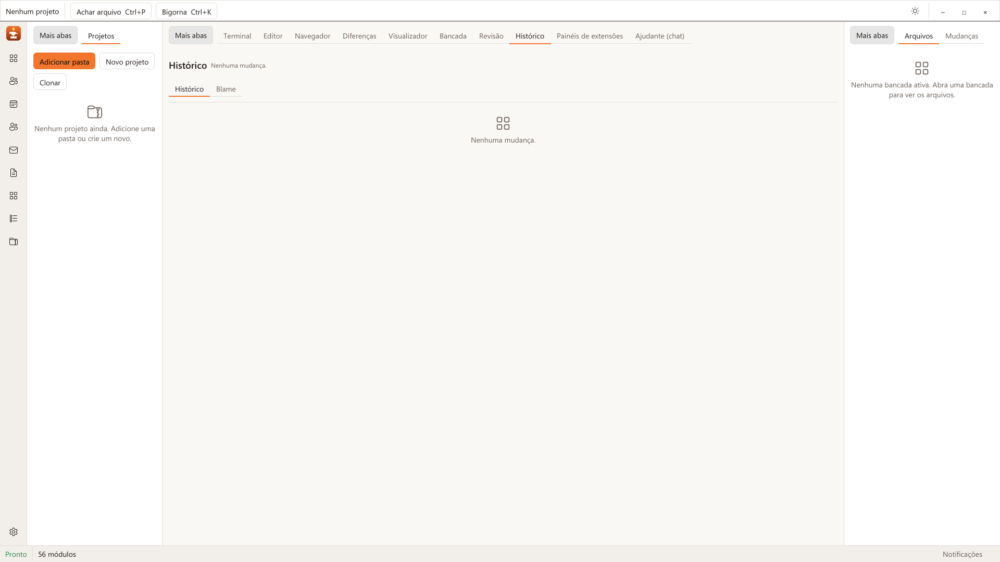

# Bancada — aba Histórico (Git)

Tela da bancada que mostra a visão de histórico Git no painel central; nesta captura não há projeto nem bancada ativa, então histórico, projetos e arquivos aparecem vazios. Variante em tema claro da página de referência (pt-BR.dark.bench-tab.git.history).

## Como chegar
Abrir a Forja e, na faixa de abas do painel central, escolher a visão "Histórico" (com a sub-aba "Histórico" ativa ao lado de "Blame"). Comando de captura: `forja-app --locale pt-BR --theme light --bench-tab git.history`. Em relação à referência dark, a janela aqui tem 1920×1080: todas as abas centrais ficam visíveis até "Ajudante (chat)"; cada grupo de abas exibe um botão "Mais abas" e o grupo esquerdo mostra só "Projetos" (na referência havia também "Bancadas" e "Painéis de extensões"); o botão de criar projeto se chama "Novo projeto" (na referência, "Novo").

## Regiões
- **Barra superior** (0,0)–(1920,42): rótulo "Nenhum projeto" à esquerda, botões "Achar arquivo  Ctrl+P" e "Bigorna  Ctrl+K"; à direita, botão sem nome (ícone de sol, alternar tema) e os botões de janela "–", "□" e "×".
- **Trilho à esquerda** (0,42)–(52,1048): logotipo da Forja no topo e, abaixo, os ícones "Quadro", "Ajudantes", "Rotinas", "Mutirão", "Pedidos", "Skills", "Uso", "Extensões", "Acervo" e, na base, "Ajustes".
- **Faixa de abas esquerda + painel Projetos** (52,42)–(304,1048): botão "Mais abas" e aba "Projetos" (ativa, com sublinhado laranja); abaixo, os botões "Adicionar pasta" (destaque laranja), "Novo projeto" e "Clonar" e o estado vazio com ícone de pasta e o texto "Nenhum projeto ainda. Adicione uma pasta ou crie um novo.".
- **Divisor vertical** (304,42)–(320,1048): separador sem nome entre o painel de projetos e o painel central.
- **Painel central** (320,42)–(1612,1048): botão "Mais abas" e abas "Terminal", "Editor", "Navegador", "Diferenças", "Visualizador", "Bancada", "Revisão", "Histórico" (ativa), "Painéis de extensões" e "Ajudante (chat)"; abaixo, o título "Histórico" com a nota "Nenhuma mudança.", as sub-abas "Histórico" (ativa) e "Blame" e a área vazia com ícone de grade e o texto "Nenhuma mudança.".
- **Divisor vertical** (1612,42)–(1628,1048): separador sem nome entre o painel central e o painel direito.
- **Painel direito (Arquivos)** (1628,42)–(1920,1048): botão "Mais abas", abas "Arquivos" (ativa) e "Mudanças"; abaixo, ícone de grade (quatro quadrados) e o estado vazio "Nenhuma bancada ativa. Abra uma bancada para ver os arquivos.".
- **Barra de status** (0,1048)–(1920,1080): "Pronto" em verde à esquerda, "56 módulos" ao lado e "Notificações" à direita.

## Elementos
| Elemento | Tipo | Posição (px) | Estado | O que faz |
|---|---|---|---|---|
| "Achar arquivo  Ctrl+P" | Button | (135,5)–(291,37) | — | Abre a busca de arquivos pelo atalho Ctrl+P. |
| "Bigorna  Ctrl+K" | Button | (299,5)–(417,37) | — | Abre a paleta de comandos pelo atalho Ctrl+K. |
| (sem nome acessível) | Unknown | (1741,5)–(1773,37) | focável | Botão com ícone de sol no canto direito da barra: alterna o tema claro/escuro. |
| "–" | Button | (1795,5)–(1827,37) | — | Minimiza a janela. |
| "□" | Button | (1835,5)–(1867,37) | — | Maximiza/restaura a janela. |
| "×" | Button | (1875,5)–(1909,37) | — | Fecha a janela. |
| "Nenhum projeto" | Label | (11,12)–(113,31) | — | Indica que não há projeto aberto; clicável. |
| (sem nome acessível) | Unknown | (304,42)–(320,1048) | focável | Divisor vertical entre os painéis esquerdo e central. |
| (sem nome acessível) | Unknown | (1612,42)–(1628,1048) | focável | Divisor vertical entre os painéis central e direito. |
| (sem nome acessível) | Image | (12,50)–(40,78) | clicável, focável | Logotipo da Forja no topo do trilho. |
| "Mais abas" | Button | (64,50)–(149,85) | — | Lista as abas ocultas do grupo esquerdo. |
| "Mais abas" | Button | (324,50)–(409,85) | — | Lista as abas ocultas do grupo central. |
| "Mais abas" | Button | (1632,50)–(1717,85) | — | Lista as abas ocultas do grupo direito. |
| "Projetos" | Button | (157,52)–(231,84) | marcado=True | Aba ativa do grupo esquerdo; mostra o painel de projetos. |
| "Terminal" | Button | (417,52)–(494,84) | marcado=False | Aba do painel central para a visão de terminal. |
| "Editor" | Button | (494,52)–(554,84) | marcado=False | Aba do painel central para a visão de editor. |
| "Navegador" | Button | (554,52)–(646,84) | marcado=False | Aba do painel central para a visão de navegador. |
| "Diferenças" | Button | (646,52)–(734,84) | marcado=False | Aba do painel central para a visão de diferenças. |
| "Visualizador" | Button | (734,52)–(832,84) | marcado=False | Aba do painel central para a visão de visualizador. |
| "Bancada" | Button | (832,52)–(908,84) | marcado=False | Aba do painel central para a visão da bancada. |
| "Revisão" | Button | (908,52)–(978,84) | marcado=False | Aba do painel central para a visão de revisão. |
| "Histórico" | Button | (978,52)–(1057,84) | marcado=True | Aba ativa do painel central; mostra a visão de histórico Git. |
| "Painéis de extensões" | Button | (1057,52)–(1208,84) | marcado=False | Aba do painel central para os painéis de extensões. |
| "Ajudante (chat)" | Button | (1208,52)–(1327,84) | marcado=False | Aba do painel central para o chat do ajudante. |
| "Arquivos" | Button | (1725,52)–(1803,84) | marcado=True | Aba ativa do painel direito; mostra o explorador de arquivos da bancada. |
| "Mudanças" | Button | (1803,52)–(1890,84) | marcado=False | Aba do painel direito para as mudanças da bancada. |
| "Quadro" | Button | (8,94)–(44,130) | marcado=False | Ícone do trilho: abre o quadro geral. |
| "Adicionar pasta" | Button | (64,101)–(183,133) | — | Adiciona uma pasta de projeto existente (botão laranja em destaque). |
| "Novo projeto" | Button | (191,101)–(297,133) | — | Cria um projeto novo. |
| "Histórico" | Label | (324,113)–(397,137) | clicável | Título do painel central (visão de histórico Git), em laranja. |
| "Nenhuma mudança." | Label | (405,117)–(511,133) | clicável | Nota ao lado do título: sem mudanças no histórico. |
| (ícone) | Label | (1756,117)–(1784,145) | clicável | Ícone de grade (quatro quadrados) do estado vazio do painel direito. |
| "Ajudantes" | Button | (8,138)–(44,174) | marcado=False | Ícone do trilho: abre a lista de ajudantes. |
| "Clonar" | Button | (64,141)–(128,173) | — | Clona um repositório como projeto. |
| "Histórico" | Button | (324,153)–(403,185) | marcado=True | Sub-aba ativa da visão Git: lista de commits. |
| "Blame" | Button | (403,153)–(465,185) | marcado=False | Sub-aba da visão Git: blame por linha. |
| "Nenhuma bancada ativa. Abra uma bancada para ver os arquivos." | Label | (1634,153)–(1906,191) | clicável | Estado vazio do painel de arquivos, em duas linhas. |
| "Rotinas" | Button | (8,182)–(44,218) | marcado=False | Ícone do trilho: abre as rotinas. |
| (ícone) | Label | (168,201)–(196,229) | clicável | Ícone de pasta do estado vazio do painel de projetos. |
| (ícone) | Label | (952,223)–(980,251) | clicável | Ícone de grade (quatro quadrados) do estado vazio da área central. |
| "Mutirão" | Button | (8,226)–(44,262) | marcado=False | Ícone do trilho: abre o mutirão. |
| "Nenhum projeto ainda. Adicione uma pasta ou crie um novo." | Label | (66,237)–(298,275) | clicável | Estado vazio do painel de projetos, em duas linhas. |
| "Nenhuma mudança." | Label | (904,259)–(1028,278) | clicável | Texto do estado vazio da área central, abaixo do ícone de grade. |
| "Pedidos" | Button | (8,270)–(44,306) | marcado=False | Ícone do trilho: abre os pedidos. |
| "Skills" | Button | (8,314)–(44,350) | marcado=False | Ícone do trilho: abre as skills. |
| "Uso" | Button | (8,358)–(44,394) | marcado=False | Ícone do trilho: abre o uso. |
| "Extensões" | Button | (8,402)–(44,438) | marcado=False | Ícone do trilho: abre as extensões. |
| "Acervo" | Button | (8,446)–(44,482) | marcado=False | Ícone do trilho: abre o acervo. |
| "Ajustes" | Button | (8,1004)–(44,1040) | marcado=False | Ícone do trilho: abre os ajustes, fixado na base. |
| "Pronto" | Label | (10,1055)–(51,1074) | clicável | Status geral na barra de status, em verde. |
| "56 módulos" | Label | (73,1055)–(146,1074) | clicável | Contagem de módulos carregados. |
| "Notificações" | Label | (1810,1055)–(1886,1074) | clicável, focável | Acesso às notificações, à direita da barra de status. |

## Aparência
Variante clara: em relação à referência dark, os papéis se invertem — fundo geral off-white com leve tom quente, painéis em branco com variação sutil e divisores cinza-claros. Texto principal em cinza-quase-preto; textos secundários ("Nenhum projeto", "Nenhuma mudança.", estados vazios) em cinza médio, com contraste menor que no tema escuro. O acento laranja (identidade "Brasa") se mantém: fundo laranja com texto branco no botão "Adicionar pasta", sublinhados laranja das abas ativas "Projetos", "Histórico" (painel central), "Arquivos" e da sub-aba "Histórico", e título "Histórico" em laranja. "Pronto" continua em verde. Tipografia sem serifa, corpo em torno de 13–14 px e título em ~17–18 px seminegrito. Botões com cantos arredondados, contorno sutil e fundo levemente elevado; ícones do trilho em traço fino, centralizados em coluna de ~36 px; abas alinhadas em linha única com sublinhado inferior marcando a ativa; estados vazios centralizados no painel, com ícone acima do texto.

## Problemas encontrados
- O botão de alternar tema (1741,5)–(1773,37) é um "Unknown" sem nome acessível, identificável apenas pelo ícone de sol.
- Nomes duplicados/ambíguos para leitores de tela: três botões "Mais abas"; dois botões "Histórico" (aba do painel central e sub-aba da visão Git), além do Label "Histórico"; dois Labels "Nenhuma mudança.".
- Três Labels declarados como "(ícone)" sem nome acessível (grade do painel direito, pasta do painel de projetos e grade da área central); a Image do logotipo (12,50)–(40,78) e os dois divisores verticais (304,42)–(320,1048) e (1612,42)–(1628,1048) também não têm nome.
- Textos secundários em cinza médio sobre fundo claro ("Nenhum projeto ainda. Adicione uma pasta ou crie um novo.", "Nenhuma mudança.", "Nenhuma bancada ativa. Abra uma bancada para ver os arquivos.") têm contraste visivelmente reduzido em relação ao texto principal.
