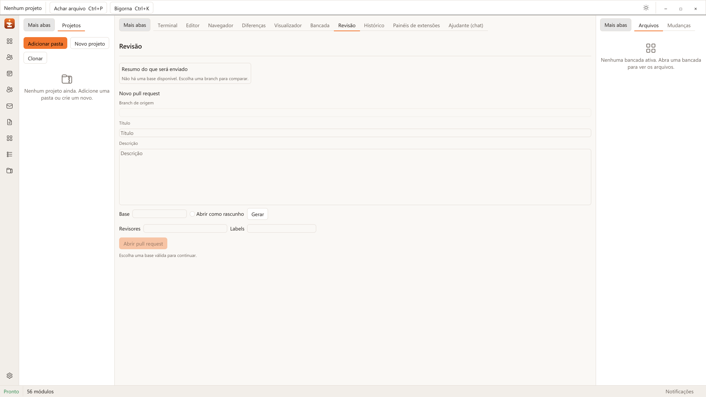

# Revisão (aba de bancada) — tema claro

Tela da aba "Revisão" de uma bancada da Forja, que concentra a criação de um novo pull request; capturada sem projeto aberto, por isso os painéis laterais mostram estados vazios. Variante do tema claro da página de referência (pt-BR.dark.bench-tab.review.tab): a estrutura é a mesma, mudando as cores (fundo creme claro em vez de escuro) e alguns detalhes dos conjuntos de abas — os grupos exibem o botão de estouro "Mais abas" (um em cada painel) em vez de faixas de fundo, o painel direito mostra só as abas "Arquivos" e "Mudanças" além de "Mais abas", e o botão de novo projeto do painel esquerdo chama-se "Novo projeto" (na referência escura, "Novo").

## Como chegar
Abrir o app sem projeto carregado (rótulo "Nenhum projeto" na barra superior), entrar na bancada e clicar na aba "Revisão" do conjunto de abas da bancada. Comando de captura: `forja-app --locale pt-BR --theme light --bench-tab review.tab`.

## Regiões
- **Barra superior** — (0,0)–(1920,42): rótulo "Nenhum projeto", botões "Achar arquivo  Ctrl+P" e "Bigorna  Ctrl+K", ícone de tema (sol, sem nome acessível) e botões de janela "–", "□", "×".
- **Trilho à esquerda** — (0,42)–(56,1048): logotipo da Forja (imagem) no topo, seguido dos botões-ícone "Quadro", "Ajudantes", "Rotinas", "Mutirão", "Pedidos", "Skills", "Uso", "Extensões", "Acervo" e, na base, "Ajustes".
- **Painel esquerdo (Projetos)** — (56,42)–(304,1048): botão de estouro "Mais abas", aba "Projetos" (ativa, sublinhada); botões "Adicionar pasta" (primário laranja), "Novo projeto" e "Clonar"; estado vazio com ícone de pasta e o texto "Nenhum projeto ainda. Adicione uma pasta ou crie um novo.".
- **Área central (Revisão)** — (320,42)–(1612,1048): botão "Mais abas" e abas do cabeçalho ("Terminal", "Editor", "Navegador", "Diferenças", "Visualizador") e da bancada ("Bancada", "Revisão" ativa e sublinhada, "Histórico", "Painéis de extensões", "Ajudante (chat)"); título "Revisão"; caixa "Resumo do que será enviado" com a mensagem "Não há uma base disponível. Escolha uma branch para comparar."; formulário "Novo pull request" com rótulo "Branch de origem" (campo desativado), "Título", "Descrição" (multilinha), linha com "Base", "Abrir como rascunho" e "Gerar", campos "Revisores" e "Labels" e o botão desativado "Abrir pull request" com a mensagem "Escolha uma base válida para continuar.".
- **Painel direito (Arquivos)** — (1628,42)–(1920,1048): botão "Mais abas", abas "Arquivos" (ativa, sublinhada) e "Mudanças"; estado vazio com ícone de grade e o texto "Nenhuma bancada ativa. Abra uma bancada para ver os arquivos.".
- **Barra de status** — (0,1048)–(1920,1080): "Pronto" em verde e "56 módulos" à esquerda, "Notificações" à direita.
- Dois divisores verticais sem nome acessível separam os painéis: (304,42)–(320,1048) e (1612,42)–(1628,1048).

## Elementos
| Elemento | Tipo | Posição (px) | Estado | O que faz |
|---|---|---|---|---|
| "Achar arquivo  Ctrl+P" | Botão | (135,5)–(291,37) | — | Abre o seletor rápido de arquivos (atalho Ctrl+P) |
| "Bigorna  Ctrl+K" | Botão | (299,5)–(417,37) | — | Abre a paleta de comandos da Forja (atalho Ctrl+K) |
| (sem nome acessível) | Desconhecido | (1741,5)–(1773,37) | — | Ícone de sol; alterna o tema da interface |
| "–" | Botão | (1795,5)–(1827,37) | — | Minimiza a janela |
| "□" | Botão | (1835,5)–(1867,37) | — | Maximiza/restaura a janela |
| "×" | Botão | (1875,5)–(1909,37) | — | Fecha a janela |
| "Nenhum projeto" | Rótulo | (11,12)–(113,31) | — | Indica que nenhum projeto está aberto |
| (sem nome acessível) | Desconhecido | (304,42)–(320,1048) | — | Divisor vertical entre o painel esquerdo e a área central |
| (sem nome acessível) | Desconhecido | (1612,42)–(1628,1048) | — | Divisor vertical entre a área central e o painel direito |
| (sem nome acessível) | Imagem | (12,50)–(40,78) | — | Logotipo da Forja (bigorna) no topo do trilho |
| "Mais abas" | Botão | (64,50)–(149,85) | — | Abre a lista de abas ocultas do painel esquerdo |
| "Mais abas" | Botão | (324,50)–(409,85) | — | Abre a lista de abas ocultas do cabeçalho central |
| "Mais abas" | Botão | (1632,50)–(1717,85) | — | Abre a lista de abas ocultas do painel direito |
| "Projetos" | Botão | (157,52)–(231,84) | marcado=True | Aba ativa do painel esquerdo; mostra a lista de projetos (sublinhada) |
| "Terminal" | Botão | (417,52)–(494,84) | marcado=False | Aba do cabeçalho central; abre o terminal da bancada |
| "Editor" | Botão | (494,52)–(554,84) | marcado=False | Aba do cabeçalho central; abre o editor |
| "Navegador" | Botão | (554,52)–(646,84) | marcado=False | Aba do cabeçalho central; abre o navegador |
| "Diferenças" | Botão | (646,52)–(734,84) | marcado=False | Aba do cabeçalho central; mostra diffs |
| "Visualizador" | Botão | (734,52)–(832,84) | marcado=False | Aba do cabeçalho central; abre o visualizador |
| "Bancada" | Botão | (832,52)–(908,84) | marcado=False | Aba da bancada; visão geral da bancada |
| "Revisão" | Botão | (908,52)–(978,84) | marcado=True | Aba da bancada; abre a tela documentada (criação de pull request), sublinhada |
| "Histórico" | Botão | (978,52)–(1057,84) | marcado=False | Aba da bancada; histórico de commits |
| "Painéis de extensões" | Botão | (1057,52)–(1208,84) | marcado=False | Aba da bancada; painéis de extensões |
| "Ajudante (chat)" | Botão | (1208,52)–(1327,84) | marcado=False | Aba da bancada; chat do ajudante |
| "Arquivos" | Botão | (1725,52)–(1803,84) | marcado=True | Aba ativa do painel direito; lista de arquivos (sublinhada) |
| "Mudanças" | Botão | (1803,52)–(1890,84) | marcado=False | Aba do painel direito; mudanças não commitadas |
| "Quadro" | Botão | (8,94)–(44,130) | marcado=False | Ícone do trilho; abre o quadro de projetos |
| "Adicionar pasta" | Botão | (64,101)–(183,133) | — | Adiciona uma pasta de projeto existente (botão primário laranja) |
| "Novo projeto" | Botão | (191,101)–(297,133) | — | Cria um projeto novo |
| "Revisão" | Rótulo | (324,109)–(386,141) | — | Título da tela central |
| (ícone) | Rótulo | (1756,117)–(1784,145) | — | Ícone de grade acima da mensagem de estado vazio do painel direito |
| "Ajudantes" | Botão | (8,138)–(44,174) | marcado=False | Ícone do trilho; abre a lista de ajudantes de código |
| "Clonar" | Botão | (64,141)–(128,173) | — | Clona um repositório como novo projeto |
| "Nenhuma bancada ativa. Abra uma bancada para ver os arquivos." | Rótulo | (1634,153)–(1906,191) | — | Estado vazio do painel de arquivos, em duas linhas |
| "Resumo do que será enviado" | Rótulo | (331,178)–(510,197) | — | Título da caixa de resumo sobre a base de comparação |
| "Rotinas" | Botão | (8,182)–(44,218) | marcado=False | Ícone do trilho; abre as rotinas |
| (ícone) | Rótulo | (168,201)–(196,229) | — | Ícone de pasta do estado vazio do painel esquerdo |
| "Não há uma base disponível. Escolha uma branch para comparar." | Rótulo | (331,205)–(676,221) | — | Mensagem da caixa de resumo; explica por que não há base para comparar |
| "Mutirão" | Botão | (8,226)–(44,262) | marcado=False | Ícone do trilho; abre o mutirão |
| "Nenhum projeto ainda. Adicione uma pasta ou crie um novo." | Rótulo | (66,237)–(298,275) | — | Estado vazio do painel de projetos, em duas linhas |
| "Novo pull request" | Rótulo | (324,244)–(434,263) | — | Título do formulário de criação de pull request |
| "Pedidos" | Botão | (8,270)–(44,306) | marcado=False | Ícone do trilho; abre os pedidos (pull requests) |
| "Branch de origem" | Rótulo | (324,271)–(417,287) | — | Rótulo do campo de branch de origem do pull request |
| (sem nome acessível) | Campo de texto | (324,295)–(1608,318) | desativado | Campo de uma linha da branch de origem; desabilitado por falta de base |
| "Skills" | Botão | (8,314)–(44,350) | marcado=False | Ícone do trilho; abre as skills |
| "Título" | Rótulo | (324,326)–(354,342) | — | Rótulo do campo de título do pull request |
| (sem nome acessível) | Campo de texto | (324,350)–(1608,373) | — | Campo do título; exibe o texto de sugestão "Título" |
| "Descrição" | Rótulo | (324,381)–(375,397) | — | Rótulo do campo de descrição do pull request |
| "Extensões" | Botão | (8,402)–(44,438) | marcado=False | Ícone do trilho; abre as extensões |
| (sem nome acessível) | Campo de texto multilinha | (324,405)–(1608,558) | — | Campo "Descrição" do pull request; ocupa toda a largura da área central |
| "Acervo" | Botão | (8,446)–(44,482) | marcado=False | Ícone do trilho; abre o acervo |
| "Abrir como rascunho" | Caixa de seleção | (516,566)–(664,598) | marcado=False | Marca o pull request como rascunho |
| "Gerar" | Botão | (672,566)–(729,598) | — | Gera o título/descrição do pull request |
| (sem nome acessível) | Campo de texto | (360,570)–(508,593) | — | Campo do valor "Base" do pull request |
| "Base" | Rótulo | (324,572)–(352,591) | — | Rótulo do campo Base |
| (sem nome acessível) | Campo de texto | (390,610)–(618,633) | — | Campo de revisores do pull request |
| (sem nome acessível) | Campo de texto | (672,610)–(860,633) | — | Campo de labels do pull request |
| "Revisores" | Rótulo | (324,612)–(382,631) | — | Rótulo do campo de revisores |
| "Labels" | Rótulo | (626,612)–(664,631) | — | Rótulo do campo de labels |
| "Abrir pull request" | Botão | (324,646)–(455,678) | desativado | Cria o pull request com os dados do formulário; inativo até escolher uma base |
| "Escolha uma base válida para continuar." | Rótulo | (324,686)–(535,702) | — | Mensagem explicando por que o botão está desativado |
| "Ajustes" | Botão | (8,1004)–(44,1040) | marcado=False | Ícone do trilho; abre os ajustes (base do trilho) |
| "Pronto" | Rótulo | (10,1055)–(51,1074) | — | Estado geral do app na barra de status |
| "56 módulos" | Rótulo | (73,1055)–(146,1074) | — | Quantidade de módulos carregados |
| "Notificações" | Rótulo | (1810,1055)–(1886,1074) | — | Acesso às notificações na barra de status |

## Aparência
Tema claro: fundo creme/off-white nos painéis, na barra superior e na barra de status, com a área central em tom levemente distinto, separada por divisores finos. A cor de destaque é o laranja (accent "Brasa"), visto no logotipo, no sublinhado das abas ativas ("Projetos", "Revisão" e "Arquivos"), no botão primário "Adicionar pasta" (preenchido) e em "Abrir pull request" (preenchido em tom pálido por estar desativado); os demais botões têm contorno cinza sutil sobre fundo claro. Texto em cinza escuro para títulos e cinza médio para textos secundários; "Pronto" na barra de status em verde. Tipografia sans-serif em dois níveis (título "Revisão" maior; rótulos e abas menores). O painel esquerdo e o painel direito centralizam o estado vazio (ícone + texto em duas linhas). O formulário central usa rótulos à esquerda dos campos curtos ("Base", "Revisores", "Labels") e rótulos acima dos campos full-width ("Branch de origem", "Título", "Descrição"), com espaçamento vertical constante entre as linhas.

## Problemas encontrados
- Campos de texto sem nome acessível: branch de origem (324,295), "Título" (324,350), "Descrição" (324,405), Base (360,570), Revisores (390,610) e Labels (672,610); os rótulos existem na tela, mas não há associação explícita entre rótulo e campo.
- Elemento interativo sem nome acessível: ícone de tema na barra superior (1741,5)–(1773,37), que só expõe "click,focus".
- Botões de janela "–", "□" e "×" têm apenas símbolos como nome acessível, pouco descritivos para leitores de tela.
- Os divisores verticais (304,42)–(320,1048) e (1612,42)–(1628,1048) só expõem a ação "focus", sem ação de arrastar/redimensionar associada.
- "Abrir pull request" está desativado com texto laranja pálido sobre fundo laranja claro, em baixo contraste.
- O campo "Branch de origem" aparece desativado antes de qualquer interação; o motivo só é explicado longe do campo ("Não há uma base disponível. Escolha uma branch para comparar." no topo e "Escolha uma base válida para continuar." abaixo do botão), e não junto ao campo.
- "Abrir como rascunho" e "Gerar" ficam na mesma linha do campo "Base", um agrupamento que dificulta a leitura do formulário.
- Nenhum elemento com retângulo fora dos limites da janela (1920×1080) e nenhuma sobreposição entre abas nesta variante.
