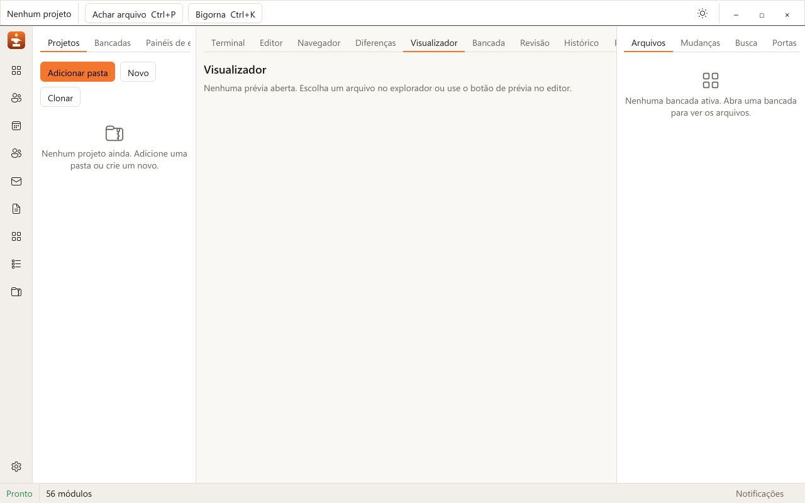

# Visualizador (aba da bancada) — estado vazio (tema claro)

Tela da aba "Visualizador" da bancada, que mostra prévias de arquivos; neste estado nenhum projeto está aberto e nenhuma prévia foi solicitada. Variante clara da página de referência (pt-BR.dark.bench-tab.viewers.tab), capturada em janela de 1920×1080 px.

## Como chegar
Abra o app (`forja-app`), clique na aba "Visualizador" na faixa de abas da área central. Comando de captura: `forja-app --locale pt-BR --theme light --bench-tab viewers.tab`.

## Regiões
Em relação à referência escura, a janela é mais larga (1920 px), então as três colunas têm mais espaço e não há textos cortados nem elementos fora da janela.
- **Barra superior** (0,0)–(1920,42): chip "Nenhum projeto", botões "Achar arquivo  Ctrl+P" e "Bigorna  Ctrl+K" à esquerda; ícone sem nome (tema claro, sol) em (1741,5) e os botões de janela "–", "□" e "×" à direita.
- **Trilho à esquerda** (0,42)–(52,1048): marca da Forja no topo (imagem sem nome em (12,50)), coluna de botões-ícone ("Quadro", "Ajudantes", "Rotinas", "Mutirão", "Pedidos", "Skills", "Uso", "Extensões", "Acervo") e, no pé, "Ajustes" em (8,1004).
- **Painel lateral esquerdo** (52,42)–(304,1048): faixa de abas com "Mais abas" e "Projetos" (ativa), botões "Adicionar pasta" (laranja), "Novo projeto" e "Clonar", ícone de pasta e a mensagem "Nenhum projeto ainda. Adicione uma pasta ou crie um novo." em duas linhas.
- **Divisor vertical esquerdo** (304,42)–(320,1048): faixa sem nome que separa o painel esquerdo da área central.
- **Área central** (320,42)–(1612,1048): faixa de abas com "Mais abas", "Terminal", "Editor", "Navegador", "Diferenças", "Visualizador" (ativa), "Bancada", "Revisão", "Histórico", "Painéis de extensões" e "Ajudante (chat)"; título "Visualizador" e a mensagem "Nenhuma prévia aberta. Escolha um arquivo no explorador ou use o botão de prévia no editor." em uma linha, sem corte.
- **Divisor vertical direito** (1612,42)–(1628,1048): faixa sem nome que separa a área central do painel direito.
- **Painel direito** (1628,42)–(1920,1048): faixa de abas com "Mais abas", "Arquivos" (ativa) e "Mudanças"; ícone de grade (1756,117) e a mensagem "Nenhuma bancada ativa. Abra uma bancada para ver os arquivos." em duas linhas.
- **Barra de status** (0,1048)–(1920,1080): "Pronto" à esquerda, "56 módulos" ao lado e "Notificações" à direita.

## Elementos
| Elemento | Tipo | Posição (px) | Estado | O que faz |
|---|---|---|---|---|
| "Achar arquivo  Ctrl+P" | Button | (135,5)–(291,37) | — | Abre a busca rápida de arquivos (atalho Ctrl+P). |
| "Bigorna  Ctrl+K" | Button | (299,5)–(417,37) | — | Abre a paleta de comandos (atalho Ctrl+K). |
| (sem nome acessível) | Unknown | (1741,5)–(1773,37) | — | Ícone de sol no canto direito da barra superior; alterna o tema. |
| "–" | Button | (1795,5)–(1827,37) | — | Minimiza a janela. |
| "□" | Button | (1835,5)–(1867,37) | — | Maximiza/restaura a janela. |
| "×" | Button | (1875,5)–(1909,37) | — | Fecha a janela. |
| "Nenhum projeto" | Label | (11,12)–(113,31) | — | Indica que não há projeto aberto. |
| (sem nome acessível) | Unknown | (304,42)–(320,1048) | — | Divisor vertical entre o painel esquerdo e a área central. |
| (sem nome acessível) | Unknown | (1612,42)–(1628,1048) | — | Divisor vertical entre a área central e o painel direito. |
| (sem nome acessível) | Image | (12,50)–(40,78) | — | Ícone/marca da Forja no topo do trilho. |
| "Mais abas" | Button | (64,50)–(149,85) | — | Revela abas adicionais do painel esquerdo. |
| "Mais abas" | Button | (324,50)–(409,85) | — | Revela abas adicionais da área central. |
| "Mais abas" | Button | (1632,50)–(1717,85) | — | Revela abas adicionais do painel direito. |
| "Projetos" | Button | (157,52)–(231,84) | marcado=True | Aba ativa do painel esquerdo; mostra a lista de projetos. |
| "Terminal" | Button | (417,52)–(494,84) | marcado=False | Aba do terminal. |
| "Editor" | Button | (494,52)–(554,84) | marcado=False | Aba do editor. |
| "Navegador" | Button | (554,52)–(646,84) | marcado=False | Aba do navegador. |
| "Diferenças" | Button | (646,52)–(734,84) | marcado=False | Aba de diferenças. |
| "Visualizador" | Button | (734,52)–(832,84) | marcado=True | Aba ativa da área central; mostra este visualizador. |
| "Bancada" | Button | (832,52)–(908,84) | marcado=False | Aba da bancada. |
| "Revisão" | Button | (908,52)–(978,84) | marcado=False | Aba de revisão. |
| "Histórico" | Button | (978,52)–(1057,84) | marcado=False | Aba de histórico. |
| "Painéis de extensões" | Button | (1057,52)–(1208,84) | marcado=False | Aba de painéis de extensões; cabe inteira na janela nesta largura. |
| "Ajudante (chat)" | Button | (1208,52)–(1327,84) | marcado=False | Aba do ajudante de chat. |
| "Arquivos" | Button | (1725,52)–(1803,84) | marcado=True | Aba ativa do painel direito; explorador de arquivos. |
| "Mudanças" | Button | (1803,52)–(1890,84) | marcado=False | Aba de mudanças. |
| "Quadro" | Button | (8,94)–(44,130) | marcado=False | Ícone do trilho; abre o quadro. |
| "Adicionar pasta" | Button | (64,101)–(183,133) | — | Botão laranja em destaque; abre seletor de pasta. |
| "Novo projeto" | Button | (191,101)–(297,133) | — | Cria um projeto novo. |
| "Visualizador" | Label | (324,109)–(423,133) | — | Título da área central. |
| (ícone) | Label | (1756,117)–(1784,145) | — | Ícone de grade do estado vazio do painel direito. |
| "Ajudantes" | Button | (8,138)–(44,174) | marcado=False | Ícone do trilho; abre os ajudantes. |
| "Clonar" | Button | (64,141)–(128,173) | — | Clona um repositório. |
| "Nenhuma prévia aberta. Escolha um arquivo no explorador ou use o botão de prévia no editor." | Label | (324,141)–(909,160) | — | Mensagem de estado vazio da área central, em uma linha, dentro do painel. |
| "Nenhuma bancada ativa. Abra uma bancada para ver os arquivos." | Label | (1634,153)–(1906,191) | — | Mensagem de estado vazio do painel direito, em duas linhas. |
| "Rotinas" | Button | (8,182)–(44,218) | marcado=False | Ícone do trilho; abre as rotinas. |
| (ícone) | Label | (168,201)–(196,229) | — | Ícone de pasta ilustrando o estado vazio do painel esquerdo. |
| "Mutirão" | Button | (8,226)–(44,262) | marcado=False | Ícone do trilho; abre o mutirão. |
| "Nenhum projeto ainda. Adicione uma pasta ou crie um novo." | Label | (66,237)–(298,275) | — | Mensagem de estado vazio do painel esquerdo, em duas linhas. |
| "Pedidos" | Button | (8,270)–(44,306) | marcado=False | Ícone do trilho; abre os pedidos. |
| "Skills" | Button | (8,314)–(44,350) | marcado=False | Ícone do trilho; abre as skills. |
| "Uso" | Button | (8,358)–(44,394) | marcado=False | Ícone do trilho; abre o uso. |
| "Extensões" | Button | (8,402)–(44,438) | marcado=False | Ícone do trilho; abre as extensões. |
| "Acervo" | Button | (8,446)–(44,482) | marcado=False | Ícone do trilho; abre o acervo. |
| "Ajustes" | Button | (8,1004)–(44,1040) | marcado=False | Ícone do trilho; abre os ajustes. |
| "Pronto" | Label | (10,1055)–(51,1074) | — | Estado geral na barra de status, em verde. |
| "56 módulos" | Label | (73,1055)–(146,1074) | — | Quantidade de módulos carregados. |
| "Notificações" | Label | (1810,1055)–(1886,1074) | — | Abre a área de notificações. |

## Aparência
Diferentemente da referência escura, o tema claro usa fundo geral off-white (bege claro) nos painéis, com a barra superior e a barra de status em tom levemente mais escuro; os divisores verticais aparecem como faixas cinza-claro. O destaque continua sendo o laranja da marca (Brasa): preenchimento sólido no botão "Adicionar pasta" e sublinhado laranja sob as abas ativas ("Projetos", "Visualizador" e "Arquivos"). O texto é cinza médio nas mensagens de estado vazio e cinza escuro/quase preto nos títulos e abas; "Pronto" permanece em verde. Tipografia sem serifa, corpo pequeno (abas e barra de status) e médio no título "Visualizador". O trilho à esquerda usa apenas ícones de 36 px em coluna única; as mensagens vazias são centralizadas horizontalmente em seus painéis. Como a janela tem 1920 px de largura, todas as abas e textos cabem sem corte — na referência escura (1024 px) havia sobreposições e elementos fora da janela que não ocorrem aqui.

## Problemas encontrados
- Botão sem nome acessível: o ícone de tema claro/escuro em (1741,5)–(1773,37) é exposto como "Unknown" sem rótulo (na imagem é um ícone de sol).
- Imagem sem nome acessível: a marca da Forja em (12,50)–(40,78) não tem rótulo.
- Três ocorrências do botão "Mais abas" compartilham o mesmo nome sem distinção (painel esquerdo, área central e painel direito), o que dificulta a identificação por leitor de tela.
- Nenhum texto cortado, elemento fora da janela ou sobreposição visível nesta captura.
