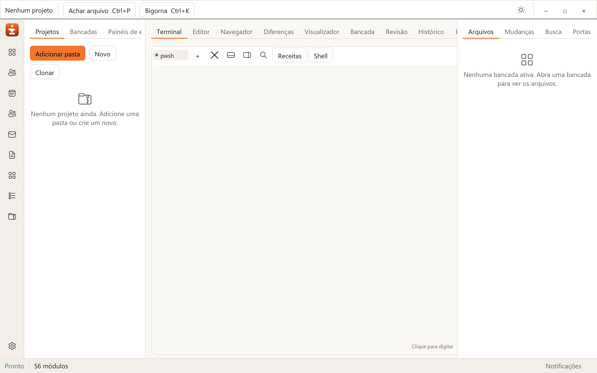

# Tela inicial (home, sem projeto)

É a janela principal da Forja no estado vazio, sem projeto aberto: mostra o trilho de navegação lateral, o painel de Projetos vazio, o Terminal central e o painel Arquivos aguardando uma bancada ativa.

## Como chegar
É a tela padrão do app: iniciar `forja-app --locale pt-BR --theme light`. Nenhuma interação é necessária — é o estado `pt-BR.light.home.default`. Comando de captura: rotina do Atlas gravando `captures/pt-BR.light.home.default.png` (pixels, escala 1.0).

## Regiões
- **Barra superior** (aprox. (0,0)–(1920,42)): rótulo "Nenhum projeto" à esquerda, botões "Achar arquivo  Ctrl+P" e "Bigorna  Ctrl+K", e, à direita, o botão de alternância de tema (ícone de sol, sem nome acessível, (1741,5)–(1773,37)) seguido dos botões de janela "–", "□" e "×".
- **Trilho à esquerda** (aprox. (0,42)–(52,1048)): logotipo (imagem laranja em forma de bigorna, (12,50)–(40,78)) e, de cima para baixo, os ícones "Quadro", "Ajudantes", "Rotinas", "Mutirão", "Pedidos", "Skills", "Uso", "Extensões", "Acervo" e, colado ao rodapé, "Ajustes".
- **Painel lateral esquerdo — Projetos** (aprox. (52,42)–(304,1048)): faixa de abas com "Mais abas" e "Projetos" (ativa); botões "Adicionar pasta" (destacado em laranja), "Novo projeto" e "Clonar"; estado vazio com ícone de pasta (rótulo "(ícone)", (168,201)–(196,229)) e o texto "Nenhum projeto ainda. Adicione uma pasta ou crie um novo.".
- **Divisores verticais** (aprox. (304,42)–(320,1048) e (1612,42)–(1628,1048)): faixas estreitas sem nome acessível entre o painel esquerdo, a área central e o painel direito (redimensionadores de painel).
- **Área central — Terminal** (aprox. (320,42)–(1612,1048)): faixa de abas com "Mais abas" e as abas "Terminal" (ativa), "Editor", "Navegador", "Diferenças", "Visualizador", "Bancada", "Revisão", "Histórico", "Painéis de extensões" e "Ajudante (chat)" — nesta captura a janela é larga (1920 px) e todas cabem visíveis; barra de ferramentas do terminal com "+", quatro botões de ícone sem nome acessível, "Receitas" e "Shell"; pílula de sessão "pwsh · Em execução" com o botão interno "Fechar pwsh"; área vazia de texto do terminal ((328,150)–(1604,1036)) com a sugestão "Clique para digitar" no canto inferior direito (~(1478,1017)–(1571,1030)).
- **Painel direito — Arquivos** (aprox. (1628,42)–(1920,1048)): faixa de abas com "Mais abas", "Arquivos" (ativa) e "Mudanças"; estado vazio com ícone de grade (rótulo "(ícone)", (1756,117)–(1784,145)) e o texto "Nenhuma bancada ativa. Abra uma bancada para ver os arquivos.".
- **Barra de status** (aprox. (0,1048)–(1920,1080)): rótulos "Pronto" (em verde) e "56 módulos" à esquerda e "Notificações" à direita.

## Elementos
| Elemento | Tipo | Posição (px) | Estado | O que faz |
|---|---|---|---|---|
| "Nenhum projeto" | Label | (11,12)–(113,31) | clicável | Mostra o projeto atual (nenhum). |
| "Achar arquivo  Ctrl+P" | Button | (135,5)–(291,37) | normal | Abre o localizador de arquivos (atalho Ctrl+P). |
| "Bigorna  Ctrl+K" | Button | (299,5)–(417,37) | normal | Abre a paleta de comandos (atalho Ctrl+K). |
| (sem nome acessível) | Unknown | (1741,5)–(1773,37) | normal | Ícone de sol: alterna o tema (claro/escuro). |
| "–" | Button | (1795,5)–(1827,37) | normal | Minimiza a janela. |
| "□" | Button | (1835,5)–(1867,37) | normal | Maximiza/restaura a janela. |
| "×" | Button | (1875,5)–(1909,37) | normal | Fecha a janela. |
| (sem nome acessível) | Unknown | (304,42)–(320,1048) | foco | Divisor arrastável entre painel esquerdo e área central. |
| (sem nome acessível) | Unknown | (1612,42)–(1628,1048) | foco | Divisor arrastável entre área central e painel direito. |
| (sem nome acessível) | Image | (12,50)–(40,78) | clicável | Logotipo da Forja no topo do trilho. |
| "Mais abas" | Button | (64,50)–(149,85) | normal | Lista suspeita de abas ocultas do painel esquerdo. |
| "Projetos" | Button | (157,52)–(231,84) | marcado=True | Aba ativa do painel esquerdo; lista projetos. |
| "Mais abas" | Button | (324,50)–(409,85) | normal | Lista suspeita de abas ocultas da área central. |
| "Terminal" | Button | (417,52)–(494,84) | marcado=True | Aba ativa da área central; mostra o terminal. |
| "Editor" | Button | (494,52)–(554,84) | marcado=False | Aba do editor de arquivos. |
| "Navegador" | Button | (554,52)–(646,84) | marcado=False | Aba do navegador integrado. |
| "Diferenças" | Button | (646,52)–(734,84) | marcado=False | Aba de comparação de diffs. |
| "Visualizador" | Button | (734,52)–(832,84) | marcado=False | Aba do visualizador de arquivos. |
| "Bancada" | Button | (832,52)–(908,84) | marcado=False | Aba de informações da bancada. |
| "Revisão" | Button | (908,52)–(978,84) | marcado=False | Aba de revisão. |
| "Histórico" | Button | (978,52)–(1057,84) | marcado=False | Aba de histórico. |
| "Painéis de extensões" | Button | (1057,52)–(1208,84) | marcado=False | Aba de painéis de extensões. |
| "Ajudante (chat)" | Button | (1208,52)–(1327,84) | marcado=False | Aba do chat do ajudante. |
| "Mais abas" | Button | (1632,50)–(1717,85) | normal | Lista suspeita de abas ocultas do painel direito. |
| "Arquivos" | Button | (1725,52)–(1803,84) | marcado=True | Aba ativa do painel direito; lista arquivos da bancada. |
| "Mudanças" | Button | (1803,52)–(1890,84) | marcado=False | Aba de mudanças pendentes. |
| "Quadro" | Button | (8,94)–(44,130) | marcado=False | Ícone do quadro geral (projetos/bancadas). |
| "Adicionar pasta" | Button | (64,101)–(183,133) | normal (destaque laranja) | Adiciona uma pasta de projeto existente. |
| "Novo projeto" | Button | (191,101)–(297,133) | normal | Cria um projeto novo. |
| "Clonar" | Button | (64,141)–(128,173) | normal | Clona um repositório/projeto. |
| "Ajudantes" | Button | (8,138)–(44,174) | marcado=False | Ícone do painel de ajudantes (agentes de IA). |
| "Rotinas" | Button | (8,182)–(44,218) | marcado=False | Ícone do painel de rotinas. |
| "Mutirão" | Button | (8,226)–(44,262) | marcado=False | Ícone do painel de mutirão (tarefas em lote). |
| "Pedidos" | Button | (8,270)–(44,306) | marcado=False | Ícone do painel de pedidos. |
| "Skills" | Button | (8,314)–(44,350) | marcado=False | Ícone do painel de skills. |
| "Uso" | Button | (8,358)–(44,394) | marcado=False | Ícone do painel de uso. |
| "Extensões" | Button | (8,402)–(44,438) | marcado=False | Ícone do painel de extensões. |
| "Acervo" | Button | (8,446)–(44,482) | marcado=False | Ícone do painel de acervo. |
| "Ajustes" | Button | (8,1004)–(44,1040) | marcado=False | Ícone de ajustes, no rodapé do trilho. |
| "+" | Button | (407,113)–(441,145) | normal | Abre nova aba/sessão de terminal. |
| (sem nome acessível) | Unknown | (444,113)–(476,145) | clicável | Ícone de fechar (X): encerra o terminal. |
| (sem nome acessível) | Unknown | (479,113)–(511,145) | clicável | Ícone de retângulo: alterna a exibição do terminal. |
| (sem nome acessível) | Unknown | (514,113)–(546,145) | clicável | Ícone de painel: alterna o terminal em painel dedicado. |
| (sem nome acessível) | Unknown | (549,113)–(581,145) | clicável | Ícone de lupa: busca no terminal. |
| "Receitas" | Button | (584,113)–(658,145) | normal | Abre a lista de receitas de terminal. |
| "Shell" | Button | (661,113)–(714,145) | normal | Seletor do shell da sessão (pwsh). |
| "pwsh · Em execução" | Button | (328,118)–(404,140) | normal | Pílula da sessão ativa "pwsh", com ponto verde de status; clique foca a sessão. |
| "Fechar pwsh" | Button | (385,121)–(401,137) | normal | Botão interno da pílula: encerra a sessão pwsh. |
| (ícone) | Label | (1756,117)–(1784,145) | clicável | Ícone de grade do estado vazio do painel Arquivos. |
| (sem nome acessível) | Unknown | (328,150)–(1604,1036) | clicável | Área de texto do terminal (vazia); clique foca o terminal. |
| "Nenhuma bancada ativa. Abra uma bancada para ver os arquivos." | Label | (1634,153)–(1906,191) | clicável | Estado vazio do painel Arquivos. |
| (ícone) | Label | (168,201)–(196,229) | clicável | Ícone de pasta do estado vazio do painel Projetos. |
| "Nenhum projeto ainda. Adicione uma pasta ou crie um novo." | Label | (66,237)–(298,275) | clicável | Estado vazio do painel Projetos. |
| "Pronto" | Label | (10,1055)–(51,1074) | clicável | Estado geral do app na barra de status. |
| "56 módulos" | Label | (73,1055)–(146,1074) | clicável | Contagem de módulos carregados. |
| "Notificações" | Label | (1810,1055)–(1886,1074) | clicável | Acesso a notificações na barra de status. |

## Aparência
Variante clara da mesma tela da página de referência (pt-BR.dark.home.default): a estrutura e a disposição são as mesmas, com as diferenças abaixo.
- **Cores**: fundo creme/off-white (aproximadamente #faf6f0) na janela e nos painéis, em vez do grafite escuro; a área do terminal aparece como cartão levemente mais claro com borda discreta. Texto em cinza-escuro/quase preto, com rótulos de estado vazio em cinza médio centralizados.
- **Acento "Brasa"**: mantém o laranja — o botão "Adicionar pasta" tem fundo laranja com texto claro, as abas ativas ("Projetos", "Terminal", "Arquivos") recebem sublinhado e texto em laranja, e o logotipo do trilho é laranja. Na barra de status, "Pronto" aparece em verde, indicando estado saudável.
- **Contraste**: textos escuros sobre fundo claro com contraste confortável; os pontos de menor contraste são os ícones cinza do trilho e da barra de ferramentas do terminal.
- **Tipografia e alinhamento**: sans-serif compacta (~13 px), igual à referência. Como a janela desta captura é maior (1920×1080 contra 1024×768 da referência), a faixa de abas central exibe todas as abas ("Terminal" a "Ajudante (chat)") sem cortes, e o painel direito mostra apenas "Arquivos" e "Mudanças"; na referência várias dessas abas transbordavam a janela.
- **Pílula de sessão**: nesta variante a pílula é acessível ("pwsh · Em execução") com botão "Fechar pwsh" dentro dela; na referência aparecia como elemento sem nome.

## Problemas encontrados
- Botões sem nome acessível (acessibilidade): o alternador de tema (1741,5)–(1773,37) e os quatro ícones da barra do terminal (444,113)–(581,145) não expõem nome; dependem de reconhecimento visual, sem rótulo ou tooltip acessível na árvore.
- Elementos sem nome acessível: os dois divisores de painel ((304,42)–(320,1048) e (1612,42)–(1628,1048)) e a área de texto do terminal (328,150)–(1604,1036).
- O botão "Fechar pwsh" (385,121)–(401,137) tem apenas 16×16 px — alvo de clique muito pequeno — e sobrepõe a pílula "pwsh · Em execução" (328,118)–(404,140) por design.
- O texto "Clique para digitar" na área do terminal (canto inferior direito, ~(1478,1017)–(1571,1030)) não corresponde a nenhum elemento da árvore de acessibilidade.
- Estados com pixels idênticos a esta captura incluem modais que deveriam alterar a imagem (pt-BR.light.modal.bench.dialogs, pt-BR.light.modal.counter.poller, pt-BR.light.modal.mcp.approval, pt-BR.light.modal.notify.toasts, pt-BR.light.modal.onboarding.wizard, pt-BR.light.modal.project.dialogs, pt-BR.light.modal.voice.overlay, pt-BR.light.right-tab.explorer.panel e pt-BR.light.bench-tab.terminal.tab): nessas capturas nenhum diálogo, aviso ou sobreposição aparece renderizado.
- Nenhum elemento da árvore tem retângulo além dos limites da imagem (1920×1080) nesta variante — os cortes de abas relatados na referência escura não ocorrem aqui.
