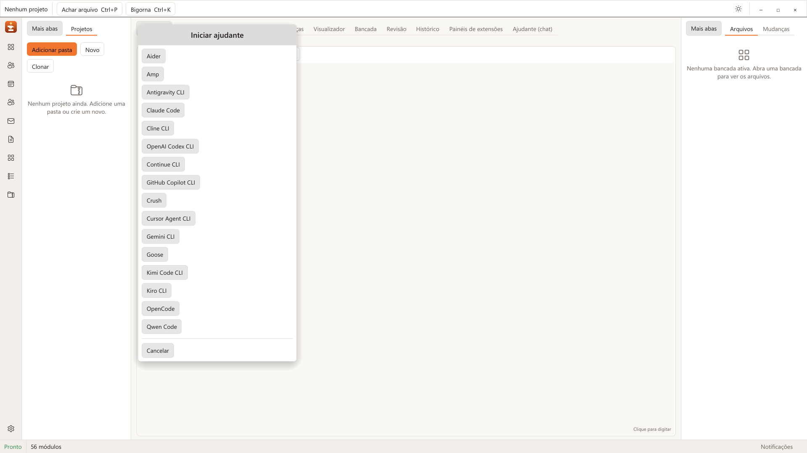

# Iniciar ajudante (modal helper.profile_picker)

Modal central que lista os ajudantes de código (agentes de IA) disponíveis para iniciar uma sessão na bancada atual.

*Variante clara (light) da página de referência [pt-BR.dark.modal.helper.profile_picker](pt-BR.dark.modal.helper.profile_picker.md). A estrutura é a mesma; mudam o tema (fundos e textos claros em vez de escuros) e as coordenadas, porque a janela capturada é maior (1920×1080 px em vez de 1024×768) — nessa captura o modal aparece inteiro, sem cortes na borda inferior.*

## Como chegar
Na janela principal, acione a ação de iniciar ajudante (o painel de "Ajudantes" fica no trilho à esquerda; o modal abre sobreposto ao app). Captura: `forja-app --locale pt-BR --theme light --modal helper.profile_picker`.

## Regiões
- **Barra superior do app** — (0,0)–(1920,42). À esquerda o rótulo "Nenhum projeto" e os botões "Achar arquivo  Ctrl+P" e "Bigorna  Ctrl+K"; à direita um botão de tema sem nome acessível (1741,5)–(1773,37) e os botões de janela "–", "□", "×".
- **Trilho à esquerda** — (0,42)–(52,1048). Coluna de ícones: "Quadro", "Ajudantes", "Rotinas", "Mutirão", "Pedidos", "Skills", "Uso", "Extensões" e "Acervo", todos não marcados, com "Ajustes" isolado na base (8,1004)–(44,1040); no topo, um ícone de módulo ativo em laranja (12,50)–(40,78).
- **Painel lateral esquerdo (Projetos)** — (52,42)–(320,1048). Aba "Projetos" (marcada) e botão "Mais abas"; ações "Adicionar pasta" (laranja), "Novo projeto" e "Clonar"; estado vazio com ícone de pasta (168,201)–(196,229) e o rótulo "Nenhum projeto ainda. Adicione uma pasta ou crie um novo.".
- **Área central** — (320,42)–(1628,1048). Linha de abas "Terminal" (marcada), "Editor", "Navegador", "Diferenças", "Visualizador", "Bancada", "Revisão", "Histórico", "Painéis de extensões" e "Ajudante (chat)", com "Mais abas" na ponta; abaixo, barra com "+", quatro controles sem nome, "Receitas" e "Shell"; conteúdo de terminal ("pwsh · Em execução") quase todo coberto pelo modal, restando visível a área de entrada com o texto "Clique para digitar" no canto inferior direito.
- **Modal "Iniciar ajudante"** — (328,58)–(706,862). Coluna clara sobreposta ao centro do app; barra de título cinza (361,59)–(673,107) com o texto "Iniciar ajudante" centralizado e corpo com a lista vertical de chips de ajudantes (de "Aider" a "Qwen Code") e o botão "Cancelar" no fim, separado por uma linha divisória.
- **Painel direito (Arquivos)** — (1628,42)–(1920,1048). Botão "Mais abas" e abas "Arquivos" (marcada, com sublinhado laranja) e "Mudanças"; estado vazio com ícone de grade (1756,117)–(1784,145) e o rótulo "Nenhuma bancada ativa. Abra uma bancada para ver os arquivos.".
- **Barra de status** — (0,1048)–(1920,1080). "Pronto" em verde à esquerda, "56 módulos" ao lado e "Notificações" à direita.

## Elementos
| Elemento | Tipo | Posição (px) | Estado | O que faz |
|---|---|---|---|---|
| "Achar arquivo  Ctrl+P" | Botão | (135,5)–(291,37) | clique, foco | Abre a busca rápida de arquivos (atalho Ctrl+P) |
| "Bigorna  Ctrl+K" | Botão | (299,5)–(417,37) | clique, foco | Abre a paleta de comandos (Ctrl+K) |
| (sem nome acessível) | Desconhecido | (1741,5)–(1773,37) | clique, foco | Botão de alternância de tema (ícone de sol) |
| "–" | Botão | (1795,5)–(1827,37) | clique, foco | Minimiza a janela |
| "□" | Botão | (1835,5)–(1867,37) | clique, foco | Maximiza/restaura a janela |
| "×" | Botão | (1875,5)–(1909,37) | clique, foco | Fecha a janela |
| "Nenhum projeto" | Rótulo | (11,12)–(113,31) | clique, foco | Indica ausência de projeto selecionado |
| (sem nome acessível) | Desconhecido | (304,42)–(320,1048) | foco | Divisor vertical entre painel esquerdo e área central |
| (sem nome acessível) | Desconhecido | (1612,42)–(1628,1048) | foco | Divisor vertical entre área central e painel direito |
| (sem nome acessível) | Imagem | (12,50)–(40,78) | clique, foco | Ícone do módulo ativo no topo do trilho (laranja) |
| "Mais abas" | Botão | (64,50)–(149,85) | clique, foco | Exibe abas adicionais do painel esquerdo |
| "Mais abas" | Botão | (324,50)–(409,85) | clique, foco | Exibe abas adicionais da área central; parcialmente coberto pelo modal |
| "Mais abas" | Botão | (1632,50)–(1717,85) | clique, foco | Exibe abas adicionais do painel direito |
| "Projetos" | Botão (aba) | (157,52)–(231,84) | clique, foco; marcado=True | Mostra o painel de projetos (sublinhado laranja) |
| "Terminal" | Botão (aba) | (417,52)–(494,84) | clique, foco; marcado=True | Aba central ativa; coberta pelo modal |
| "Editor" | Botão (aba) | (494,52)–(554,84) | clique, foco; marcado=False | Aba do editor; coberta pelo modal |
| "Navegador" | Botão (aba) | (554,52)–(646,84) | clique, foco; marcado=False | Aba do navegador; coberta pelo modal |
| "Diferenças" | Botão (aba) | (646,52)–(734,84) | clique, foco; marcado=False | Aba de diferenças; início coberto pelo modal (só "…zas" visível) |
| "Visualizador" | Botão (aba) | (734,52)–(832,84) | clique, foco; marcado=False | Aba do visualizador |
| "Bancada" | Botão (aba) | (832,52)–(908,84) | clique, foco; marcado=False | Aba da bancada |
| "Revisão" | Botão (aba) | (908,52)–(978,84) | clique, foco; marcado=False | Aba de revisão |
| "Histórico" | Botão (aba) | (978,52)–(1057,84) | clique, foco; marcado=False | Aba de histórico |
| "Painéis de extensões" | Botão (aba) | (1057,52)–(1208,84) | clique, foco; marcado=False | Aba dos painéis de extensões |
| "Ajudante (chat)" | Botão (aba) | (1208,52)–(1327,84) | clique, foco; marcado=False | Aba do chat do ajudante |
| "Arquivos" | Botão (aba) | (1725,52)–(1803,84) | clique, foco; marcado=True | Mostra a lista de arquivos da bancada (sublinhado laranja) |
| "Mudanças" | Botão (aba) | (1803,52)–(1890,84) | clique, foco; marcado=False | Aba de mudanças |
| "Iniciar ajudante" | Janela (modal) | (328,58)–(706,862) | foco | Modal de escolha do ajudante; recebe o foco ao abrir e está inteiramente dentro da imagem |
| (sem nome acessível) | Desconhecido | (361,59)–(673,107) | clique, foco | Barra de título cinza do modal, sobre a qual se lê "Iniciar ajudante" |
| "Quadro" | Botão (ícone) | (8,94)–(44,130) | clique, foco; marcado=False | Abre o quadro no trilho |
| "Adicionar pasta" | Botão | (64,101)–(183,133) | clique, foco | Destaque laranja; abre seletor de pasta para criar projeto |
| "Novo projeto" | Botão | (191,101)–(297,133) | clique, foco | Cria um projeto novo |
| "+" | Botão | (407,113)–(441,145) | clique, foco | Ação adicional da barra central; coberto pelo modal |
| (sem nome acessível) | Desconhecido | (444,113)–(476,145) | clique, foco | Controle da barra central, oculto pelo modal |
| (sem nome acessível) | Desconhecido | (479,113)–(511,145) | clique, foco | Controle da barra central, oculto pelo modal |
| (sem nome acessível) | Desconhecido | (514,113)–(546,145) | clique, foco | Controle da barra central, oculto pelo modal |
| (sem nome acessível) | Desconhecido | (549,113)–(581,145) | clique, foco | Controle da barra central, oculto pelo modal |
| "Receitas" | Botão | (584,113)–(658,145) | clique, foco | Abre receitas; oculto pelo modal |
| "Shell" | Botão | (661,113)–(714,145) | clique, foco | Abre o shell; quase todo oculto pelo modal (borda em x=706) |
| "Aider" | Botão (chip) | (337,116)–(394,151) | clique, foco | Seleciona o ajudante Aider |
| (ícone) | Rótulo | (1756,117)–(1784,145) | clique | Ícone de grade do estado vazio do painel de arquivos |
| "pwsh · Em execução" | Botão | (328,118)–(404,140) | clique, foco | Aba do terminal pwsh em execução; coberta pelo modal |
| "Fechar pwsh" | Botão | (385,121)–(401,137) | clique, foco | Fecha o terminal pwsh; coberto pelo modal |
| "Ajudantes" | Botão (ícone) | (8,138)–(44,174) | clique, foco; marcado=False | Abre o painel de ajudantes |
| "Clonar" | Botão | (64,141)–(128,173) | clique, foco | Clona um repositório como projeto |
| (sem nome acessível) | Desconhecido | (328,150)–(1604,1036) | clique, foco | Área de conteúdo central (terminal) atrás do modal; sem nome |
| "Nenhuma bancada ativa. Abra uma bancada para ver os arquivos." | Rótulo | (1634,153)–(1906,191) | clique | Mensagem de estado vazio do painel de arquivos |
| "Amp" | Botão (chip) | (337,159)–(390,194) | clique, foco | Seleciona o ajudante Amp |
| "Rotinas" | Botão (ícone) | (8,182)–(44,218) | clique, foco; marcado=False | Abre o painel de rotinas |
| (ícone) | Rótulo | (168,201)–(196,229) | clique | Ícone de pasta do estado vazio de projetos |
| "Antigravity CLI" | Botão (chip) | (337,202)–(451,237) | clique, foco | Seleciona o ajudante Antigravity CLI |
| "Mutirão" | Botão (ícone) | (8,226)–(44,262) | clique, foco; marcado=False | Abre o painel de mutirão |
| "Nenhum projeto ainda. Adicione uma pasta ou crie um novo." | Rótulo | (66,237)–(298,275) | clique | Mensagem de estado vazio de projetos |
| "Claude Code" | Botão (chip) | (337,245)–(439,280) | clique, foco | Seleciona o ajudante Claude Code |
| "Pedidos" | Botão (ícone) | (8,270)–(44,306) | clique, foco; marcado=False | Abre o painel de pedidos |
| "Cline CLI" | Botão (chip) | (337,288)–(414,323) | clique, foco | Seleciona o ajudante Cline CLI |
| "Skills" | Botão (ícone) | (8,314)–(44,350) | clique, foco; marcado=False | Abre o painel de skills |
| "OpenAI Codex CLI" | Botão (chip) | (337,331)–(473,366) | clique, foco | Seleciona o ajudante OpenAI Codex CLI |
| "Uso" | Botão (ícone) | (8,358)–(44,394) | clique, foco; marcado=False | Abre o painel de uso |
| "Continue CLI" | Botão (chip) | (337,374)–(440,409) | clique, foco | Seleciona o ajudante Continue CLI |
| "Extensões" | Botão (ícone) | (8,402)–(44,438) | clique, foco; marcado=False | Abre o painel de extensões |
| "GitHub Copilot CLI" | Botão (chip) | (337,417)–(476,452) | clique, foco | Seleciona o ajudante GitHub Copilot CLI |
| "Acervo" | Botão (ícone) | (8,446)–(44,482) | clique, foco; marcado=False | Abre o painel de acervo |
| "Crush" | Botão (chip) | (337,460)–(396,495) | clique, foco | Seleciona o ajudante Crush |
| "Cursor Agent CLI" | Botão (chip) | (337,503)–(465,538) | clique, foco | Seleciona o ajudante Cursor Agent CLI |
| (sem nome acessível) | Desconhecido | (960,540)–(960,540) | clique, foco | Elemento de dimensão nula (retrôo da árvore) |
| "Gemini CLI" | Botão (chip) | (337,546)–(427,581) | clique, foco | Seleciona o ajudante Gemini CLI |
| "Goose" | Botão (chip) | (337,589)–(400,624) | clique, foco | Seleciona o ajudante Goose |
| "Kimi Code CLI" | Botão (chip) | (337,632)–(447,667) | clique, foco | Seleciona o ajudante Kimi Code CLI |
| "Kiro CLI" | Botão (chip) | (337,675)–(408,710) | clique, foco | Seleciona o ajudante Kiro CLI |
| "OpenCode" | Botão (chip) | (337,718)–(427,753) | clique, foco | Seleciona o ajudante OpenCode |
| "Qwen Code" | Botão (chip) | (337,761)–(432,796) | clique, foco | Seleciona o ajudante Qwen Code; último chip da lista |
| "Cancelar" | Botão | (337,818)–(414,853) | clique, foco | Fecha o modal sem escolher; visível por completo nesta captura |
| "Ajustes" | Botão (ícone) | (8,1004)–(44,1040) | clique, foco; marcado=False | Abre o painel de ajustes, na base do trilho |
| "Pronto" | Rótulo | (10,1055)–(51,1074) | clique | Status geral em verde na barra de status |
| "56 módulos" | Rótulo | (73,1055)–(146,1074) | clique | Contagem de módulos carregados |
| "Notificações" | Rótulo | (1810,1055)–(1886,1074) | clique, foco | Atalho para notificações, à direita da barra de status |

## Aparência
Tema claro: fundo off-white/creme no app, painéis claros e modal branco com sombra projetada e cantos arredondados; a barra de título do modal é uma faixa cinza com o texto "Iniciar ajudante" centralizado em cinza-escuro. Acento laranja ("Brasa") no botão "Adicionar pasta", no ícone do módulo ativo do trilho e no sublinhado das abas marcadas ("Projetos", "Arquivos"). Os chips de ajudantes são retângulos arredondados cinza-claro com texto escuro, empilhados em coluna única alinhada à esquerda a partir de x≈337, com espaçamento vertical regular de ~43 px; uma linha divisória separa a lista do botão "Cancelar". Texto em fonte sem serifa de ~13–15 px, cinza-escuro sobre fundo claro, com bom contraste; mensagens de estado vazio em cinza médio. "Pronto" aparece em verde na barra de status, e "Clique para digitar" em cinza claro no canto inferior direito da área de terminal.

## Problemas encontrados
- O modal sobrepõe a área central: as abas "Terminal", "Editor" e "Navegador", o início da aba "Diferenças", o botão "Mais abas" central (324,50)–(409,85), os botões "+" e "Receitas" e a aba de terminal "pwsh · Em execução" com "Fechar pwsh" continuam na árvore de acessibilidade mas estão invisíveis ou ilegíveis para o usuário; "Shell" e o "Mais abas" central ficam parcialmente encobertos.
- Botão de tema na barra superior (1741,5)–(1773,37), os quatro controles da barra central (444–581,113–145), os dois divisores verticais (304–320 e 1612–1628) e a grande área de conteúdo central (328,150)–(1604,1036) sem nome acessível.
- Rótulos de ícone expostos como "(ícone)" (grade e pasta dos estados vazios), sem nome descritivo.
- Elemento de dimensão nula na árvore em (960,540)–(960,540).
