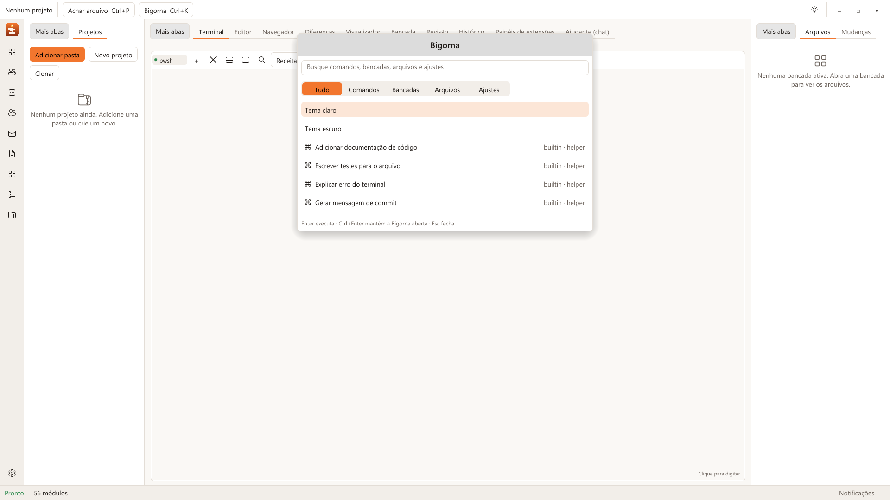

# Bigorna sobre a tela inicial (sem projeto)

Tela inicial da Forja sem projeto aberto, com a sobreposição da Bigorna (paleta de comandos) aberta no centro; nesta variante o tema é claro.

## Como chegar
Na barra superior, clique no botão "Bigorna  Ctrl+K" (ou pressione Ctrl+K); o app abre direto nessa tela com `forja-app --locale pt-BR --theme light --open anvil` (captura em `captures/pt-BR.light.open.anvil.png`, 1920×1080 px).

## Regiões
- **Barra superior** (0,0)–(1920,42): rótulo do projeto ("Nenhum projeto"), botões "Achar arquivo  Ctrl+P" e "Bigorna  Ctrl+K", botão de tema (ícone de sol, sem nome), botões de janela "–", "□", "×".
- **Trilho de ícones à esquerda** (0,42)–(48,1048): logo da Forja (imagem em (12,50)–(40,78)) e ícones de navegação: "Quadro", "Ajudantes", "Rotinas", "Mutirão", "Pedidos", "Skills", "Uso", "Extensões", "Acervo" e, no fim, "Ajustes".
- **Painel lateral esquerdo (Projetos)** (48,42)–(304,1048): botão "Mais abas", abas "Projetos" (ativa) e o restante do grupo de abas do painel, botões "Adicionar pasta", "Novo projeto" e "Clonar", e estado vazio com ícone de pasta e o texto "Nenhum projeto ainda. Adicione uma pasta ou crie um novo.".
- **Divisor central** (304,42)–(320,1048): separador arrastável entre o painel esquerdo e a área central.
- **Área central** (320,42)–(1612,1048): barra de abas com "Mais abas", "Terminal" (ativa), "Editor", "Navegador", "Diferenças", "Visualizador", "Bancada", "Revisão", "Histórico", "Painéis de extensões" e "Ajudante (chat)"; abaixo, a barra do terminal com a aba "pwsh · Em execução" (com "Fechar pwsh" embutida), botões "+" e "Receitas"/"Shell" e quatro ícones de filtro; o corpo do terminal aparece vazio com a marca "Clique para digitar" no canto inferior direito. Sobre essa área ficam o pano de fundo da Bigorna (328,150)–(1604,1036) e a janela "Bigorna" (641,72)–(1279,499).
- **Divisor direito** (1612,42)–(1628,1048): separador arrastável.
- **Painel lateral direito (Arquivos)** (1628,42)–(1920,1048): botão "Mais abas", abas "Arquivos" (ativa) e "Mudanças", ícone de grade vazia e o texto "Nenhuma bancada ativa. Abra uma bancada para ver os arquivos.".
- **Barra de status** (0,1048)–(1920,1080): "Pronto", "56 módulos" e "Notificações".

## Elementos
| Elemento | Tipo | Posição (px) | Estado | O que faz |
|---|---|---|---|---|
| "Achar arquivo  Ctrl+P" | Button | (135,5)–(291,37) | — | Abre a busca de arquivos (atalho Ctrl+P). |
| "Bigorna  Ctrl+K" | Button | (299,5)–(417,37) | — | Abre/fecha a Bigorna (já aberta nesta captura). |
| (sem nome acessível) | Unknown | (1741,5)–(1773,37) | — | Ícone de sol: alterna tema claro/escuro. |
| "–" | Button | (1795,5)–(1827,37) | — | Minimiza a janela. |
| "□" | Button | (1835,5)–(1867,37) | — | Maximiza/restaura a janela. |
| "×" | Button | (1875,5)–(1909,37) | — | Fecha o app. |
| "Nenhum projeto" | Label | (11,12)–(113,31) | — | Indica que não há projeto aberto; clique reabre o painel de projetos. |
| (sem nome acessível) | Unknown | (304,42)–(320,1048) | — | Divisor arrastável entre o painel esquerdo e a área central. |
| (sem nome acessível) | Unknown | (1612,42)–(1628,1048) | — | Divisor arrastável entre a área central e o painel direito. |
| (sem nome acessível) | Image | (12,50)–(40,78) | — | Logo da Forja no topo do trilho. |
| "Mais abas" | Button | (64,50)–(149,85) | — | Lista as abas ocultas do painel esquerdo. |
| "Mais abas" | Button | (324,50)–(409,85) | — | Lista as abas ocultas da área central. |
| "Mais abas" | Button | (1632,50)–(1717,85) | — | Lista as abas ocultas do painel direito. |
| "Projetos" | Button | (157,52)–(231,84) | marcado=True | Aba ativa do painel esquerdo. |
| "Terminal" | Button | (417,52)–(494,84) | marcado=True | Aba ativa da área central. |
| "Editor" | Button | (494,52)–(554,84) | marcado=False | Mostra o editor. |
| "Navegador" | Button | (554,52)–(646,84) | marcado=False | Mostra o navegador de arquivos. |
| "Diferenças" | Button | (646,52)–(734,84) | marcado=False | Mostra as diferenças; aparece esmaecida sob a Bigorna. |
| "Visualizador" | Button | (734,52)–(832,84) | marcado=False | Mostra o visualizador; aparece esmaecida sob a Bigorna. |
| "Bancada" | Button | (832,52)–(908,84) | marcado=False | Mostra a bancada; aparece esmaecida sob a Bigorna. |
| "Revisão" | Button | (908,52)–(978,84) | marcado=False | Mostra a revisão; aparece esmaecida sob a Bigorna. |
| "Histórico" | Button | (978,52)–(1057,84) | marcado=False | Mostra o histórico; aparece esmaecida sob a Bigorna. |
| "Painéis de extensões" | Button | (1057,52)–(1208,84) | marcado=False | Aba de painéis de extensões da área central; aparece esmaecida sob a Bigorna. |
| "Ajudante (chat)" | Button | (1208,52)–(1327,84) | marcado=False | Abre o chat do ajudante; aparece esmaecida e cortada pela borda da Bigorna. |
| "Arquivos" | Button | (1725,52)–(1803,84) | marcado=True | Aba ativa do painel direito. |
| "Mudanças" | Button | (1803,52)–(1890,84) | marcado=False | Mostra as mudanças da bancada. |
| "Bigorna" | Window | (641,72)–(1279,499) | — | Janela de sobreposição da paleta de comandos. |
| (sem nome acessível) | Unknown | (674,73)–(1246,121) | — | Faixa de título da Bigorna, com o título centralizado. |
| "Quadro" | Button | (8,94)–(44,130) | marcado=False | Ícone do quadro no trilho. |
| "Adicionar pasta" | Button | (64,101)–(183,133) | — | Botão primário laranja: adiciona uma pasta de projeto. |
| "Novo projeto" | Button | (191,101)–(297,133) | — | Cria um projeto novo. |
| "+" | Button | (407,113)–(441,145) | — | Botão de adicionar do terminal; junto à borda da Bigorna. |
| (sem nome acessível) | Unknown | (444,113)–(476,145) | — | Primeiro ícone de filtro/visão do terminal, parcialmente encostado na borda da Bigorna. |
| (sem nome acessível) | Unknown | (479,113)–(511,145) | — | Segundo ícone de filtro/visão do terminal. |
| (sem nome acessível) | Unknown | (514,113)–(546,145) | — | Terceiro ícone de filtro/visão do terminal. |
| (sem nome acessível) | Unknown | (549,113)–(581,145) | — | Quarto ícone de filtro/visão do terminal. |
| "Receitas" | Button | (584,113)–(658,145) | — | Visão de receitas do terminal; parcialmente coberta pela janela da Bigorna (texto aparece cortado como "Recita..."). |
| "Shell" | Button | (661,113)–(714,145) | — | Visão de shell do terminal; totalmente coberta pela janela da Bigorna. |
| "(ícone)" | Label | (1756,117)–(1784,145) | — | Ícone de grade do estado vazio do painel direito. |
| "pwsh · Em execução" | Button | (328,118)–(404,140) | — | Aba da sessão pwsh do terminal, com indicador verde de execução. |
| "Fechar pwsh" | Button | (385,121)–(401,137) | — | Fecha a sessão pwsh; botão "×" embutido na aba. |
| (sem nome acessível) | TextInput | (650,130)–(1270,162) | — | Campo de busca da Bigorna, com o texto de exemplo "Busque comandos, bancadas, arquivos e ajustes". |
| "Ajudantes" | Button | (8,138)–(44,174) | marcado=False | Ícone de ajudantes no trilho. |
| "Clonar" | Button | (64,141)–(128,173) | — | Clona um repositório como projeto. |
| (sem nome acessível) | Unknown | (328,150)–(1604,1036) | — | Pano de fundo da sobreposição da Bigorna sobre a área central. |
| "Nenhuma bancada ativa. Abra uma bancada para ver os arquivos." | Label | (1634,153)–(1906,191) | — | Estado vazio do painel direito. |
| "Tudo" | Button | (650,176)–(740,208) | marcado=True | Filtro ativo da Bigorna: lista tudo. |
| "Comandos" | Button | (740,176)–(830,208) | marcado=False | Filtro de comandos. |
| "Bancadas" | Button | (830,176)–(920,208) | marcado=False | Filtro de bancadas. |
| "Arquivos" | Button | (920,176)–(1010,208) | marcado=False | Filtro de arquivos. |
| "Ajustes" | Button | (1010,176)–(1100,208) | marcado=False | Filtro de ajustes. |
| "Rotinas" | Button | (8,182)–(44,218) | marcado=False | Ícone de rotinas no trilho. |
| "(ícone)" | Label | (168,201)–(196,229) | — | Ícone de pasta do estado vazio do painel esquerdo. |
| "Tema claro" | Button | (650,220)–(1270,252) | — | Comando de tema da Bigorna; primeira linha da lista, com fundo destacado. |
| (sem nome acessível) | Unknown | (650,220)–(1270,460) | — | Bloco visível da lista de resultados da Bigorna (linhas de "Tema claro" a "Otimizar desempenho"). |
| (sem nome acessível) | Unknown | (1268,220)–(1270,460) | — | Barra de rolagem da lista de resultados. |
| "Mutirão" | Button | (8,226)–(44,262) | marcado=False | Ícone do mutirão no trilho. |
| "Nenhum projeto ainda. Adicione uma pasta ou crie um novo." | Label | (66,237)–(298,275) | — | Estado vazio do painel esquerdo. |
| "Tema escuro" | Button | (650,260)–(1270,292) | — | Comando de tema da Bigorna. |
| "Pedidos" | Button | (8,270)–(44,306) | marcado=False | Ícone de pedidos no trilho. |
| "Adicionar documentação de código" | Button | (650,300)–(1270,332) | — | Resultado da Bigorna (ajudante, marcado "builtin · helper" na imagem). |
| "Skills" | Button | (8,314)–(44,350) | marcado=False | Ícone de skills no trilho. |
| "Escrever testes para o arquivo" | Button | (650,340)–(1270,372) | — | Resultado da Bigorna (ajudante). |
| "Uso" | Button | (8,358)–(44,394) | marcado=False | Ícone de uso no trilho. |
| "Explicar erro do terminal" | Button | (650,380)–(1270,412) | — | Resultado da Bigorna (ajudante). |
| "Extensões" | Button | (8,402)–(44,438) | marcado=False | Ícone de extensões no trilho. |
| "Gerar mensagem de commit" | Button | (650,420)–(1270,452) | — | Resultado da Bigorna (ajudante). |
| "Acervo" | Button | (8,446)–(44,482) | marcado=False | Ícone do acervo no trilho. |
| "Otimizar desempenho" | Button | (650,460)–(1270,492) | — | Resultado da Bigorna (ajudante); última linha visível dentro da janela. |
| "Enter executa · Ctrl+Enter mantém a Bigorna aberta · Esc fecha" | Label | (650,474)–(980,490) | — | Dica de teclado da Bigorna, sobreposta à última linha da lista. |
| "Preparar descrição de PR" | Button | (650,500)–(1270,532) | — | Comando da Bigorna; retângulo abaixo do fundo da janela, invisível na captura. |
| "Refatorar código para clareza" | Button | (650,540)–(1270,572) | — | Comando da Bigorna; invisível na captura. |
| "Resumir as mudanças da bancada" | Button | (650,580)–(1270,612) | — | Comando da Bigorna; invisível na captura. |
| "Revisar as mudanças da bancada" | Button | (650,620)–(1270,652) | — | Comando da Bigorna; invisível na captura. |
| "Revisar segurança do diff" | Button | (650,660)–(1270,692) | — | Comando da Bigorna; invisível na captura. |
| "Aba anterior" | Button | (650,700)–(1270,732) | — | Comando da Bigorna; invisível na captura. |
| "Abas iniciais" | Button | (650,740)–(1270,772) | — | Comando da Bigorna; invisível na captura. |
| "Abortar rebase ou merge" | Button | (650,780)–(1270,812) | — | Comando da Bigorna; invisível na captura. |
| "Abrir Mutirão" | Button | (650,820)–(1270,852) | — | Comando da Bigorna; invisível na captura. |
| "Abrir a Bigorna" | Button | (650,860)–(1270,892) | — | Comando da Bigorna; invisível na captura. |
| "Abrir arquivo" | Button | (650,900)–(1270,932) | — | Comando da Bigorna; invisível na captura. |
| "Abrir atalhos" | Button | (650,940)–(1270,972) | — | Comando da Bigorna; invisível na captura. |
| "Abrir diferenças" | Button | (650,980)–(1270,1012) | — | Comando da Bigorna; invisível na captura. |
| "Ajustes" | Button | (8,1004)–(44,1040) | marcado=False | Ícone de ajustes no fim do trilho. |
| "Abrir diálogo de adicionar pasta" | Button | (650,1020)–(1270,1052) | — | Comando da Bigorna; invisível na captura. |
| "Pronto" | Label | (10,1055)–(51,1074) | — | Status atual na barra inferior, em verde. |
| "56 módulos" | Label | (73,1055)–(146,1074) | — | Quantidade de módulos carregados. |
| "Notificações" | Label | (1810,1055)–(1886,1074) | — | Atalho de notificações na barra inferior. |
| "Abrir diálogo de aprovação de scripts" | Button | (650,1060)–(1270,1092) | — | Comando da Bigorna; cortado na borda inferior da imagem. |
| "Abrir diálogo de guardar bancada" | Button | (650,1100)–(1270,1132) | — | Comando da Bigorna; fora do corte visível. |
| "Abrir diálogo de nova bancada" | Button | (650,1140)–(1270,1172) | — | Comando da Bigorna; fora do corte visível. |
| "Abrir links com" | Button | (650,1180)–(1270,1212) | — | Comando da Bigorna; fora do corte visível. |
| "Abrir maximizada" | Button | (650,1220)–(1270,1252) | — | Comando da Bigorna; fora do corte visível. |
| "Abrir no app padrão" | Button | (650,1260)–(1270,1292) | — | Comando da Bigorna; fora do corte visível. |
| "Abrir no app padrão" | Button | (650,1300)–(1270,1332) | — | Comando da Bigorna duplicado; fora do corte visível. |
| "Abrir no navegador" | Button | (650,1340)–(1270,1372) | — | Comando da Bigorna; fora do corte visível. |
| "Abrir no navegador do sistema" | Button | (650,1380)–(1270,1412) | — | Comando da Bigorna; fora do corte visível. |
| "Abrir no visualizador" | Button | (650,1420)–(1270,1452) | — | Comando da Bigorna; fora do corte visível. |
| "Abrir o primeiro uso" | Button | (650,1460)–(1270,1492) | — | Comando da Bigorna; fora do corte visível. |
| "Abrir os ajustes" | Button | (650,1500)–(1270,1532) | — | Comando da Bigorna; fora do corte visível. |
| "Abrir ou fechar um pedido do GitHub" | Button | (650,1540)–(1270,1572) | — | Comando da Bigorna; fora do corte visível. |
| "Abrir ou fechar um pedido do GitLab" | Button | (650,1580)–(1270,1612) | — | Comando da Bigorna; fora do corte visível. |
| "Abrir ou fechar um pedido do Linear" | Button | (650,1620)–(1270,1652) | — | Comando da Bigorna; fora do corte visível. |
| "Abrir pull request" | Button | (650,1660)–(1270,1692) | — | Comando da Bigorna; fora do corte visível. |
| "Abrir página do trilho" | Button | (650,1700)–(1270,1732) | — | Comando da Bigorna; fora do corte visível. |
| "Abrir sessão de chat" | Button | (650,1740)–(1270,1772) | — | Comando da Bigorna; fora do corte visível. |
| "Abrir terminal" | Button | (650,1780)–(1270,1812) | — | Comando da Bigorna; fora do corte visível. |

## Aparência
Tema claro: fundo off-white quente na barra superior, trilho, painéis e barra de status, e branco na janela da Bigorna. Acento laranja (Brasa) nas abas ativas ("Projetos", "Terminal", "Arquivos") com sublinhado laranja, no filtro ativo "Tudo" (fundo laranja, texto branco), no botão primário "Adicionar pasta" e no destaque da primeira linha da lista ("Tema claro", fundo pêssego translúcido). Texto em cinza quase preto para itens ativos e cinza médio para abas inativas, tags "builtin · helper" e estados vazios; "Pronto" na barra de status em verde. A diferença para a referência escura (`pt-BR.dark.open.anvil`) é a inversão dos fundos (claro em vez de quase preto), texto escuro em vez de claro e o mesmo laranja de acento; nesta captura a lista da Bigorna não mostra a seção de receitas com chips que aparece na referência, apenas as linhas de comando, e a linha destacada é "Tema claro". Tipografia sans-serif de um único tamanho, com o título "Bigorna" em negrito centralizado. Abas com altura fixa de ~32 px, ícones do trilho em quadrados de 36 px espaçados de 44 px, linhas de resultado de 40 px de altura ocupando toda a largura da janela (620 px) e a barra de status em texto pequeno.

## Problemas encontrados
- Vários comandos da Bigorna têm retângulos muito além dos limites da captura (1920×1080): a lista vai até y=1812 ("Abrir terminal"). A partir de "Preparar descrição de PR" (650,500) os comandos ficam abaixo do fundo da janela "Bigorna" (que termina em y=499) e não são visíveis; "Abrir diálogo de aprovação de scripts" (650,1060)–(1270,1092) cruza a borda inferior da imagem e os demais ficam totalmente fora dela.
- A dica "Enter executa · Ctrl+Enter mantém a Bigorna aberta · Esc fecha" (650,474)–(980,490) sobrepõe a última linha visível da lista ("Otimizar desempenho", 650,460–492).
- A janela "Bigorna" (641,72)–(1279,499) cobre as abas centrais de "Diferenças" a "Ajudante (chat)", que aparecem esmaecidas e com o texto cortado na borda da janela.
- Botões "Shell" (661,113)–(714,145) fica totalmente oculto atrás da janela da Bigorna e "Receitas" (584,113)–(658,145) é parcialmente coberto (texto renderizado como "Recita..."); sobreposição de camadas sem indicação de que há conteúdo sob a sobreposição.
- O botão "Fechar pwsh" (385,121)–(401,137), de 16×16 px, sobrepõe a aba "pwsh · Em execução" e tem área de clique muito pequena.
- Elementos interativos sem nome acessível: o botão de alternar tema (ícone de sol, (1741,5)–(1773,37)), o campo de busca da Bigorna, os quatro ícones de filtro do terminal e os dois divisores dos painéis.
- A barra de rolagem da lista de resultados tem apenas 2 px de largura ((1268,220)–(1270,460)), muito fina e de baixo contraste.
- Comando duplicado na lista da Bigorna: "Abrir no app padrão" aparece duas vezes ((650,1260) e (650,1300)).
