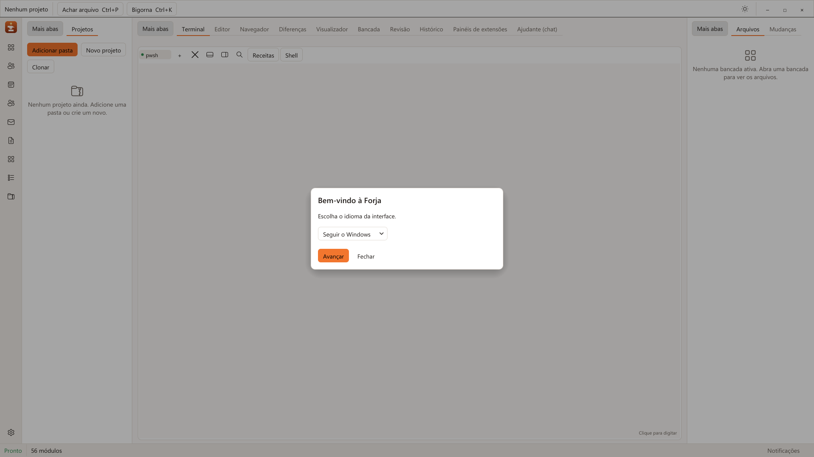

# Onboarding — Boas-vindas e escolha de idioma (tema claro)

Tela de primeiro uso exibida sobre a janela principal, em que a pessoa escolhe o idioma da interface e avança pela configuração inicial da Forja.

*Variante do tema claro (1920×1080) da página de referência `pt-BR.dark.open.onboarding` (1280×800). A estrutura é a mesma; as diferenças estão na paleta, nas coordenadas e em alguns detalhes listados em "Elementos" e "Problemas".*

## Como chegar
Abertura direta pela linha de comando: `forja-app --locale pt-BR --theme light --open onboarding`. No app normal, a tela aparece na primeira execução (quando ainda não há projeto) e pode ser retomada pelos Ajustes (botão "Ajustes" no rodapé do trilho à esquerda, retângulo (8,1004)–(44,1040)).

## Regiões
- **Barra superior** — (0,0)–(1920,42): à esquerda o rótulo "Nenhum projeto" e os botões "Achar arquivo  Ctrl+P" e "Bigorna  Ctrl+K"; à direita o botão sem nome acessível com ícone de sol (alternar tema), seguido dos botões de janela "–", "□" e "×".
- **Trilho à esquerda** — (0,42)–(56,1048): o logotipo (imagem sem nome acessível em (12,50)–(40,78)) e uma coluna de botões de ícone: "Quadro", "Ajudantes", "Rotinas", "Mutirão", "Pedidos", "Skills", "Uso", "Extensões" e "Acervo", com "Ajustes" fixado no rodapé.
- **Painel lateral esquerdo (Projetos)** — (56,42)–(304,1048): botão "Mais abas" e a aba "Projetos" (marcada); abaixo, os botões "Adicionar pasta", "Novo projeto" e "Clonar"; mais abaixo, um ícone de pasta (rótulo "(ícone)" em (168,201)–(196,229)) e a mensagem "Nenhum projeto ainda. Adicione uma pasta ou crie um novo."
- **Área central (Terminal + cartão de onboarding)** — (320,42)–(1612,1048): botão "Mais abas" e faixa de abas "Terminal" (marcada), "Editor", "Navegador", "Diferenças", "Visualizador", "Bancada", "Revisão", "Histórico", "Painéis de extensões" e "Ajudante (chat)"; barra do terminal com o separador "+", quatro botões de ícone sem nome acessível e os botões "Receitas" e "Shell"; aba de sessão "pwsh · Em execução" com o botão "Fechar pwsh"; área do terminal em (328,150)–(1604,1036), vazia, com a dica "Clique para digitar" no canto inferior direito (visível na imagem, sem item na árvore). Sobre o terminal, o cartão de onboarding (aprox. (735,445)–(1185,635)), branco e com cantos arredondados, traz o título "Bem-vindo à Forja", o texto "Escolha o idioma da interface.", a caixa de seleção de idioma mostrando "Seguir o Windows" e os botões "Avançar" (laranja) e "Fechar".
- **Painel lateral direito (Arquivos)** — (1628,42)–(1920,1048): botão "Mais abas" e as abas "Arquivos" (marcada) e "Mudanças"; abaixo, um ícone de grade (rótulo "(ícone)" em (1756,117)–(1784,145)) e a mensagem "Nenhuma bancada ativa. Abra uma bancada para ver os arquivos."
- **Barra de status** — (0,1048)–(1920,1080): "Pronto" à esquerda em verde, "56 módulos" ao lado e "Notificações" à direita.

## Elementos
| Elemento | Tipo | Posição (px) | Estado | O que faz |
|---|---|---|---|---|
| "Achar arquivo  Ctrl+P" | Button | (135,5)–(291,37) | — | Busca rápida de arquivo pelo comando Ctrl+P |
| "Bigorna  Ctrl+K" | Button | (299,5)–(417,37) | — | Paleta de comandos (Ctrl+K) |
| (sem nome acessível) | Unknown | (1741,5)–(1773,37) | — | Ícone de sol: alterna tema claro/escuro |
| "–" | Button | (1795,5)–(1827,37) | — | Minimiza a janela |
| "□" | Button | (1835,5)–(1867,37) | — | Maximiza/restaura a janela |
| "×" | Button | (1875,5)–(1909,37) | — | Fecha a janela |
| "Nenhum projeto" | Label | (11,12)–(113,31) | — | Mostra que nenhum projeto está aberto; clicável |
| (sem nome acessível) | Unknown | (304,42)–(320,1048) | foco | Separador vertical entre o painel esquerdo e a área central |
| (sem nome acessível) | Unknown | (1612,42)–(1628,1048) | foco | Separador vertical entre a área central e o painel direito |
| (sem nome acessível) | Image | (12,50)–(40,78) | — | Logotipo da Forja no topo do trilho |
| "Mais abas" | Button | (64,50)–(149,85) | — | Lista as abas ocultas do painel esquerdo |
| "Mais abas" | Button | (324,50)–(409,85) | — | Lista as abas ocultas da área central |
| "Mais abas" | Button | (1632,50)–(1717,85) | — | Lista as abas ocultas do painel direito |
| "Projetos" | Button | (157,52)–(231,84) | marcado=True | Aba ativa do painel esquerdo: lista de projetos |
| "Terminal" | Button | (417,52)–(494,84) | marcado=True | Aba ativa da área central: terminal |
| "Editor" | Button | (494,52)–(554,84) | marcado=False | Alterna a área central para o editor |
| "Navegador" | Button | (554,52)–(646,84) | marcado=False | Alterna para o navegador de arquivos |
| "Diferenças" | Button | (646,52)–(734,84) | marcado=False | Alterna para a vista de diferenças |
| "Visualizador" | Button | (734,52)–(832,84) | marcado=False | Alterna para o visualizador de arquivos |
| "Bancada" | Button | (832,52)–(908,84) | marcado=False | Alterna para a vista de bancada |
| "Revisão" | Button | (908,52)–(978,84) | marcado=False | Alterna para a vista de revisão |
| "Histórico" | Button | (978,52)–(1057,84) | marcado=False | Alterna para o histórico |
| "Painéis de extensões" | Button | (1057,52)–(1208,84) | marcado=False | Aba de painéis de extensões da área central |
| "Ajudante (chat)" | Button | (1208,52)–(1327,84) | marcado=False | Aba do chat com o ajudante |
| "Arquivos" | Button | (1725,52)–(1803,84) | marcado=True | Aba ativa do painel direito: arquivos da bancada |
| "Mudanças" | Button | (1803,52)–(1890,84) | marcado=False | Aba de mudanças (diffs) |
| "Quadro" | Button | (8,94)–(44,130) | marcado=False | Ícone do trilho: abre o quadro |
| "Adicionar pasta" | Button | (64,101)–(183,133) | — | Destaque laranja: adiciona uma pasta como projeto |
| "Novo projeto" | Button | (191,101)–(297,133) | — | Cria um projeto novo |
| "+" | Button | (407,113)–(441,145) | — | Nova aba/sessão de terminal |
| (sem nome acessível) | Unknown | (444,113)–(476,145) | — | Ícone de dividir terminal |
| (sem nome acessível) | Unknown | (479,113)–(511,145) | — | Ícone de encerrar sessão (X) |
| (sem nome acessível) | Unknown | (514,113)–(546,145) | — | Ícone de limpar terminal |
| (sem nome acessível) | Unknown | (549,113)–(581,145) | — | Ícone de busca no terminal |
| "Receitas" | Button | (584,113)–(658,145) | — | Alterna o painel de receitas do terminal |
| "Shell" | Button | (661,113)–(714,145) | — | Alterna o painel de shell |
| "(ícone)" | Label | (1756,117)–(1784,145) | — | Ícone de grade do painel Arquivos vazio |
| "pwsh · Em execução" | Button | (328,118)–(404,140) | — | Aba da sessão "pwsh" com ponto verde de sessão ativa |
| "Fechar pwsh" | Button | (385,121)–(401,137) | — | X de fechar da aba "pwsh" |
| "Ajudantes" | Button | (8,138)–(44,174) | marcado=False | Ícone do trilho: abre os ajudantes |
| "Clonar" | Button | (64,141)–(128,173) | — | Clona um repositório como projeto |
| (sem nome acessível) | Unknown | (328,150)–(1604,1036) | — | Área do terminal (vazia, com dica "Clique para digitar") |
| "Nenhuma bancada ativa. Abra uma bancada para ver os arquivos." | Label | (1634,153)–(1906,191) | — | Mensagem de estado vazio do painel Arquivos |
| "Rotinas" | Button | (8,182)–(44,218) | marcado=False | Ícone do trilho: abre as rotinas |
| "(ícone)" | Label | (168,201)–(196,229) | — | Ícone de pasta do painel Projetos vazio |
| "Mutirão" | Button | (8,226)–(44,262) | marcado=False | Ícone do trilho: abre o mutirão |
| "Nenhum projeto ainda. Adicione uma pasta ou crie um novo." | Label | (66,237)–(298,275) | — | Mensagem de estado vazio do painel Projetos |
| "Pedidos" | Button | (8,270)–(44,306) | marcado=False | Ícone do trilho: abre os pedidos |
| "Skills" | Button | (8,314)–(44,350) | marcado=False | Ícone do trilho: abre as skills |
| "Uso" | Button | (8,358)–(44,394) | marcado=False | Ícone do trilho: abre o uso |
| "Extensões" | Button | (8,402)–(44,438) | marcado=False | Ícone do trilho: abre as extensões |
| "Acervo" | Button | (8,446)–(44,482) | marcado=False | Ícone do trilho: abre o acervo |
| "Bem-vindo à Forja" | Label | (750,461)–(899,485) | — | Título do cartão de onboarding |
| "Escolha o idioma da interface." | Label | (750,501)–(934,520) | — | Instrução do passo de idioma |
| "Seguir o Windows" | ComboBox | (750,536)–(914,568) | — | Caixa de seleção de idioma exibindo "Seguir o Windows" |
| (sem nome acessível) | Unknown | (960,540)–(960,540) | — | Elemento de tamanho zero associado à seleção de idioma |
| "Avançar" | Button | (750,588)–(823,620) | — | Botão laranja de destaque: segue para o próximo passo do onboarding |
| "Fechar" | Button | (831,588)–(895,620) | — | Fecha o cartão de onboarding sem concluir |
| "Ajustes" | Button | (8,1004)–(44,1040) | marcado=False | Ícone do rodapé do trilho: abre os ajustes |
| "Pronto" | Label | (10,1055)–(51,1074) | — | Estado geral, em verde, na barra de status |
| "56 módulos" | Label | (73,1055)–(146,1074) | — | Contagem de módulos carregados |
| "Notificações" | Label | (1810,1055)–(1886,1074) | — | Atalho de notificações na barra de status |

## Aparência
Tema claro: fundo branco/off-white na janela e nas barras, painéis laterais em cinza muito claro e a área do terminal em um cinza levemente mais escuro. O cartão de onboarding é branco, com cantos arredondados e sombra suave sobre o terminal. A cor de destaque é o laranja (paleta "Brasa"), aplicada ao botão "Avançar" (texto branco sobre laranja), ao botão "Adicionar pasta" e ao texto e à sublinha das abas marcadas ("Projetos", "Terminal", "Arquivos"). Tipografia sem serifa em dois níveis: textos principais em cinza-escuro/quase preto e mensagens secundárias e estados vazios em cinza médio. Os textos de estado vazio ("Nenhum projeto ainda...", "Nenhuma bancada ativa...") aparecem com o ícone correspondente acima ou ao lado, centralizados no painel. O trilho à esquerda tem botões de ícone de 36 px com espaçamento uniforme; a barra de status usa fonte menor e mantém "Pronto" em verde; o ponto verde na aba "pwsh · Em execução" indica sessão ativa.

Em relação à referência (tema escuro), mudam as cores — fundo claro com texto escuro no lugar do fundo quase preto — e o contraste dos textos de estado vazio, que aqui é menor (cinza médio sobre fundo claro). Os textos e a estrutura são idênticos; como a janela é mais larga (1920 px), cabem mais abas visíveis sem cortes.

## Problemas encontrados
- O botão de alternar tema (ícone de sol, (1741,5)–(1773,37)) está sem nome acessível.
- Os quatro botões de ícone da barra do terminal (dividir, encerrar, limpar, buscar) estão sem nome acessível.
- O elemento associado à seleção de idioma em (960,540)–(960,540) está sem nome acessível e tem tamanho zero.
- Dois rótulos de ícone aparecem na árvore com o texto literal "(ícone)" em vez de um nome descritivo: o da pasta do painel Projetos (168,201)–(196,229) e o da grade do painel Arquivos (1756,117)–(1784,145).
- O botão "Fechar pwsh" tem apenas 16×16 px e fica sobreposto ao interior da aba "pwsh · Em execução" — alvo de clique muito pequeno.
- A dica "Clique para digitar" no canto inferior direito do terminal (visível na imagem, sem item na árvore) está em cinza claro sobre fundo cinza claro, com contraste baixo.
- Os botões de janela usam os símbolos "–", "□" e "×" como nome, em vez de rótulos textuais (minimizar, maximizar, fechar).
