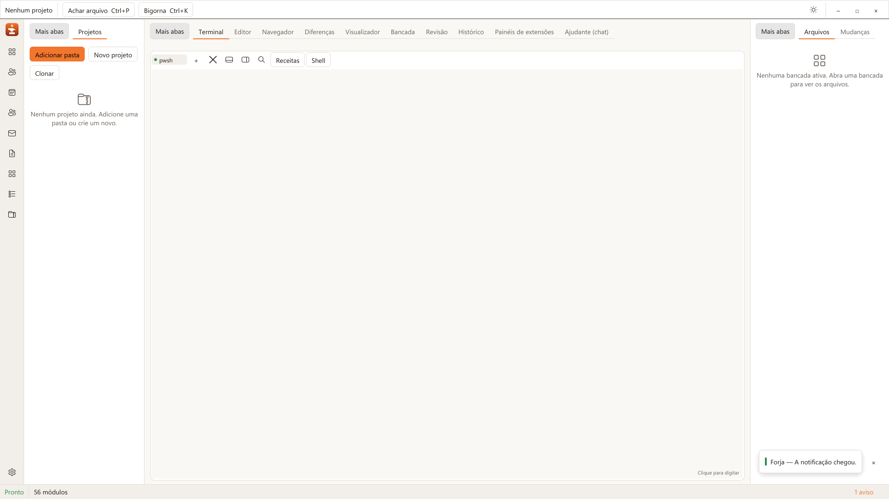

# Notificação (toast) — tema claro

Captura da janela principal no tema claro com uma notificação (toast) aberta no canto inferior direito; o restante da tela mostra o estado inicial sem projeto, com o painel Terminal ativo ao centro. Variante clara da página de referência (pt-BR.dark.open.toast): a estrutura é a mesma; o que muda são as cores (fundo creme em vez de marrom-escuro), a janela mais larga (1920 px, o que elimina os cortes de abas da referência) e o contador da barra de status, aqui no singular ("1 aviso").

## Como chegar
Na janela principal, dispare uma notificação (o alvo desta captura é o toast aberto sobre o painel direito). Comando de captura: `forja-app --locale pt-BR --theme light --open toast`.

## Regiões
- **Barra superior** — (0,0)–(1920,42): rótulo "Nenhum projeto" à esquerda, botões "Achar arquivo Ctrl+P" e "Bigorna Ctrl+K", botão de alternância de tema (ícone de sol, sem nome acessível) em (1741,5)–(1773,37) e os botões de janela "–", "□" e "×" à direita.
- **Trilho à esquerda** — (0,42)–(52,1048): coluna de ícones de navegação: logotipo da Forja (12,50)–(40,78) e, de cima para baixo, "Quadro", "Ajudantes", "Rotinas", "Mutirão", "Pedidos", "Skills", "Uso", "Extensões", "Acervo" e, no fim, "Ajustes".
- **Painel esquerdo (Projetos)** — (52,42)–(304,1048): botão "Mais abas", aba "Projetos" (marcada); botões "Adicionar pasta" (destaque laranja), "Novo projeto" e "Clonar"; estado vazio com ícone de pasta e o texto "Nenhum projeto ainda. Adicione uma pasta ou crie um novo.".
- **Área central (Terminal)** — (320,42)–(1612,1048): botão "Mais abas" e abas do painel ("Terminal" marcada, "Editor", "Navegador", "Diferenças", "Visualizador", "Bancada", "Revisão", "Histórico", "Painéis de extensões" e "Ajudante (chat)"), barra de ferramentas do terminal com a aba "pwsh · Em execução", o botão "Fechar pwsh", "+", quatro botões de ícone sem nome, os filtros "Receitas" e "Shell", e a área vazia do terminal com a dica "Clique para digitar" no canto inferior direito.
- **Painel direito (Arquivos)** — (1628,42)–(1920,1048): botão "Mais abas", abas "Arquivos" (marcada) e "Mudanças"; estado vazio com ícone de grade e o texto "Nenhuma bancada ativa. Abra uma bancada para ver os arquivos."; sobre a base do painel, o toast com "Forja — A notificação chegou." e botão de fechar "×".
- **Barra de status** — (0,1048)–(1920,1080): "Pronto" à esquerda, "56 módulos" ao lado e "1 aviso" em laranja à direita.

## Elementos
| Elemento | Tipo | Posição (px) | Estado | O que faz |
|---|---|---|---|---|
| "Nenhum projeto" | Label | (11,12)–(113,31) | — | Indica que não há projeto aberto. |
| "Achar arquivo  Ctrl+P" | Button | (135,5)–(291,37) | — | Abre a busca rápida de arquivos (Ctrl+P). |
| "Bigorna  Ctrl+K" | Button | (299,5)–(417,37) | — | Abre a paleta de comandos (Ctrl+K). |
| (sem nome acessível) | Unknown | (1741,5)–(1773,37) | — | Botão de alternância de tema (ícone de sol); alterna para o tema escuro. |
| "–" | Button | (1795,5)–(1827,37) | — | Minimiza a janela. |
| "□" | Button | (1835,5)–(1867,37) | — | Maximiza/restaura a janela. |
| "×" | Button | (1875,5)–(1909,37) | — | Fecha a janela. |
| (sem nome acessível) | Unknown | (304,42)–(320,1048) | — | Divisor arrastável entre o painel esquerdo e a área central. |
| (sem nome acessível) | Unknown | (1612,42)–(1628,1048) | — | Divisor arrastável entre a área central e o painel direito. |
| (sem nome acessível) | Image | (12,50)–(40,78) | — | Logotipo da Forja no topo do trilho. |
| "Mais abas" | Button | (64,50)–(149,85) | — | Lista as abas do painel esquerdo (primeiro de três botões homônimos). |
| "Mais abas" | Button | (324,50)–(409,85) | — | Lista as abas da área central. |
| "Mais abas" | Button | (1632,50)–(1717,85) | — | Lista as abas do painel direito. |
| "Projetos" | Button | (157,52)–(231,84) | marcado=True | Aba ativa do painel esquerdo; mostra a lista de projetos. |
| "Terminal" | Button | (417,52)–(494,84) | marcado=True | Aba ativa da área central; mostra o terminal. |
| "Editor" | Button | (494,52)–(554,84) | marcado=False | Mostra o editor na área central. |
| "Navegador" | Button | (554,52)–(646,84) | marcado=False | Mostra o navegador de conteúdo na área central. |
| "Diferenças" | Button | (646,52)–(734,84) | marcado=False | Mostra a visão de diferenças. |
| "Visualizador" | Button | (734,52)–(832,84) | marcado=False | Mostra o visualizador de arquivos. |
| "Bancada" | Button | (832,52)–(908,84) | marcado=False | Mostra a visão da bancada. |
| "Revisão" | Button | (908,52)–(978,84) | marcado=False | Mostra a visão de revisão. |
| "Histórico" | Button | (978,52)–(1057,84) | marcado=False | Mostra o histórico. |
| "Painéis de extensões" | Button | (1057,52)–(1208,84) | marcado=False | Mostra os painéis de extensões na área central; cabe inteiro nesta largura de janela. |
| "Ajudante (chat)" | Button | (1208,52)–(1327,84) | marcado=False | Mostra o chat do ajudante na área central. |
| "Arquivos" | Button | (1725,52)–(1803,84) | marcado=True | Aba ativa do painel direito; lista de arquivos da bancada. |
| "Mudanças" | Button | (1803,52)–(1890,84) | marcado=False | Mostra as mudanças da bancada. |
| "Quadro" | Button | (8,94)–(44,130) | marcado=False | Ícone do trilho: abre o quadro. |
| "Adicionar pasta" | Button | (64,101)–(183,133) | — | Abre o seletor para adicionar uma pasta de projeto. |
| "Novo projeto" | Button | (191,101)–(297,133) | — | Cria um novo projeto. |
| "+" | Button | (407,113)–(441,145) | — | Abre nova aba/instância de terminal. |
| (sem nome acessível) | Unknown | (444,113)–(476,145) | — | Botão de ícone da barra do terminal (fechar o terminal, ícone de X). |
| (sem nome acessível) | Unknown | (479,113)–(511,145) | — | Botão de ícone da barra do terminal (limpar o terminal). |
| (sem nome acessível) | Unknown | (514,113)–(546,145) | — | Botão de ícone da barra do terminal (dividir o terminal). |
| (sem nome acessível) | Unknown | (549,113)–(581,145) | — | Botão de ícone da barra do terminal (busca no terminal, ícone de lupa). |
| "Receitas" | Button | (584,113)–(658,145) | — | Alterna o filtro de receitas do terminal. |
| "Shell" | Button | (661,113)–(714,145) | — | Alterna o filtro de shells do terminal. |
| (ícone) | Label | (1756,117)–(1784,145) | — | Ícone de grade do estado vazio do painel direito. |
| "pwsh · Em execução" | Button | (328,118)–(404,140) | — | Aba da sessão de terminal "pwsh", com ponto verde de status à esquerda do texto. |
| "Fechar pwsh" | Button | (385,121)–(401,137) | — | Fecha a sessão "pwsh"; alvo minúsculo (16×16 px) dentro da própria aba. |
| "Ajudantes" | Button | (8,138)–(44,174) | marcado=False | Ícone do trilho: abre os ajudantes de código. |
| "Clonar" | Button | (64,141)–(128,173) | — | Clona um repositório como novo projeto. |
| (sem nome acessível) | Unknown | (328,150)–(1604,1036) | — | Área do terminal (vazia); clique concentra o teclado; mostra "Clique para digitar" no canto inferior direito. |
| "Nenhuma bancada ativa. Abra uma bancada para ver os arquivos." | Label | (1634,153)–(1906,191) | — | Estado vazio do painel de arquivos. |
| "Rotinas" | Button | (8,182)–(44,218) | marcado=False | Ícone do trilho: abre as rotinas. |
| (ícone) | Label | (168,201)–(196,229) | — | Ícone de pasta do estado vazio do painel de projetos. |
| "Mutirão" | Button | (8,226)–(44,262) | marcado=False | Ícone do trilho: abre o mutirão. |
| "Nenhum projeto ainda. Adicione uma pasta ou crie um novo." | Label | (66,237)–(298,275) | — | Estado vazio do painel de projetos. |
| "Pedidos" | Button | (8,270)–(44,306) | marcado=False | Ícone do trilho: abre os pedidos. |
| "Skills" | Button | (8,314)–(44,350) | marcado=False | Ícone do trilho: abre as skills. |
| "Uso" | Button | (8,358)–(44,394) | marcado=False | Ícone do trilho: abre o uso. |
| "Extensões" | Button | (8,402)–(44,438) | marcado=False | Ícone do trilho: abre as extensões. |
| "Acervo" | Button | (8,446)–(44,482) | marcado=False | Ícone do trilho: abre o acervo. |
| (sem nome acessível) | Unknown | (960,540)–(960,540) | — | Elemento de dimensão zero no centro da janela; sem efeito visível. |
| (sem nome acessível) | Unknown | (1639,974)–(1904,1040) | — | Contêiner do toast no canto inferior direito, sobre a base do painel de arquivos. |
| "×" | Button | (1870,983)–(1904,1015) | — | Fecha o toast. |
| "Forja — A notificação chegou." | Label | (1664,990)–(1849,1009) | — | Texto da notificação, com barra vertical laranja à esquerda. |
| "Ajustes" | Button | (8,1004)–(44,1040) | marcado=False | Ícone do trilho: abre os ajustes. |
| "Pronto" | Label | (10,1055)–(51,1074) | — | Estado geral na barra de status. |
| "56 módulos" | Label | (73,1055)–(146,1074) | — | Quantidade de módulos carregados. |
| "1 aviso" | Label | (1846,1055)–(1886,1074) | — | Contador de avisos, em laranja. Diferença em relação à referência escura, que exibia "1 avisos" (plural para valor singular). |

## Aparência
Tema claro com fundo creme- rosado (tons próximos de #faf5ef) nos painéis e um creme levemente mais escuro na área do terminal; divisórias finas em bege-acinzentado separam as regiões. A cor de destaque é o laranja (Brasa), a mesma da referência escura: fundo do botão "Adicionar pasta", sublinhado e texto das abas marcadas ("Projetos", "Terminal", "Arquivos"), aba "pwsh", barra vertical do toast e o contador "1 aviso" na barra de status. Textos em marrom-escuro quase preto sobre fundo claro, com contraste alto. Tipografia sem serifa em dois tamanhos: rótulos de interface (~15 px) e textos de apoio em cinza médio; atalhos ("Ctrl+P", "Ctrl+K") aparecem em cinza mais apagado dentro dos botões da barra superior. Ícones do trilho são monocromáticos em cinza-escuro, alinhados em coluna única de 36 px. Os estados vazios são centrados (ícone acima do texto) nos painéis de projetos e arquivos; o terminal exibe a dica "Clique para digitar" em cinza claro alinhada ao canto inferior direito — no tema claro ela tem contraste mais baixo que na referência escura. O toast tem fundo branco, sombra suave, barra vertical laranja à esquerda e botão "×" apagado à direita.

## Problemas encontrados
- O botão de alternância de tema (1741,5)–(1773,37) não tem nome acessível.
- Os quatro botões de ícone da barra do terminal (444,113)–(581,145) não têm nome acessível.
- Há dois botões nomeados apenas "×" (fechar janela em (1875,5) e fechar toast em (1870,983)), o que os torna ambíguos para leitores de tela.
- Há três botões com o mesmo nome "Mais abas" (painéis esquerdo, central e direito), também ambíguos sem contexto de posição.
- A área do terminal (328,150)–(1604,1036) e os dois divisores verticais não têm nome acessível nem papel definido (Unknown).
- O texto "Clique para digitar", visível no canto inferior direito da área do terminal (~1505,1023), não aparece na árvore de acessibilidade.
- O botão "Fechar pwsh" (385,121)–(401,137) tem apenas 16×16 px, dentro da aba "pwsh · Em execução" — alvo de clique muito pequeno e sobreposto à aba.
- Elemento de dimensão zero (960,540)–(960,540) sem nome na área central.
- O toast (1639,974)–(1904,1040) cobre a base do painel de arquivos; em janelas mais baixas tenderia a cobrir conteúdo.
- Os rótulos de ícone dos estados vazios aparecem na árvore apenas como "(ícone)", sem nome descritivo.
