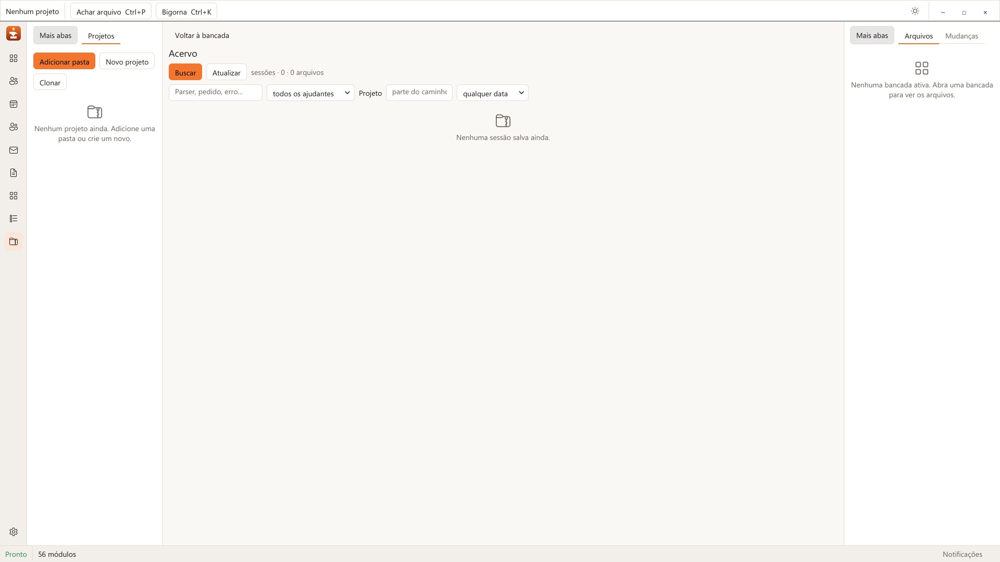

state: pt-BR.light.rail.archive.tab
model: opencode/glm-5.3-flash-free
---

# Acervo (aba do trilho)

Tela do módulo Acervo, que lista e filtra sessões anteriores dos ajudantes e os arquivos de que eles dispõem, com estados vazios quando não há projeto ou bancada ativa. Variante em tema claro da página de referência (pt-BR.dark.rail.archive.tab); a estrutura é a mesma e as diferenças de cores e de alguns elementos estão indicadas ao longo da página.

## Como chegar
No trilho à esquerda, clique no botão "Acervo" (o último dos ícones do grupo principal, destacado em laranja quando ativo). Equivalente por comando de captura: `forja-app --locale pt-BR --theme light --rail archive.tab`.

## Regiões
- **Barra superior** (0,0)–(1920,40): indicador de projeto ("Nenhum projeto"), botões de comando "Achar arquivo  Ctrl+P" e "Bigorna  Ctrl+K", alternador de tema (ícone de sol, sem nome acessível) e os botões de janela "–", "□" e "×".
- **Trilho à esquerda** (0,40)–(50,1048): logo do app (imagem em (12,50)–(40,78)) e a coluna de botões-ícone de navegação ("Quadro", "Ajudantes", "Rotinas", "Mutirão", "Pedidos", "Skills", "Uso", "Extensões", "Acervo"), com "Ajustes" fixado na base.
- **Painel lateral esquerdo** (50,40)–(304,1048): botão "Mais abas" e a aba "Projetos" (ativa); ações "Adicionar pasta", "Novo projeto" e "Clonar"; ícone e mensagem de estado vazio "Nenhum projeto ainda. Adicione uma pasta ou crie um novo."
- **Divisor vertical** (304,42)–(320,1048): separador fino entre o painel esquerdo e a área central.
- **Área central** (320,42)–(1612,1048): botão "Voltar à bancada" acima do título "Acervo", botões "Buscar" e "Atualizar", contador "sessões · 0 · 0 arquivos", campo de filtro, seletor "todos os ajudantes", rótulo "Projeto" com campo de filtro e seletor de período "qualquer data"; abaixo, ícone de pasta e o estado vazio "Nenhuma sessão salva ainda.".
- **Divisor vertical** (1612,42)–(1628,1048): separador entre a área central e o painel direito.
- **Painel direito** (1628,42)–(1920,1048): botão "Mais abas" e as abas "Arquivos" (ativa) e "Mudanças"; ícone (sem nome acessível) em (1756,117)–(1784,145) e a mensagem "Nenhuma bancada ativa. Abra uma bancada para ver os arquivos.".
- **Barra de status** (0,1048)–(1920,1080): rótulos "Pronto" (em verde) à esquerda, "56 módulos" ao lado e "Notificações" à direita.

## Elementos
| Elemento | Tipo | Posição (px) | Estado | O que faz |
|---|---|---|---|---|
| "Nenhum projeto" | Label | (11,12)–(113,31) | — | Mostra que não há projeto selecionado na sessão atual. |
| "Achar arquivo  Ctrl+P" | Button | (135,5)–(291,37) | — | Abre a busca rápida de arquivos (atalho Ctrl+P). |
| "Bigorna  Ctrl+K" | Button | (299,5)–(417,37) | — | Abre a paleta de comandos (atalho Ctrl+K). |
| (sem nome acessível) | Unknown | (1741,5)–(1773,37) | — | Alternador de tema (ícone de sol). |
| "–" | Button | (1795,5)–(1827,37) | — | Minimiza a janela. |
| "□" | Button | (1835,5)–(1867,37) | — | Maximiza/restaura a janela. |
| "×" | Button | (1875,5)–(1909,37) | — | Fecha a janela. |
| (sem nome acessível) | Unknown | (304,42)–(320,1048) | — | Divisor vertical entre painel esquerdo e área central. |
| (sem nome acessível) | Unknown | (1612,42)–(1628,1048) | — | Divisor vertical entre área central e painel direito. |
| (sem nome acessível) | Image | (12,50)–(40,78) | clicável | Logo do app no topo do trilho. |
| "Mais abas" | Button | (64,50)–(149,85) | — | Revela as abas adicionais do painel esquerdo que não couberam na linha. |
| "Voltar à bancada" | Button | (324,50)–(452,82) | — | Retorna à visão da bancada ativa (visível na área central, acima do título). |
| "Mais abas" | Button | (1632,50)–(1717,85) | — | Revela as abas adicionais do painel direito que não couberam na linha. |
| "Projetos" | Button | (157,52)–(231,84) | marcado=True | Aba ativa do painel esquerdo; lista os projetos. |
| "Arquivos" | Button | (1725,52)–(1803,84) | marcado=True | Aba ativa do painel direito; mostraria os arquivos acessíveis à bancada. |
| "Mudanças" | Button | (1803,52)–(1890,84) | marcado=False | Aba de alterações pendentes da bancada. |
| "Acervo" | Label | (324,90)–(379,114) | — | Título da área central. |
| "Quadro" | Button | (8,94)–(44,130) | marcado=False | Botão-ícone do trilho que abre a visão de quadro. |
| "Adicionar pasta" | Button | (64,101)–(183,133) | — | Adiciona uma pasta existente como projeto (botão em destaque laranja). |
| "Novo projeto" | Button | (191,101)–(297,133) | — | Cria um projeto novo. |
| (ícone) | Label | (1756,117)–(1784,145) | clicável | Ícone do estado vazio do painel direito. |
| "Buscar" | Button | (324,122)–(388,154) | — | Aplica os filtros de busca do acervo (botão em destaque laranja). |
| "Atualizar" | Button | (396,122)–(474,154) | — | Recarrega a lista de sessões do acervo. |
| "sessões · 0 · 0 arquivos" | Label | (482,129)–(621,148) | — | Contador do resultado atual (0 sessões, 0 arquivos). |
| "Ajudantes" | Button | (8,138)–(44,174) | marcado=False | Botão-ícone do trilho que abre os ajudantes. |
| "Clonar" | Button | (64,141)–(128,173) | — | Clona um repositório como novo projeto. |
| "Nenhuma bancada ativa. Abra uma bancada para ver os arquivos." | Label | (1634,153)–(1906,191) | — | Estado vazio do painel direito. |
| (sem nome acessível) | TextInput | (324,162)–(504,194) | — | Campo de filtro textual (sugestão exibida: "Parser, pedido, erro..."). |
| "todos os ajudantes" | ComboBox | (512,162)–(681,194) | — | Seletor de ajudante para filtrar as sessões do acervo. |
| "Projeto" | Label | (689,162)–(733,194) | — | Rótulo do filtro por projeto ao lado. |
| (sem nome acessível) | TextInput | (741,162)–(869,194) | — | Campo do filtro por projeto (sugestão: "parte do caminho"). |
| "qualquer data" | ComboBox | (877,162)–(1015,194) | — | Seletor de período das sessões. |
| "Rotinas" | Button | (8,182)–(44,218) | marcado=False | Botão-ícone do trilho que abre as rotinas. |
| (ícone) | Label | (168,201)–(196,229) | clicável | Ícone de pasta do estado vazio do painel esquerdo. |
| (ícone) | Label | (952,218)–(980,246) | clicável | Ícone de pasta do estado vazio da área central. |
| "Mutirão" | Button | (8,226)–(44,262) | marcado=False | Botão-ícone do trilho que abre o mutirão. |
| "Nenhum projeto ainda. Adicione uma pasta ou crie um novo." | Label | (66,237)–(298,275) | — | Estado vazio do painel esquerdo. |
| "Nenhuma sessão salva ainda." | Label | (877,254)–(1056,273) | — | Estado vazio da busca do acervo (na variante escura, o texto era "Nenhuma sessão corresponde à busca."). |
| "Pedidos" | Button | (8,270)–(44,306) | marcado=False | Botão-ícone do trilho que abre os pedidos. |
| "Skills" | Button | (8,314)–(44,350) | marcado=False | Botão-ícone do trilho que abre as skills. |
| "Uso" | Button | (8,358)–(44,394) | marcado=False | Botão-ícone do trilho que abre o uso. |
| "Extensões" | Button | (8,402)–(44,438) | marcado=False | Botão-ícone do trilho que abre as extensões. |
| "Acervo" | Button | (8,446)–(44,482) | marcado=True | Botão-ícone do trilho da tela atual, em destaque laranja. |
| "Ajustes" | Button | (8,1004)–(44,1040) | marcado=False | Botão-ícone do trilho que abre os ajustes, fixado na base. |
| "Pronto" | Label | (10,1055)–(51,1074) | — | Status geral do app. |
| "56 módulos" | Label | (73,1055)–(146,1074) | — | Quantidade de módulos carregados. |
| "Notificações" | Label | (1810,1055)–(1886,1074) | — | Acesso às notificações na barra de status. |

## Aparência
Tema claro: fundo creme/off-white nas áreas de trabalho, painéis e barra superior em branco com bordas finas cinza-claro. Destaque em laranja ("Brasa") nos elementos ativos: botões "Adicionar pasta" e "Buscar" preenchidos com laranja e texto branco, botão-ícone "Acervo" do trilho com fundo laranja-pálido e ícone laranja, e linha laranja sob a aba "Arquivos" do painel direito; a aba "Projetos" ativa usa texto escuro com sublinhado. Diferente da variante escura, aqui as linhas de abas dos dois painéis mostram um botão "Mais abas" no lugar das abas que não couberam (no escuro, as abas extras apareciam e estouravam a largura). Tipografia sans-serif em tons de grafite; títulos ("Acervo") maiores e rótulos de estado vazio em cinza médio, centralizados. Botões do trilho com 36 px de lado e passo de 44 px; campos de filtro de 32 px de altura alinhados em uma única linha; cantos levemente arredondados nos botões. A barra de status usa 32 px de altura, com "Pronto" em verde e os demais textos em cinza.

## Problemas encontrados
- O texto de sugestão do campo de projeto ("parte do caminho") é cortado na borda direita do campo em (741,162)–(869,194), ficando ilegível no final.
- Vários elementos sem nome acessível: os dois divisores verticais, o alternador de tema da barra superior, o logo, os dois campos de filtro (TextInput) e os ícones de estado vazio expostos como "Label" clicável em vez de botão, o que dificulta a navegação por leitor de telas.
- Os botões de janela usam apenas os símbolos "–", "□" e "×" como nome acessível, sem rótulo descritivo.
- Os dois botões "Mais abas" têm nomes genéricos e não indicam quais abas estão escondidas (no painel esquerdo, só a aba "Projetos" está visível).
- Os três ícones de estado vazio são expostos como "Label" com ação de clique, mas sem papel de botão nem nome acessível descritivo.
