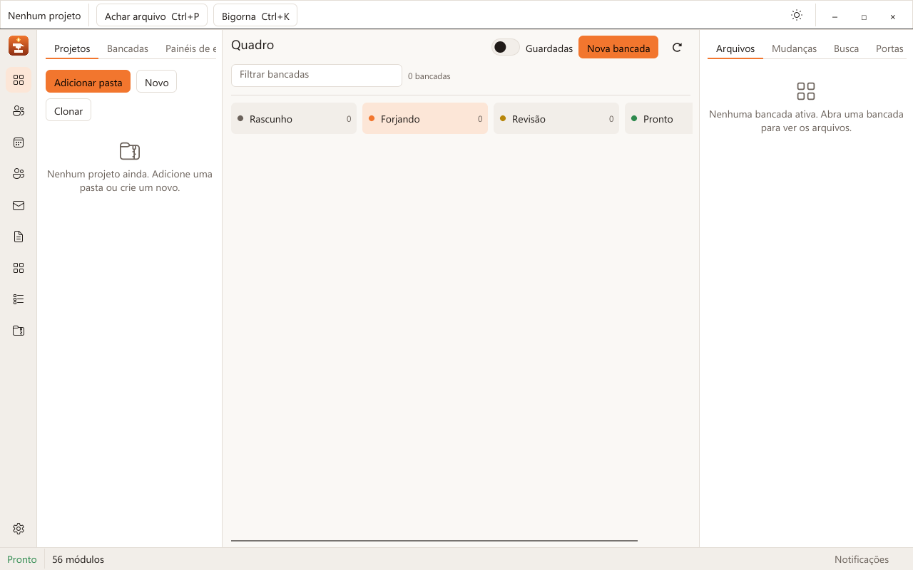

state: pt-BR.light.rail.board.page
capture_sha: (não informado)
model: opencode/glm-5.3-flash-free
---

# Quadro (página do painel Projetos)

Tela inicial da área de projetos: mostra um quadro Kanban de bancadas em colunas de fluxo (Rascunho, Forjando, Revisão, Pronto), com painel de projetos à esquerda e painel de arquivos à direita, ambos vazios porque não há projeto aberto.

*Variante do tema claro (referência: pt-BR.dark.rail.board.page). A estrutura e a ordem dos elementos são as mesmas; o que muda é descrito em "Aparência" e "Problemas encontrados", além das coordenadas, pois esta captura foi feita numa janela de 1920×1080 (a referência tem 1280×800). Nesta variante a árvore traz também os botões "Mais abas" (dois, um em cada painel lateral) e "Voltar à bancada", e as abas extras dos painéis aparecem recolhidas atrás de "Mais abas" em vez de listadas.*

## Como chegar
Na janela principal, clique no primeiro ícone do trilho à esquerda, o botão "Quadro" (retângulo (8,94)–(44,130)), abaixo da logomarca da Forja; a aba "Projetos" do painel esquerdo fica marcada. A captura foi gerada com o comando `forja-app --locale pt-BR --theme light --rail board.page`.

## Regiões
- **Barra superior** — (0,0)–(1920,42): rótulo "Nenhum projeto", botões "Achar arquivo  Ctrl+P" e "Bigorna  Ctrl+K" à esquerda; à direita, ícone de tema (sol, sem nome acessível) e os botões de janela "–", "□" e "×".
- **Trilho à esquerda** — (0,42)–(56,1042): logomarca (imagem sem nome acessível em (12,50)–(40,78)) e coluna de ícones: "Quadro", "Ajudantes", "Rotinas", "Mutirão", "Pedidos", "Skills", "Uso", "Extensões", "Acervo", com "Ajustes" fixado no rodapé.
- **Painel esquerdo (Projetos)** — (56,42)–(320,1042): botão "Mais abas" e aba "Projetos" (marcada); botões "Adicionar pasta", "Novo projeto" e "Clonar"; mensagem de vazio "Nenhum projeto ainda. Adicione uma pasta ou crie um novo." com ícone de pasta.
- **Área central (Quadro)** — (320,42)–(1612,1042): botão "Voltar à bancada" no topo; título "Quadro", interruptor "Guardadas", botão "Nova bancada" e botão "⟳"; campo de filtro sem nome acessível, contador "0 bancadas", as quatro colunas com cabeçalhos e contadores "0", e a mensagem de vazio do quadro (fora da área visível).
- **Painel direito (Arquivos)** — (1628,42)–(1920,1042): botão "Mais abas", abas "Arquivos" (marcada) e "Mudanças"; ícone de grade e mensagem "Nenhuma bancada ativa. Abra uma bancada para ver os arquivos."
- **Barra de status** — (0,1042)–(1920,1080): "Pronto" (em verde), "56 módulos" à esquerda e "Notificações" à direita.

## Elementos
| Elemento | Tipo | Posição (px) | Estado | O que faz |
|---|---|---|---|---|
| "Achar arquivo  Ctrl+P" | Button | (135,5)–(291,37) | normal | Abre a busca/arquivos rápidos pelo atalho Ctrl+P. |
| "Bigorna  Ctrl+K" | Button | (299,5)–(417,37) | normal | Abre o lançador de ajudantes/agentes pelo atalho Ctrl+K. |
| (sem nome acessível) | Unknown | (1741,5)–(1773,37) | normal | Ícone de sol; alterna o tema da interface. |
| "–" | Button | (1795,5)–(1827,37) | normal | Minimiza a janela. |
| "□" | Button | (1835,5)–(1867,37) | normal | Maximiza/restaura a janela. |
| "×" | Button | (1875,5)–(1909,37) | normal | Fecha a janela. |
| "Nenhum projeto" | Label | (11,12)–(113,31) | normal | Mostra que não há projeto aberto. |
| (sem nome acessível) | Unknown | (304,42)–(320,1048) | normal | Divisor vertical entre o painel esquerdo e a área central. |
| (sem nome acessível) | Unknown | (1612,42)–(1628,1048) | normal | Divisor vertical entre a área central e o painel direito. |
| (sem nome acessível) | Image | (12,50)–(40,78) | normal | Logomarca da Forja no topo do trilho. |
| "Mais abas" | Button | (64,50)–(149,85) | normal | Recolhe/revela as abas adicionais do painel esquerdo (na referência escura aparecem como "Bancadas" e "Painéis de extensões"). |
| "Voltar à bancada" | Button | (324,50)–(452,82) | normal | Volta da página do quadro à visão da bancada; aparece mesmo sem bancada aberta. |
| "Mais abas" | Button | (1632,50)–(1717,85) | normal | Recolhe/revela as abas adicionais do painel direito (na referência escura aparecem como "Busca", "Portas" e "Painéis de extensões"). |
| "Projetos" | Button | (157,52)–(231,84) | marcado=True | Aba ativa do painel esquerdo, com sublinhado laranja. |
| "Arquivos" | Button | (1725,52)–(1803,84) | marcado=True | Aba ativa do painel direito, com sublinhado laranja. |
| "Mudanças" | Button | (1803,52)–(1890,84) | marcado=False | Aba que mostraria as mudanças (controle de versão). |
| "Quadro" | Label | (324,90)–(384,114) | normal | Título da página central. |
| "Nova bancada" | Button | (1451,90)–(1563,122) | normal | Botão em destaque laranja para criar uma bancada. |
| "⟳" | Button | (1571,90)–(1608,122) | normal | Recarrega/atualiza o quadro. |
| "Quadro" | Button | (8,94)–(44,130) | marcado=True | Ícone do trilho que abre esta página do quadro. |
| "Guardadas" | CheckBox | (1329,94)–(1443,118) | marcado=False | Interruptor para exibir somente bancadas guardadas. |
| "Adicionar pasta" | Button | (64,101)–(183,133) | normal | Botão em destaque laranja para importar uma pasta como projeto. |
| "Novo projeto" | Button | (191,101)–(297,133) | normal | Cria um projeto novo. |
| (ícone) | Label | (1756,117)–(1784,145) | normal | Ícone de grade do estado vazio do painel direito. |
| (sem nome acessível) | TextInput | (324,130)–(564,162) | normal | Campo de filtro com o texto de marca d'água "Filtrar bancadas". |
| "Ajudantes" | Button | (8,138)–(44,174) | normal | Ícone do trilho para a área de ajudantes (agentes de IA). |
| "0 bancadas" | Label | (572,138)–(631,154) | normal | Contador de bancadas visíveis no quadro. |
| "Clonar" | Button | (64,141)–(128,173) | normal | Clona um projeto existente. |
| "Nenhuma bancada ativa. Abra uma bancada para ver os arquivos." | Label | (1634,153)–(1906,191) | normal | Mensagem de vazio do painel direito. |
| "Rotinas" | Button | (8,182)–(44,218) | normal | Ícone do trilho para a área de rotinas. |
| "Rascunho" | Label | (350,197)–(409,216) | normal | Cabeçalho da primeira coluna do fluxo, com ponto cinza. |
| "Forjando" | Label | (534,197)–(588,216) | normal | Cabeçalho da segunda coluna, com fundo laranja claro (coluna destacada) e ponto laranja. |
| "Revisão" | Label | (718,197)–(764,216) | normal | Cabeçalho da terceira coluna, com ponto amarelo/oliva. |
| "Pronto" | Label | (902,197)–(943,216) | normal | Cabeçalho da quarta coluna, com ponto verde. |
| "0" | Label | (486,198)–(492,214) | normal | Contador de cartões na coluna Rascunho. |
| "0" | Label | (670,198)–(676,214) | normal | Contador de cartões na coluna Forjando. |
| "0" | Label | (854,198)–(860,214) | normal | Contador de cartões na coluna Revisão. |
| "0" | Label | (1038,198)–(1044,214) | normal | Contador de cartões na coluna Pronto. |
| (ícone) | Label | (168,201)–(196,229) | normal | Ícone de pasta ilustrando o estado vazio do painel esquerdo. |
| "Mutirão" | Button | (8,226)–(44,262) | normal | Ícone do trilho para a área de mutirão. |
| "Nenhum projeto ainda. Adicione uma pasta ou crie um novo." | Label | (66,237)–(298,275) | normal | Mensagem de vazio do painel de projetos. |
| "Pedidos" | Button | (8,270)–(44,306) | normal | Ícone do trilho para a área de pedidos. |
| "Skills" | Button | (8,314)–(44,350) | normal | Ícone do trilho para a área de skills. |
| "Uso" | Button | (8,358)–(44,394) | normal | Ícone do trilho para a área de uso. |
| "Extensões" | Button | (8,402)–(44,438) | normal | Ícone do trilho para a área de extensões. |
| "Acervo" | Button | (8,446)–(44,482) | normal | Ícone do trilho para a área de acervo. |
| "Ajustes" | Button | (8,1004)–(44,1040) | normal | Ícone do trilho para os ajustes, fixado no rodapé do trilho. |
| "Pronto" | Label | (10,1055)–(51,1074) | normal | Estado geral do app na barra de status, em verde. |
| "56 módulos" | Label | (73,1055)–(146,1074) | normal | Quantidade de módulos carregados. |
| "Notificações" | Label | (1810,1055)–(1886,1074) | normal | Indicador de notificações, clicável, no canto direito. |
| (ícone) | Label | (952,1072)–(980,1100) | normal | Ícone de estado vazio do quadro; invade a barra de status e fica parcialmente abaixo da borda da janela (1080 px). |
| "Nenhuma bancada neste quadro ainda. Crie uma para começar." | Label | (770,1108)–(1162,1127) | normal | Mensagem de vazio do quadro; inteiramente abaixo da altura da janela, invisível na captura. |

## Aparência
Tema claro com fundo creme/off-white (tons próximos de #f5f2ec), painéis laterais e área central em tons ligeiramente distintos e barra superior mais clara. O acento laranja ("Brasa") aparece nos botões "Nova bancada" e "Adicionar pasta", no sublinhado das abas ativas "Projetos" e "Arquivos" e na coluna destacada "Forjando", que tem fundo laranja bem claro com ponto laranja; as demais colunas usam pontos cinza (Rascunho), amarelo/oliva (Revisão) e verde (Pronto). O texto é predominantemente cinza escuro sobre claro, com "Pronto" na barra de status em verde. Comparada à referência escura, apenas invertem-se os fundos e os tons de texto; o laranja de destaque mantém boa visibilidade sobre o fundo claro. Tipografia sem serifa de um único tamanho; botões do trilho de 36 px alinhados a um trilho de 56 px; abas e botões de cabeçalho em faixas de ~32 px de altura com cantos arredondados pequenos.

## Problemas encontrados
- O Label "(ícone)" do estado vazio do quadro, em (952,1072)–(980,1100), invade a barra de status e ultrapassa a altura da janela (1080 px), ficando parcialmente invisível.
- A mensagem "Nenhuma bancada neste quadro ainda. Crie uma para começar." (770,1108)–(1162,1127) está inteiramente abaixo da área visível e não aparece na tela.
- O campo de filtro de bancadas (TextInput em (324,130)–(564,162)) não tem nome acessível; o rótulo visível é só a marca d'água "Filtrar bancadas".
- O botão "Voltar à bancada" é exibido no topo da área central mesmo com o rótulo "Nenhum projeto" e nenhuma bancada ativa, indicando um estado incoerente.
- Os dois botões "Mais abas" (paineis esquerdo e direito) não informam quais abas estão recolhidas; na referência escura as mesmas abas aparecem nomeadas.
- Elementos sem nome acessível além do esperado: os dois divisores verticais e o ícone de tema da barra superior.
