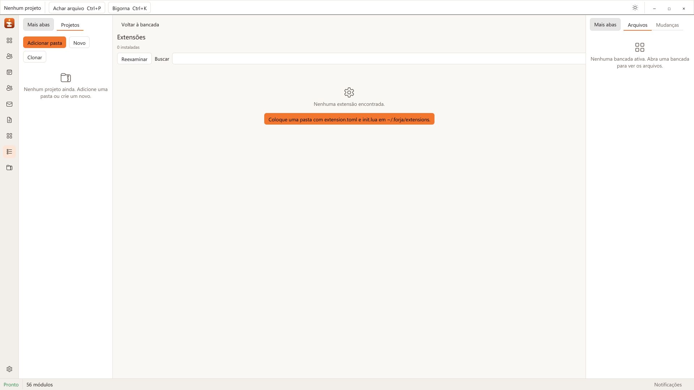

# Painel de extensões (Extensões)

Tela do painel central de extensões, onde se vê a lista de extensões instaladas do projeto (vazia nesta captura) e a instrução para instalá-las manualmente em `~/.forja/extensions`.

## Como chegar
Abrir a Forja e, no trilho vertical à esquerda, clicar no botão "Extensões" (nono ícone do trilho, destacado com fundo laranja claro). Equivale a abrir o app com o trilho apontando para o painel de extensões. Comando de captura: `forja-app --locale pt-BR --theme light --rail extension.page`.

## Regiões
- **Barra superior** (0,0)–(1920,40): rótulo do projeto atual "Nenhum projeto", botões de comando "Achar arquivo  Ctrl+P" e "Bigorna  Ctrl+K" com atalhos, botão sem nome acessível para alternar tema (ícone de sol em ~1741,5) e os botões de janela "–", "□" e "×" no canto direito.
- **Trilho à esquerda** (0,42)–(48,1048): logotipo do app (imagem em 12,50) e uma coluna de ícones de navegação: "Quadro", "Ajudantes", "Rotinas", "Mutirão", "Pedidos", "Skills", "Uso", "Extensões" (ativo) e "Acervo", com "Ajustes" isolado na base (8,1004).
- **Painel lateral esquerdo (Projetos)** (48,42)–(304,1048): botão "Mais abas" e aba "Projetos" (ativa); botões "Adicionar pasta" (destacado em laranja), "Novo projeto" e "Clonar"; estado vazio com ícone de pasta e o texto "Nenhum projeto ainda. Adicione uma pasta ou crie um novo.".
- **Área central (painel de extensões)** (320,42)–(1612,1048): botão "Voltar à bancada" no topo, título "Extensões" com contador "0 instaladas", botão "Reexaminar", rótulo "Buscar" e campo de texto de busca em largura quase total (324,186)–(1608,218); estado vazio com ícone de engrenagem, o texto "Nenhuma extensão encontrada." e um botão-aviso com o caminho de instalação.
- **Painel direito (Arquivos)** (1628,42)–(1920,1048): botão "Mais abas" e abas "Arquivos" (ativa) e "Mudanças"; estado vazio com ícone de grade e o texto "Nenhuma bancada ativa. Abra uma bancada para ver os arquivos.".
- **Barra de status** (0,1048)–(1920,1080): status "Pronto" em verde à esquerda, contador "56 módulos" ao lado e "Notificações" à direita.

## Elementos
| Elemento | Tipo | Posição (px) | Estado | O que faz |
|---|---|---|---|---|
| "Nenhum projeto" | Rótulo | (11,12)–(113,31) | — | Mostra que nenhum projeto está aberto. |
| "Achar arquivo  Ctrl+P" | Botão | (135,5)–(291,37) | clicável, focável | Abre a busca rápida de arquivos (Ctrl+P). |
| "Bigorna  Ctrl+K" | Botão | (299,5)–(417,37) | clicável, focável | Abre a paleta de comandos (Ctrl+K). |
| (sem nome acessível) | Desconhecido | (1741,5)–(1773,37) | clicável, focável | Ícone de sol na barra superior: alterna tema claro/escuro. |
| "–" | Botão | (1795,5)–(1827,37) | clicável, focável | Minimiza a janela. |
| "□" | Botão | (1835,5)–(1867,37) | clicável, focável | Maximiza/restaura a janela. |
| "×" | Botão | (1875,5)–(1909,37) | clicável, focável | Fecha a janela. |
| (sem nome acessível) | Desconhecido | (304,42)–(320,1048) | focável | Divisor arrastável entre o painel de projetos e a área central. |
| (sem nome acessível) | Desconhecido | (1612,42)–(1628,1048) | focável | Divisor arrastável entre a área central e o painel de arquivos. |
| (sem nome acessível) | Imagem | (12,50)–(40,78) | clicável, focável | Logotipo do app no topo do trilho. |
| "Mais abas" | Botão | (64,50)–(149,85) | clicável, focável | Abre a lista das demais abas do painel lateral (Bancadas, Painéis de extensões). |
| "Projetos" | Botão (aba) | (157,52)–(231,84) | marcado=True | Aba ativa do painel lateral: lista de projetos. |
| "Mais abas" | Botão | (1632,50)–(1717,85) | clicável, focável | Abre a lista das demais abas do painel direito (Busca, Portas, Painéis de extensões). |
| "Arquivos" | Botão (aba) | (1725,52)–(1803,84) | marcado=True | Aba ativa do painel direito: navegador de arquivos da bancada. |
| "Mudanças" | Botão (aba) | (1803,52)–(1890,84) | clicável, focável, marcado=False | Mostra as mudanças (diff) da bancada. |
| "Voltar à bancada" | Botão | (324,50)–(452,82) | clicável, focável | Volta ao painel da bancada ativa; aparece mesmo sem bancada aberta. |
| "Extensões" | Rótulo | (324,90)–(402,114) | clicável | Título do painel central. |
| "Quadro" | Botão (ícone) | (8,94)–(44,130) | clicável, focável, marcado=False | Vai à tela de quadro do trilho. |
| "Adicionar pasta" | Botão | (64,101)–(183,133) | clicável, focável | Abre o seletor para adicionar uma pasta de projeto; botão primário em laranja. |
| "Novo projeto" | Botão | (191,101)–(297,133) | clicável, focável | Cria um novo projeto. |
| (ícone) | Rótulo | (1756,117)–(1784,145) | clicável | Ícone de grade do estado vazio do painel de arquivos. |
| "0 instaladas" | Rótulo | (324,122)–(386,138) | clicável | Contador de extensões instaladas (vazio). |
| "Ajudantes" | Botão (ícone) | (8,138)–(44,174) | clicável, focável, marcado=False | Vai à tela de ajudantes (agentes de IA). |
| "Clonar" | Botão | (64,141)–(128,173) | clicável, focável | Clona um repositório como novo projeto. |
| "Reexaminar" | Botão | (324,146)–(420,178) | clicável, focável | Reescaneia as pastas de extensões e atualiza a lista. |
| "Buscar" | Rótulo | (428,146)–(468,178) | clicável | Rótulo do campo de busca de extensões. |
| "Nenhuma bancada ativa. Abra uma bancada para ver os arquivos." | Rótulo | (1634,153)–(1906,191) | clicável | Estado vazio do painel de arquivos. |
| "Rotinas" | Botão (ícone) | (8,182)–(44,218) | clicável, focável, marcado=False | Vai à tela de rotinas. |
| (sem nome acessível) | Campo de texto | (324,186)–(1608,218) | clicável, focável | Campo de busca por nome de extensão, em largura quase total da área central. |
| (ícone) | Rótulo | (168,201)–(196,229) | clicável | Ícone de pasta do estado vazio do painel de projetos. |
| "Mutirão" | Botão (ícone) | (8,226)–(44,262) | clicável, focável, marcado=False | Vai à tela de mutirão. |
| "Nenhum projeto ainda. Adicione uma pasta ou crie um novo." | Rótulo | (66,237)–(298,275) | clicável | Estado vazio do painel de projetos. |
| (ícone) | Rótulo | (952,242)–(980,270) | clicável | Ícone de engrenagem do estado vazio do painel de extensões. |
| "Pedidos" | Botão (ícone) | (8,270)–(44,306) | clicável, focável, marcado=False | Vai à tela de pedidos. |
| "Nenhuma extensão encontrada." | Rótulo | (868,278)–(1064,297) | clicável | Mensagem de lista vazia de extensões. |
| "Coloque uma pasta com extension.toml e init.lua em ~/.forja/extensions." | Botão | (731,313)–(1202,345) | clicável, focável | Instrução de instalação manual de extensões, exposta como botão clicável (destaque laranja). |
| "Skills" | Botão (ícone) | (8,314)–(44,350) | clicável, focável, marcado=False | Vai à tela de skills. |
| "Uso" | Botão (ícone) | (8,358)–(44,394) | clicável, focável, marcado=False | Vai à tela de uso. |
| "Extensões" | Botão (ícone) | (8,402)–(44,438) | clicável, focável, marcado=True | Item ativo do trilho: mostra o painel de extensões (esta tela). |
| "Acervo" | Botão (ícone) | (8,446)–(44,482) | clicável, focável, marcado=False | Vai à tela de acervo. |
| "Ajustes" | Botão (ícone) | (8,1004)–(44,1040) | clicável, focável, marcado=False | Vai à tela de ajustes, fixado na base do trilho. |
| "Pronto" | Rótulo | (10,1055)–(51,1074) | clicável | Status geral do app na barra inferior. |
| "56 módulos" | Rótulo | (73,1055)–(146,1074) | clicável | Contador de módulos carregados. |
| "Notificações" | Rótulo | (1810,1055)–(1886,1074) | clicável, focável | Abre a área de notificações, no canto direito da barra de status. |

## Aparência (o que muda em relação à variante escura)
Mesma estrutura e mesmos elementos da referência `pt-BR.dark.rail.extension.page`; muda o tema e alguns detalhes de layout desta captura:

- **Cores**: fundo claro (branco/cinza muito claro) em toda a janela, com os painéis laterais em tom levemente creme; o trilho fica num bege claro. O destaque continua sendo o laranja ("Brasa"): preenchimento do botão "Adicionar pasta" e do botão-aviso de instalação, fundo suave do item ativo "Extensões" no trilho e sublinhado laranja das abas ativas "Projetos" e "Arquivos". O status "Pronto" aparece em verde na barra de status.
- **Texto**: cinza-escuro sobre fundo claro, com bom contraste; textos de estado vazio em cinza médio.
- **Alternar tema**: o botão sem nome acessível (ícone de sol) fica aqui no canto direito da barra superior (1741,5), ao lado dos botões de janela, e não em ~1101,5 como na captura escura.
- **Abas dos painéis**: nesta captura os painéis mostram o botão "Mais abas" no lugar das abas "Bancadas" e "Painéis de extensões" (esquerda) e de "Busca", "Portas" e "Painéis de extensões" (direita); assim desaparecem os problemas de truncamento/estouro da variante escura. O botão direito traz também "Novo projeto" (na referência escura aparece como "Novo").
- **Campo de busca**: ocupa quase toda a área central (324,186)–(1608,218), mais largo que na referência escura (até 968).
- **"Voltar à bancada"**: botão visível no topo da área central nesta captura, sem equivalente listado na referência escura.
- Tipografia sem serifa (~13–14 px), atalhos "Ctrl+P"/"Ctrl+K" na mesma linha do comando, divisores verticais de 1 px entre os três painéis; conteúdo do painel central concentrado no topo, com o restante vazio.

## Problemas encontrados
- O botão de alternar tema na barra superior (1741,5)–(1773,37) não tem nome acessível; só se identifica pela imagem do sol.
- O campo de busca de extensões (324,186)–(1608,218) é um TextInput sem nome acessível; o rótulo "Buscar" fica fora do campo, sem associação.
- O logotipo do app (imagem em 12,50) e os três ícones de estado vazio (168,201), (952,242) e (1756,117) estão sem nome acessível.
- A instrução "Coloque uma pasta com extension.toml e init.lua em ~/.forja/extensions." é exposta com papel de Botão; semanticamente é um texto de ajuda, o que pode confundir leitores de tela.
- O botão "Voltar à bancada" (324,50) aparece habilitado mesmo sem nenhuma bancada ativa (o painel de arquivos exibe "Nenhuma bancada ativa...").
- Dois elementos genéricos sem nome acessível (os divisores em (304,42) e (1612,42)) são focáveis, mas não identificam sua função de redimensionamento.
