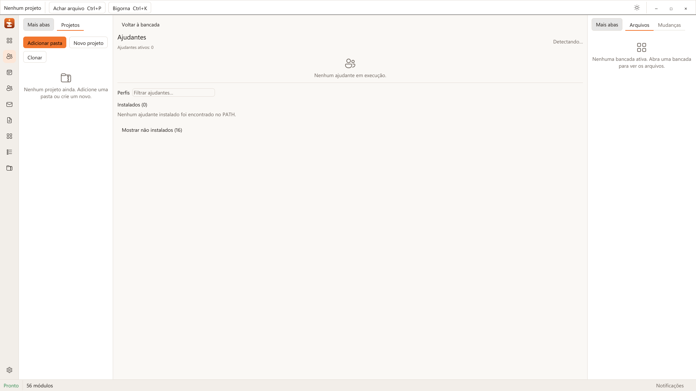

# Ajudantes (trilho, aba helper.tab — tema claro)

Tela do painel central "Ajudantes", que lista os perfis de ajudantes de código (agentes de IA) e permite detectar e iniciar cada um, com o trilho esquerdo na aba Ajudantes e o painel direito em Arquivos. Variante do tema claro (1280×800 na referência escura; esta captura tem 1920×1080 px, o que muda as coordenadas e o comportamento visível da tela).

## Como chegar
Na janela principal, clique no segundo ícone do trilho à esquerdo (ícone de pessoas, botão "Ajudantes", (8,138)–(44,174), marcado como ativo). Comando de captura/abertura: `forja-app --locale pt-BR --theme light --rail helper.tab` (arquivo `captures/pt-BR.light.rail.helper.tab.png`, 1920×1080 px).

## Regiões
- **Barra de título** — (0,0)–(1920,42): rótulo do projeto ("Nenhum projeto"), ações rápidas "Achar arquivo  Ctrl+P" e "Bigorna  Ctrl+K", botão de tema (ícone de sol, sem nome acessível, (1741,5)–(1773,37)) e botões de janela "–", "□", "×".
- **Trilho esquerdo (rail)** — (0,42)–(48,1048): logotipo da Forja (imagem sem nome acessível, (12,50)–(40,78)) e ícones de navegação: "Quadro", "Ajudantes" (ativo), "Rotinas", "Mutirão", "Pedidos", "Skills", "Uso", "Extensões", "Acervo" e "Ajustes" (fixado no rodapé do trilho, (8,1004)–(44,1040)).
- **Painel lateral esquerdo** — (48,42)–(304,1048): botão "Mais abas", aba "Projetos" (ativa), botões "Adicionar pasta", "Novo projeto" e "Clonar", e estado vazio com ícone de pasta (rótulo "(íicone)" corrigido: "(ícone)" em (168,201)–(196,229)) e a mensagem "Nenhum projeto ainda. Adicione uma pasta ou crie um novo.".
- **Divisor 1** — (304,42)–(320,1048): divisor arrastável entre o painel esquerdo e a área central.
- **Área central** — (320,42)–(1612,1048): botão "Voltar à bancada" no topo; cabeçalho "Ajudantes" com contador "Ajudantes ativos: 0"; estado vazio com ícone de pessoas (rótulo "(ícone)" em (952,162)–(980,190)) e o texto "Nenhum ajudante em execução."; indicador "Detectando…" no canto superior direito da área central; seção "Perfis" com campo de filtro (TextInput sem nome acessível, com o marcador visível "Filtrar ajudantes…"), subtítulo "Instalados (0)", aviso "Nenhum ajudante instalado foi encontrado no PATH." e o botão expansível "Mostrar não instalados (16)". Diferente da referência escura, a lista dos 16 perfis fica recolhida atrás desse botão, portanto não há nomes de ajudantes nem botões "Iniciar" visíveis.
- **Divisor 2** — (1612,42)–(1628,1048): divisor arrastável entre a área central e o painel direito.
- **Painel direito** — (1628,42)–(1920,1048): botão "Mais abas", abas "Arquivos" (ativa) e "Mudanças"; estado vazio com ícone de grade (rótulo "(ícone)" em (1756,117)–(1784,145)) e a mensagem "Nenhuma bancada ativa. Abra uma bancada para ver os arquivos.". Na janela maior de 1920 px, as abas extras da referência ("Busca", "Portas", "Painéis de extensões") não aparecem na árvore desta captura.
- **Barra de status** — (0,1048)–(1920,1080): "Pronto" (em verde), "56 módulos" e "Notificações" à direita.

## Elementos
| Elemento | Tipo | Posição (px) | Estado | O que faz |
|---|---|---|---|---|
| "Achar arquivo  Ctrl+P" | Button | (135,5)–(291,37) | — | Abre a busca rápida de arquivos (atalho Ctrl+P). |
| "Bigorna  Ctrl+K" | Button | (299,5)–(417,37) | — | Abre a paleta de comandos (atalho Ctrl+K). |
| (sem nome acessível) | Unknown | (1741,5)–(1773,37) | — | Ícone de sol: alterna tema claro/escuro. |
| "–" | Button | (1795,5)–(1827,37) | — | Minimiza a janela. |
| "□" | Button | (1835,5)–(1867,37) | — | Maximiza/restaura a janela. |
| "×" | Button | (1875,5)–(1909,37) | — | Fecha a janela. |
| "Nenhum projeto" | Label | (11,12)–(113,31) | — | Mostra que nenhum projeto está aberto. |
| (sem nome acessível) | Unknown | (304,42)–(320,1048) | foco | Divisor arrastável entre painel esquerdo e área central. |
| (sem nome acessível) | Unknown | (1612,42)–(1628,1048) | foco | Divisor arrastável entre área central e painel direito. |
| (sem nome acessível) | Image | (12,50)–(40,78) | — | Logotipo da Forja no trilho (ícone de bigorna laranja). |
| "Mais abas" | Button | (64,50)–(149,85) | — | Abre o menu com as abas restantes do painel esquerdo. |
| "Voltar à bancada" | Button | (324,50)–(452,82) | — | Volta da visão de Ajudantes para a bancada. |
| "Mais abas" | Button | (1632,50)–(1717,85) | — | Abre o menu com as abas restantes do painel direito. |
| "Projetos" | Button | (157,52)–(231,84) | marcado=True | Aba ativa do painel esquerdo (sublinhado laranja). |
| "Arquivos" | Button | (1725,52)–(1803,84) | marcado=True | Aba ativa do painel direito (sublinhado laranja). |
| "Mudanças" | Button | (1803,52)–(1890,84) | marcado=False | Aba de mudanças (diffs) da bancada. |
| "Ajudantes" | Label | (324,90)–(403,114) | — | Título do painel central. |
| "Quadro" | Button | (8,94)–(44,130) | marcado=False | Ícone do trilho: abre o quadro. |
| "Adicionar pasta" | Button | (64,101)–(183,133) | — | Adiciona uma pasta de projeto existente; botão primário laranja. |
| "Novo projeto" | Button | (191,101)–(297,133) | — | Cria um projeto novo. |
| "Detectando…" | Label | (1526,105)–(1608,124) | — | Indica que a detecção de ajudantes instalados está em andamento. |
| (ícone) | Label | (1756,117)–(1784,145) | — | Ícone de grade do estado vazio do painel direito. |
| "Ajudantes ativos: 0" | Label | (324,122)–(423,138) | — | Contador de ajudantes em execução. |
| "Ajudantes" | Button | (8,138)–(44,174) | marcado=True | Ícone do trilho: abre esta tela de Ajudantes (ativa). |
| "Clonar" | Button | (64,141)–(128,173) | — | Clona um repositório como projeto. |
| "Nenhuma bancada ativa. Abra uma bancada para ver os arquivos." | Label | (1634,153)–(1906,191) | — | Estado vazio do painel de arquivos. |
| (ícone) | Label | (952,162)–(980,190) | — | Ícone de pessoas do estado vazio do painel central. |
| "Rotinas" | Button | (8,182)–(44,218) | marcado=False | Ícone do trilho: abre rotinas. |
| "Nenhum ajudante em execução." | Label | (867,198)–(1065,217) | — | Estado vazio da lista de ajudantes. |
| (ícone) | Label | (168,201)–(196,229) | — | Ícone de pasta do estado vazio do painel esquerdo. |
| "Mutirão" | Button | (8,226)–(44,262) | marcado=False | Ícone do trilho: abre o mutirão. |
| "Nenhum projeto ainda. Adicione uma pasta ou crie um novo." | Label | (66,237)–(298,275) | — | Estado vazio da lista de projetos. |
| (sem nome acessível) | TextInput | (365,244)–(593,267) | — | Campo de filtro da seção "Perfis"; mostra o marcador "Filtrar ajudantes…". |
| "Perfis" | Label | (324,246)–(357,265) | — | Título da seção que lista os perfis de ajudantes. |
| "Pedidos" | Button | (8,270)–(44,306) | marcado=False | Ícone do trilho: abre pedidos. |
| "Instalados (0)" | Label | (324,279)–(406,298) | — | Subtítulo com a contagem de ajudantes instalados. |
| "Nenhum ajudante instalado foi encontrado no PATH." | Label | (324,306)–(650,325) | — | Aviso de que a detecção não achou ajudantes no PATH. |
| "Skills" | Button | (8,314)–(44,350) | marcado=False | Ícone do trilho: abre skills. |
| "Mostrar não instalados (16)" | Button | (324,341)–(514,373) | — | Expande a lista dos 16 perfis não instalados (recolhida nesta captura, ao contrário da referência escura, que a mostra aberta). |
| "Uso" | Button | (8,358)–(44,394) | marcado=False | Ícone do trilho: abre uso/consumo. |
| "Extensões" | Button | (8,402)–(44,438) | marcado=False | Ícone do trilho: abre extensões. |
| "Acervo" | Button | (8,446)–(44,482) | marcado=False | Ícone do trilho: abre o acervo. |
| "Ajustes" | Button | (8,1004)–(44,1040) | marcado=False | Ícone do trilho: abre os ajustes (fixado no rodapé do trilho). |
| "Pronto" | Label | (10,1055)–(51,1074) | — | Status geral do app na barra de status, em verde. |
| "56 módulos" | Label | (73,1055)–(146,1074) | — | Quantidade de módulos carregados. |
| "Notificações" | Label | (1810,1055)–(1886,1074) | — | Atalho/área de notificações na barra de status. |

## Aparência
Tema claro: fundo creme/off-white (~#faf9f6) na área central, painel esquerdo e painel direito; faixas levemente mais claras (quase brancas) na barra de título, no trilho e na barra de status. Cor de destaque laranja (accent "Brasa") no logotipo, no botão primário "Adicionar pasta" (fundo laranja com texto branco) e no sublinhado das abas ativas "Projetos" e "Arquivos"; o ícone ativo do trilho "Ajudantes" recebe fundo laranja claro arredondado. Texto em cinza-escuro; textos de estado vazio e o indicador "Detectando…" em cinza mais apagado; "Pronto" na barra de status em verde. Tipografia sem serifa de tamanho único, com hierarquia por peso (título "Ajudantes" maior). Espaçamento regular: abas e botões do painel esquerdo alinhados à esquerda a partir de x≈64, conteúdo central alinhado em x=324, divisores verticais de 16 px separando as três colunas.

Em relação à referência escura (pt-BR.dark.rail.helper.tab): invertem-se os fundos (creme em vez de quase preto) e o texto (cinza-escuro em vez de cinza-claro); o laranja de destaque se mantém; a janela desta captura é 1920×1080 (contra 1280×800), o que desloca todas as coordenadas, mantém as abas "Busca", "Portas" e "Painéis de extensões" fora da árvore visível e, com a lista de perfis recolhida, não aparecem os 16 pares "nome / não instalado / Iniciar" da referência. Também mudam os rótulos "Novo projeto" (na referência, "Novo") e "Detectando…" (na referência, botão "Detectar").

## Problemas encontrados
- Campo de filtro "Filtrar ajudantes…" exposto como TextInput "(sem nome acessível)": o marcador não é publicado como nome acessível.
- Botões de janela com nomes acessíveis simbólicos "–", "□" e "×" em vez de rótulos descritivos (Minimizar/Maximizar/Fechar).
- Três ícones de estado vazio expostos com o nome acessível literal "(ícone)", que não descreve o significado (pasta, pessoas, grade).
- Vários elementos sem nome acessível: o botão de tema (ícone de sol), os dois divisores arrastáveis e a imagem do logotipo.
- Dois botões com o mesmo nome acessível "Mais abas" na mesma tela (painel esquerdo e painel direito), o que dificulta a identificação por leitor de tela.
- Nenhum texto cortado, sobreposição ou elemento fora da janela nesta captura; os textos de estado vazio e as abas cabem integralmente nos 1920×1080 px.
