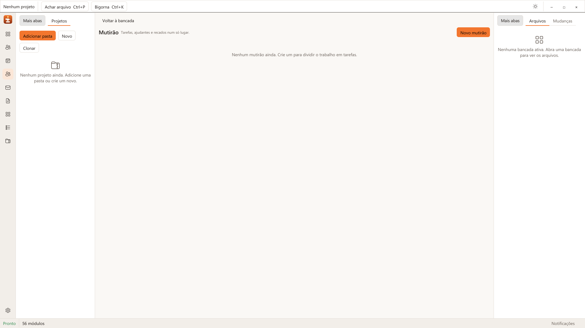

state: pt-BR.light.rail.muster.page
capture_sha: pt-BR.light.rail.muster.page
model: opencode/glm-5.3-flash-free
---

# Mutirão (muster.page)

Tela inicial do trilho "Mutirão", que reúne tarefas, ajudantes e recados do projeto; sem projeto aberto, mostra estados vazios nas três colunas.

## Como chegar
Inicie o app com o trilho Mutirão ativo: `forja-app --locale pt-BR --theme light --rail muster.page`. Na interface, clique no quarto ícone do trilho à esquerda (o de pessoas, "Mutirão"), que é a entrada marcada.

## Regiões
*(Variante clara de `pt-BR.dark.rail.muster.page`; janela de 1920×1080 px. Mudam cores, dimensões e as tiras de abas, que aqui estão recolhidas atrás dos botões "Mais abas".)*

- **Barra superior** (0,0)–(1920,42): à esquerda o chip "Nenhum projeto" e os botões "Achar arquivo  Ctrl+P" e "Bigorna  Ctrl+K"; à direita o botão de tema (ícone de sol, sem nome) e os botões de janela "–", "□" e "×".
- **Trilho à esquerda** (0,42)–(56,1048): a marca do app no topo e uma coluna de ícones ("Quadro", "Ajudantes", "Rotinas", "Mutirão", "Pedidos", "Skills", "Uso", "Extensões", "Acervo") e, no rodapé, "Ajustes".
- **Painel esquerdo** (56,42)–(304,1048): botão "Mais abas" e a aba "Projetos" (marcada), com os botões "Adicionar pasta", "Novo projeto" e "Clonar" e a mensagem de estado vazio "Nenhum projeto ainda. Adicione uma pasta ou crie um novo." sobre um ícone de pasta.
- **Área central** (320,42)–(1612,1048): cabeçalho com o botão "Voltar à bancada", o título "Mutirão" e o subtítulo "Tarefas, ajudantes e recados num só lugar.", o botão laranja "Novo mutirão" alinhado à direita do cabeçalho e o estado vazio "Nenhum mutirão ainda. Crie um para dividir o trabalho em tarefas." na parte superior da coluna, centralizado horizontalmente.
- **Painel direito** (1628,42)–(1920,1048): botão "Mais abas", abas "Arquivos" (marcada) e "Mudanças", ícone de grade e a mensagem "Nenhuma bancada ativa. Abra uma bancada para ver os arquivos.".
- **Barra de status** (0,1048)–(1920,1080): "Pronto" em verde à esquerda, "56 módulos" ao lado e "Notificações" à direita.

## Elementos
| Elemento | Tipo | Posição (px) | Estado | O que faz |
|---|---|---|---|---|
| "Achar arquivo  Ctrl+P" | Button | (135,5)–(291,37) | clicável, focável | Abre o localizador de arquivos do projeto; atalho Ctrl+P indicado no rótulo. |
| "Bigorna  Ctrl+K" | Button | (299,5)–(417,37) | clicável, focável | Abre a paleta de comandos ("Bigorna"); atalho Ctrl+K indicado no rótulo. |
| (sem nome acessível) | Unknown | (1741,5)–(1773,37) | clicável, focável | Botão de alternância de tema, desenhado como ícone de sol antes dos botões de janela. |
| "–" | Button | (1795,5)–(1827,37) | clicável, focável | Minimiza a janela. |
| "□" | Button | (1835,5)–(1867,37) | clicável, focável | Maximiza/restaura a janela. |
| "×" | Button | (1875,5)–(1909,37) | clicável, focável | Fecha a janela. |
| "Nenhum projeto" | Label | (11,12)–(113,31) | clicável, focável | Indicador do projeto atual na barra de título; sem projeto, exibe este texto. |
| (sem nome acessível) | Unknown | (304,42)–(320,1048) | focável | Divisor vertical entre o painel esquerdo e a área central (arrastável/redimensionável). |
| (sem nome acessível) | Unknown | (1612,42)–(1628,1048) | focável | Divisor vertical entre a área central e o painel direito. |
| (sem nome acessível) | Image | (12,50)–(40,78) | clicável, focável | Marca/logo do app no topo do trilho (ícone laranja). |
| "Mais abas" | Button | (64,50)–(149,85) | clicável, focável | Revela as abas ocultas da tira do painel esquerdo ("Bancadas", "Painéis de extensões"). |
| "Voltar à bancada" | Button | (324,50)–(452,82) | clicável, focável | Volta da área central para a visão da bancada ativa. |
| "Mais abas" | Button | (1632,50)–(1717,85) | clicável, focável | Revela as abas ocultas da tira do painel direito ("Busca", "Portas", "Painéis de extensões"). |
| "Projetos" | Button | (157,52)–(231,84) | marcado=True | Aba do painel esquerdo que lista os projetos; é a aba ativa. |
| "Arquivos" | Button | (1725,52)–(1803,84) | marcado=True | Aba do painel direito com o navegador de arquivos; é a aba ativa. |
| "Mudanças" | Button | (1803,52)–(1890,84) | marcado=False | Aba de mudanças (arquivos alterados) do painel direito. |
| "Novo mutirão" | Button | (1499,90)–(1608,122) | clicável, focável | Botão primário laranja que cria um mutirão na área central. |
| "Quadro" | Button | (8,94)–(44,130) | marcado=False | Entrada do trilho para o quadro; ícone de grade. |
| "Mutirão" | Label | (324,94)–(389,118) | clicável | Título da tela na área central. |
| "Tarefas, ajudantes e recados num só lugar." | Label | (397,98)–(621,114) | clicável | Subtítulo descritivo ao lado do título. |
| "Adicionar pasta" | Button | (64,101)–(183,133) | clicável, focável | Botão destacado do painel Projetos para adicionar uma pasta de projeto. |
| "Novo projeto" | Button | (191,101)–(297,133) | clicável, focável | Cria um projeto novo no painel Projetos. |
| (ícone) | Label | (1756,117)–(1784,145) | clicável | Ícone decorativo (grade de quadradinhos) do estado vazio do painel Arquivos. |
| "Ajudantes" | Button | (8,138)–(44,174) | marcado=False | Entrada do trilho para ajudantes de código. |
| "Clonar" | Button | (64,141)–(128,173) | clicável, focável | Ação do painel Projetos para clonar um repositório/pasta. |
| "Nenhuma bancada ativa. Abra uma bancada para ver os arquivos." | Label | (1634,153)–(1906,191) | clicável | Estado vazio do painel Arquivos; orienta abrir uma bancada. |
| "Nenhum mutirão ainda. Crie um para dividir o trabalho em tarefas." | Label | (761,170)–(1171,189) | clicável | Estado vazio da área central; orienta criar um mutirão. |
| "Rotinas" | Button | (8,182)–(44,218) | marcado=False | Entrada do trilho para rotinas. |
| (ícone) | Label | (168,201)–(196,229) | clicável | Ícone decorativo (pasta aberta) do estado vazio do painel Projetos. |
| "Mutirão" | Button | (8,226)–(44,262) | marcado=True | Entrada do trilho da tela atual; é a entrada marcada. |
| "Nenhum projeto ainda. Adicione uma pasta ou crie um novo." | Label | (66,237)–(298,275) | clicável | Estado vazio do painel Projetos; orienta adicionar pasta ou criar projeto. |
| "Pedidos" | Button | (8,270)–(44,306) | marcado=False | Entrada do trilho para pedidos. |
| "Skills" | Button | (8,314)–(44,350) | marcado=False | Entrada do trilho para skills. |
| "Uso" | Button | (8,358)–(44,394) | marcado=False | Entrada do trilho para uso. |
| "Extensões" | Button | (8,402)–(44,438) | marcado=False | Entrada do trilho para extensões. |
| "Acervo" | Button | (8,446)–(44,482) | marcado=False | Entrada do trilho para o acervo. |
| "Ajustes" | Button | (8,1004)–(44,1040) | marcado=False | Entrada do trilho para ajustes, fixada no rodapé do trilho. |
| "Pronto" | Label | (10,1055)–(51,1074) | clicável | Status geral na barra inferior, em verde. |
| "56 módulos" | Label | (73,1055)–(146,1074) | clicável | Contagem de módulos carregados. |
| "Notificações" | Label | (1810,1055)–(1886,1074) | clicável, focável | Área de notificações no canto direito da barra de status. |

## Aparência
Tema claro: fundos em branco e tons muito claros de bege, com divisórias cinza-claras entre trilho, painéis e área central. O laranja é a cor de destaque: marca do app no trilho, aba "Projetos" sublinhada, ícone do trilho "Mutirão" com fundo laranja-claro, botão primário "Novo mutirão" e botão "Adicionar pasta" em laranja sólido com texto branco. Tipografia sem serifa em dois tamanhos: título "Mutirão" maior em negrito, o resto em corpo pequeno; subtítulos e estados vazios aparecem em cinza médio (contraste mais baixo que o texto principal escuro). A aba ativa de cada tira é marcada por um sublinhado laranja. Espaçamento uniforme: ícones do trilho com 32 px de lado e passo vertical de 44 px; botões de janela de 32 px alinhados no topo. Em relação à variante escura, as tiras de abas aparecem recolhidas: apenas "Projetos"/"Arquivos"/"Mudanças" ficam visíveis e o restante fica atrás dos botões "Mais abas"; a área central ganha o botão "Voltar à bancada" e o "Novo mutirão" fica na mesma linha do título, à direita.

## Problemas encontrados
- Dois botões com o mesmo nome acessível "Mais abas" em tiras diferentes (esquerda e direita), o que dificulta a identificação por leitores de tela.
- Botão de alternância de tema, as duas divisórias verticais e a marca do app (Image) estão sem nome acessível.
- O estado vazio central "Nenhum mutirão ainda. Crie um para dividir o trabalho em tarefas." fica a cerca de 170 px do topo da coluna (que tem ~1006 px de altura), em vez de centrado verticalmente.
- Textos de estado vazio e subtítulo em cinza sobre fundo claro têm contraste reduzido (por exemplo, "Tarefas, ajudantes e recados num só lugar." e "Nenhuma bancada ativa. Abra uma bancada para ver os arquivos.").
