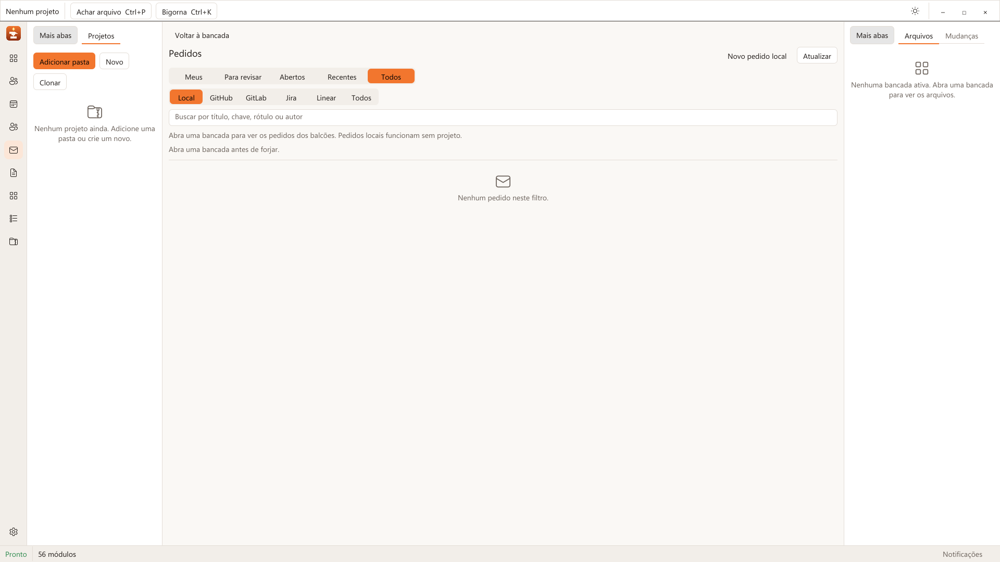

state: pt-BR.light.rail.request.page
capture_sha: (ver captures/pt-BR.light.rail.request.page.png)
model: opencode/glm-5.3-flash-free
---

# Pedidos (página request.page no trilho) — variante tema claro

Tela de listagem e filtro de pedidos (tarefas/demandas) dos balcões, com painel de projetos à esquerda e painel de arquivos da bancada à direita; funciona sem projeto aberto para pedidos locais. Esta é a variante em tema claro da PÁGINA DE REFERÊNCIA (pt-BR.dark.rail.request.page): a estrutura é a mesma, capturada em janela de 1920×1080 px (a referência tem 1280×800), o que alarga a área central e o campo de busca, e faz as abas extras dos painéis laterais ficarem recolhidas nos botões "Mais abas" (na referência elas aparecem como abas nomeadas). Aparece também aqui o botão "Voltar à bancada" no topo da área central.

## Como chegar
Na janela principal, clicar no ícone de envelope "Pedidos" no trilho à esquerda (em (8,270)–(44,306)). Via comando de captura: `forja-app --locale pt-BR --theme light --rail request.page`.

## Regiões
- **Barra superior** (0,0)–(1920,42): seletor de projeto "Nenhum projeto", atalhos "Achar arquivo  Ctrl+P" e "Bigorna  Ctrl+K", botão de alternância de tema (ícone de sol, sem nome acessível) em (1741,5)–(1773,37) e botões de janela –, □, ×.
- **Trilho à esquerda** (0,42)–(52,1048): logotipo da Forja no topo (12,50)–(40,78) e botões-ícone de 36×36 px: Quadro, Ajudantes, Rotinas, Mutirão, Pedidos (ativo, marcado=True), Skills, Uso, Extensões, Acervo; "Ajustes" fixado no rodapé (8,1004)–(44,1040).
- **Painel lateral esquerdo** (52,42)–(304,1048): botão "Mais abas" e aba ativa "Projetos"; ações "Adicionar pasta", "Novo projeto" e "Clonar"; estado vazio com ícone de pasta (168,201)–(196,229) e o texto "Nenhum projeto ainda. Adicione uma pasta ou crie um novo.".
- **Área central** (320,42)–(1612,1048): "Voltar à bancada" no topo; cabeçalho "Pedidos" com "Novo pedido local" e "Atualizar"; filtros de lista (Meus, Para revisar, Abertos, Recentes, Todos — "Todos" ativo); filtros de origem (Local — ativo, GitHub, GitLab, Jira, Linear, Todos); campo de busca com o texto-guia "Buscar por título, chave, rótulo ou autor" (324,210)–(1608,242); dois avisos ("Abra uma bancada para ver os pedidos dos balcões. Pedidos locais funcionam sem projeto." e "Abra uma bancada antes de forjar."); estado vazio com ícone de envelope (952,334)–(980,362) e "Nenhum pedido neste filtro.".
- **Painel direito** (1628,42)–(1920,1048): botão "Mais abas", aba ativa "Arquivos" e aba "Mudanças"; estado vazio com ícone de grade (1756,117)–(1784,145) e o texto "Nenhuma bancada ativa. Abra uma bancada para ver os arquivos.".
- **Barra de status** (0,1048)–(1920,1080): "Pronto" em verde, "56 módulos" e "Notificações" à direita.

Separadores verticais finos de 16 px dividem os painéis em x=304–320 e x=1612–1628.

## Elementos
| Elemento | Tipo | Posição (px) | Estado | O que faz |
|---|---|---|---|---|
| "Nenhum projeto" | Label | (11,12)–(113,31) | — | Indica o projeto atual (nenhum selecionado); abre a lista de projetos. |
| "Achar arquivo  Ctrl+P" | Button | (135,5)–(291,37) | — | Abre a busca rápida de arquivos (atalho Ctrl+P). |
| "Bigorna  Ctrl+K" | Button | (299,5)–(417,37) | — | Abre a paleta de comandos (atalho Ctrl+K). |
| (sem nome acessível) | Unknown | (1741,5)–(1773,37) | — | Botão-ícone de sol: alterna tema claro/escuro. |
| "–" | Button | (1795,5)–(1827,37) | — | Minimiza a janela. |
| "□" | Button | (1835,5)–(1867,37) | — | Maximiza/restaura a janela. |
| "×" | Button | (1875,5)–(1909,37) | — | Fecha a janela. |
| (sem nome acessível) | Unknown | (304,42)–(320,1048) | foco | Separador vertical entre painel esquerdo e área central. |
| (sem nome acessível) | Unknown | (1612,42)–(1628,1048) | foco | Separador vertical entre área central e painel direito. |
| (sem nome acessível) | Image | (12,50)–(40,78) | — | Logotipo da Forja no topo do trilho. |
| "Mais abas" | Button | (64,50)–(149,85) | — | Revela as abas adicionais do painel esquerdo (na referência escura: "Bancadas" e "Painéis de extensões"). |
| "Projetos" | Button | (157,52)–(231,84) | marcado=True | Aba ativa do painel esquerdo; mostra a lista de projetos. |
| "Voltar à bancada" | Button | (324,50)–(452,82) | — | Volta da área central à tela da bancada. |
| "Mais abas" | Button | (1632,50)–(1717,85) | — | Revela as abas adicionais do painel direito (na referência escura: "Busca", "Portas" e "Painéis de extensões"). |
| "Arquivos" | Button | (1725,52)–(1803,84) | marcado=True | Aba ativa do painel direito; lista os arquivos da bancada. |
| "Mudanças" | Button | (1803,52)–(1890,84) | marcado=False | Mostra as mudanças (diff) da bancada. |
| "Pedidos" | Label | (324,90)–(387,114) | — | Título da área central. |
| "Novo pedido local" | Button | (1385,90)–(1522,122) | — | Cria um pedido local (funciona sem projeto). |
| "Atualizar" | Button | (1530,90)–(1608,122) | — | Recarrega a lista de pedidos. |
| "Quadro" | Button | (8,94)–(44,130) | marcado=False | Botão-ícone do trilho: abre o quadro de pedidos. |
| "Adicionar pasta" | Button | (64,101)–(183,133) | — | Adiciona uma pasta existente como projeto (destacado em laranja). |
| "Novo projeto" | Button | (191,101)–(297,133) | — | Cria um projeto novo. |
| (ícone) | Label | (1756,117)–(1784,145) | — | Ícone de grade do estado vazio do painel direito. |
| "Meus" | Button | (324,130)–(419,162) | marcado=False | Filtro de pedidos atribuídos a mim. |
| "Para revisar" | Button | (419,130)–(514,162) | marcado=False | Filtro de pedidos aguardando revisão. |
| "Abertos" | Button | (514,130)–(609,162) | marcado=False | Filtro de pedidos em aberto. |
| "Recentes" | Button | (609,130)–(704,162) | marcado=False | Filtro de pedidos acessados recentemente. |
| "Todos" | Button | (704,130)–(798,162) | marcado=True | Filtro ativo: mostra todos os pedidos. |
| "Ajudantes" | Button | (8,138)–(44,174) | marcado=False | Botão-ícone do trilho: abre os ajudantes de código. |
| "Clonar" | Button | (64,141)–(128,173) | — | Clona um repositório para criar um projeto. |
| "Nenhuma bancada ativa. Abra uma bancada para ver os arquivos." | Label | (1634,153)–(1906,191) | — | Estado vazio do painel direito. |
| "Local" | Button | (324,170)–(391,202) | marcado=True | Filtro de origem ativo: pedidos locais. |
| "GitHub" | Button | (391,170)–(458,202) | marcado=False | Filtro de origem: pedidos do GitHub. |
| "GitLab" | Button | (458,170)–(526,202) | marcado=False | Filtro de origem: pedidos do GitLab. |
| "Jira" | Button | (526,170)–(593,202) | marcado=False | Filtro de origem: pedidos do Jira. |
| "Linear" | Button | (593,170)–(660,202) | marcado=False | Filtro de origem: pedidos do Linear. |
| "Todos" | Button | (660,170)–(727,202) | marcado=False | Filtro de origem: todas as origens. |
| "Rotinas" | Button | (8,182)–(44,218) | marcado=False | Botão-ícone do trilho: abre as rotinas. |
| (ícone) | Label | (168,201)–(196,229) | — | Ícone de pasta do estado vazio do painel esquerdo. |
| (sem nome acessível) | TextInput | (324,210)–(1608,242) | — | Campo de busca com o texto-guia "Buscar por título, chave, rótulo ou autor". |
| "Mutirão" | Button | (8,226)–(44,262) | marcado=False | Botão-ícone do trilho: abre o mutirão. |
| "Nenhum projeto ainda. Adicione uma pasta ou crie um novo." | Label | (66,237)–(298,275) | — | Estado vazio do painel esquerdo. |
| "Abra uma bancada para ver os pedidos dos balcões. Pedidos locais funcionam sem projeto." | Label | (324,250)–(886,269) | — | Aviso sobre o escopo dos pedidos. |
| "Pedidos" | Button | (8,270)–(44,306) | marcado=True | Botão-ícone do trilho da tela atual (envelope, realce laranja). |
| "Abra uma bancada antes de forjar." | Label | (324,277)–(536,296) | — | Aviso: a ação de forjar exige bancada ativa. |
| "Skills" | Button | (8,314)–(44,350) | marcado=False | Botão-ícone do trilho: abre as skills. |
| (ícone) | Label | (952,334)–(980,362) | — | Ícone de envelope do estado vazio da área central. |
| "Uso" | Button | (8,358)–(44,394) | marcado=False | Botão-ícone do trilho: abre o uso de recursos. |
| "Nenhum pedido neste filtro." | Label | (879,370)–(1053,389) | — | Estado vazio da lista de pedidos. |
| "Extensões" | Button | (8,402)–(44,438) | marcado=False | Botão-ícone do trilho: abre as extensões. |
| "Acervo" | Button | (8,446)–(44,482) | marcado=False | Botão-ícone do trilho: abre o acervo. |
| "Ajustes" | Button | (8,1004)–(44,1040) | marcado=False | Botão-ícone do trilho (rodapé): abre os ajustes. |
| "Pronto" | Label | (10,1055)–(51,1074) | — | Status geral na cor verde. |
| "56 módulos" | Label | (73,1055)–(146,1074) | — | Quantidade de módulos carregados. |
| "Notificações" | Label | (1810,1055)–(1886,1074) | foco | Atalho/indicador de notificações na barra de status. |

## Aparência
Tema claro de fundo creme/off-white (janela ~#faf7f2, painéis em tom próximo, com a área central levemente mais clara). A cor de destaque é o laranja, aplicada ao botão primário "Adicionar pasta", aos filtros ativos "Todos" (lista) e "Local" (origem) — nestes, texto branco sobre fundo laranja —, ao realce do botão ativo "Pedidos" do trilho e ao sublinhado da aba ativa "Projetos". Texto em cinza-escuro/marrom; rótulos inativos ("Mudanças", filtros não selecionados) em cinza médio sobre fundo cinza-claro, com contraste menor. Tipografia sem serifa de um único tamanho nas abas e botões, com tamanhos menores nos avisos, nos textos de estado vazio e na barra de status. Botões e abas com cantos arredondados e bordas sutis; espaçamento consistente de ~8 px entre filtros e ~16 px entre seções. Na barra de status, "Pronto" aparece em verde sobre fundo claro. Em relação à referência escura, invertem-se fundo e texto; o realce laranja e o verde de "Pronto" se mantêm, com os avisos em texto cinza simples (sem fundo colorido perceptível).

## Problemas encontrados
- O botão de alternância de tema no topo direito (1741,5)–(1773,37) não tem nome acessível; é identificável apenas pelo ícone de sol.
- O campo de busca (TextInput) não tem nome acessível, apenas o texto-guia visível.
- Os três ícones de estado vazio (pasta, envelope, grade) são Labels "(ícone)" sem descrição acessível.
- O nome "Todos" se repete em dois grupos de filtro (lista e origem) com retângulos distintos, o que pode gerar ambiguidade para leitores de tela.
- As abas extras dos painéis laterais ficam escondidas atrás dos botões "Mais abas" nesta resolução, exigindo um clique extra para alcançar "Bancadas", "Painéis de extensões", "Busca" e "Portas" (visíveis diretamente na referência escura).
