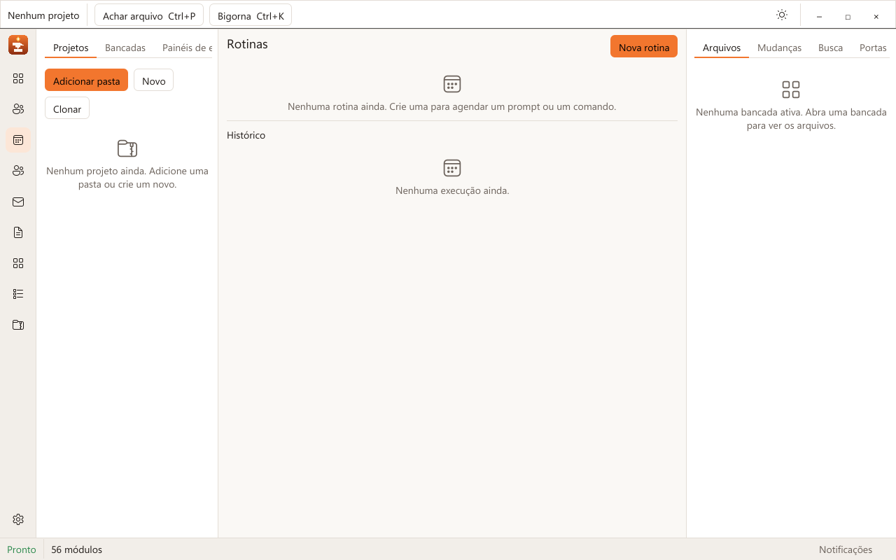

# Rotinas (página do trilho, com painéis vazios — tema claro)

Tela inicial da área de rotinas do app, mostrada no tema claro com os painéis de projetos (à esquerda), rotinas (centro) e arquivos de bancada (à direita) ainda sem conteúdo.

## Como chegar
Abrir o Forja em pt-BR com tema light, com o trilho esquerdo posicionado em "Rotinas" (o botão "Rotinas" do trilho aparece marcado). Comando de captura: `forja-app --locale pt-BR --theme light --rail routine.page`.

Variante de referência: `pt-BR.dark.rail.routine.page` (tema dark). A estrutura da tela é a mesma; o que muda está indicado nas seções abaixo.

## Regiões
- **Barra superior (0,0)–(1920,42):** rótulo do projeto ("Nenhum projeto") à esquerda; botões "Achar arquivo  Ctrl+P" e "Bigorna  Ctrl+K"; ícone de tema (sol) à direita; e os botões de janela (minimizar "–", maximizar "□", fechar "×") no canto superior direito. Igual à referência dark; apenas as posições mudam pela janela mais larga.
- **Trilho à esquerda (0,42)–(56,1048):** coluna vertical de ícones de navegação; a logomarca (12,50)–(40,78) no topo e, abaixo, os botões-ícone "Quadro", "Ajudantes", "Rotinas" (marcado, em laranja), "Mutirão", "Pedidos", "Skills", "Uso", "Extensões", "Acervo" e, na base, "Ajustes". Igual à referência, com a coluna mais alta.
- **Painel lateral esquerdo (56,42)–(304,1048):** botão "Mais abas" e a aba "Projetos" (marcada); botões "Adicionar pasta" (destaque laranja), "Novo projeto" e "Clonar"; estado vazio com ícone de pasta e a mensagem "Nenhum projeto ainda. Adicione uma pasta ou crie um novo.". Diferença da referência dark: nesta largura as abas "Bancadas" e "Painéis de extensões" não aparecem diretamente — ficam atrás do botão "Mais abas" — e o botão de criação se chama "Novo projeto" (na dark era "Novo").
- **Área central (320,42)–(1612,1048):** botão "Voltar à bancada" no topo (elemento que não existia na captura dark), título "Rotinas" e o botão de destaque "Nova rotina" à direita; estado vazio com ícone e a mensagem "Nenhuma rotina ainda. Crie uma para agendar um prompt ou um comando."; abaixo, a seção "Histórico" com ícone e a mensagem "Nenhuma execução ainda.".
- **Painel direito (1628,42)–(1920,1048):** botão "Mais abas", abas "Arquivos" (marcada) e "Mudanças"; estado vazio com ícone e a mensagem "Nenhuma bancada ativa. Abra uma bancada para ver os arquivos.". Diferença da referência dark: as abas "Busca", "Portas" e "Painéis de extensões" ficam recolhidas no botão "Mais abas".
- **Barra de status (0,1048)–(1920,1080):** "Pronto" em verde à esquerda, "56 módulos" ao lado; "Notificações" à direita.

## Elementos
| Elemento | Tipo | Posição (px) | Estado | O que faz |
|---|---|---|---|---|
| "Achar arquivo  Ctrl+P" | Button | (135,5)–(291,37) | — | Atalho global de busca de arquivos (Ctrl+P). |
| "Bigorna  Ctrl+K" | Button | (299,5)–(417,37) | — | Atalho global de comandos (Ctrl+K). |
| (sem nome acessível) | Unknown | (1741,5)–(1773,37) | — | Ícone de tema (sol) na barra superior; alterna o tema. |
| "–" | Button | (1795,5)–(1827,37) | — | Minimizar a janela. |
| "□" | Button | (1835,5)–(1867,37) | — | Maximizar/restaurar a janela. |
| "×" | Button | (1875,5)–(1909,37) | — | Fechar a janela. |
| "Nenhum projeto" | Label | (11,12)–(113,31) | clicável | Indica que nenhum projeto está aberto; abre a seletora de projetos. |
| (sem nome acessível) | Unknown | (304,42)–(320,1048) | — | Divisor/calha entre o painel esquerdo e a área central (arrastável). |
| (sem nome acessível) | Unknown | (1612,42)–(1628,1048) | — | Divisor/calha entre a área central e o painel direito (arrastável). |
| (sem nome acessível) | Image | (12,50)–(40,78) | clicável | Logomarca do Forja no topo do trilho. |
| "Mais abas" | Button | (64,50)–(149,85) | — | Abre a lista das abas do painel esquerdo que não couberam visíveis (na dark eram "Bancadas" e "Painéis de extensões"). |
| "Voltar à bancada" | Button | (324,50)–(452,82) | — | Volta da página de rotinas à visão da bancada; ausente na captura dark. |
| "Mais abas" | Button | (1632,50)–(1717,85) | — | Abre a lista das abas do painel direito que não couberam visíveis (na dark eram "Busca", "Portas" e "Painéis de extensões"). |
| "Projetos" | Button | (157,52)–(231,84) | marcado=True | Aba do painel esquerdo que exibe a lista de projetos (ativa). |
| "Arquivos" | Button | (1725,52)–(1803,84) | marcado=True | Aba do painel direito que mostra os arquivos da bancada (ativa). |
| "Mudanças" | Button | (1803,52)–(1890,84) | marcado=False | Aba do painel direito que mostra as mudanças da bancada. |
| "Rotinas" | Label | (324,90)–(383,114) | clicável | Título da página central. |
| "Nova rotina" | Button | (1512,90)–(1608,122) | — | Cria uma nova rotina (ação principal da página, em destaque laranja). |
| "Quadro" | Button | (8,94)–(44,130) | marcado=False | Botão-ícone do trilho para a tela do quadro. |
| "Adicionar pasta" | Button | (64,101)–(183,133) | — | Adiciona uma pasta de projeto existente (botão em destaque laranja). |
| "Novo projeto" | Button | (191,101)–(297,133) | — | Cria um projeto novo; na captura dark o rótulo era "Novo". |
| (ícone) | Label | (1756,117)–(1784,145) | clicável | Ícone ilustrativo do estado vazio do painel de arquivos (centralizado). |
| "Ajudantes" | Button | (8,138)–(44,174) | marcado=False | Botão-ícone do trilho para a tela de ajudantes. |
| "Clonar" | Button | (64,141)–(128,173) | — | Clona um projeto (repositório) existente. |
| (ícone) | Label | (952,146)–(980,174) | clicável | Ícone ilustrativo do estado vazio das rotinas (centralizado). |
| "Nenhuma bancada ativa. Abra uma bancada para ver os arquivos." | Label | (1634,153)–(1906,191) | clicável | Mensagem de estado vazio do painel de arquivos, em duas linhas. |
| "Rotinas" | Button | (8,182)–(44,218) | marcado=True | Botão-ícone do trilho da página atual, destacado em laranja. |
| "Nenhuma rotina ainda. Crie uma para agendar um prompt ou um comando." | Label | (732,182)–(1201,201) | clicável | Mensagem de estado vazio das rotinas. |
| (ícone) | Label | (168,201)–(196,229) | clicável | Ícone ilustrativo do estado vazio dos projetos (centralizado no painel esquerdo). |
| "Histórico" | Label | (324,223)–(379,242) | clicável | Título da seção de histórico de execuções abaixo das rotinas. |
| "Mutirão" | Button | (8,226)–(44,262) | marcado=False | Botão-ícone do trilho para a tela de mutirão. |
| "Nenhum projeto ainda. Adicione uma pasta ou crie um novo." | Label | (66,237)–(298,275) | clicável | Mensagem de estado vazio do painel de projetos, em duas linhas. |
| (ícone) | Label | (952,266)–(980,294) | clicável | Ícone ilustrativo do estado vazio do histórico (centralizado). |
| "Pedidos" | Button | (8,270)–(44,306) | marcado=False | Botão-ícone do trilho para a tela de pedidos. |
| "Nenhuma execução ainda." | Label | (885,302)–(1047,321) | clicável | Mensagem de estado vazio do histórico de execuções. |
| "Skills" | Button | (8,314)–(44,350) | marcado=False | Botão-ícone do trilho para a tela de skills. |
| "Uso" | Button | (8,358)–(44,394) | marcado=False | Botão-ícone do trilho para a tela de uso. |
| "Extensões" | Button | (8,402)–(44,438) | marcado=False | Botão-ícone do trilho para a tela de extensões. |
| "Acervo" | Button | (8,446)–(44,482) | marcado=False | Botão-ícone do trilho para a tela de acervo. |
| "Ajustes" | Button | (8,1004)–(44,1040) | marcado=False | Botão-ícone do trilho (engrenagem), fixado na base, para os ajustes. |
| "Pronto" | Label | (10,1055)–(51,1074) | clicável | Indicador de estado na barra de status, em verde. |
| "56 módulos" | Label | (73,1055)–(146,1074) | clicável | Contagem de módulos carregados, na barra de status. |
| "Notificações" | Label | (1810,1055)–(1886,1074) | clicável | Abre as notificações, à direita da barra de status. |

## Aparência
Tema claro: fundo geral em bege/creme claro (aprox. #faf6ef na área de conteúdo, com tom levemente mais escuro na barra superior e na barra de status), em contraste com o marrom-escuro quase preto da referência dark. O texto é marrom-escuro/cinza-escuro, com bom contraste sobre o fundo claro. A cor de destaque laranja é a mesma da dark: aparece no botão "Nova rotina", no botão "Adicionar pasta" e no ícone "Rotinas" do trilho (fundo laranja com ícone claro), além do sublinhado das abas ativas ("Projetos" e "Arquivos"). O indicador "Pronto" na barra de status usa verde. Mensagens de estado vazio ficam centralizadas horizontalmente em suas regiões, com um ícone acima do texto, em cinza médio. Tipografia sem serifa em tamanho pequeno (títulos "Rotinas" e "Histórico" levemente maiores), trilho com ícones de 36 px em passos regulares de 44 px, divisores verticais de 16 px (304–320 e 1612–1628) separando os três painéis, e barra de status de 32 px com "Pronto"/"56 módulos" à esquerda e "Notificações" à direita.

## Problemas encontrados
- Nenhum elemento com retângulo fora dos limites da janela (1920×1080) nesta variante; o problema de estouro da aba "Painéis de extensões" visto na dark não ocorre aqui porque essas abas ficam recolhidas em "Mais abas".
- Os botões-ícone do trilho ("Quadro", "Ajudantes", "Mutirão", "Pedidos", "Skills", "Uso", "Extensões", "Acervo") dependem exclusivamente de ícone na interface; o nome acessível existe na árvore, mas não há rótulo visível nem dica na tela.
- Os três ícones ilustrativos dos estados vazios, a logomarca, o ícone de tema da barra superior e os dois divisores verticais são expostos como "(sem nome acessível)", sem descrição para leitores de tela.
- Há dois botões com o mesmo nome "Mais abas" (painel esquerdo e painel direito), o que dificulta a distinção por leitores de tela.
