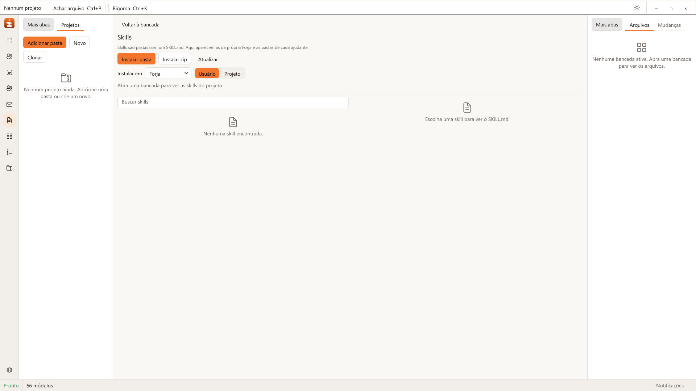

state: pt-BR.light.rail.skill.page
capture_sha: —
model: opencode/glm-5.3-flash-free
---

# Skills (página central)

Tela de gerenciamento de skills (pastas com `SKILL.md`): permite instalar, criar e buscar skills da Forja e dos ajudantes, enquanto o restante da janela mostra projetos e arquivos.

## Como chegar
Na barra vertical à esquerda, clique no ícone de skills (o nono botão do trilho, marcado em laranja). Equivalente a abrir o app com `forja-app --locale pt-BR --theme light --rail skill.page`.

## Regiões
- **Barra superior** (0,0)–(1920,42): rótulo do projeto atual ("Nenhum projeto"), botões "Achar arquivo  Ctrl+P" e "Bigorna  Ctrl+K", ícone de tema e botões de janela (minimizar, maximizar, fechar).
- **Trilho à esquerda** (0,42)–(52,1048): logotipo da Forja no topo e ícones de navegação (Quadro, Ajudantes, Rotinas, Mutirão, Pedidos, Skills, Uso, Extensões, Acervo), com "Ajustes" fixado no rodapé do trilho.
- **Painel lateral esquerdo** (52,42)–(304,1048): botão "Mais abas", aba "Projetos" (ativa); ações "Adicionar pasta", "Novo projeto" e "Clonar"; estado vazio com ícone de pasta e o texto "Nenhum projeto ainda. Adicione uma pasta ou crie um novo.".
- **Área central** (320,42)–(1612,1048): página "Skills", com botão "Voltar à bancada" no topo, descrição, ações de instalação, seletor de destino, campo de busca e duas mensagens de estado vazio ("Nenhuma skill encontrada." e "Escolha uma skill para ver o SKILL.md.").
- **Painel lateral direito** (1628,42)–(1920,1048): botão "Mais abas", abas "Arquivos" (ativa) e "Mudanças"; ícone de grade e texto "Nenhuma bancada ativa. Abra uma bancada para ver os arquivos.".
- **Barra de status** (0,1048)–(1920,1080): status "Pronto", contagem "56 módulos" e "Notificações" à direita.

## Elementos
| Elemento | Tipo | Posição (px) | Estado | O que faz |
|---|---|---|---|---|
| "Achar arquivo  Ctrl+P" | Botão | (135,5)–(291,37) | — | Abre a busca rápida de arquivos (atalho Ctrl+P) |
| "Bigorna  Ctrl+K" | Botão | (299,5)–(417,37) | — | Abre a paleta de comandos (atalho Ctrl+K) |
| (sem nome acessível) | Ícone | (1741,5)–(1773,37) | — | Ícone de sol na barra superior; alterna o tema |
| "–" | Botão | (1795,5)–(1827,37) | — | Minimiza a janela |
| "□" | Botão | (1835,5)–(1867,37) | — | Maximiza/restaura a janela |
| "×" | Botão | (1875,5)–(1909,37) | — | Fecha a janela |
| "Nenhum projeto" | Rótulo | (11,12)–(113,31) | — | Mostra o projeto ativo na barra superior |
| (sem nome acessível) | Divisor | (304,42)–(320,1048) | — | Separador vertical entre o painel esquerdo e a área central |
| (sem nome acessível) | Divisor | (1612,42)–(1628,1048) | — | Separador vertical entre a área central e o painel direito |
| (sem nome acessível) | Imagem | (12,50)–(40,78) | — | Logotipo da Forja no topo do trilho |
| "Mais abas" | Botão | (64,50)–(149,85) | — | Abre a lista de abas restantes do painel esquerdo |
| "Voltar à bancada" | Botão | (324,50)–(452,82) | — | Volta da página central à visão da bancada |
| "Mais abas" | Botão | (1632,50)–(1717,85) | — | Abre a lista de abas restantes do painel direito |
| "Projetos" | Botão | (157,52)–(231,84) | marcado=True | Aba ativa do painel esquerdo; mostra a lista de projetos |
| "Arquivos" | Botão | (1725,52)–(1803,84) | marcado=True | Aba ativa do painel direito; lista de arquivos |
| "Mudanças" | Botão | (1803,52)–(1890,84) | marcado=False | Aba de mudanças (versionamento) |
| "Skills" | Rótulo | (324,90)–(363,114) | — | Título da página central |
| "Quadro" | Botão | (8,94)–(44,130) | marcado=False | Ícone do trilho para o quadro |
| "Adicionar pasta" | Botão | (64,101)–(183,133) | — | Adiciona uma pasta de projeto existente (botão destacado em laranja) |
| "Novo projeto" | Botão | (191,101)–(297,133) | — | Cria um projeto novo |
| (ícone) | Rótulo | (1756,117)–(1784,145) | — | Ícone de grade do estado vazio do painel de arquivos |
| "Skills são pastas com um SKILL.md. Aqui aparecem as da própria Forja e as pastas de cada ajudante." | Rótulo | (324,122)–(851,138) | — | Descrição da página |
| "Ajudantes" | Botão | (8,138)–(44,174) | marcado=False | Ícone do trilho para ajudantes |
| "Clonar" | Botão | (64,141)–(128,173) | — | Clona um projeto |
| "Instalar pasta" | Botão | (324,146)–(429,178) | — | Instala uma skill a partir de uma pasta (botão destacado em laranja) |
| "Instalar zip" | Botão | (437,146)–(527,178) | — | Instala uma skill a partir de um arquivo zip |
| "Atualizar" | Botão | (535,146)–(613,178) | — | Atualiza a lista de skills |
| "Nenhuma bancada ativa. Abra uma bancada para ver os arquivos." | Rótulo | (1634,153)–(1906,191) | — | Estado vazio do painel de arquivos |
| "Rotinas" | Botão | (8,182)–(44,218) | marcado=False | Ícone do trilho para rotinas |
| "Instalar em" | Rótulo | (324,186)–(392,218) | — | Rótulo do seletor de destino da instalação |
| "Forja" | Caixa de seleção | (400,186)–(528,218) | — | Combobox que escolhe o escopo de instalação |
| "Usuário" | Botão | (536,186)–(606,218) | marcado=True | Escopo de instalação no usuário (selecionado, laranja) |
| "Projeto" | Botão | (606,186)–(677,218) | marcado=False | Escopo de instalação no projeto |
| (ícone) | Rótulo | (168,201)–(196,229) | — | Ícone de pasta do estado vazio do painel de projetos |
| "Mutirão" | Botão | (8,226)–(44,262) | marcado=False | Ícone do trilho para o mutirão |
| "Abra uma bancada para ver as skills do projeto." | Rótulo | (324,226)–(616,245) | — | Aviso de que as skills de projeto dependem de uma bancada |
| "Nenhum projeto ainda. Adicione uma pasta ou crie um novo." | Rótulo | (66,237)–(298,275) | — | Estado vazio da lista de projetos |
| (sem nome acessível) | Campo de texto | (324,267)–(962,299) | — | Campo de busca com o texto de sugestão "Buscar skills" |
| "Pedidos" | Botão | (8,270)–(44,306) | marcado=False | Ícone do trilho para pedidos |
| (ícone) | Rótulo | (1275,283)–(1303,311) | — | Ícone de documento do estado vazio direito da área central |
| "Skills" | Botão | (8,314)–(44,350) | marcado=True | Ícone do trilho da página atual (destacado em laranja) |
| "Escolha uma skill para ver o SKILL.md." | Rótulo | (1173,319)–(1405,338) | — | Estado vazio do painel de detalhe da skill |
| (ícone) | Rótulo | (629,323)–(657,351) | — | Ícone de documento do estado vazio esquerdo da área central |
| "Uso" | Botão | (8,358)–(44,394) | marcado=False | Ícone do trilho para uso |
| "Nenhuma skill encontrada." | Rótulo | (561,359)–(725,378) | — | Estado vazio da lista de skills |
| "Extensões" | Botão | (8,402)–(44,438) | marcado=False | Ícone do trilho para extensões |
| "Acervo" | Botão | (8,446)–(44,482) | marcado=False | Ícone do trilho para o acervo |
| "Ajustes" | Botão | (8,1004)–(44,1040) | marcado=False | Ícone do trilho para ajustes, fixado no rodapé |
| "Pronto" | Rótulo | (10,1055)–(51,1074) | — | Status atual na barra inferior |
| "56 módulos" | Rótulo | (73,1055)–(146,1074) | — | Contagem de módulos carregados |
| "Notificações" | Rótulo | (1810,1055)–(1886,1074) | — | Abre as notificações na barra de status |

## Aparência
Tema claro: fundo off-white/creme nas três colunas, separadas por divisores verticais finos e discretos. A cor de destaque é o laranja, usado nos botões "Adicionar pasta" e "Instalar pasta", no botão de escopo "Usuário" e no ícone ativo "Skills" do trilho; as abas ativas ("Projetos", "Arquivos") recebem sublinhado laranja. Tipografia sans-serif de corpo pequeno (texto de rótulos em torno de 13–16 px), cinza-escuro sobre fundo claro, com o título "Skills" em tamanho maior. O status "Pronto" aparece em verde. Os ícones de estado vazio são contornos cinza centralizados com a mensagem abaixo. Botões secundários têm borda fina arredondada e fundo levemente mais escuro que o painel; o espaçamento entre ações é uniforme (cerca de 8–16 px). Em relação à variante de referência (tema escuro), mudam o esquema de cores (fundo claro, texto escuro, laranja mais saturado sobre claro) e a geometria: a janela aqui tem 1920×1080 px (referência 1280×800), os painéis laterais usam botão "Mais abas" em vez das abas "Bancadas"/"Painéis de extensões" e "Busca"/"Portas" recolhidas, o botão de criação de projeto se chama "Novo projeto" (na referência, "Novo"), a combobox de escopo tem o nome acessível "Forja" e há um botão "Voltar à bancada" no topo da área central, ausente na referência.

## Problemas encontrados
- O campo de busca "Buscar skills" é um TextInput sem nome acessível; o texto de sugestão só aparece visualmente.
- O ícone de alternância de tema na barra superior (1741,5)–(1773,37) é um elemento clicável sem nome acessível; a função só é identificável pela imagem.
- Os dois divisores verticais e a imagem do logotipo no trilho são elementos sem nome acessível.
- Os três ícones de estado vazio aparecem como rótulos "(ícone)" sem descrição de texto alternativa.
- A página exibe o botão "Voltar à bancada" no topo da área central mesmo sem nenhuma bancada ativa (o painel de arquivos informa "Nenhuma bancada ativa"), o que é inconsistente para o usuário.
