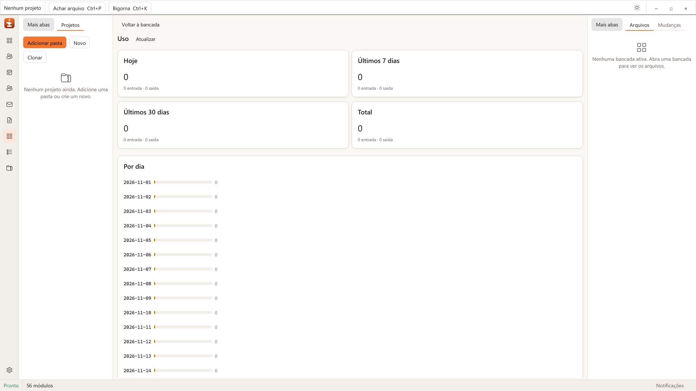

# Uso (página central, com trilho e painéis laterais)

Tela de estatísticas de uso de tokens dos ajudantes, exibida na área central enquanto o trilho lateral e os painéis de projetos e arquivos continuam visíveis.

## Como chegar
Na barra superior ou no trilho à esquerda, clique no botão "Uso" (o sétimo ícone do trilho, marcado como ativo). Equivalente a abrir o app com `forja-app --locale pt-BR --theme light --rail usage.page`. Captura: `captures/pt-BR.light.rail.usage.page.png` (1920×1080 px, escala 1.0). Variante clara da página de referência `pt-BR.dark.rail.usage.page`.

## Regiões
- **Barra superior** (0,0)–(1920,42): botão de projeto "Nenhum projeto", "Achar arquivo  Ctrl+P", "Bigorna  Ctrl+K", botão de alternância de tema (ícone de sol, sem nome acessível) e os botões de janela "–", "□", "×".
- **Trilho de ícones à esquerda** (0,42)–(48,1048): logotipo do app (imagem) em cima, seguido dos botões "Quadro", "Ajudantes", "Rotinas", "Mutirão", "Pedidos", "Skills", "Uso" (ativo), "Extensões" e "Acervo"; "Ajustes" fixado embaixo.
- **Painel de projetos (esquerda)** (48,42)–(304,1048): botão "Mais abas", aba "Projetos" (ativa), botões "Adicionar pasta", "Novo projeto" e "Clonar", e o estado vazio com ícone de pasta e a mensagem "Nenhum projeto ainda. Adicione uma pasta ou crie um novo.".
- **Área central** (320,42)–(1612,1048): botão "Voltar à bancada" no topo; cabeçalho "Uso" com botão "Atualizar"; seletor "Período" com os botões "Hoje", "Últimos 7 dias" (ativo), "Últimos 30 dias" e "Total"; aviso de estado vazio "Nenhum uso registrado ainda" com texto explicativo e botão "Varrer de novo"; e quatro cartões ("Hoje", "Últimos 7 dias", "Últimos 30 dias", "Total") com "US$ 0,00", "0 tokens", "0 entrada · 0 saída" e "0 cache lido · 0 cache escrito".
- **Painel direito** (1628,42)–(1920,1048): botão "Mais abas", abas "Arquivos" (ativa) e "Mudanças", e o estado vazio com ícone de grade e a mensagem "Nenhuma bancada ativa. Abra uma bancada para ver os arquivos.".
- **Barra de status** (0,1048)–(1920,1080): "Pronto" em verde, "56 módulos" e, à direita, "Notificações".

Diferenças em relação à referência escura (capturada em 1280×800): nesta captura a janela tem 1920×1080 e as abas extras dos painéis laterais aparecem recolhidas nos botões "Mais abas" (não há as abas "Bancadas", "Painéis de e…", "Busca", "Portas" nem a aba truncada "Painéis de extensões"); a área central mostra o seletor "Período" e o aviso "Nenhum uso registrado ainda" com o botão "Varrer de novo" no lugar da série "Por dia"; os cartões passam a exibir o custo "US$ 0,00" além dos tokens.

## Elementos
| Elemento | Tipo | Posição (px) | Estado | O que faz |
|---|---|---|---|---|
| "Achar arquivo  Ctrl+P" | Button | (135,5)–(291,37) | — | Abre a busca de arquivos (atalho Ctrl+P) |
| "Bigorna  Ctrl+K" | Button | (299,5)–(417,37) | — | Abre a paleta de comandos (atalho Ctrl+K) |
| (sem nome acessível) | Unknown | (1741,5)–(1773,37) | — | Ícone de sol: alterna tema claro/escuro |
| "–" | Button | (1795,5)–(1827,37) | — | Minimiza a janela |
| "□" | Button | (1835,5)–(1867,37) | — | Maximiza/restaura a janela |
| "×" | Button | (1875,5)–(1909,37) | — | Fecha a janela |
| "Nenhum projeto" | Label | (11,12)–(113,31) | — | Mostra que não há projeto aberto; clique abre o seletor de projeto |
| (sem nome acessível) | Unknown | (304,42)–(320,1048) | — | Divisor redimensionável entre painel esquerdo e área central |
| (sem nome acessível) | Unknown | (1612,42)–(1628,1048) | — | Divisor redimensionável entre área central e painel direito |
| (sem nome acessível) | Image | (12,50)–(40,78) | — | Logotipo da Forja no topo do trilho |
| "Mais abas" | Button | (64,50)–(149,85) | — | Agrupa as abas ocultas do painel esquerdo |
| "Voltar à bancada" | Button | (324,50)–(452,82) | — | Volta da página central para a visão de bancada |
| "Mais abas" | Button | (1632,50)–(1717,85) | — | Agrupa as abas ocultas do painel direito |
| "Projetos" | Button | (157,52)–(231,84) | marcado=True | Aba ativa do painel esquerdo; mostra a lista de projetos |
| "Arquivos" | Button | (1725,52)–(1803,84) | marcado=True | Aba ativa do painel direito; lista os arquivos da bancada |
| "Mudanças" | Button | (1803,52)–(1890,84) | marcado=False | Aba de mudanças (diffs) da bancada |
| "Uso" | Label | (324,90)–(355,122) | — | Título da página central |
| "Atualizar" | Button | (363,90)–(441,122) | — | Recarrega os dados de uso |
| "Quadro" | Button | (8,94)–(44,130) | marcado=False | Ícone do trilho: abre o quadro de projetos |
| "Adicionar pasta" | Button | (64,101)–(183,133) | — | Destaque laranja: adiciona uma pasta de projeto |
| "Novo projeto" | Button | (191,101)–(297,133) | — | Cria um projeto novo |
| (ícone) | Label | (1756,117)–(1784,145) | — | Ícone de grade do estado vazio do painel direito |
| "Hoje" | Button | (373,130)–(491,162) | marcado=False | Filtro de período: mostra só o dia de hoje |
| "Últimos 7 dias" | Button | (491,130)–(609,162) | marcado=True | Filtro de período ativo: últimos 7 dias |
| "Últimos 30 dias" | Button | (609,130)–(727,162) | marcado=False | Filtro de período: últimos 30 dias |
| "Total" | Button | (727,130)–(845,162) | marcado=False | Filtro de período: total acumulado |
| "Ajudantes" | Button | (8,138)–(44,174) | marcado=False | Ícone do trilho: lista os ajudantes |
| "Período" | Label | (324,138)–(365,154) | — | Rótulo do seletor de período |
| "Clonar" | Button | (64,141)–(128,173) | — | Clona um repositório para usar como projeto |
| "Nenhuma bancada ativa. Abra uma bancada para ver os arquivos." | Label | (1634,153)–(1906,191) | — | Estado vazio do painel direito |
| "Rotinas" | Button | (8,182)–(44,218) | marcado=False | Ícone do trilho: abre as rotinas |
| "Nenhum uso registrado ainda" | Label | (341,195)–(583,219) | — | Título do aviso de estado vazio da página de uso |
| (ícone) | Label | (168,201)–(196,229) | — | Ícone de pasta do estado vazio do painel esquerdo |
| "Mutirão" | Button | (8,226)–(44,262) | marcado=False | Ícone do trilho: abre o mutirão |
| "Os números vêm das transcrições locais dos ajudantes instalados: o Claude Code lê ~/.claude/projects, o Codex lê ~/.codex/sessions e o OpenCode lê a pasta storage. Nada sai desta máquina. Rode uma sessão de um ajudante em uma bancada e clique em Atualizar; se tudo continuar zerado, confira se o CLI do ajudante está instalado e se ele já rodou ao menos uma vez." | Label | (341,235)–(1562,273) | — | Explica de onde vêm os números, garante que nada sai da máquina e orienta o que fazer se ficarem zerados |
| "Nenhum projeto ainda. Adicione uma pasta ou crie um novo." | Label | (66,237)–(298,275) | — | Estado vazio da lista de projetos |
| "Pedidos" | Button | (8,270)–(44,306) | marcado=False | Ícone do trilho: abre os pedidos |
| "Varrer de novo" | Button | (341,287)–(456,319) | — | Repete a leitura das transcrições locais dos ajudantes |
| "Skills" | Button | (8,314)–(44,350) | marcado=False | Ícone do trilho: abre as skills |
| "Uso" | Button | (8,358)–(44,394) | marcado=True | Ícone do trilho ativo: mostra esta página de uso |
| "Hoje" | Label | (341,365)–(945,389) | — | Título do cartão de uso de hoje |
| "Últimos 7 dias" | Label | (987,365)–(1591,389) | — | Título do cartão dos últimos 7 dias |
| "Extensões" | Button | (8,402)–(44,438) | marcado=False | Ícone do trilho: abre as extensões |
| "US$ 0,00" | Label | (341,405)–(945,437) | — | Custo do cartão "Hoje" |
| "US$ 0,00" | Label | (987,405)–(1591,437) | — | Custo do cartão "Últimos 7 dias" |
| "0 tokens" | Label | (341,445)–(945,464) | — | Total de tokens do cartão "Hoje" |
| "0 tokens" | Label | (987,445)–(1591,464) | — | Total de tokens do cartão "Últimos 7 dias" |
| "Acervo" | Button | (8,446)–(44,482) | marcado=False | Ícone do trilho: abre o acervo |
| "0 entrada · 0 saída" | Label | (341,472)–(945,488) | — | Detalhe de tokens do cartão "Hoje" |
| "0 entrada · 0 saída" | Label | (987,472)–(1591,488) | — | Detalhe de tokens do cartão "Últimos 7 dias" |
| "0 cache lido · 0 cache escrito" | Label | (341,496)–(945,512) | — | Detalhe de cache do cartão "Hoje" |
| "0 cache lido · 0 cache escrito" | Label | (987,496)–(1591,512) | — | Detalhe de cache do cartão "Últimos 7 dias" |
| "Últimos 30 dias" | Label | (341,558)–(945,582) | — | Título do cartão dos últimos 30 dias |
| "Total" | Label | (987,558)–(1591,582) | — | Título do cartão de total acumulado |
| "US$ 0,00" | Label | (341,598)–(945,630) | — | Custo do cartão "Últimos 30 dias" |
| "US$ 0,00" | Label | (987,598)–(1591,630) | — | Custo do cartão "Total" |
| "0 tokens" | Label | (341,638)–(945,657) | — | Total de tokens do cartão "Últimos 30 dias" |
| "0 tokens" | Label | (987,638)–(1591,657) | — | Total de tokens do cartão "Total" |
| "0 entrada · 0 saída" | Label | (341,665)–(945,681) | — | Detalhe de tokens do cartão "Últimos 30 dias" |
| "0 entrada · 0 saída" | Label | (987,665)–(1591,681) | — | Detalhe de tokens do cartão "Total" |
| "0 cache lido · 0 cache escrito" | Label | (341,689)–(945,705) | — | Detalhe de cache do cartão "Últimos 30 dias" |
| "0 cache lido · 0 cache escrito" | Label | (987,689)–(1591,705) | — | Detalhe de cache do cartão "Total" |
| "Ajustes" | Button | (8,1004)–(44,1040) | marcado=False | Ícone do trilho: abre os ajustes |
| "Pronto" | Label | (10,1055)–(51,1074) | — | Status do app, em verde |
| "56 módulos" | Label | (73,1055)–(146,1074) | — | Quantidade de módulos carregados |
| "Notificações" | Label | (1810,1055)–(1886,1074) | — | Abre as notificações, na barra de status |

## Aparência
Tema claro: barra superior, trilho e painéis laterais em branco/off-white, com a área central em cinza-claro levemente mais escuro e cartões brancos delimitados por bordas arredondadas finas e sombra sutil. O acento laranja (Brasa) aparece no botão primário "Adicionar pasta", no segmento ativo "Últimos 7 dias" do seletor de período, no retângulo do item ativo "Uso" do trilho e nos sublinhados das abas ativas "Projetos" e "Arquivos". Texto principal em cinza-escuro, textos secundários e estados vazios em cinza médio; "Pronto" na barra de status em verde. Em relação à referência escura, invertem-se fundo e texto (fundos claros com texto escuro); os textos secundários cinza-médio sobre branco mantêm contraste adequado. Tipografia sans-serif de peso médio, com títulos de cartão maiores ("Hoje", "Total") e os valores "US$ 0,00" e "0 tokens" em destaque, em algarismos de estilo monoespaçado. Alinhamento consistente: cartões em duas colunas (341–945 e 987–1591), seletor de período alinhado à esquerda sob o cabeçalho e ícones do trilho centralizados em coluna única de 36 px.

## Problemas encontrados
- O botão de alternância de tema na barra superior (1741,5)–(1773,37) não tem nome acessível (apenas ícone de sol).
- Os botões de janela usam os símbolos "–", "□" e "×" como nome acessível, em vez de rótulos descritivos ("Minimizar", "Maximizar", "Fechar").
- O logotipo do app (12,50)–(40,78) é uma imagem sem nome acessível.
- Dois botões compartilham o mesmo nome acessível "Mais abas" (painéis esquerdo e direito), sem distinção para leitores de tela.
- O botão "Voltar à bancada" aparece na página de uso mesmo sem nenhuma bancada ativa (o painel direito exibe "Nenhuma bancada ativa. Abra uma bancada para ver os arquivos."), o que pode confundir sobre o destino do botão.
