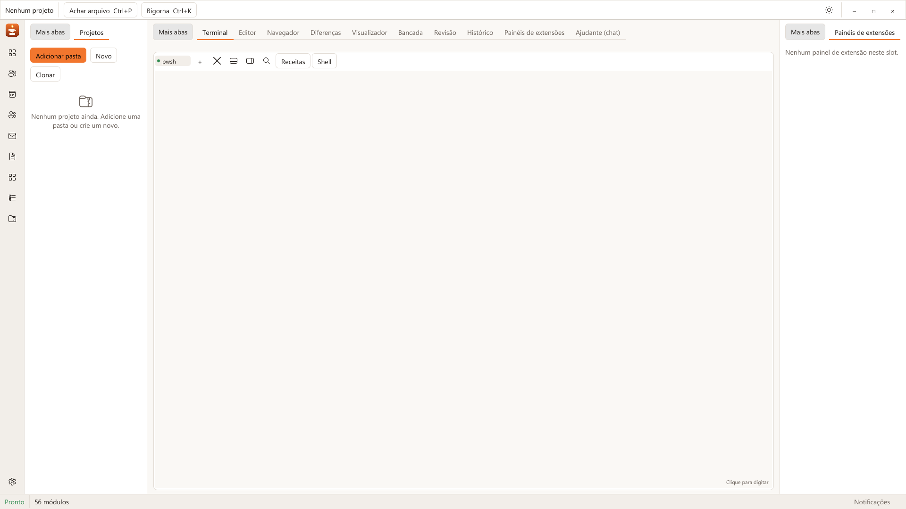

# Painel de extensões (slot direito)

Tela principal da Forja no estado inicial (nenhum projeto aberto), com o painel direito exibindo o slot "Painéis de extensões", vazio. Variante em tema claro da página de referência (pt-BR.dark.right-tab.extension.panels.right); a estrutura é a mesma e as diferenças são indicadas ao longo da página.

## Como chegar
Abrir o app com o painel direito apontado para o slot de painéis de extensão: `forja-app --locale pt-BR --theme light --right-tab extension.panels.right`. Na interface, clicando na aba "Painéis de extensões" da faixa de abas do painel direito — nesta captura essa aba está visível e marcada como ativa, ao contrário da variante escura, em que ficava fora da janela.

## Regiões
- **Barra superior** (0,0)–(1920,42): rótulo "Nenhum projeto" à esquerda; botões "Achar arquivo  Ctrl+P" e "Bigorna  Ctrl+K"; ícone de tema (sol) e botões de janela (–, □, ×) à direita.
- **Trilho de ícones à esquerda** (0,42)–(48,1048): logotipo da Forja (bigorna laranja) e, de cima para baixo, os botões "Quadro", "Ajudantes", "Rotinas", "Mutirão", "Pedidos", "Skills", "Uso", "Extensões", "Acervo" e, no rodapé do trilho, "Ajustes".
- **Painel esquerdo** (48,42)–(304,1048): faixa de abas com o botão "Mais abas" e a aba "Projetos" (ativa, sublinhada em laranja); botões "Adicionar pasta" (destaque laranja), "Novo projeto" e "Clonar"; estado vazio com ícone de pasta e o texto "Nenhum projeto ainda. Adicione uma pasta ou crie um novo.".
- **Divisor vertical 1** (304,42)–(320,1048): separador redimensionável entre o painel esquerdo e a área central.
- **Área central** (320,42)–(1644,1048): faixa de abas ("Mais abas", "Terminal" ativa, "Editor", "Navegador", "Diferenças", "Visualizador", "Bancada", "Revisão", "Histórico", "Painéis de extensões" e "Ajudante (chat)"); barra de ferramentas do terminal com a aba "pwsh · Em execução" (bolinha verde), "+", ícones de fechar/dividir/maximizar/busca e os botões "Receitas" e "Shell"; área do terminal vazia com a dica "Clique para digitar" no canto inferior direito.
- **Divisor vertical 2** (1644,42)–(1660,1048): separador entre a área central e o painel direito.
- **Painel direito** (1660,42)–(1920,1048): faixa de abas com "Mais abas" e a aba ativa "Painéis de extensões" (sublinhada em laranja); mensagem "Nenhum painel de extensão neste slot." indicando o slot vazio.
- **Barra de status** (0,1048)–(1920,1080): "Pronto" em verde à esquerda, "56 módulos" em seguida e "Notificações" à direita.

## Elementos
| Elemento | Tipo | Posição (px) | Estado | O que faz |
|---|---|---|---|---|
| "Achar arquivo  Ctrl+P" | Button | (135,5)–(291,37) | — | Abre a busca rápida de arquivos (atalho Ctrl+P) |
| "Bigorna  Ctrl+K" | Button | (299,5)–(417,37) | — | Abre a paleta de comandos (atalho Ctrl+K) |
| (sem nome acessível) | Unknown | (1741,5)–(1773,37) | — | Ícone de sol na barra superior: alterna tema claro/escuro |
| "–" | Button | (1795,5)–(1827,37) | — | Minimiza a janela |
| "□" | Button | (1835,5)–(1867,37) | — | Maximiza/restaura a janela |
| "×" | Button | (1875,5)–(1909,37) | — | Fecha a janela |
| "Nenhum projeto" | Label | (11,12)–(113,31) | — | Indica que nenhum projeto está aberto |
| (sem nome acessível) | Unknown | (304,42)–(320,1048) | — | Divisor vertical entre painel esquerdo e área central (arrastar redimensiona) |
| (sem nome acessível) | Unknown | (1644,42)–(1660,1048) | — | Divisor vertical entre área central e painel direito |
| (sem nome acessível) | Image | (12,50)–(40,78) | — | Logotipo da Forja (bigorna laranja) no topo do trilho |
| "Mais abas" | Button | (64,50)–(149,85) | — | Menu "mais abas" da faixa de abas do painel esquerdo (abas adicionais ficam nele — nesta variante não há "Bancadas" nem segunda "Painéis de extensões" visíveis no painel esquerdo) |
| "Mais abas" | Button | (324,50)–(409,85) | — | Menu "mais abas" da faixa de abas da área central |
| "Mais abas" | Button | (1664,50)–(1749,85) | — | Menu "mais abas" da faixa de abas do painel direito |
| "Projetos" | Button | (157,52)–(231,84) | marcado=True | Aba ativa do painel esquerdo; mostra a lista de projetos |
| "Terminal" | Button | (417,52)–(494,84) | marcado=True | Aba ativa da área central; mostra o terminal |
| "Editor" | Button | (494,52)–(554,84) | marcado=False | Aba da área central; mostra o editor |
| "Navegador" | Button | (554,52)–(646,84) | marcado=False | Aba da área central; mostra o navegador |
| "Diferenças" | Button | (646,52)–(734,84) | marcado=False | Aba da área central; mostra diff de arquivos |
| "Visualizador" | Button | (734,52)–(832,84) | marcado=False | Aba da área central; visualiza arquivos |
| "Bancada" | Button | (832,52)–(908,84) | marcado=False | Aba da área central; mostra a visão da bancada |
| "Revisão" | Button | (908,52)–(978,84) | marcado=False | Aba da área central; revisão de mudanças |
| "Histórico" | Button | (978,52)–(1057,84) | marcado=False | Aba da área central; histórico da bancada |
| "Painéis de extensões" | Button | (1057,52)–(1208,84) | marcado=False | Aba da área central; mostra painéis de extensões na área central; não cruza o divisor (termina em x=1208, antes de 1644), ao contrário da variante escura |
| "Ajudante (chat)" | Button | (1208,52)–(1327,84) | marcado=False | Aba da área central; chat com ajudante; visível na faixa, sem sobreposição com a aba anterior (começa exatamente em x=1208) |
| "Painéis de extensões" | Button | (1757,52)–(1908,84) | marcado=True | Aba ativa do slot direito; visível dentro da janela (x1=1908 < 1920), diferente da variante escura em que ficava fora da área visível |
| "Quadro" | Button | (8,94)–(44,130) | marcado=False | Item do trilho: quadro geral do app |
| "Adicionar pasta" | Button | (64,101)–(183,133) | — | Botão em destaque laranja: adiciona uma pasta de projeto |
| "Novo projeto" | Button | (191,101)–(297,133) | — | Cria um projeto novo (na variante escura o rótulo é "Novo") |
| "Nenhum painel de extensão neste slot." | Label | (1664,101)–(1903,120) | — | Mensagem de estado vazio do slot direito |
| "+" | Button | (407,113)–(441,145) | — | Abre um novo terminal |
| (sem nome acessível) | Unknown | (444,113)–(476,145) | — | Ícone X: fecha o terminal atual |
| (sem nome acessível) | Unknown | (479,113)–(511,145) | — | Ícone de dividir terminal |
| (sem nome acessível) | Unknown | (514,113)–(546,145) | — | Ícone de maximizar o painel do terminal |
| (sem nome acessível) | Unknown | (549,113)–(581,145) | — | Ícone de lupa: busca no terminal |
| "Receitas" | Button | (584,113)–(658,145) | — | Lista de receitas do terminal |
| "Shell" | Button | (661,113)–(714,145) | — | Seletor de shell/perfil do terminal |
| "pwsh · Em execução" | Button | (328,118)–(404,140) | — | Aba do terminal "pwsh" com indicador de status (bolinha verde) e estado "Em execução" |
| "Fechar pwsh" | Button | (385,121)–(401,137) | — | Fecha a aba do terminal "pwsh"; retângulo contido dentro da aba, sobrepondo-se a ela por construção |
| "Ajudantes" | Button | (8,138)–(44,174) | marcado=False | Item do trilho: lista de ajudantes (agentes de IA) |
| "Clonar" | Button | (64,141)–(128,173) | — | Clona um repositório para começar um projeto |
| (sem nome acessível) | Unknown | (328,150)–(1636,1036) | — | Área de conteúdo do terminal, vazia; exibe a dica "Clique para digitar" no canto inferior direito |
| "Rotinas" | Button | (8,182)–(44,218) | marcado=False | Item do trilho: rotinas/tarefas |
| (ícone) | Label | (168,201)–(196,229) | — | Ícone de pasta do estado vazio do painel esquerdo |
| "Mutirão" | Button | (8,226)–(44,262) | marcado=False | Item do trilho: mutirão de ajudantes |
| "Nenhum projeto ainda. Adicione uma pasta ou crie um novo." | Label | (66,237)–(298,275) | — | Mensagem de estado vazio do painel esquerdo |
| "Pedidos" | Button | (8,270)–(44,306) | marcado=False | Item do trilho: pedidos |
| "Skills" | Button | (8,314)–(44,350) | marcado=False | Item do trilho: skills dos ajudantes |
| "Uso" | Button | (8,358)–(44,394) | marcado=False | Item do trilho: uso de recursos |
| "Extensões" | Button | (8,402)–(44,438) | marcado=False | Item do trilho: extensões instaladas |
| "Acervo" | Button | (8,446)–(44,482) | marcado=False | Item do trilho: acervo de conteúdo |
| "Ajustes" | Button | (8,1004)–(44,1040) | marcado=False | Item do trilho: abre os ajustes |
| "Pronto" | Label | (10,1055)–(51,1074) | — | Status geral na barra de status, em verde |
| "56 módulos" | Label | (73,1055)–(146,1074) | — | Quantidade de módulos carregados |
| "Notificações" | Label | (1810,1055)–(1886,1074) | — | Atalho/indicador de notificações na barra de status |

## Aparência
Tema claro: fundo geral bege/creme claro, painéis separados por bordas finas cinza; área do terminal em tom levemente mais claro que o painel esquerdo. Cor de destaque laranja (identidade "Brasa") no logotipo, no botão "Adicionar pasta" (fundo laranja sólido com texto branco) e no sublinhado das abas ativas ("Projetos", "Terminal" e "Painéis de extensões" do painel direito). Bolinha verde indica o terminal "pwsh" em execução e "Pronto" aparece em verde na barra de status. Tipografia sans-serif de tamanho uniforme; rótulos de abas e botões em cinza escuro sobre fundo claro, com bom contraste; textos de estado vazio em cinza médio. Botões "Novo projeto", "Clonar", "Receitas", "Shell" e as abas usam contornos arredondados discretos. Alinhamento consistente: trilho de ícones com botões quadrados de 36 px de lado e passo vertical regular de 44 px; faixas de abas e barras de ferramenta com altura de 32–40 px.

## Problemas encontrados
- Botão de tema na barra superior (1741,5)–(1773,37) sem nome acessível; mesmo problema nos ícones de fechar/dividir/maximizar/busca do terminal (444–581, y 113–145) e nos divisores de painéis.
- Nome acessível "(ícone)" no rótulo do ícone de pasta (168,201)–(196,229) não descreve o elemento.
- Botões de janela nomeados apenas com os símbolos "–", "□" e "×", sem rótulos descritivos.
- "Fechar pwsh" (385,121)–(401,137) tem retângulo sobreposto ao da aba "pwsh · Em execução" (328,118)–(404,140); na imagem é um botão interno da aba, mas a árvore o expõe como sobreposição.
- Diferença de estado em relação à variante escura: aqui o painel esquerdo mostra apenas a aba "Projetos" além de "Mais abas", enquanto na referência escura aparecem também "Bancadas" e "Painéis de extensões" na mesma faixa.
