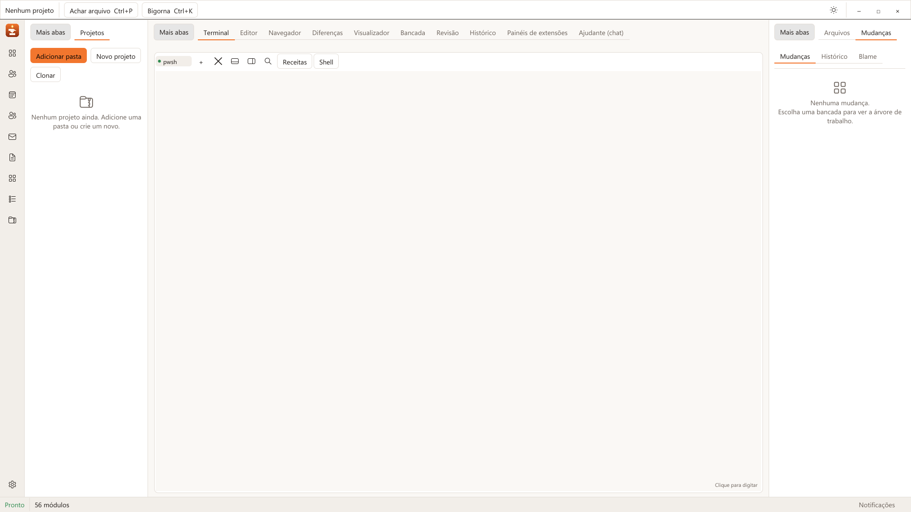

# Tela principal — painel direito "Mudanças" (git.changes)

Tela principal do app com o painel direito aberto na aba "Mudanças" (git), mostrando estado vazio porque nenhuma bancada está selecionada. Variante pt-BR, tema light, layout "right-tab" com alvo "git.changes" — a estrutura é a da janela principal (mesma da referência em tema dark); o que muda é o tema (claro) e pequenas diferenças de árvore de acessibilidade (aqui o chip do terminal aparece nomeado como "pwsh · Em execução" com o botão "Fechar pwsh", o botão de novo projeto se chama "Novo projeto" e as faixas de abas têm botões "Mais abas" nomeados).

## Como chegar
Na janela principal, clique em "Mudanças" na faixa de abas do topo do painel direito (à direita de "Arquivos"). A subaba "Mudanças" já vem selecionada. Comando de captura: `forja-app --locale pt-BR --theme light --right-tab git.changes` (imagem: `captures/pt-BR.light.right-tab.git.changes.png`, 1920×1080 px, escala 1.0).

## Regiões
- **Barra superior** (0,0)–(1920,42): chip de projeto "Nenhum projeto" à esquerda, botões "Achar arquivo  Ctrl+P" e "Bigorna  Ctrl+K", e à direita o alternador de tema (ícone de sol, sem nome acessível) e os botões de janela "–", "□", "×".
- **Trilho à esquerda** (0,42)–(52,1048): coluna de ícones de navegação — "Quadro", "Ajudantes", "Rotinas", "Mutirão", "Pedidos", "Skills", "Uso", "Extensões", "Acervo" e, no rodapé, "Ajustes"; o logotipo da Forja (bigorna laranja) no topo.
- **Painel esquerdo** (52,42)–(304,1048): faixa de abas com "Mais abas" e "Projetos" (ativa, com sublinhado); ações "Adicionar pasta" (destaque laranja), "Novo projeto" e "Clonar"; estado vazio com ícone de pasta e o texto "Nenhum projeto ainda. Adicione uma pasta ou crie um novo.".
- **Divisor** (304,42)–(320,1048): separador vertical arrastável entre o painel esquerdo e a área central.
- **Área central** (320,42)–(1612,1048): faixa de abas "Mais abas", "Terminal" (ativa), "Editor", "Navegador", "Diferenças", "Visualizador", "Bancada", "Revisão", "Histórico", "Painéis de extensões" e "Ajudante (chat)"; barra do terminal com chip "pwsh · Em execução" (ponto verde), botão "+", quatro botões de ícone (sem nome acessível) e os chips "Receitas" e "Shell"; abaixo, a área do terminal vazia com a dica "Clique para digitar" no canto inferior direito.
- **Divisor** (1612,42)–(1628,1048): separador vertical entre a área central e o painel direito.
- **Painel direito** (1628,42)–(1920,1048): faixa de abas "Mais abas", "Arquivos" e "Mudanças" (ativa); subabas "Mudanças" (ativa), "Histórico" e "Blame"; estado vazio com ícone de grade e o texto "Nenhuma mudança. Escolha uma bancada para ver a árvore de trabalho.".
- **Barra de status** (0,1048)–(1920,1080): "Pronto" em verde à esquerda, "56 módulos" ao lado e "Notificações" à direita.

## Elementos
| Elemento | Tipo | Posição (px) | Estado | O que faz |
|---|---|---|---|---|
| "Achar arquivo  Ctrl+P" | Button | (135,5)–(291,37) | — | Abre a busca rápida de arquivos (atalho Ctrl+P). |
| "Bigorna  Ctrl+K" | Button | (299,5)–(417,37) | — | Abre a paleta de comandos (atalho Ctrl+K). |
| (sem nome acessível) | Unknown | (1741,5)–(1773,37) | — | Ícone de sol: alterna tema claro/escuro. |
| "–" | Button | (1795,5)–(1827,37) | — | Minimiza a janela. |
| "□" | Button | (1835,5)–(1867,37) | — | Maximiza/restaura a janela. |
| "×" | Button | (1875,5)–(1909,37) | — | Fecha a janela. |
| "Nenhum projeto" | Label | (11,12)–(113,31) | — | Indicador do projeto ativo na barra superior (chip clicável). |
| (sem nome acessível) | Unknown | (304,42)–(320,1048) | — | Divisor vertical entre painel esquerdo e área central. |
| (sem nome acessível) | Unknown | (1612,42)–(1628,1048) | — | Divisor vertical entre área central e painel direito. |
| (sem nome acessível) | Image | (12,50)–(40,78) | — | Logotipo da Forja (bigorna laranja) no topo do trilho. |
| "Mais abas" | Button | (64,50)–(149,85) | — | Abre o menu de abas ocultas do painel esquerdo. |
| "Mais abas" | Button | (324,50)–(409,85) | — | Abre o menu de abas ocultas da faixa central. |
| "Mais abas" | Button | (1632,50)–(1717,85) | — | Abre o menu de abas ocultas do painel direito. |
| "Projetos" | Button | (157,52)–(231,84) | marcado=True | Aba ativa do painel esquerdo; mostra a lista de projetos. |
| "Terminal" | Button | (417,52)–(494,84) | marcado=True | Aba ativa da área central; mostra o terminal integrado. |
| "Editor" | Button | (494,52)–(554,84) | marcado=False | Aba do editor de arquivos. |
| "Navegador" | Button | (554,52)–(646,84) | marcado=False | Aba do navegador. |
| "Diferenças" | Button | (646,52)–(734,84) | marcado=False | Aba de visualização de difusões. |
| "Visualizador" | Button | (734,52)–(832,84) | marcado=False | Aba do visualizador de arquivos. |
| "Bancada" | Button | (832,52)–(908,84) | marcado=False | Aba da bancada. |
| "Revisão" | Button | (908,52)–(978,84) | marcado=False | Aba de revisão. |
| "Histórico" | Button | (978,52)–(1057,84) | marcado=False | Aba de histórico. |
| "Painéis de extensões" | Button | (1057,52)–(1208,84) | marcado=False | Aba de painéis de extensão da faixa central. |
| "Ajudante (chat)" | Button | (1208,52)–(1327,84) | marcado=False | Aba do chat do ajudante. |
| "Arquivos" | Button | (1725,52)–(1803,84) | marcado=False | Aba do painel de arquivos. |
| "Mudanças" | Button | (1803,52)–(1890,84) | marcado=True | Aba ativa do painel direito; mostra as mudanças (git) da bancada. |
| "Quadro" | Button | (8,94)–(44,130) | marcado=False | Ícone do trilho: abre o quadro. |
| "Adicionar pasta" | Button | (64,101)–(183,133) | — | Ação destacada em laranja: adiciona uma pasta de projeto. |
| "Novo projeto" | Button | (191,101)–(297,133) | — | Cria um novo projeto. |
| "Mudanças" | Button | (1632,101)–(1719,133) | marcado=True | Subaba ativa do painel de git: lista de mudanças. |
| "Histórico" | Button | (1719,101)–(1798,133) | marcado=False | Subaba de histórico de commits. |
| "Blame" | Button | (1798,101)–(1859,133) | marcado=False | Subaba de blame. |
| "+" | Button | (407,113)–(441,145) | — | Nova instância/aba de terminal. |
| (sem nome acessível) | Unknown | (444,113)–(476,145) | — | Ícone "X": fecha o terminal/painel atual. |
| (sem nome acessível) | Unknown | (479,113)–(511,145) | — | Ícone de retângulo cheio: alterna modo de preenchimento/divisão do painel. |
| (sem nome acessível) | Unknown | (514,113)–(546,145) | — | Ícone de retângulo dividido: divide o terminal. |
| (sem nome acessível) | Unknown | (549,113)–(581,145) | — | Ícone de lupa: busca no terminal. |
| "Receitas" | Button | (584,113)–(658,145) | — | Chip que abre a lista de receitas do terminal. |
| "Shell" | Button | (661,113)–(714,145) | — | Chip para escolher/trocar o shell. |
| "pwsh · Em execução" | Button | (328,118)–(404,140) | — | Chip da sessão do terminal "pwsh" com ponto verde (sessão ativa). |
| "Fechar pwsh" | Button | (385,121)–(401,137) | — | Fecha a sessão "pwsh" (X dentro do chip). |
| "Ajudantes" | Button | (8,138)–(44,174) | marcado=False | Ícone do trilho: abre a lista de ajudantes. |
| (sem nome acessível) | Unknown | (328,150)–(1604,1036) | — | Área do terminal, vazia; dica "Clique para digitar" no canto inferior direito. |
| (ícone) | Label | (1756,171)–(1784,199) | — | Ícone de grade (quatro quadrados) do estado vazio do painel direito. |
| "Rotinas" | Button | (8,182)–(44,218) | marcado=False | Ícone do trilho: abre rotinas. |
| (ícone) | Label | (168,201)–(196,229) | — | Ícone de pasta do estado vazio do painel esquerdo. |
| "Nenhuma mudança. Escolha uma bancada para ver a árvore de trabalho." | Label | (1640,207)–(1900,264) | — | Mensagem de estado vazio das mudanças (git), em duas linhas, centralizada. |
| "Mutirão" | Button | (8,226)–(44,262) | marcado=False | Ícone do trilho: abre o mutirão. |
| "Nenhum projeto ainda. Adicione uma pasta ou crie um novo." | Label | (66,237)–(298,275) | — | Mensagem de estado vazio da lista de projetos, em duas linhas, centralizada. |
| "Pedidos" | Button | (8,270)–(44,306) | marcado=False | Ícone do trilho: abre pedidos. |
| "Skills" | Button | (8,314)–(44,350) | marcado=False | Ícone do trilho: abre skills. |
| "Uso" | Button | (8,358)–(44,394) | marcado=False | Ícone do trilho: abre uso. |
| "Extensões" | Button | (8,402)–(44,438) | marcado=False | Ícone do trilho: abre extensões. |
| "Acervo" | Button | (8,446)–(44,482) | marcado=False | Ícone do trilho: abre o acervo. |
| "Ajustes" | Button | (8,1004)–(44,1040) | marcado=False | Ícone do trilho (rodapé): abre os ajustes. |
| "Pronto" | Label | (10,1055)–(51,1074) | — | Status geral na barra de status, em verde. |
| "56 módulos" | Label | (73,1055)–(146,1074) | — | Contador de módulos carregados. |
| "Notificações" | Label | (1810,1055)–(1886,1074) | — | Abre notificações, à direita da barra de status. |

## Aparência
Tema claro de fundo off-white/creme em toda a janela, com texto escuro. A cor de destaque é o laranja (Brasa), usada no logotipo, no botão "Adicionar pasta" (fundo laranja com texto claro), no sublinhado das abas ativas ("Projetos", "Terminal", "Mudanças" do painel direito e a subaba "Mudanças") e no ponto verde do chip "pwsh · Em execução" (verde indica sessão ativa); "Pronto" também aparece em verde. Tipografia sem serifa de ~13 px em rótulos de abas, botões e status; as mensagens de estado vazio têm ~13 px em cinza médio, centralizadas, com ícone acima (grade no painel direito, pasta no painel esquerdo). Chips ("pwsh · Em execução", "Receitas", "Shell") são pequenos retângulos arredondados com borda sutil sobre fundo levemente mais escuro que o painel. Abas inativas ficam em cinza médio sem sublinhado; as faixas de abas têm ~32–35 px de altura e alinhamento consistente à esquerda nos painéis. Em comparação com a referência dark, invertem-se fundo e texto; o laranja mantém bom destaque sobre o fundo claro, e o contraste geral é maior que no tema escuro. A área central é dominada pela superfície vazia do terminal (quase toda a região 328–1604 × 150–1036).

## Problemas encontrados
- Botões de janela rotulados apenas com os caracteres "–", "□" e "×" como nome acessível, sem rótulo descritivo (minimizar/maximizar/fechar).
- Vários controles sem nome acessível: alternador de tema (1741,5)–(1773,37), os quatro botões de ícone da barra do terminal (444–581), os divisores verticais, a área do terminal, o logotipo (Image) e os ícones "(ícone)" dos estados vazios.
- "Fechar pwsh" (385,121)–(401,137): alvo de clique de apenas 16×16 px, sobreposto dentro do chip "pwsh · Em execução" (328,118)–(404,140) — pequeno demais e com sobreposição intencional que pode dificultar o acerto.
- A dica "Clique para digitar" (≈1480,1017–1570,1029), visível na imagem dentro do terminal, não tem entrada na árvore de acessibilidade.
- Abas e textos inativos em cinza médio sobre fundo claro (por exemplo "Editor", "Navegador", "Histórico" da faixa central e as mensagens de estado vazio) têm contraste moderado/baixo.
- O painel direito (292 px de largura) acomoda apenas "Arquivos" e "Mudanças" na faixa de abas; demais abas ficam atrás do menu "Mais abas", sem indicação visual de que existem.
