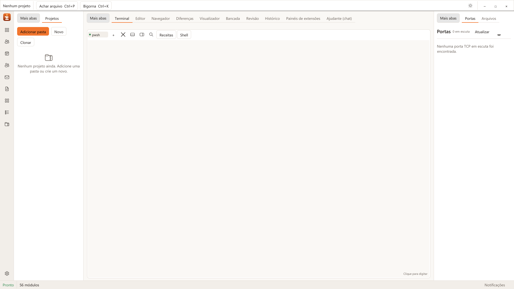

# Painel Portas (aba lateral direita) — tema claro

Tela do painel "Portas", que lista as portas TCP em escuta detectadas no ambiente de trabalho; nesta captura nenhuma porta foi encontrada. É a variante em tema claro da [página de referência](pt-BR.dark.right-tab.ports.panel.md) (mesma tela no tema escuro).

## Como chegar
Na janela principal do Forja, clique na aba **"Portas"** na linha de abas do painel lateral direito. A captura foi gerada com o comando `forja-app --locale pt-BR --theme light --right-tab ports.panel`.

## Regiões
Maioria idêntica à referência em organização; muda a paleta (claro) e a janela capturada é maior (1920×1080). O que muda em conteúdo: as linhas de abas dos três painéis aparecem colapsadas num botão **"Mais abas"** (na referência escura as abas aparecem estendidas), e o painel direito mostra, além do cabeçalho, um campo de filtro e a opção "Mostrar todas as portas do sistema", ausentes da referência.

- **Barra superior (barra de título)** — (0,0)–(1920,42): rótulo do projeto atual ("Nenhum projeto"), botões "Achar arquivo  Ctrl+P" e "Bigorna  Ctrl+K", botão-ícone de tema (sol) em (1741,5)–(1773,37) e os controles de janela "–", "□", "×".
- **Trilho à esquerda** — (0,42)–(52,1048): logotipo da Forja no topo e botões-ícone verticais "Quadro", "Ajudantes", "Rotinas", "Mutirão", "Pedidos", "Skills", "Uso", "Extensões", "Acervo" e, na base, "Ajustes".
- **Painel lateral esquerdo (Projetos)** — (52,42)–(304,1048): botão "Mais abas" e a aba ativa "Projetos"; botões "Adicionar pasta" e "Novo projeto" (e o botão "Clonar", visível na imagem mas ausente da árvore); estado vazio com ícone de pasta e o texto "Nenhum projeto ainda. Adicione uma pasta ou crie um novo.".
- **Área central (Terminal)** — (320,42)–(1612,1048): botão "Mais abas" e linha de abas ("Terminal", "Editor", "Navegador", "Diferenças", "Visualizador", "Bancada", "Revisão", "Histórico", "Painéis de extensões", "Ajudante (chat)"); barra do terminal com o chip "pwsh · Em execução", "+", ícones de fechar/dividir/sessão/busca e botões "Receitas" e "Shell"; superfície do terminal vazia com o aviso "Clique para digitar" no canto inferior direito.
- **Painel lateral direito (Portas)** — (1628,42)–(1920,1048): botão "Mais abas" e as abas "Arquivos" e "Portas" (ativa); cabeçalho "Portas" com o contador "0 em escuta" e o botão "Atualizar"; campo de filtro ("Filtrar porta, processo ou bancada..."), opção "Mostrar todas as portas do sistema" e a mensagem "Nenhuma porta TCP em escuta foi encontrada.".
- **Barra de status** — (0,1048)–(1920,1080): "Pronto" (tom de destaque) e "56 módulos" à esquerda; "Notificações" à direita.

## Elementos
| Elemento | Tipo | Posição (px) | Estado | O que faz |
|---|---|---|---|---|
| "Achar arquivo  Ctrl+P" | Button | (135,5)–(291,37) | click,focus | Abre a busca rápida de arquivos (atalho Ctrl+P). |
| "Bigorna  Ctrl+K" | Button | (299,5)–(417,37) | click,focus | Abre a paleta de comandos "Bigorna" (atalho Ctrl+K). |
| (sem nome acessível) | Unknown | (1741,5)–(1773,37) | click,focus | Botão-ícone de alternância de tema (sol), à esquerda dos controles de janela. |
| "–" | Button | (1795,5)–(1827,37) | click,focus | Minimiza a janela. |
| "□" | Button | (1835,5)–(1867,37) | click,focus | Restaura/maximiza a janela. |
| "×" | Button | (1875,5)–(1909,37) | click,focus | Fecha a janela. |
| "Nenhum projeto" | Label | (11,12)–(113,31) | click,focus | Indica o projeto atual na barra de título; sem projeto aberto. |
| (sem nome acessível) | Unknown | (304,42)–(320,1048) | focus | Divisor vertical arrastável entre o painel esquerdo e a área central. |
| (sem nome acessível) | Unknown | (1612,42)–(1628,1048) | focus | Divisor vertical arrastável entre a área central e o painel direito. |
| (sem nome acessível) | Image | (12,50)–(40,78) | click,focus | Logotipo da Forja (bigorna sobre quadrado laranja) no topo do trilho. |
| "Mais abas" | Button | (64,50)–(149,85) | click,focus | Botão que revela as abas ocultas do painel esquerdo ("Bancadas", "Painéis de extensões"). |
| "Mais abas" | Button | (324,50)–(409,85) | click,focus | Botão que revela as abas ocultas da área central. |
| "Mais abas" | Button | (1632,50)–(1717,85) | click,focus | Botão que revela as abas ocultas do painel direito ("Mudanças", "Ajudante (chat)", "Busca"). |
| "Projetos" | Button | (157,52)–(231,84) | click,focus, marcado=True | Aba ativa do painel esquerdo; mostra a lista de projetos. |
| "Terminal" | Button | (417,52)–(494,84) | click,focus, marcado=True | Aba ativa da área central; mostra o terminal. |
| "Editor" | Button | (494,52)–(554,84) | click,focus, marcado=False | Aba que troca a área central para o editor. |
| "Navegador" | Button | (554,52)–(646,84) | click,focus, marcado=False | Aba que troca a área central para o navegador de arquivos. |
| "Diferenças" | Button | (646,52)–(734,84) | click,focus, marcado=False | Aba que troca a área central para a visualização de diferenças. |
| "Visualizador" | Button | (734,52)–(832,84) | click,focus, marcado=False | Aba que troca a área central para o visualizador. |
| "Bancada" | Button | (832,52)–(908,84) | click,focus, marcado=False | Aba que troca a área central para a bancada. |
| "Revisão" | Button | (908,52)–(978,84) | click,focus, marcado=False | Aba que troca a área central para a revisão. |
| "Histórico" | Button | (978,52)–(1057,84) | click,focus, marcado=False | Aba que troca a área central para o histórico. |
| "Painéis de extensões" | Button | (1057,52)–(1208,84) | click,focus, marcado=False | Aba que troca a área central para painéis de extensões. |
| "Ajudante (chat)" | Button | (1208,52)–(1327,84) | click,focus, marcado=False | Aba que abre o chat do ajudante na área central. |
| "Arquivos" | Button | (1725,52)–(1803,84) | click,focus, marcado=False | Aba do painel direito que mostra arquivos. |
| "Portas" | Button | (1803,52)–(1865,84) | click,focus, marcado=True | Aba ativa do painel direito; mostra esta tela de portas em escuta. |
| "Quadro" | Button | (8,94)–(44,130) | click,focus, marcado=False | Botão-ícone do trilho que abre o quadro. |
| "Adicionar pasta" | Button | (64,101)–(183,133) | click,focus | Botão primário laranja; abre o seletor para adicionar uma pasta de projeto. |
| "Novo projeto" | Button | (191,101)–(297,133) | click,focus | Cria um novo projeto (na referência escura o rótulo é "Novo"). |
| "Portas" | Label | (1632,101)–(1683,133) | click | Título do painel atual. |
| "0 em escuta" | Label | (1690,101)–(1754,133) | click | Contador de portas TCP detectadas; zero nesta captura. |
| "Atualizar" | Button | (1762,101)–(1840,133) | click,focus | Repete a detecção de portas em escuta; a cada clique aparece um pequeno indicador de giro ao lado (visível em (1863,119)–(1883,139)). |
| "+" | Button | (407,113)–(441,145) | click,focus | Abre uma nova sessão/aba de terminal. |
| (sem nome acessível) | Unknown | (444,113)–(476,145) | click,focus | Botão-ícone fechar (X) da sessão atual. |
| (sem nome acessível) | Unknown | (479,113)–(511,145) | click,focus | Botão-ícone de dividir o terminal. |
| (sem nome acessível) | Unknown | (514,113)–(546,145) | click,focus | Botão-ícone de sessão/aba (retângulo). |
| (sem nome acessível) | Unknown | (549,113)–(581,145) | click,focus | Botão-ícone de busca no terminal (lupa). |
| "Receitas" | Button | (584,113)–(658,145) | click,focus | Lista de receitas de comandos para o terminal. |
| "Shell" | Button | (661,113)–(714,145) | click,focus | Seletor do shell da sessão. |
| "pwsh · Em execução" | Button | (328,118)–(404,140) | click,focus | Chip da sessão ativa "pwsh", com ponto verde de status. |
| "Fechar pwsh" | Button | (385,121)–(401,137) | click,focus | Fecha a sessão "pwsh"; fica dentro da área do chip. |
| "Ajudantes" | Button | (8,138)–(44,174) | click,focus, marcado=False | Botão-ícone do trilho que abre a lista de ajudantes. |
| (sem nome acessível) | TextInput | (1632,145)–(1908,177) | click,focus | Campo de filtro da lista de portas; no placeholder mostra "Filtrar porta, processo ou bancada...". |
| "Rotinas" | Button | (8,182)–(44,218) | click,focus, marcado=False | Botão-ícone do trilho que abre rotinas. |
| "Mostrar todas as portas do sistema" | CheckBox | (1632,189)–(1896,213) | click,focus, marcado=False | Opção que amplia a detecção para todas as portas do sistema; desmarcada. |
| (ícone) | Label | (168,201)–(196,229) | click | Ícone de pasta do estado vazio da lista de projetos. |
| "Mutirão" | Button | (8,226)–(44,262) | click,focus, marcado=False | Botão-ícone do trilho que abre o mutirão. |
| "Nenhum projeto ainda. Adicione uma pasta ou crie um novo." | Label | (66,237)–(298,275) | click | Mensagem de estado vazio da lista de projetos. |
| "Nenhuma porta TCP em escuta foi encontrada." | Label | (1632,243)–(1847,281) | click | Mensagem de estado vazio da lista de portas. |
| "Pedidos" | Button | (8,270)–(44,306) | click,focus, marcado=False | Botão-ícone do trilho que abre pedidos. |
| "Skills" | Button | (8,314)–(44,350) | click,focus, marcado=False | Botão-ícone do trilho que abre skills. |
| "Uso" | Button | (8,358)–(44,394) | click,focus, marcado=False | Botão-ícone do trilho que abre o uso de recursos. |
| "Extensões" | Button | (8,402)–(44,438) | click,focus, marcado=False | Botão-ícone do trilho que abre extensões. |
| "Acervo" | Button | (8,446)–(44,482) | click,focus, marcado=False | Botão-ícone do trilho que abre o acervo. |
| "Ajustes" | Button | (8,1004)–(44,1040) | click,focus, marcado=False | Botão-ícone do trilho que abre os ajustes, fixado na base. |
| "Pronto" | Label | (10,1055)–(51,1074) | click | Estado geral do app na barra de status. |
| "56 módulos" | Label | (73,1055)–(146,1074) | click | Quantidade de módulos carregados. |
| "Notificações" | Label | (1810,1055)–(1886,1074) | click,focus | Área de notificações na barra de status. |

## Aparência
Tema claro quente: fundo creme/bege nas barras e no trilho, painéis e área central do terminal em tom quase branco levemente mais claro. Acento laranja ("Brasa") no botão primário "Adicionar pasta", no logotipo e no sublinhado das abas ativas "Projetos", "Terminal" e "Portas"; os botões secundários têm contorno fino cinza e fundo claro, com boa definição sobre o fundo. Texto em cinza-escuro com contraste bom nos rótulos principais; "0 em escuta" e as mensagens de estado vazio aparecem em cinza mais apagado, com contraste moderado. "Pronto" na barra de status aparece em tom alaranjado de destaque; ponto verde indica a sessão "pwsh · Em execução". Tipografia sem serifa de tamanho médio (~13–14 px) nos botões e rótulos, com atalhos ("Ctrl+P", "Ctrl+K") e o contador em tom mais apagado; cantos arredondados moderados em botões e chips; o trilho de ícones tem 36 px de largura útil, alinhado ao centro, e a barra de status é uma faixa fina e contínua na base. Em comparação com a referência escura, o contraste dos textos secundários parece um pouco menor no claro.

## Problemas encontrados
- O botão "Clonar", visível na imagem (~64,141)–(~128,173) abaixo de "Adicionar pasta", não aparece na árvore de acessibilidade desta captura (na referência escura ele existe como Button "Clonar").
- O botão "Fechar pwsh" (385,121)–(401,137) fica inteiramente dentro da área do chip "pwsh · Em execução" (328,118)–(404,140): dois elementos clicáveis sobrepostos, fácil errar o alvo.
- Botões sem nome acessível: alternância de tema (1741,5)–(1773,37) e os quatro ícones da barra do terminal (fechar, dividir, sessão, busca).
- O campo de filtro (1632,145)–(1908,177) é um TextInput sem nome acessível; o placeholder não é exposto como nome.
- Três botões com o mesmo nome "Mais abas" em painéis diferentes, ambíguos para leitor de tela.
- O rótulo "(ícone)" do estado vazio (168,201)–(196,229) não tem nome acessível significativo.
- "Nenhum projeto" (11,12)–(113,31), "Portas" (1632,101)–(1683,133), "0 em escuta" (1690,101)–(1754,133), "Nenhum projeto ainda..." (66,237)–(298,275), "Nenhuma porta TCP em escuta foi encontrada." (1632,243)–(1847,281) e "Notificações" (1810,1055)–(1886,1074) são Labels, mas expõem ações de clique (e alguns também foco), papel incoerente com o tipo.
- Três abas aparecem simultaneamente com marcado=True ("Projetos", "Terminal" e "Portas"), o que torna ambíguo qual painel está de fato selecionado.
